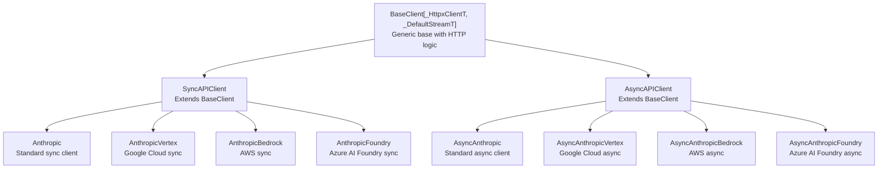

<!-- source: DeepWiki mcp.deepwiki.com · repo anthropics/anthropic-sdk-python · page 4 Client Architecture · fetched 2026-10-26 -->

# Client Architecture

Relevant source files

The following files were used as context for generating this wiki page:

- [CONTRIBUTING.md](CONTRIBUTING.md)
- [README.md](README.md)
- [scripts/utils/ruffen-docs.py](scripts/utils/ruffen-docs.py)
- [src/anthropic/__init__.py](src/anthropic/__init__.py)
- [src/anthropic/_base_client.py](src/anthropic/_base_client.py)
- [src/anthropic/_client.py](src/anthropic/_client.py)
- [src/anthropic/_constants.py](src/anthropic/_constants.py)
- [src/anthropic/_resource.py](src/anthropic/_resource.py)
- [src/anthropic/_types.py](src/anthropic/_types.py)
- [tests/test_client.py](tests/test_client.py)

This page outlines the overall client design of the Anthropic Python SDK, detailing the `BaseClient` foundation, how synchronous and asynchronous implementations share common infrastructure, and how specialized clients manage cloud integrations, authentication, request lifecycles, middleware, and telemetry.

For in-depth technical details, refer to the child pages:
- [Base Client and HTTP Layer](#4.1)
- [Synchronous and Asynchronous Clients](#4.2)
- [Cloud Provider Integrations](#4.3)
- [Authentication and Configuration](#4.4)
- [Request Lifecycle and Error Handling](#4.5)
- [Middleware and Model Fallbacks](#4.6)
- [OpenTelemetry Instrumentation](#4.7)

## Client Class Hierarchy

The SDK implements a layered client architecture where specialized clients inherit common functionality from base classes. This design enables code reuse while supporting multiple deployment targets (standard API, AWS Bedrock, Google Vertex AI, Azure AI Foundry) and execution models (synchronous, asynchronous).

Title: Client Class Hierarchy Diagram

Sources: [src/anthropic/_base_client.py:368-397](), [src/anthropic/_client.py:132-140](), [src/anthropic/__init__.py:128-132]()

## 4.1 Base Client and HTTP Layer

The `BaseClient` foundation handles low-level request building, query serialization via `_qs.py`, timeout handling, and robust retry logic with exponential backoff using `httpx2`. It exposes core methods for processing responses and managing connection pools.

For complete details, see [Base Client and HTTP Layer](#4.1).

Sources: [src/anthropic/_base_client.py:368-836]()

## 4.2 Synchronous and Asynchronous Clients

The `Anthropic` and `AsyncAnthropic` classes provide the primary user-facing interfaces for sync and async contexts respectively, sharing identical resource structures while leveraging sync/async HTTP backends (`httpx2.Client` vs `httpx2.AsyncClient`).

For complete details, see [Synchronous and Asynchronous Clients](#4.2).

Sources: [src/anthropic/_client.py:153-200](), [src/anthropic/_client.py:517-596]()

## 4.3 Cloud Provider Integrations

Optional modules integrate the SDK with platforms like Google Cloud Vertex AI, AWS Bedrock, and Azure AI Foundry. These clients handle SigV4 auth signing, URL rewriting, stream decoding, and platform-specific API restrictions.

For complete details, see [Cloud Provider Integrations](#4.3).

Sources: [src/anthropic/__init__.py:131-142]()

## 4.4 Authentication and Configuration

Clients support flexible configuration via API keys, bearer tokens, environment variables, credential provider chains, caching, workload identity federation, and configuration profiles. The `copy()` method and `with_options()` enable scoped configuration overrides.

For complete details, see [Authentication and Configuration](#4.4).

Sources: [src/anthropic/_client.py:71-116](), [src/anthropic/_client.py:440-492]()

## 4.5 Request Lifecycle and Error Handling

Requests flow from parameter preparation through HTTP execution, automatic retries, and response validation. Status codes are mapped cleanly to specialized exceptions inheriting from `APIStatusError`.

For complete details, see [Request Lifecycle and Error Handling](#4.5).

Sources: [src/anthropic/_base_client.py:490-592](), [src/anthropic/_exceptions.py:100-140]()

## 4.6 Middleware and Model Fallbacks

The middleware chain architecture (`CallNext`, `MiddlewareInput`) supports interception and transformation of requests. Features include refusal-fallback handling (`lib/middleware/_fallbacks.py`) and fallback credit tokens.

For complete details, see [Middleware and Model Fallbacks](#4.6).

Sources: [src/anthropic/_middleware.py:120-126](), [src/anthropic/__init__.py:58-59]()

## 4.7 OpenTelemetry Instrumentation

Native OpenTelemetry tracing support allows tracking API calls via `open_telemetry` options or environment variables. It covers span naming, routing, `gen_ai.*` attributes, content vs. metadata-only modes, and streaming span lifecycles.

For complete details, see [OpenTelemetry Instrumentation](#4.7).

Sources: [README.md:47-78](), [src/anthropic/_types.py:118-190]()

---

