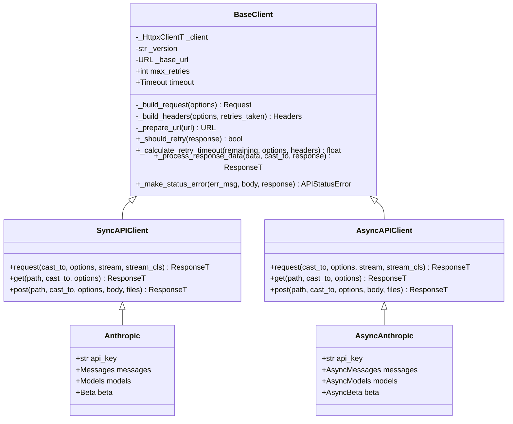
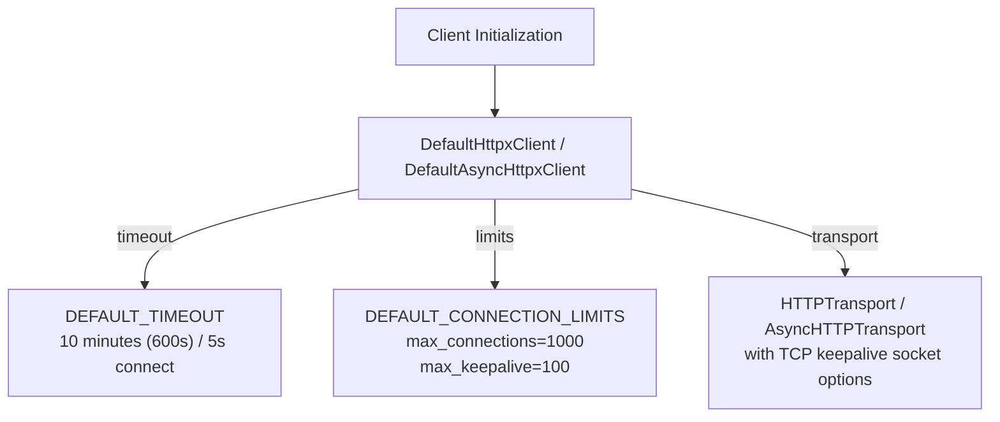
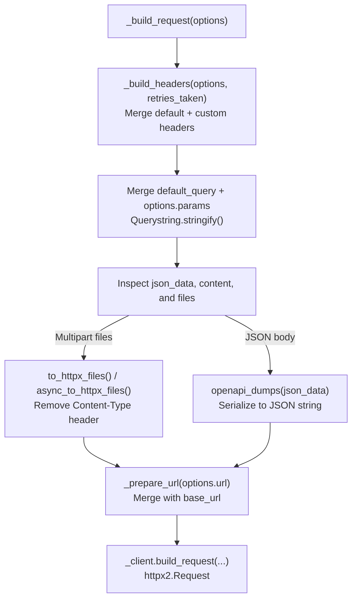
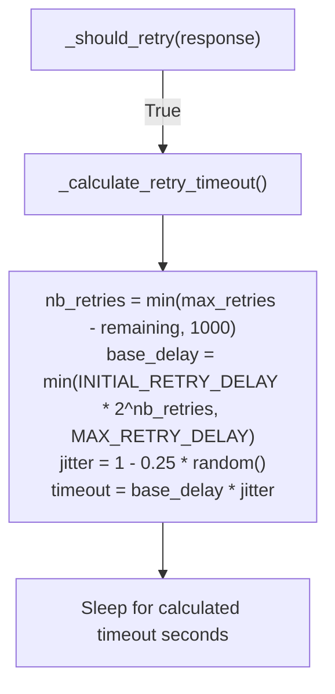
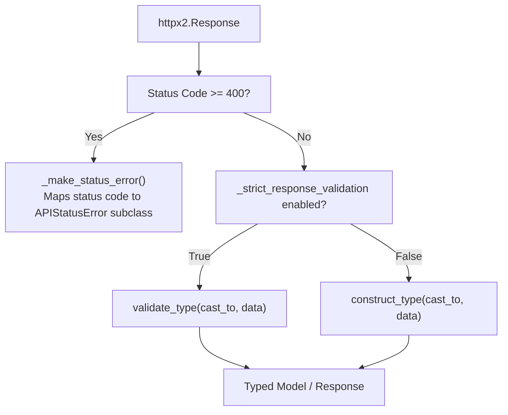

<!-- source: DeepWiki mcp.deepwiki.com · repo anthropics/anthropic-sdk-python · page 4.1 Base Client and HTTP Layer · fetched 2026-10-26 -->

# Base Client and HTTP Layer

Relevant source files

The following files were used as context for generating this wiki page:

- [CONTRIBUTING.md](CONTRIBUTING.md)
- [README.md](README.md)
- [scripts/mock](scripts/mock)
- [scripts/test](scripts/test)
- [scripts/utils/ruffen-docs.py](scripts/utils/ruffen-docs.py)
- [src/anthropic/__init__.py](src/anthropic/__init__.py)
- [src/anthropic/_base_client.py](src/anthropic/_base_client.py)
- [src/anthropic/_client.py](src/anthropic/_client.py)
- [src/anthropic/_constants.py](src/anthropic/_constants.py)
- [src/anthropic/_qs.py](src/anthropic/_qs.py)
- [src/anthropic/_types.py](src/anthropic/_types.py)
- [tests/test_client.py](tests/test_client.py)
- [tests/test_qs.py](tests/test_qs.py)

## Purpose and Scope

This document covers the `BaseClient` class and HTTP layer implementation in the Anthropic Python SDK. The `BaseClient` class serves as the foundation for all client variants (synchronous, asynchronous, and cloud provider-specific) by providing core HTTP communication, request building, retry logic, timeout management, query serialization via `_qs.py`, and connection pooling through the `httpx2` library.

For information about the synchronous `Anthropic` and asynchronous `AsyncAnthropic` client classes that extend `BaseClient`, see [Synchronous and Asynchronous Clients](4.2). For cloud-specific implementations (`AnthropicAWS`, `AnthropicFoundry`, etc.), see [Cloud Provider Integrations](4.3). For authentication mechanisms, see [Authentication and Configuration](4.4).

Sources: `[src/anthropic/_base_client.py:1-250]()`, `[src/anthropic/_client.py:1-177]()`

---

## BaseClient Class Architecture

The `BaseClient` class is a generic base class parameterized by HTTP client types and stream types, enabling a single infrastructure to support both synchronous and asynchronous operations.

### Core Responsibilities

| Responsibility | Methods/Properties | Description |
|----------------|-------------------|-------------|
| **HTTP Communication** | `_build_request`, `_prepare_url` | Constructs and prepares HTTP requests using `httpx2` |
| **Request Options** | `_build_headers`, `_serialize_multipartform` | Builds headers, query parameters, and serializes request bodies |
| **Retry Logic** | `_should_retry`, `_calculate_retry_timeout` | Determines retry eligibility and computes backoff timing with jitter |
| **Response Processing** | `_process_response_data`, `_make_status_error` | Parses responses and instantiates typed error objects |
| **Configuration** | `base_url`, `max_retries`, `timeout` | Manages global and request-scoped client configuration |

### BaseClient Class Diagram

Sources: `[src/anthropic/_base_client.py:1-250]()`, `[src/anthropic/_client.py:132-177]()`

---

## HTTP Client Integration (`httpx2`)

The SDK relies on `httpx2` for underlying HTTP communication. `BaseClient` wraps either `httpx2.Client` (synchronous) or `httpx2.AsyncClient` (asynchronous) stored in the `_client` attribute.

### Default HTTP Client Configuration

The SDK provides `DefaultHttpxClient` and `DefaultAsyncHttpxClient` implementations configured with SDK-specific connection limits, default timeouts, and socket options.

#### Default Configuration Values

| Configuration | Value | Constant |
|---------------|-------|----------|
| Default Timeout | 10 minutes total, 5 seconds connect | `DEFAULT_TIMEOUT` (`[src/anthropic/_constants.py:9-10]()`) |
| Max Connections | 1,000 | `DEFAULT_CONNECTION_LIMITS` (`[src/anthropic/_constants.py:12-12]()`) |
| Max Keepalive Connections | 100 | `DEFAULT_CONNECTION_LIMITS` (`[src/anthropic/_constants.py:12-12]()`) |
| Default Max Retries | 2 | `DEFAULT_MAX_RETRIES` (`[src/anthropic/_constants.py:11-11]()`) |

Sources: `[src/anthropic/_constants.py:1-12]()`, `[src/anthropic/_base_client.py:40-42]()`

---

## Request Building Pipeline & Query Serialization (`_qs.py`)

The request building pipeline transforms high-level parameters into a fully formed `httpx2.Request`. This process involves building headers, merging query parameters via `Querystring`, processing request bodies, and serializing multipart payloads.

### Request Building Flow

### Query Serialization (`_qs.py`)

Query parameters are serialized using the `Querystring` class located in `src/anthropic/_qs.py`. It supports customizable array and nested parameter formats:

| Format Option | Supported Values | Description |
|---------------|------------------|-------------|
| `array_format` | `"repeat"`, `"comma"`, `"indices"`, `"brackets"` | Controls how list/tuple query parameters are serialized (e.g., `key=a&key=b` vs `key=a,b`). |
| `nested_format` | `"brackets"`, `"dots"` | Controls how nested dictionary keys are structured (e.g., `key[sub]=val` vs `key.sub=val`). |

Primitive values (dates, datetimes, booleans, strings, numbers) are converted to strings via `_primitive_value_to_str()`, with `datetime` and `date` objects automatically formatted to ISO-8601 strings.

Sources: `[src/anthropic/_qs.py:20-132]`, `[src/anthropic/_base_client.py:490-592]()`

---

## Retry Logic with Exponential Backoff

The SDK implements automatic retry handling for transient errors (such as rate limits, timeouts, and server errors) with exponential backoff and jitter.

### Retry Eligibility (`_should_retry`)

A request is eligible for retry if:
1. The response contains an `x-should-retry` header set to `"true"`, or is explicitly suppressed when set to `"false"`.
2. The HTTP status code matches retryable error categories: `408` (Request Timeout), `409` (Conflict), `429` (Rate Limit), or any `5xx` server error (e.g., `500`, `503`, `529`).

### Backoff Calculation Formula

| Constant | Value | Description |
|----------|-------|-------------|
| `INITIAL_RETRY_DELAY` | `0.5` seconds | Starting backoff delay (`[src/anthropic/_constants.py:14-14]()`) |
| `MAX_RETRY_DELAY` | `8.0` seconds | Upper bound for backoff delay (`[src/anthropic/_constants.py:15-15]()`) |
| `DEFAULT_MAX_RETRIES` | `2` | Default number of retry attempts (`[src/anthropic/_constants.py:11-11]()`) |

Sources: `[src/anthropic/_base_client.py:741-832]`, `[src/anthropic/_constants.py:11-15]()`

---

## Timeout Management

Timeouts can be configured globally on the client instance or overridden on a per-request basis via `RequestOptions`.

### Timeout Resolution Hierarchy

1. **Request-Level Timeout**: Specified via `options.timeout` in individual API calls.
2. **Client-Level Timeout**: Configured on client instantiation (`client = Anthropic(timeout=...)`).
3. **SDK Default Timeout**: Falls back to `DEFAULT_TIMEOUT` (`600` seconds total, `5.0` seconds connection timeout).

Granular timeout controls (`httpx2.Timeout`) allow independent configuration of connect, read, write, and pool timeout phases.

Sources: `[src/anthropic/_base_client.py:726-739]`, `[src/anthropic/_constants.py:9-10]()`

---

## Response Processing & Error Handling

Upon receiving an HTTP response, `BaseClient` evaluates status codes and processes response bodies.

### Response Flow

If a response returns a non-2xx status code, `_make_status_error()` maps the status code to appropriate typed exceptions (such as `RateLimitError`, `BadRequestError`, `InternalServerError`, or `APIStatusError`).

Sources: `[src/anthropic/_base_client.py:409-438]`, `[src/anthropic/_base_client.py:644-666]()`

---

