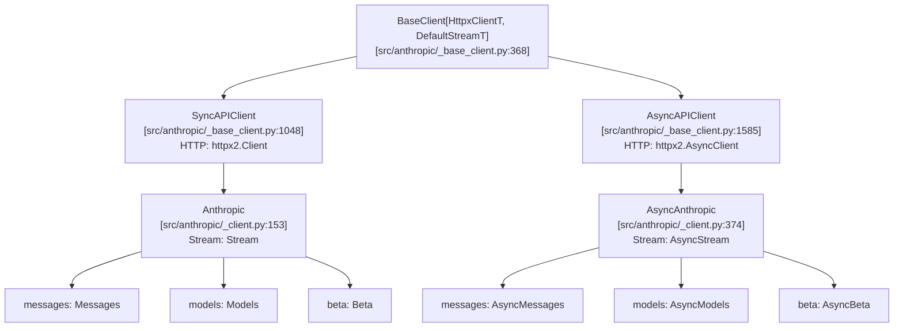
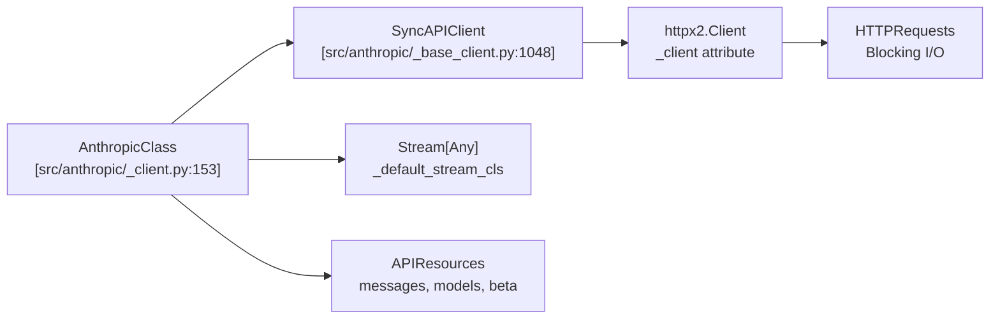
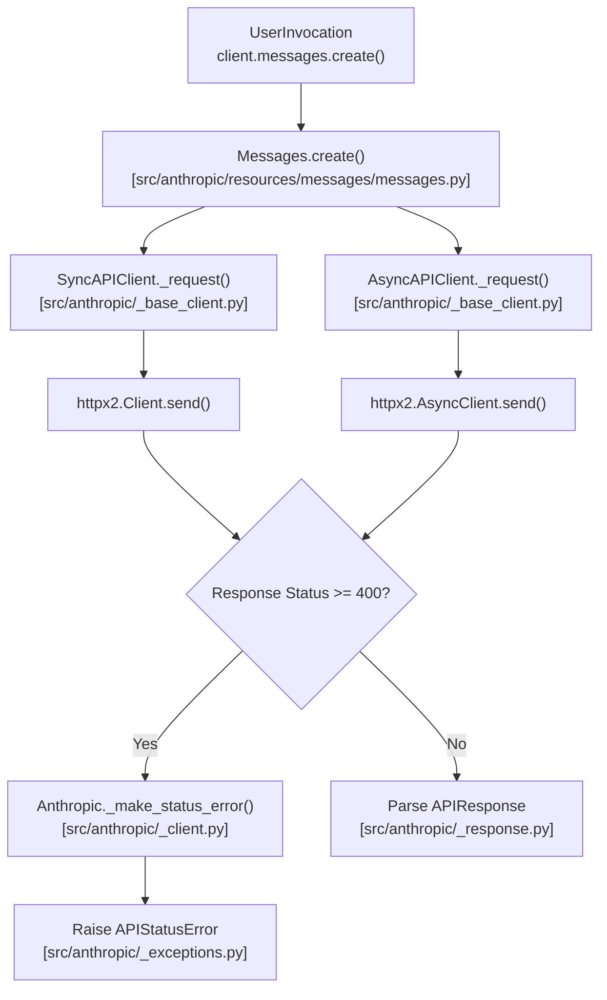

<!-- source: DeepWiki mcp.deepwiki.com · repo anthropics/anthropic-sdk-python · page 4.2 Synchronous and Asynchronous Clients · fetched 2026-10-26 -->

# Synchronous and Asynchronous Clients

<details>
<summary>Relevant source files</summary>

The following files were used as context for generating this wiki page:

- [CONTRIBUTING.md](CONTRIBUTING.md)
- [README.md](README.md)
- [scripts/utils/ruffen-docs.py](scripts/utils/ruffen-docs.py)
- [src/anthropic/__init__.py](src/anthropic/__init__.py)
- [src/anthropic/_base_client.py](src/anthropic/_base_client.py)
- [src/anthropic/_client.py](src/anthropic/_client.py)
- [src/anthropic/_constants.py](src/anthropic/_constants.py)
- [src/anthropic/_types.py](src/anthropic/_types.py)
- [src/anthropic/resources/__init__.py](src/anthropic/resources/__init__.py)
- [src/anthropic/resources/beta/__init__.py](src/anthropic/resources/beta/__init__.py)
- [src/anthropic/resources/beta/beta.py](src/anthropic/resources/beta/beta.py)
- [tests/test_client.py](tests/test_client.py)

</details>


## Purpose and Scope

This document details the `Anthropic` and `AsyncAnthropic` client classes (`[src/anthropic/_client.py:153]()` and async counterpart), which provide synchronous and asynchronous interfaces respectively for interacting with the Anthropic API. Both clients offer identical API surfaces but differ in their execution model: the synchronous client blocks during I/O operations using `httpx2.Client`, while the asynchronous client uses Python's `async`/`await` syntax with `httpx2.AsyncClient` to enable concurrent operations.

For information about the underlying HTTP layer and base client functionality, see [Base Client and HTTP Layer (4.1)](). For details on cloud platform-specific clients (Vertex, Bedrock), see [Cloud Provider Integrations (4.3)]().

Sources: [README.md:1-40](), [src/anthropic/_client.py:128-130]()

## Client Class Hierarchy

The SDK provides two primary client classes that extend from base implementations defined in `_base_client.py`. These base classes manage the common request lifecycle, retry logic, and connection pooling via `httpx2`.

### Code Entity Space: Client Inheritance

The following diagram maps the logical client roles to their specific code entities and inheritance structure.



Sources: [src/anthropic/_base_client.py:368-375](), [src/anthropic/_base_client.py:1048-1055](), [src/anthropic/_base_client.py:1585-1592](), [src/anthropic/_client.py:153-170](), [src/anthropic/_client.py:374-390]()

## Synchronous Client: Anthropic

The `Anthropic` class provides a blocking, synchronous interface to the API. All method calls block until the HTTP request completes and the response is received.

### Initialization

The synchronous client is instantiated directly from `[src/anthropic/_client.py:153]()`. It supports various authentication methods including API keys, auth tokens, and workload identity credentials resolved in a specific precedence order.

| Parameter | Type | Default | Description |
|-----------|------|---------|-------------|
| `api_key` | `str \| None` | `ANTHROPIC_API_KEY` env var | API authentication key |
| `auth_token` | `str \| None` | `ANTHROPIC_AUTH_TOKEN` env var | Alternative bearer token auth |
| `base_url` | `str \| httpx2.URL \| None` | `https://api.anthropic.com` | API endpoint URL |
| `timeout` | `float \| Timeout \| None \| NotGiven` | 10 minutes (`DEFAULT_TIMEOUT`) | Request timeout configuration |
| `max_retries` | `int` | 2 (`DEFAULT_MAX_RETRIES`) | Maximum number of retry attempts |
| `default_headers` | `Mapping[str, str] \| None` | `None` | Headers sent with every request |
| `http_client` | `httpx2.Client \| None` | `None` | Custom httpx2 client instance |
| `_strict_response_validation` | `bool` | `False` | Enable strict Pydantic validation |

Sources: [src/anthropic/_client.py:153-195](), [src/anthropic/_constants.py:10-12]()

### Internal Architecture

The client utilizes `httpx2.Client` for network operations and caches resource instances via `cached_property` to avoid repeated allocations.



Sources: [src/anthropic/_client.py:153-231](), [src/anthropic/_base_client.py:1048-1060]()

### Resource Access

Resources are lazily initialized as cached properties. This ensures that resource classes like `Messages` or `Models` are only instantiated when first accessed.

Sources: [src/anthropic/_client.py:209-231]()

## Asynchronous Client: AsyncAnthropic

The `AsyncAnthropic` class provides a non-blocking interface using Python's `async`/`await` syntax (`[src/anthropic/_client.py:374]`). It is designed for use in event loops like `asyncio`.

### Initialization

The async client has a nearly identical signature to the sync client but accepts an `httpx2.AsyncClient` for the `http_client` parameter.

| Parameter | Type | Default | Description |
|-----------|------|---------|-------------|
| `api_key` | `str \| None` | `ANTHROPIC_API_KEY` env var | API authentication key |
| `http_client` | `httpx2.AsyncClient \| None` | `None` | Custom httpx2 async client |
| `_token_cache` | `TokenCache \| None` | `not_given` | Cache for identity federation tokens |

Sources: [src/anthropic/_client.py:374-415]()

### Async Library Detection

The async client detects the active async library (e.g., `asyncio` or `trio`) using `get_async_library()` to provide appropriate headers and internal task handling.

The `X-Stainless-Async` header is populated with the detected async library name, while the sync client sets this to `false`.

Sources: [src/anthropic/_client.py:536-544](), [src/anthropic/_utils/_sync.py:19-24]()

## API Parity and Usage Patterns

The SDK maintains strict parity between sync and async clients. For every sync resource, there is a corresponding async resource (e.g., `Messages` vs `AsyncMessages`).

### Synchronous Usage
```python
from anthropic import Anthropic

client = Anthropic()
message = client.messages.create(
    max_tokens=1024,
    messages=[
        {
            "role": "user",
            "content": "Hello",
        }
    ],
    model="claude-3-5-sonnet-20240620",
)
```

### Asynchronous Usage
```python
from anthropic import AsyncAnthropic

client = AsyncAnthropic()
message = await client.messages.create(
    max_tokens=1024,
    messages=[
        {
            "role": "user",
            "content": "Hello",
        }
    ],
    model="claude-3-5-sonnet-20240620",
)
```

Sources: [README.md:23-44](), [src/anthropic/_client.py:209-231](), [src/anthropic/_client.py:449-471]()

## Client Lifecycle and Context Managers

Both clients support context managers to ensure underlying HTTP connections and credential providers are closed correctly (`[src/anthropic/_base_client.py:1027]()` and `[src/anthropic/_base_client.py:1564]`).

- **Sync**: Uses `with Anthropic() as client:`. The `__exit__` method calls `self.close()`.
- **Async**: Uses `async with AsyncAnthropic() as client:`. The `__aexit__` method calls `await self.close()`.

The `close()` method specifically handles releasing resources from credential providers if they expose a `close()` or async `close()` method.

Sources: [src/anthropic/_base_client.py:1027-1037](), [src/anthropic/_base_client.py:1564-1574](), [src/anthropic/_client.py:51-54]()

## Configuration and Copying

Clients are immutable regarding their primary configuration once initialized. To change settings, use the `copy()` or `with_options()` methods (`[src/anthropic/_client.py:293]()`), which create a new instance sharing the same underlying connection pool but with updated parameters.

```python
client = Anthropic(api_key="original")
new_client = client.copy(api_key="new-key", timeout=5.0)
```

The `copy()` method merges existing `default_headers` and `default_query` with any new values provided.

Sources: [src/anthropic/_client.py:293-327](), [tests/test_client.py:168-185]()

## Error Handling Parity

The SDK ensures that both clients behave identically when encountering API errors. The `_make_status_error` method is implemented across client instances to map HTTP status codes to specific exception types like `RateLimitError` or `AuthenticationError`.

### Code Entity Space: Request Execution and Error Mapping



Tests ensure strict parity between these two implementations by comparing the exception types returned for various status codes across synchronous and asynchronous execution paths.

Sources: [tests/test_client.py:115-130](), [src/anthropic/_client.py:346-371](), [src/anthropic/_client.py:586-611]()

---

