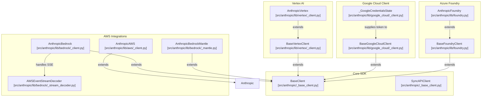
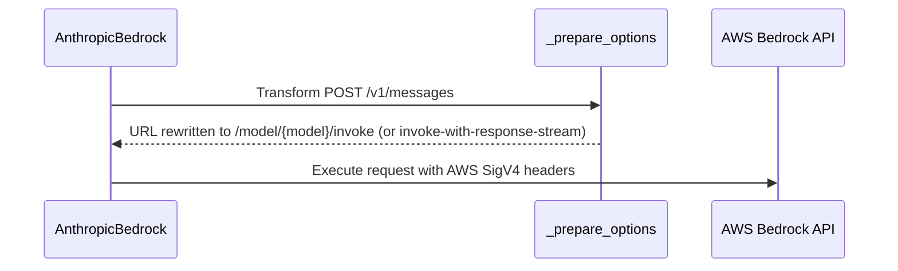

<!-- source: DeepWiki mcp.deepwiki.com · repo anthropics/anthropic-sdk-python · page 4.3 Cloud Provider Integrations · fetched 2026-10-26 -->

# Cloud Provider Integrations

<details>
<summary>Relevant source files</summary>

The following files were used as context for generating this wiki page:

- [examples/azure.py](examples/azure.py)
- [examples/bedrock.py](examples/bedrock.py)
- [examples/google_cloud.py](examples/google_cloud.py)
- [examples/vertex.py](examples/vertex.py)
- [src/anthropic/_utils/_proxy.py](src/anthropic/_utils/_proxy.py)
- [src/anthropic/lib/_extras/_google_auth.py](src/anthropic/lib/_extras/_google_auth.py)
- [src/anthropic/lib/aws/__init__.py](src/anthropic/lib/aws/__init__.py)
- [src/anthropic/lib/aws/_auth.py](src/anthropic/lib/aws/_auth.py)
- [src/anthropic/lib/aws/_client.py](src/anthropic/lib/aws/_client.py)
- [src/anthropic/lib/aws/_credentials.py](src/anthropic/lib/aws/_credentials.py)
- [src/anthropic/lib/bedrock/_auth.py](src/anthropic/lib/bedrock/_auth.py)
- [src/anthropic/lib/bedrock/_client.py](src/anthropic/lib/bedrock/_client.py)
- [src/anthropic/lib/bedrock/_mantle.py](src/anthropic/lib/bedrock/_mantle.py)
- [src/anthropic/lib/bedrock/_stream.py](src/anthropic/lib/bedrock/_stream.py)
- [src/anthropic/lib/bedrock/_stream_decoder.py](src/anthropic/lib/bedrock/_stream_decoder.py)
- [src/anthropic/lib/foundry.md](src/anthropic/lib/foundry.md)
- [src/anthropic/lib/foundry.py](src/anthropic/lib/foundry.py)
- [src/anthropic/lib/google_cloud/README.md](src/anthropic/lib/google_cloud/README.md)
- [src/anthropic/lib/google_cloud/__init__.py](src/anthropic/lib/google_cloud/__init__.py)
- [src/anthropic/lib/google_cloud/_client.py](src/anthropic/lib/google_cloud/_client.py)
- [src/anthropic/lib/vertex/_auth.py](src/anthropic/lib/vertex/_auth.py)
- [src/anthropic/lib/vertex/_client.py](src/anthropic/lib/vertex/_client.py)
- [tests/lib/test_aws.py](tests/lib/test_aws.py)
- [tests/lib/test_aws_auth.py](tests/lib/test_aws_auth.py)
- [tests/lib/test_azure.py](tests/lib/test_azure.py)
- [tests/lib/test_bedrock.py](tests/lib/test_bedrock.py)
- [tests/lib/test_bedrock_mantle.py](tests/lib/test_bedrock_mantle.py)
- [tests/lib/test_google_cloud.py](tests/lib/test_google_cloud.py)
- [tests/lib/test_google_cloud_live.py](tests/lib/test_google_cloud_live.py)
- [tests/lib/test_vertex.py](tests/lib/test_vertex.py)
- [tests/lib/tools/test_mcp_tool.py](tests/lib/tools/test_mcp_tool.py)
- [tests/test_utils/test_proxy.py](tests/test_utils/test_proxy.py)

</details>


This page documents the optional cloud provider integrations available in the Anthropic Python SDK. These integrations enable using Claude models through Google Cloud Vertex AI, Google Cloud client, AWS Bedrock, Bedrock Mantle, AnthropicAWS, and Azure AI Foundry instead of directly connecting to the standard Anthropic API.

---

## Purpose and Scope

The SDK provides specialized client classes that handle cloud provider-specific authentication, request formatting, and endpoint configuration while maintaining compatibility with the standard SDK interface.

The integrations are available via the following extras:
- **`vertex`**: Access Claude through Google Cloud Vertex AI using `AnthropicVertex`.
- **`google_cloud`**: Access Claude through the Google Cloud client using `AnthropicGoogleCloud`.
- **`bedrock`**: Access Claude through AWS Bedrock using `AnthropicBedrock` or `AnthropicBedrockMantle`.
- **`aws`**: Access Claude through AWS external gateway using `AnthropicAWS`.
- **`foundry`**: Access Claude through Azure AI Foundry using `AnthropicFoundry` (included by default).

Sources: [src/anthropic/lib/vertex/_client.py:92-94](), [src/anthropic/lib/bedrock/_client.py:133-136](), [src/anthropic/lib/foundry.py:95-102](), [src/anthropic/lib/aws/_client.py:24-34](), [src/anthropic/lib/google_cloud/_client.py:94-97]()

---

## Installation

Cloud provider integrations are installed as optional extras to keep the core SDK lightweight.

```bash
# Google Cloud Vertex AI
pip install anthropic[vertex]

# Google Cloud Client
pip install anthropic[google_cloud]

# AWS Bedrock / AWS Client
pip install anthropic[bedrock]
```

### Dependencies
| Integration | Extra Name | Required Packages | Purpose |
|-------------|------------|-------------------|---------|
| Vertex AI | `vertex` | `google-auth` | Google Cloud authentication and token management |
| Google Cloud | `google_cloud` | `google-auth` | Application Default Credentials (ADC) and token refreshing |
| Bedrock / AWS | `bedrock` | `boto3`, `botocore` | AWS SigV4 signing and session management |

Sources: [src/anthropic/lib/vertex/_auth.py:21-24](), [src/anthropic/lib/bedrock/_client.py:80-86](), [src/anthropic/lib/google_cloud/_client.py:20-25]()

---

## Architecture and Entity Mapping

The cloud provider clients extend the same `BaseClient` foundation used by the standard `Anthropic` client. They override internal methods like `_prepare_options`, `_prepare_request`, and `_prepare_url` to inject provider-specific logic, auth headers, and endpoint rewriting.

### Entity Relationship Diagram
This diagram bridges natural language concepts to the specific code entities used across the SDK's cloud provider modules.



Sources: [src/anthropic/lib/vertex/_client.py:38-92](), [src/anthropic/lib/bedrock/_client.py:94-133](), [src/anthropic/lib/foundry.py:41-95](), [src/anthropic/lib/bedrock/_mantle.py:71-114](), [src/anthropic/lib/aws/_client.py:24-34](), [src/anthropic/lib/google_cloud/_client.py:63-106]()

---

## Google Cloud Vertex AI Integration

### Authentication and Project Configuration
`AnthropicVertex` manages Google Cloud credentials via `google-auth`. It resolves `project_id` and `region` from arguments or environment variables [src/anthropic/lib/vertex/_client.py:43-53]().

- **Environment Variables**:
  - `ANTHROPIC_VERTEX_PROJECT_ID`: Google Cloud Project ID [src/anthropic/lib/vertex/_client.py:47-50]().
  - `CLOUD_ML_REGION`: Google Cloud region [src/anthropic/lib/vertex/_client.py:118-120]().
  - `ANTHROPIC_VERTEX_BASE_URL`: Override for the API endpoint [src/anthropic/lib/vertex/_client.py:125-127]().

### Request Lifecycle
1. **Option Preparation**: `_prepare_options` injects project and region options [src/anthropic/lib/vertex/_client.py:160-163]().
2. **Request Preparation**: `_prepare_request` checks for an existing `Authorization` header and populates it via `_ensure_access_token()` if missing [src/anthropic/lib/vertex/_client.py:165-171]().
3. **Status Error Mapping**: `_make_status_error` maps GCP HTTP status codes (such as `400`, `401`, `429`, `503`) to standard Anthropic exception types [src/anthropic/lib/vertex/_client.py:55-91]().

Sources: [src/anthropic/lib/vertex/_client.py:38-176]()

---

## Google Cloud Client Integration (`anthropic.lib.google_cloud`)

The `BaseGoogleCloudClient` manages gateway routing and Application Default Credentials (ADC) for Google Cloud endpoints outside Vertex AI [src/anthropic/lib/google_cloud/_client.py:94-106]().

### Credential Synchronization State
`_GoogleCredentialsState` wraps Google credentials with a thread lock to safely handle lazy loading via ADC and token refreshing across client copies and asynchronous operations [src/anthropic/lib/google_cloud/_client.py:63-91]().

### URL Rewriting
`_prepare_url` dynamically rewrites relative paths based on whether the request targets an organization-level endpoint (`_ORGANIZATION_PATH_PREFIXES`) or workspace-scoped gateway URL template (`DEFAULT_URL_TEMPLATE`) [src/anthropic/lib/google_cloud/_client.py:31-40, 121-140]().

Sources: [src/anthropic/lib/google_cloud/_client.py:63-167]()

---

## AWS Bedrock & Bedrock Mantle Integrations

### Bedrock vs. Bedrock Mantle
The SDK provides two distinct AWS integration paths:
1. **`AnthropicBedrock`**: Uses Bedrock runtime API paths (`/model/{model}/invoke` and `/model/{model}/invoke-with-response-stream`) [src/anthropic/lib/bedrock/_client.py:48-59]().
2. **`AnthropicBedrockMantle`**: Communicates with the Bedrock Mantle service endpoint (`bedrock-mantle.{region}.api.aws/anthropic`) and supports both SigV4 and Bearer token auth (`AWS_BEARER_TOKEN_BEDROCK`, `ANTHROPIC_AWS_API_KEY`) [src/anthropic/lib/bedrock/_mantle.py:40-42, 152-178]().

### Request Transformation and URL Rewriting


### Restrictions and Formatting
- **Endpoint Transformation**: The Bedrock client intercepts requests to `/v1/messages` and converts them to Bedrock model invocation paths [src/anthropic/lib/bedrock/_client.py:48-60]().
- **Unsupported Features**: The Batch API (`/v1/messages/batches`) and Token Counting (`/v1/messages/count_tokens`) are not supported in standard Bedrock and raise an `AnthropicError` [src/anthropic/lib/bedrock/_client.py:60-65]().

Sources: [src/anthropic/lib/bedrock/_client.py:37-91](), [src/anthropic/lib/bedrock/_mantle.py:71-184]()

---

## Anthropic AWS Integration (`AnthropicAWS`)

`AnthropicAWS` targets AWS external gateways with explicit workspace routing and SigV4 request signing [src/anthropic/lib/aws/_client.py:24-34]().

### Key Behaviors
- **Workspace ID Header**: Injects `anthropic-workspace-id` into request headers [src/anthropic/lib/aws/_client.py:134-137]().
- **SigV4 Signing**: `_prepare_request` computes AWS SigV4 authorization headers over request payloads using `get_auth_headers` with the `aws-external-anthropic` service name [src/anthropic/lib/aws/_client.py:158-179]().
- **Auth Modes**: Supports explicit `api_key` mode or AWS credential-based SigV4 signing based on constructor parameters and `resolve_auth_mode` [src/anthropic/lib/aws/_client.py:65-75]().

Sources: [src/anthropic/lib/aws/_client.py:24-179]()

---

## Azure AI Foundry Integration

### Overview
`AnthropicFoundry` enables communication with Claude models hosted on Azure AI Foundry [src/anthropic/lib/foundry.py:93-102](). It accepts either an explicit `api_key` or an Azure Active Directory token provider (`azure_ad_token_provider`) [src/anthropic/lib/foundry.py:99-100]().

### Configuration Inference
Configuration is automatically inferred from environment variables if not provided explicitly:
- `ANTHROPIC_FOUNDRY_API_KEY` [src/anthropic/lib/foundry.py:150]()
- `ANTHROPIC_FOUNDRY_RESOURCE` [src/anthropic/lib/foundry.py:151]()
- `ANTHROPIC_FOUNDRY_BASE_URL` [src/anthropic/lib/foundry.py:152]()

### API Restrictions
The Foundry client overrides resource accessors to explicitly disable unsupported endpoints like `batches` (`MessagesFoundry`, `BetaFoundryMessages`) [src/anthropic/lib/foundry.py:45-91]().

Sources: [src/anthropic/lib/foundry.py:41-170](), [tests/lib/test_azure.py:11-43]()

---

## API Restrictions and Comparison Matrix

| Feature | Standard API | Vertex AI | Google Cloud | AWS Bedrock | Bedrock Mantle | AWS External | Azure Foundry |
|---------|--------------|-----------|--------------|-------------|----------------|--------------|---------------|
| **Auth Type** | API Key | Google Auth | ADC Token | SigV4 / Token | SigV4 / Token | SigV4 / Key | API Key / AAD |
| **Streaming** | SSE | SSE | SSE | EventStream | SSE | SSE | SSE |
| **Messages** | Supported | Supported | Supported | Supported | Supported | Supported | Supported |
| **Batches** | Supported | Supported | Supported | **Unsupported** | **Unsupported** | Supported | **Unsupported** |
| **Token Count**| Supported | Supported | Supported | **Unsupported** | Supported | Supported | Supported |

Sources: [src/anthropic/lib/vertex/_client.py:38-176](), [src/anthropic/lib/bedrock/_client.py:37-67](), [src/anthropic/lib/foundry.py:41-91](), [src/anthropic/lib/aws/_client.py:24-179](), [src/anthropic/lib/google_cloud/_client.py:63-167]()

---

