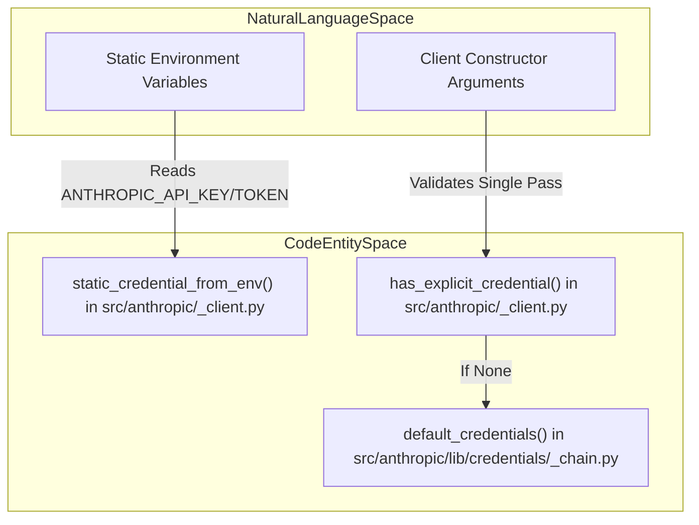
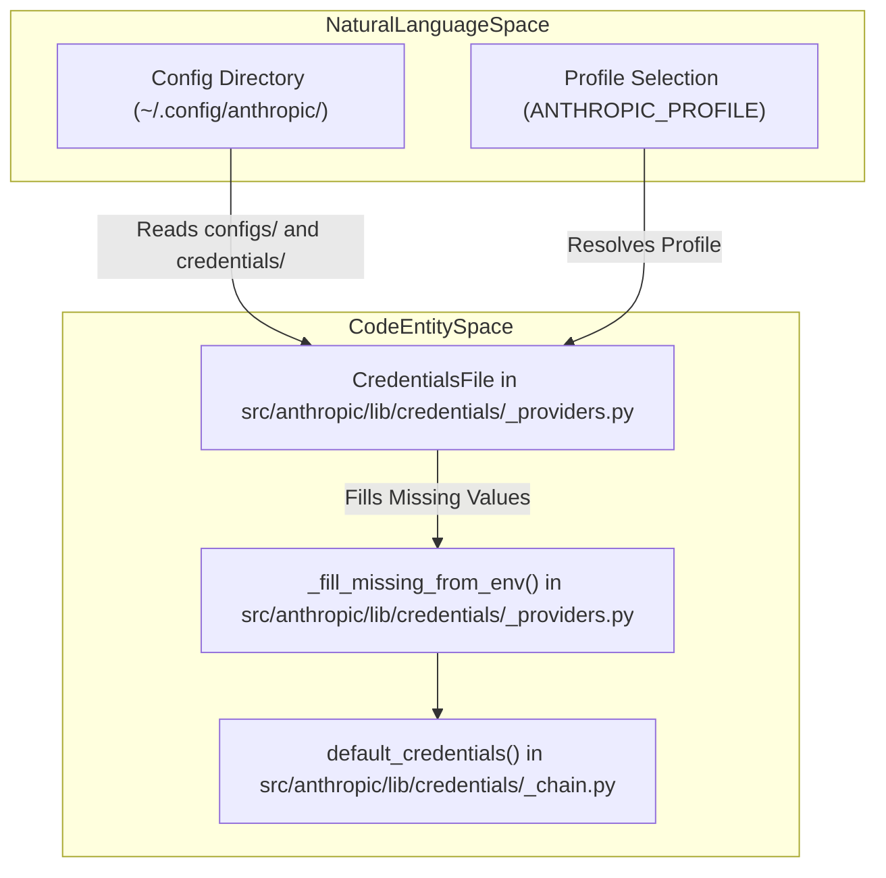
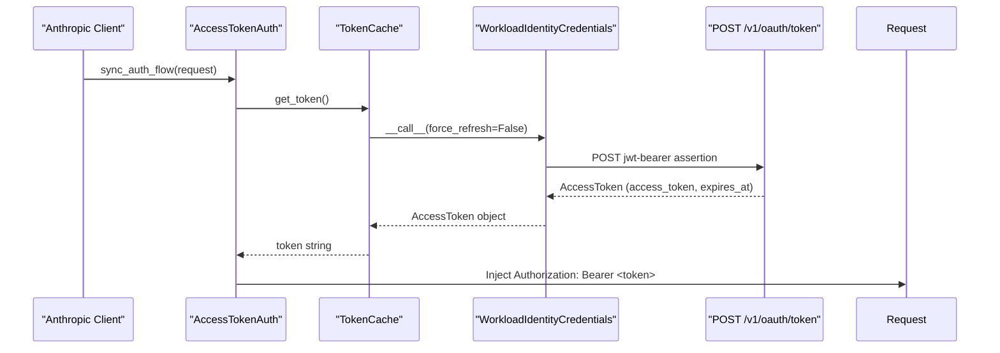

<!-- source: DeepWiki mcp.deepwiki.com · repo anthropics/anthropic-sdk-python · page 4.4 Authentication and Configuration · fetched 2026-10-26 -->

# Authentication and Configuration

Relevant source files

The following files were used as context for generating this wiki page:

- [CONTRIBUTING.md](CONTRIBUTING.md)
- [README.md](README.md)
- [examples/workload_identity.py](examples/workload_identity.py)
- [scripts/utils/ruffen-docs.py](scripts/utils/ruffen-docs.py)
- [src/anthropic/__init__.py](src/anthropic/__init__.py)
- [src/anthropic/_base_client.py](src/anthropic/_base_client.py)
- [src/anthropic/_client.py](src/anthropic/_client.py)
- [src/anthropic/_constants.py](src/anthropic/_constants.py)
- [src/anthropic/_types.py](src/anthropic/_types.py)
- [src/anthropic/lib/credentials/__init__.py](src/anthropic/lib/credentials/__init__.py)
- [src/anthropic/lib/credentials/_auth.py](src/anthropic/lib/credentials/_auth.py)
- [src/anthropic/lib/credentials/_cache.py](src/anthropic/lib/credentials/_cache.py)
- [src/anthropic/lib/credentials/_chain.py](src/anthropic/lib/credentials/_chain.py)
- [src/anthropic/lib/credentials/_close.py](src/anthropic/lib/credentials/_close.py)
- [src/anthropic/lib/credentials/_constants.py](src/anthropic/lib/credentials/_constants.py)
- [src/anthropic/lib/credentials/_providers.py](src/anthropic/lib/credentials/_providers.py)
- [src/anthropic/lib/credentials/_secrets.py](src/anthropic/lib/credentials/_secrets.py)
- [src/anthropic/lib/credentials/_types.py](src/anthropic/lib/credentials/_types.py)
- [src/anthropic/lib/credentials/_workload.py](src/anthropic/lib/credentials/_workload.py)
- [tests/lib/test_credentials.py](tests/lib/test_credentials.py)
- [tests/test_client.py](tests/test_client.py)

This page documents authentication mechanisms, configuration options, credential management, token caching, workload identity federation, configuration profiles, base URL overrides, and client copying for the Anthropic Python SDK.

## Purpose and Scope

The Anthropic Python SDK provides flexible authentication and configuration capabilities to support direct API keys, static bearer tokens, interactive user OAuth, OIDC Workload Identity Federation (WIF), and cloud provider-specific integrations (such as AWS Bedrock, Google Cloud Vertex AI, and Azure AI Foundry). Configuration state is managed through client initialization parameters, environment variables, profile config files, and dynamic credential provider chains defined in `src/anthropic/_client.py` and `src/anthropic/lib/credentials/`.

Sources: [`src/anthropic/_client.py:1-291`](), [`src/anthropic/lib/credentials/_providers.py:1-185`](), [`src/anthropic/lib/credentials/_workload.py:138-181`]

---

## Direct API Authentication and Environment Variables

The standard `Anthropic` and `AsyncAnthropic` client classes support static API keys and bearer tokens passed via constructor arguments or resolved from environment variables [src/anthropic/_client.py:153-210]().

### Credential Resolution and Shadow Warnings

The function `static_credential_from_env()` inspects the environment for static secrets [src/anthropic/_client.py:100-116]():
* `ANTHROPIC_API_KEY`: Supplies a static API key using the `X-Api-Key` header [src/anthropic/_client.py:107]().
* `ANTHROPIC_AUTH_TOKEN`: Supplies a static bearer token using the `Authorization: Bearer <token>` header [src/anthropic/_client.py:108]().

When both are set, or when a static environment variable shadows auto-discoverable credentials (like config profiles or federation rules), the SDK emits warning logs via `warn_env_api_key_shadows_env_auth_token()` and `warn_env_static_shadows_auto_discovery()` [src/anthropic/_client.py:110-113]().

Sources: [`src/anthropic/_client.py:91-116`](), [`tests/lib/test_credentials.py:58-116`]

---

## Credential Provider Chains and Config Profiles

When no explicit static credential is provided, the SDK evaluates a credential provider chain to discover authentication material [src/anthropic/lib/credentials/_chain.py:76-154]().

### Configuration Profiles and Split Storage

The `CredentialsFile` provider loads authentication configuration from named profiles stored under the configuration directory (default `~/.config/anthropic/`, overridable via `ANTHROPIC_CONFIG_DIR`) [src/anthropic/lib/credentials/_providers.py:146-164]():
1. **Config File (`configs/<profile>.json`)**: Non-secret metadata, including the nested `"authentication"` object (discriminated by `"type"`) and top-level fields like `organization_id`, `workspace_id`, and `base_url` [src/anthropic/lib/credentials/_providers.py:151-156]().
2. **Credentials File (`credentials/<profile>.json`)**: Secret material stored with strict `0600` permissions, holding `access_token`, `expires_at`, and `refresh_token` [src/anthropic/lib/credentials/_providers.py:157-159]().

Sources: [`src/anthropic/lib/credentials/_providers.py:87-184`](), [`tests/lib/test_credentials.py:91-175`]

---

## Workload Identity Federation (WIF) and Token Exchange

The SDK implements OIDC-based Workload Identity Federation using `WorkloadIdentityCredentials`, which exchanges an external OIDC JWT for an Anthropic access token via the RFC 7523 `jwt-bearer` grant (`POST /v1/oauth/token`) [src/anthropic/lib/credentials/_workload.py:138-147]().

### Token Exchange Flow

The exchange requires specific beta headers (`oauth-2025-04-20` and `oidc-federation-2026-04-01`) and enforces wire size limits (`_MAX_ASSERTION_BYTES` and `_MAX_TOKEN_RESPONSE_BYTES`) to prevent pathologically large payloads or memory exhaustion [src/anthropic/lib/credentials/_workload.py:33-50]().

Sources: [`src/anthropic/lib/credentials/_workload.py:33-181`](), [`examples/workload_identity.py:1-65`]

---

## Token Caching and Authentication Lifecycle

Token providers are wrapped in a `TokenCache` to avoid issuing token exchange requests on every API call [src/anthropic/lib/credentials/_cache.py:1-40](). 

### Expiry and Proactive Refresh
* **Advisory Window**: Proactively refreshes tokens when approaching expiration (managed by constant thresholds in `src/anthropic/lib/credentials/_constants.py`) [src/anthropic/lib/credentials/_constants.py:31-32]().
* **Thread Safety**: Uses internal threading locks to prevent duplicate simultaneous token exchanges across concurrent requests [src/anthropic/lib/credentials/_cache.py:15-50]().
* **`AccessTokenAuth`**: Implements the `httpx2.Auth` protocol, intercepting outgoing requests to dynamically inject `Authorization: Bearer <token>` and required authentication headers [src/anthropic/lib/credentials/_auth.py:65-102]().

Sources: [`src/anthropic/lib/credentials/_cache.py:1-50`](), [`src/anthropic/lib/credentials/_auth.py:65-124`](), [`src/anthropic/lib/credentials/_constants.py:31-32`]

---

## Client Configuration, Base URL Overrides, and client.copy()

Clients can be configured with custom base URLs, timeouts, headers, and retries [src/anthropic/_client.py:164-190]().

### Base URL Overrides
The `base_url` can be passed explicitly or read from environment variables [src/anthropic/_client.py:173](). When using `client.copy()`, the SDK evaluates `_keeps_base_url()` to determine whether token caches can be safely shared across the copied client instance [src/anthropic/_client.py:82-89]().

### client.copy() Usage
The `copy()` method constructs a new client instance while preserving existing underlying connection pools, transport options, and token caches unless explicitly overridden [src/anthropic/_base_client.py:821-884](), [tests/test_client.py:168-185]().

Sources: [`src/anthropic/_client.py:82-89`](), [`src/anthropic/_base_client.py:821-884`](), [`tests/test_client.py:168-185`]

---

## Cloud Provider Integrations

Specialized client subclasses handle cloud provider authentication and endpoint routing:
* **AWS Bedrock (`AnthropicAWS`)**: Uses AWS Signature Version 4 (SigV4) via `boto3.Session`, automatically resolving regions and signing requests [src/anthropic/lib/aws/_client.py:23-164](), [src/anthropic/lib/bedrock/_auth.py:14-72]().
* **Google Vertex AI (`AnthropicVertex`)**: Uses Google Cloud OAuth2 credentials and regional project routing [src/anthropic/lib/vertex/__init__.py:1]().
* **Azure AI Foundry (`AnthropicFoundry`)**: Integrates with Azure token authentication schemes [src/anthropic/lib/foundry/__init__.py:1-30]().

Sources: [`src/anthropic/lib/aws/_client.py:23-164](), [`src/anthropic/lib/bedrock/_auth.py:14-72](), [`src/anthropic/lib/vertex/__init__.py:1-50](), [`src/anthropic/lib/foundry/__init__.py:1-30`]

---

