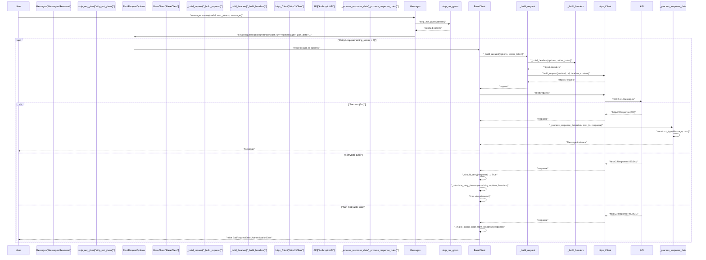
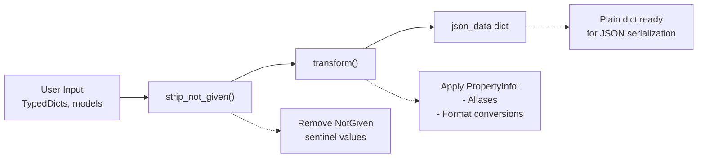
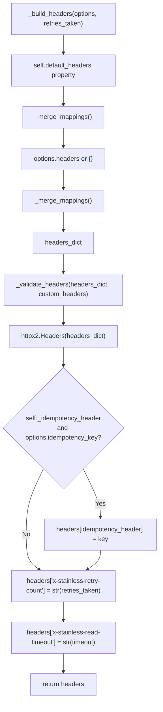

<!-- source: DeepWiki mcp.deepwiki.com · repo anthropics/anthropic-sdk-python · page 4.5 Request Lifecycle and Error Handling · fetched 2026-10-26 -->

# Request Lifecycle and Error Handling

Relevant source files

The following files were used as context for generating this wiki page:

- [CONTRIBUTING.md](CONTRIBUTING.md)
- [README.md](README.md)
- [examples/batch_results.py](examples/batch_results.py)
- [scripts/utils/ruffen-docs.py](scripts/utils/ruffen-docs.py)
- [src/anthropic/__init__.py](src/anthropic/__init__.py)
- [src/anthropic/_base_client.py](src/anthropic/_base_client.py)
- [src/anthropic/_client.py](src/anthropic/_client.py)
- [src/anthropic/_constants.py](src/anthropic/_constants.py)
- [src/anthropic/_decoders/jsonl.py](src/anthropic/_decoders/jsonl.py)
- [src/anthropic/_exceptions.py](src/anthropic/_exceptions.py)
- [src/anthropic/_response.py](src/anthropic/_response.py)
- [src/anthropic/_streaming.py](src/anthropic/_streaming.py)
- [src/anthropic/_types.py](src/anthropic/_types.py)
- [src/anthropic/resources/beta/messages/__init__.py](src/anthropic/resources/beta/messages/__init__.py)
- [tests/decoders/test_jsonl.py](tests/decoders/test_jsonl.py)
- [tests/test_client.py](tests/test_client.py)
- [tests/test_response.py](tests/test_response.py)
- [tests/test_streaming.py](tests/test_streaming.py)
- [tests/utils.py](tests/utils.py)

This page documents the complete lifecycle of HTTP requests in the SDK, tracing execution from parameter preparation through HTTP request handling, exponential backoff retries, and response parsing with status code mapping. For authentication setup, see [Authentication and Configuration](4.4). For streaming responses, see [Streaming](6).

## Overview

All HTTP requests flow through `BaseClient` ([src/anthropic/_base_client.py:1-2833]()), which implements the core request/response lifecycle. The client wraps `httpx2.Client` (or its asynchronous equivalent) and coordinates:

- **Parameter Transformation**: `strip_not_given()` and `transform()` prepare user inputs into `FinalRequestOptions` instances ([src/anthropic/_base_client.py:368-836]()).
- **Request Construction**: `_build_request()` creates an `httpx2.Request` instance complete with serialized bodies, headers, and query parameters ([src/anthropic/_base_client.py:490-592]()).
- **Retry Mechanics**: `_should_retry()` and `_calculate_retry_timeout()` manage exponential backoff and jitter for transient errors ([src/anthropic/_base_client.py:997-1054]()).
- **Response Processing**: `_process_response_data()` handles deserialization and schema validation into Pydantic models via `construct_type()` or `validate_type()` ([src/anthropic/_base_client.py:866-888]()).
- **Error Mapping**: `_make_status_error()` translates HTTP 4xx and 5xx status codes into specific exception classes ([src/anthropic/_exceptions.py:31-180]()).

Sources: [src/anthropic/_base_client.py:368-836](), [src/anthropic/_base_client.py:490-592](), [src/anthropic/_base_client.py:866-888](), [src/anthropic/_base_client.py:997-1054](), [src/anthropic/_exceptions.py:31-180]()

## Complete Request Lifecycle

**Diagram: Complete Request Lifecycle Execution Flow**

The execution flow comprises five major operational phases:
1. **Parameter Preparation**: Optional parameters carrying `NotGiven` sentinel values are stripped [src/anthropic/_utils/_utils.py:234-262]().
2. **Options Initialization**: Final configuration parameters are wrapped in `FinalRequestOptions` [src/anthropic/_models.py:754-892]().
3. **Request Construction**: `_build_request()` compiles headers via `_build_headers()` and constructs the underlying `httpx2.Request` object [src/anthropic/_base_client.py:440-592]().
4. **Transport Execution**: The request is sent through `httpx2.Client.send()`, with automatic retry evaluations executed on transient failures.
5. **Deserialization**: Successful responses invoke `_process_response_data()` to instantiate typed models via `construct_type()` [src/anthropic/_base_client.py:866-888]().

Sources: [src/anthropic/_base_client.py:440-592](), [src/anthropic/_base_client.py:866-888](), [src/anthropic/_models.py:754-892](), [src/anthropic/_utils/_utils.py:234-262]()

## Parameter Transformation Pipeline

**Diagram: Parameter Transformation Code Entities**

| Function | Code Entity / Role | File Location |
|----------|-------------------|---------------|
| `strip_not_given()` | Filters out omitted arguments from user-supplied dictionaries or objects | [src/anthropic/_utils/_utils.py:234-262]() |
| `transform()` | Maps property aliases and types into payload structures | [src/anthropic/lib/_parse/_transform.py:61-61]() |
| `extract_files()` | Recursively traverses data to isolate binary content for multipart uploads | [src/anthropic/_files.py:10-48]() |

Sources: [src/anthropic/_utils/_utils.py:234-262](), [src/anthropic/_files.py:10-48](), [src/anthropic/lib/_parse/_transform.py:61-61]()

## Request Construction and Headers

The `_build_request()` method converts `FinalRequestOptions` into `httpx2.Request` instances [src/anthropic/_base_client.py:490-592]().

### Header Construction

**Diagram: Header Construction Pipeline in _build_headers()**

Headers are synthesized sequentially:
1. Client-level `default_headers` are retrieved.
2. Request-specific `options.headers` are merged.
3. Authentication credentials and SDK metadata headers (`x-stainless-retry-count`, `x-stainless-read-timeout`) are injected [src/anthropic/_base_client.py:440-472]().

Sources: [src/anthropic/_base_client.py:440-472]()

## Retry Logic and Backoff

The client automatically retries eligible requests when transient errors occur.

### Retryable Conditions

The `_should_retry()` method identifies retry eligibility based on HTTP status codes [src/anthropic/_base_client.py:1021-1054]():
- `408`: Request Timeout
- `409`: Conflict
- `429`: Rate Limit Exceeded
- `5xx`: Server Errors (`500`, `502`, `503`, `504`, `529`)

Servers may explicitly dictate retry behavior via the `x-should-retry` header [src/anthropic/_base_client.py:1023-1031]().

### Exponential Backoff Calculation

`_calculate_retry_timeout()` computes backoff intervals using exponential curves with random jitter, respecting any `Retry-After` header values parsed via `_parse_retry_after()` [src/anthropic/_base_client.py:963-1019]().

Sources: [src/anthropic/_base_client.py:963-1019](), [src/anthropic/_base_client.py:1021-1054]()

## Error Handling and Status Code Mapping

When non-2xx status codes are received, the client invokes `_make_status_error_from_response()` to raise specialized exception classes [src/anthropic/_base_client.py:409-429]().

### Exception Hierarchy

All error classes inherit from `AnthropicError` and `APIStatusError` [src/anthropic/_exceptions.py:31-84]().

| Status Code | Exception Class | Source Reference |
|-------------|----------------|------------------|
| `400` | `BadRequestError` | [src/anthropic/_exceptions.py:135-136]() |
| `401` | `AuthenticationError` | [src/anthropic/_exceptions.py:139-140]() |
| `403` | `PermissionDeniedError` | [src/anthropic/_exceptions.py:143-144]() |
| `404` | `NotFoundError` | [src/anthropic/_exceptions.py:147-148]() |
| `409` | `ConflictError` | [src/anthropic/_exceptions.py:151-152]() |
| `413` | `RequestTooLargeError` | [src/anthropic/_exceptions.py:155-156]() |
| `422` | `UnprocessableEntityError` | [src/anthropic/_exceptions.py:159-160]() |
| `429` | `RateLimitError` | [src/anthropic/_exceptions.py:163-164]() |
| `503` | `ServiceUnavailableError` | [src/anthropic/_exceptions.py:167-168]() |
| `504` | `DeadlineExceededError` | [src/anthropic/_exceptions.py:175-176]() |
| `529` | `OverloadedError` | [src/anthropic/_exceptions.py:171-172]() |
| Generic 5xx | `InternalServerError` | [src/anthropic/_exceptions.py:179-180]() |

### Connection and Validation Errors

- `APIConnectionError`: Raised on transport-level failures [src/anthropic/_exceptions.py:95-97]().
- `APITimeoutError`: Raised when requests exceed configured duration bounds [src/anthropic/_exceptions.py:100-106]().
- `APIResponseValidationError`: Raised when response bodies violate expected Pydantic schemas [src/anthropic/_exceptions.py:57-65]().

Sources: [src/anthropic/_base_client.py:409-429](), [src/anthropic/_exceptions.py:31-180]()

---

