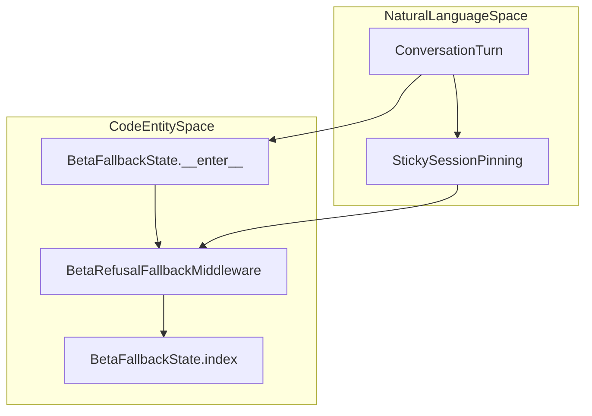
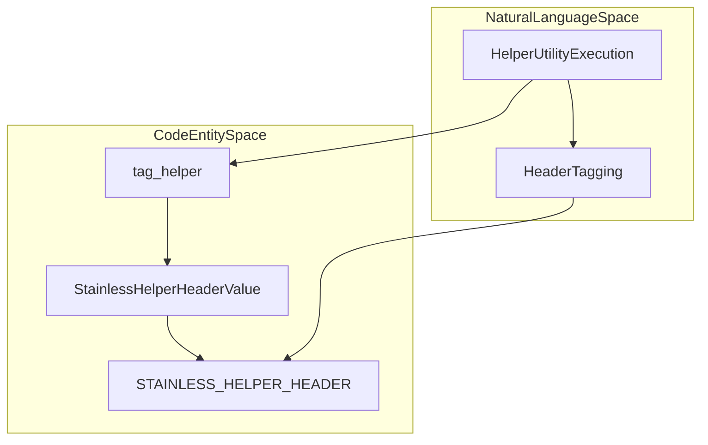

<!-- source: DeepWiki mcp.deepwiki.com · repo anthropics/anthropic-sdk-python · page 4.6 Middleware and Model Fallbacks · fetched 2026-10-26 -->

# Middleware and Model Fallbacks

<details>
<summary>Relevant source files</summary>

The following files were used as context for generating this wiki page:

- [LICENSE-MIT](LICENSE-MIT)
- [MIGRATION.md](MIGRATION.md)
- [src/anthropic/lib/_stainless_helpers.py](src/anthropic/lib/_stainless_helpers.py)
- [src/anthropic/lib/middleware/_fallbacks.py](src/anthropic/lib/middleware/_fallbacks.py)
- [src/anthropic/types/beta/beta_cache_miss_messages_changed.py](src/anthropic/types/beta/beta_cache_miss_messages_changed.py)
- [src/anthropic/types/beta/beta_cache_miss_model_changed.py](src/anthropic/types/beta/beta_cache_miss_model_changed.py)
- [src/anthropic/types/beta/beta_cache_miss_previous_message_not_found.py](src/anthropic/types/beta/beta_cache_miss_previous_message_not_found.py)
- [src/anthropic/types/beta/beta_cache_miss_system_changed.py](src/anthropic/types/beta/beta_cache_miss_system_changed.py)
- [src/anthropic/types/beta/beta_cache_miss_tools_changed.py](src/anthropic/types/beta/beta_cache_miss_tools_changed.py)
- [src/anthropic/types/beta/beta_cache_miss_unavailable.py](src/anthropic/types/beta/beta_cache_miss_unavailable.py)
- [src/anthropic/types/beta/beta_fallback_param.py](src/anthropic/types/beta/beta_fallback_param.py)
- [src/anthropic/types/beta/beta_fallback_refusal_trigger.py](src/anthropic/types/beta/beta_fallback_refusal_trigger.py)
- [src/anthropic/types/beta/beta_refusal_stop_details.py](src/anthropic/types/beta/beta_refusal_stop_details.py)
- [src/anthropic/types/refusal_stop_details.py](src/anthropic/types/refusal_stop_details.py)
- [tests/api_resources/beta/test_output_format_conversion.py](tests/api_resources/beta/test_output_format_conversion.py)
- [tests/api_resources/beta/test_webhooks.py](tests/api_resources/beta/test_webhooks.py)
- [tests/lib/_parse/test_beta_messages.py](tests/lib/_parse/test_beta_messages.py)
- [tests/lib/test_refusal_fallback.py](tests/lib/test_refusal_fallback.py)
- [tests/lib/test_refusal_fallback_streaming.py](tests/lib/test_refusal_fallback_streaming.py)
- [tests/lib/test_stainless_helpers.py](tests/lib/test_stainless_helpers.py)

</details>


This page documents the middleware chain architecture, the refusal-fallback middleware implementation in `src/anthropic/lib/middleware/_fallbacks.py`, fallback credit token handling for model failovers, and Stainless telemetry helper utilities used across the SDK.

---

## 1. Middleware Chain Architecture

The SDK provides an extensible middleware mechanism that intercepts, inspects, and modifies API requests and responses. The architecture relies on functional chaining using `CallNext` / `AsyncCallNext` and `MiddlewareInput` abstractions, allowing middleware components to wrap request execution seamlessly.

Custom middleware inherits from the `Middleware` base class defined in `src/anthropic/_middleware.py` (referenced in `src/anthropic/lib/middleware/_fallbacks.py:30`()), where each middleware intercepts calls to `/v1/messages` or other API routes.

```mermaid
anthropicClientSpace [Anthropic Client Request Lifecycle]
middlewareChain [Middleware Chain Execution]
refusalFallback [BetaRefusalFallbackMiddleware]
httpClientLayer [httpx2 HTTP Dispatch]

anthropicClientSpace --> middlewareChain
middlewareChain --> refusalFallback
refusalFallback --> httpClientLayer

classDef default stroke:#333,stroke-width:2px;
```
*Figure 1: Natural Language to Code Entity Mapping for Request Middleware.*

Sources: `src/anthropic/lib/middleware/_fallbacks.py:30-31`()

---

## 2. Refusal-Fallback Middleware and Fallback State

The refusal-fallback middleware is implemented as `BetaRefusalFallbackMiddleware` in `src/anthropic/lib/middleware/_fallbacks.py:106`(). It handles failed or refused beta `/v1/messages` requests by routing them down a configured fallback chain (`BetaFallbackParam`).

### Sticky Conversation State via `BetaFallbackState`

To prevent unnecessary primary model hops in multi-turn conversations after a fallback model has already accepted a previous turn, the SDK provides `BetaFallbackState` (`src/anthropic/lib/middleware/_fallbacks.py:64`). Wrapping conversation turns in a context manager pins subsequent requests to the successfully resolved fallback index.


*Figure 2: Bridging Conversation State Concepts to Code Entities (`BetaFallbackState`).*

Sources: `src/anthropic/lib/middleware/_fallbacks.py:64-92`(), `tests/lib/test_refusal_fallback.py:156-177`()

---

## 3. Fallback Credit Tokens and Wire Shape

When a primary model refuses a prompt with a policy category (defined in `BetaRefusalStopDetails` via `src/anthropic/types/beta/beta_refusal_stop_details.py:9`), it may issue a `fallback_credit_token` (`src/anthropic/types/beta/beta_refusal_stop_details.py:40`). 

The middleware captures this token and formats it into an object structure with `mode: "best_effort"` (`src/anthropic/lib/middleware/_fallbacks.py:55-61`), ensuring that token redemption failures do not block the fallback request.

| Field Name | Type | Description | Code Pointer |
| :--- | :--- | :--- | :--- |
| `token` | `str` | Opaque code refunding cache-miss costs on fallback models. | `src/anthropic/types/beta/beta_refusal_stop_details.py:40-44`() |
| `mode` | `str` | Transmission mode (`"best_effort"`). | `src/anthropic/lib/middleware/_fallbacks.py:61`() |
| `fallback_has_prefill_claim` | `bool` | Determines if partial assistant output can be prepended. | `src/anthropic/types/beta/beta_refusal_stop_details.py:62-83`() |
| `recommended_model` | `str \| None` | Server-suggested retry target when capacity is exhausted. | `src/anthropic/types/beta/beta_refusal_stop_details.py:85-91`() |

Sources: `src/anthropic/lib/middleware/_fallbacks.py:55-61`(), `src/anthropic/types/beta/beta_refusal_stop_details.py:9-94`()

---

## 4. Stainless Helper Utilities and Telemetry Tagging

The SDK uses Stainless helper headers to track which internal utility, toolset, or helper generated a request. These utilities are defined in `src/anthropic/lib/_stainless_helpers.py:1`().

The primary telemetry header key is `STAINLESS_HELPER_HEADER` (`x-stainless-helper`), which uses an append-don't-clobber merge strategy (`src/anthropic/lib/_stainless_helpers.py:30`).


*Figure 3: Mapping Helper Telemetry to Code Entities (`_stainless_helpers.py`).*

```python
# Example helper header construction pattern
from anthropic.lib._stainless_helpers import helper_header, STAINLESS_HELPER_HEADER

headers = helper_header("BetaToolRunner")
# Produces: {"x-stainless-helper": "BetaToolRunner"}
```

Sources: `src/anthropic/lib/_stainless_helpers.py:1-167`(), `tests/lib/test_stainless_helpers.py:32-35`()

---

