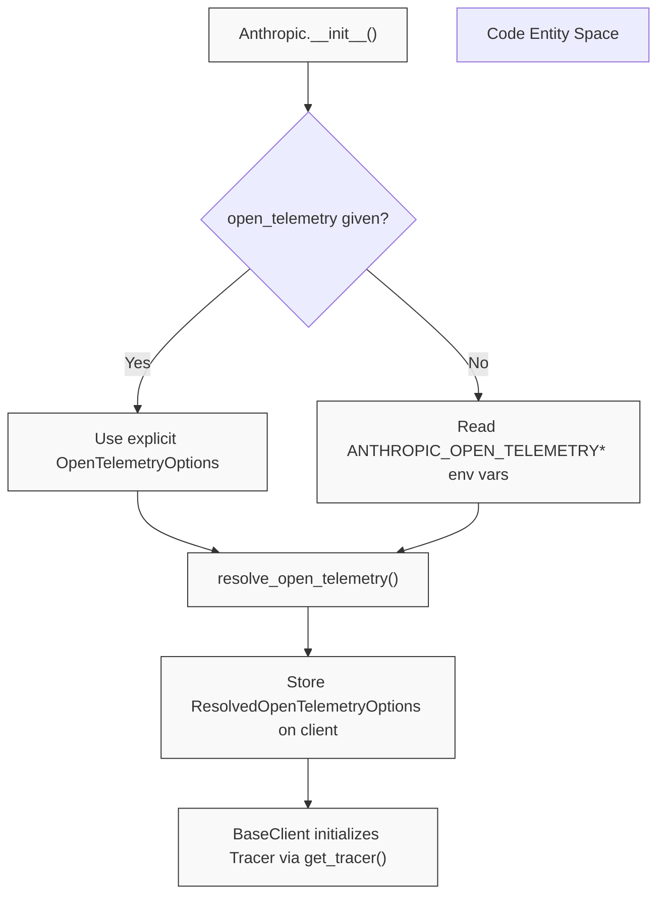
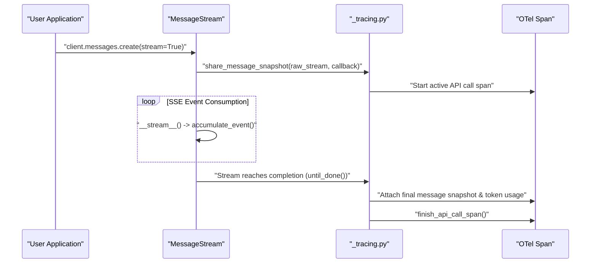

<!-- source: DeepWiki mcp.deepwiki.com · repo anthropics/anthropic-sdk-python · page 4.7 OpenTelemetry Instrumentation · fetched 2026-10-26 -->

# OpenTelemetry Instrumentation

<details>
<summary>Relevant source files</summary>

The following files were used as context for generating this wiki page:

- [CONTRIBUTING.md](CONTRIBUTING.md)
- [README.md](README.md)
- [examples/web_search.py](examples/web_search.py)
- [examples/web_search_stream.py](examples/web_search_stream.py)
- [scripts/utils/ruffen-docs.py](scripts/utils/ruffen-docs.py)
- [src/anthropic/__init__.py](src/anthropic/__init__.py)
- [src/anthropic/_base_client.py](src/anthropic/_base_client.py)
- [src/anthropic/_client.py](src/anthropic/_client.py)
- [src/anthropic/_constants.py](src/anthropic/_constants.py)
- [src/anthropic/_types.py](src/anthropic/_types.py)
- [src/anthropic/lib/streaming/_beta_messages.py](src/anthropic/lib/streaming/_beta_messages.py)
- [src/anthropic/lib/streaming/_messages.py](src/anthropic/lib/streaming/_messages.py)
- [tests/lib/_parse/test_messages.py](tests/lib/_parse/test_messages.py)
- [tests/lib/streaming/test_beta_messages.py](tests/lib/streaming/test_beta_messages.py)
- [tests/lib/streaming/test_messages.py](tests/lib/streaming/test_messages.py)
- [tests/lib/streaming/test_partial_json.py](tests/lib/streaming/test_partial_json.py)
- [tests/test_client.py](tests/test_client.py)
- [tests/test_open_telemetry.py](tests/test_open_telemetry.py)

</details>


## Purpose and Scope

This page documents the native OpenTelemetry tracing support in the Anthropic Python SDK. It details how API requests and streams are instrumented as OpenTelemetry spans, how configuration is managed via the `open_telemetry` client option and environment variables, how semantic attributes (`gen_ai.*`) and request/response payloads are captured under `metadata_only` vs. `content` modes, and how streaming span lifecycles are coordinated with asynchronous and synchronous stream consumers.

---

## 1. Configuration and Options

The SDK integrates with OpenTelemetry via `opentelemetry-api` without depending on a concrete OpenTelemetry SDK [README.md:47-50](). Tracing can be configured globally via environment variables or explicitly passed per client instance using the `open_telemetry` option dictionary [README.md:75-76]().

### Client Options and Typed Structures

The client configuration structure is defined by `OpenTelemetryOptions` and `OpenTelemetryTraces` in `src/anthropic/_types.py`:

* `tracer_provider`: A custom `TracerProvider` instance [src/anthropic/_types.py:161-163]().
* `propagation`: Controls whether trace context headers are injected into outgoing HTTP requests [src/anthropic/_types.py:164-169]().
* `traces`: Enables/disables spans and configures content modes (`content_mode`, `max_content_bytes`) [src/anthropic/_types.py:118-139]() [src/anthropic/_types.py:171-175]().
* `conversation_id`: Sets the `gen_ai.conversation.id` attribute on spans [src/anthropic/_types.py:177-183]().

```python
from anthropic import Anthropic

# Configure via client option dictionary
client = Anthropic(
    open_telemetry={
        "traces": {"content_mode": "content", "max_content_bytes": 65_536},
        "propagation": True,
    }
)
```[README.md:52-73]()

### Environment Variable Fallbacks

When no `open_telemetry` argument is supplied to the client constructor, the SDK inspects the environment:
* `ANTHROPIC_OPEN_TELEMETRY=false`: Disables span emission.
* `ANTHROPIC_OPEN_TELEMETRY_TRACES_CONTENT_MODE=content`: Switches from metadata-only to full content tracing.
* `ANTHROPIC_OPEN_TELEMETRY_TRACES_MAX_CONTENT_BYTES=<int>`: Sets the payload byte limit.
* `ANTHROPIC_OPEN_TELEMETRY_PROPAGATION=false`: Suppresses trace context header injection.

Sources: [README.md:47-78](), [src/anthropic/_types.py:118-194]()

---

## 2. Configuration Resolution and Initialization Flow

When an `Anthropic` or `AsyncAnthropic` client is instantiated, the `open_telemetry` configuration is resolved via helper utilities in `src/anthropic/_tracing.py` and stored on the client instance.


Sources: [src/anthropic/_base_client.py:44-94](), [README.md:47-78]()

---

## 3. Span Naming, Routing, and Attributes (`gen_ai.*`)

Each API request executed through `BaseClient` [src/anthropic/_base_client.py]() is wrapped in an OpenTelemetry span managed by `start_api_call_span` and `finish_api_call_span` [src/anthropic/_base_client.py:87-94]() [src/anthropic/lib/_tracing.py:130]().

### Semantic Attributes
Spans capture standard GenAI semantic conventions and SDK-specific telemetry keys:
* `gen_ai.system`: Set to `"anthropic"`.
* `gen_ai.request.model`: The model identifier used in the request.
* `gen_ai.conversation.id`: Bound when `conversation_id` is specified in client options [src/anthropic/_types.py:177-183]().
* Token usage metrics (`gen_ai.response.input_tokens`, `gen_ai.response.output_tokens`).

Sources: [src/anthropic/_base_client.py:87-94](), [src/anthropic/lib/_tracing.py:130]()

---

## 4. Content Modes and Payload Tracing

The SDK supports two distinct tracing modes governed by `content_mode`:

| Mode | Description | Truncation Behavior |
| :--- | :--- | :--- |
| `metadata_only` (Default) | Records headers, timing, status codes, token usage, and model identifiers. Does not record prompt texts or completion contents. | N/A |
| `content` | Captures prompts, system instructions, tool definitions, and response message contents within the span attributes. | Payloads exceeding `max_content_bytes` (default: 750,000 bytes) are truncated, and the span attribute `anthropic.content.truncated` is set to `True`. |

Sources: [src/anthropic/_types.py:118-139](), [README.md:52-76]()

---

## 5. Streaming Span Lifecycles

For streaming requests (`client.messages.create(..., stream=True)` or `client.messages.stream(...)`), spans remain active past the initial HTTP response headers until the stream iterator is fully consumed or closed. 

The integration utilizes `share_message_snapshot` and `withhold_message_snapshot` [src/anthropic/lib/_tracing.py:27]() to attach accumulated message content and final token usage metrics to the OpenTelemetry span upon stream completion.


Sources: [src/anthropic/lib/_tracing.py:27](), [src/anthropic/lib/streaming/_messages.py:56]()

---

## 6. Propagation and Headers

By default, the SDK injects W3C trace context or propagator-configured headers into outgoing HTTP requests (`propagation: True`) [src/anthropic/_types.py:164-169](). 

If an application's outer HTTP instrumentation layer (e.g., global `httpx` telemetry or service mesh sidecar) already injects trace headers, setting `propagation: False` prevents duplicate header injection [src/anthropic/_types.py:164-169]() [README.md:63-65]().

Sources: [src/anthropic/_types.py:164-169](), [README.md:63-65]()

---

