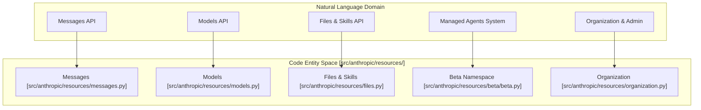

<!-- source: DeepWiki mcp.deepwiki.com · repo anthropics/anthropic-sdk-python · page 5 API Resources · fetched 2026-10-26 -->

# API Resources

Relevant source files

The following files were used as context for generating this wiki page:

- [.stats.yml](.stats.yml)
- [api.md](api.md)
- [scripts/mock-spec.json.gz](scripts/mock-spec.json.gz)
- [src/anthropic/resources/__init__.py](src/anthropic/resources/__init__.py)
- [src/anthropic/resources/beta/__init__.py](src/anthropic/resources/beta/__init__.py)
- [src/anthropic/resources/beta/beta.py](src/anthropic/resources/beta/beta.py)
- [src/anthropic/types/__init__.py](src/anthropic/types/__init__.py)
- [src/anthropic/types/anthropic_beta_param.py](src/anthropic/types/anthropic_beta_param.py)
- [src/anthropic/types/beta/__init__.py](src/anthropic/types/beta/__init__.py)

## Purpose and Scope

This document describes the API Resources layer of the Anthropic Python SDK, which provides a structured interface for accessing the various Anthropic API endpoints. Resources organize related API operations into logical groupings and are accessed through cached properties on the client objects.

As a parent page, this section provides a high-level architectural overview. For deep technical details, parameter specifications, and usage examples, refer to the following child pages:
- [Messages API](#5.1) — Stable `messages.create()` method, content blocks, usage accounting, and non-streaming usage.
- [Beta Messages API](#5.2) — Beta-specific features in `beta.messages.create()` including context management, compaction, MCP servers, and thinking configurations.
- [Prompt Caching and Cache Misses](#5.3) — Prompt caching with `cache_control` ephemeral blocks, TTLs, and cache-miss reason types.
- [Models API](#5.4) — `models.retrieve()` and `models.list()` for querying available Claude models and capabilities.
- [Message Batches](#5.5) — Batch processing with `beta.messages.batches` and `messages.batches`, including JSONL result streaming.
- [Beta Features and Capabilities](#5.6) — Overview of beta-exclusive features like MCP integration, files API, skills API, computer use, and webhooks.
- [Managed Agents](#5.7) — Managed agents system: agents, sessions, threads, environments, vaults, and memory stores.
- [Organization and Admin APIs](#5.8) — Organization-scoped administration including users, workspaces, API keys, rate limits, spend limits, and analytics.

Sources: [src/anthropic/resources/__init__.py:1-101](), [src/anthropic/resources/beta/beta.py:1-195]()

## Resource Organization and Client Namespace

Resources are exposed as cached properties on the `Anthropic` and `AsyncAnthropic` client classes [src/anthropic/resources/__init__.py:1-101](). Each resource encapsulates a set of related API operations with dedicated request parameters and response models.

### Architecture: Natural Language to Code Entity Mapping
The following diagram bridges high-level API domain concepts to their concrete Python resource classes and file paths within the codebase.

Sources: [src/anthropic/resources/__init__.py:1-101](), [src/anthropic/resources/beta/beta.py:130-194]()

### Configured Endpoints and OpenAPI Specification

The SDK supports a comprehensive set of API endpoints generated from the underlying OpenAPI specifications. Currently, the SDK is configured for **333** endpoints [.stats.yml:1]().

Sources: [.stats.yml:1]()

---

## Major Resource Groups Overview

### 5.1 Messages API
The stable Messages resource (`client.messages`) manages primary conversational interactions with Claude. For details, see [Messages API](#5.1).

Sources: [src/anthropic/resources/messages.py:1-50]()

### 5.2 Beta Messages API
The beta messages resource (`client.beta.messages`) exposes advanced experimental capabilities such as extended thinking configurations, context compaction, and MCP server integrations. For details, see [Beta Messages API](#5.2).

Sources: [src/anthropic/resources/beta/messages/messages.py:1-60]()

### 5.3 Prompt Caching and Cache Misses
Prompt caching enables efficient reuse of large context windows using `cache_control` ephemeral blocks. For details, see [Prompt Caching and Cache Misses](#5.3).

Sources: [src/anthropic/types/anthropic_beta_param.py:1-64]()

### 5.4 Models API
The models resource (`client.models` and `client.beta.models`) allows querying available Claude model metadata and capabilities. For details, see [Models API](#5.4).

Sources: [src/anthropic/resources/models.py:1-40](), [src/anthropic/resources/beta/models.py:1-40]()

### 5.5 Message Batches
Batch processing (`client.messages.batches` and `client.beta.messages.batches`) handles asynchronous bulk requests with JSONL result streaming. For details, see [Message Batches](#5.5).

Sources: [src/anthropic/resources/messages/batches.py:1-50]()

### 5.6 Beta Features and Capabilities
The beta namespace bundles experimental features including MCP client tunnels, file uploads, skills, computer use tools, webhooks, and user profiles. For details, see [Beta Features and Capabilities](#5.6).

Sources: [src/anthropic/resources/beta/beta.py:130-194](), [src/anthropic/types/anthropic_beta_param.py:1-64]()

### 5.7 Managed Agents
The managed agents system provides environments, sessions, threads, vaults, memory stores, and deployments for autonomous, long-running agentic tasks. For details, see [Managed Agents](#5.7).

Sources: [src/anthropic/resources/beta/agents/agents.py:1-50](), [src/anthropic/resources/beta/sessions/sessions.py:1-50]()

### 5.8 Organization and Admin APIs
The organization administration resources (`client.organization` and `client.beta.organization`) manage users, invites, service accounts, workspaces, API keys, federation, role-based access control (RBAC), rate limits, spend limits, and analytics reporting. For details, see [Organization and Admin APIs](#5.8).

Sources: [src/anthropic/resources/organization.py:1-50](), [src/anthropic/resources/beta/organization/organization.py:1-50]()

---

