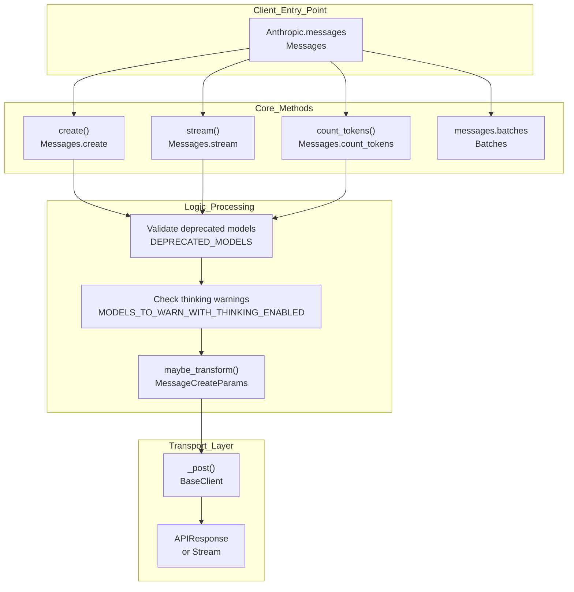
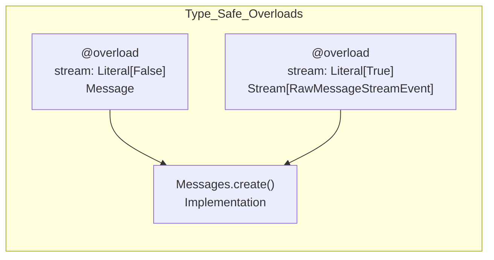
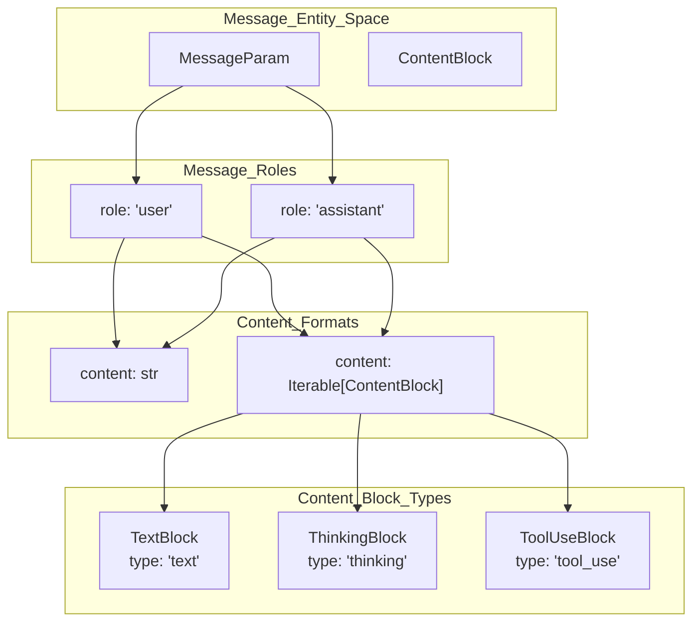
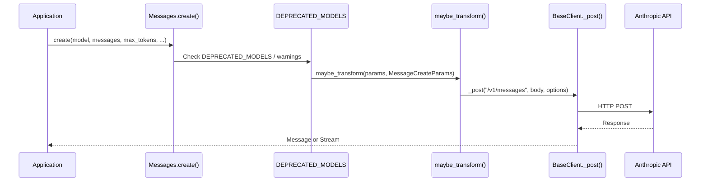

<!-- source: DeepWiki mcp.deepwiki.com · repo anthropics/anthropic-sdk-python · page 5.1 Messages API · fetched 2026-10-26 -->

# Messages API

<details>
<summary>Relevant source files</summary>

The following files were used as context for generating this wiki page:

- [src/anthropic/resources/beta/messages/messages.py](src/anthropic/resources/beta/messages/messages.py)
- [src/anthropic/resources/messages/messages.py](src/anthropic/resources/messages/messages.py)
- [src/anthropic/types/beta/beta_message.py](src/anthropic/types/beta/beta_message.py)
- [src/anthropic/types/beta/beta_raw_message_delta_event.py](src/anthropic/types/beta/beta_raw_message_delta_event.py)
- [src/anthropic/types/beta/beta_stop_reason.py](src/anthropic/types/beta/beta_stop_reason.py)
- [src/anthropic/types/beta/beta_tool_result_block_param.py](src/anthropic/types/beta/beta_tool_result_block_param.py)
- [src/anthropic/types/beta/message_count_tokens_params.py](src/anthropic/types/beta/message_count_tokens_params.py)
- [src/anthropic/types/beta/message_create_params.py](src/anthropic/types/beta/message_create_params.py)
- [src/anthropic/types/citation_search_result_location_param.py](src/anthropic/types/citation_search_result_location_param.py)
- [src/anthropic/types/citations_delta.py](src/anthropic/types/citations_delta.py)
- [src/anthropic/types/citations_search_result_location.py](src/anthropic/types/citations_search_result_location.py)
- [src/anthropic/types/content_block.py](src/anthropic/types/content_block.py)
- [src/anthropic/types/content_block_delta_event.py](src/anthropic/types/content_block_delta_event.py)
- [src/anthropic/types/content_block_param.py](src/anthropic/types/content_block_param.py)
- [src/anthropic/types/content_block_start_event.py](src/anthropic/types/content_block_start_event.py)
- [src/anthropic/types/content_block_stop_event.py](src/anthropic/types/content_block_stop_event.py)
- [src/anthropic/types/document_block_param.py](src/anthropic/types/document_block_param.py)
- [src/anthropic/types/image_block_param.py](src/anthropic/types/image_block_param.py)
- [src/anthropic/types/message.py](src/anthropic/types/message.py)
- [src/anthropic/types/message_count_tokens_params.py](src/anthropic/types/message_count_tokens_params.py)
- [src/anthropic/types/message_create_params.py](src/anthropic/types/message_create_params.py)
- [src/anthropic/types/message_delta_event.py](src/anthropic/types/message_delta_event.py)
- [src/anthropic/types/message_delta_usage.py](src/anthropic/types/message_delta_usage.py)
- [src/anthropic/types/message_param.py](src/anthropic/types/message_param.py)
- [src/anthropic/types/message_start_event.py](src/anthropic/types/message_start_event.py)
- [src/anthropic/types/message_stop_event.py](src/anthropic/types/message_stop_event.py)
- [src/anthropic/types/message_stream_event.py](src/anthropic/types/message_stream_event.py)
- [src/anthropic/types/raw_content_block_start_event.py](src/anthropic/types/raw_content_block_start_event.py)
- [src/anthropic/types/raw_message_delta_event.py](src/anthropic/types/raw_message_delta_event.py)
- [src/anthropic/types/raw_message_stream_event.py](src/anthropic/types/raw_message_stream_event.py)
- [src/anthropic/types/search_result_block_param.py](src/anthropic/types/search_result_block_param.py)
- [src/anthropic/types/stop_reason.py](src/anthropic/types/stop_reason.py)
- [src/anthropic/types/text_block_param.py](src/anthropic/types/text_block_param.py)
- [src/anthropic/types/text_citation.py](src/anthropic/types/text_citation.py)
- [src/anthropic/types/text_citation_param.py](src/anthropic/types/text_citation_param.py)
- [src/anthropic/types/tool_result_block_param.py](src/anthropic/types/tool_result_block_param.py)
- [src/anthropic/types/usage.py](src/anthropic/types/usage.py)

</details>


The Messages API is the primary stable interface for generating conversational responses from Claude models. This page documents the non-beta `messages.create()` method, token counting, content blocks, usage accounting, and parameter configuration for single queries and multi-turn conversations.

For beta-specific features including MCP integration, context management, and extended capabilities, see [Beta Messages API](#5.2). For streaming implementation details, see [Streaming](#6). For batch processing, see [Message Batches](#5.5).

## Overview

The Messages API is implemented in the `Messages` resource class located at [src/anthropic/resources/messages/messages.py:97-1543](). It provides core methods for message generation and utility functions:

| Method | Purpose | Return Type |
|--------|---------|-------------|
| `create()` | Generate message responses | `Message` or `Stream[RawMessageStreamEvent]` [src/anthropic/resources/messages/messages.py:121-150]() |
| `stream()` | Context manager for streaming | `MessageStreamManager` [src/anthropic/resources/messages/messages.py:1260-1376]() |
| `count_tokens()` | Calculate token usage without generation | `MessageTokensCount` [src/anthropic/resources/messages/messages.py:1378-1543]() |

The API operates on alternating `user` and `assistant` conversational turns, supporting both single queries and stateless multi-turn conversations [src/anthropic/types/message_create_params.py:50-120]().

Sources: [src/anthropic/resources/messages/messages.py:97-120](), [src/anthropic/resources/messages/messages.py:121-1543](), [src/anthropic/types/message_create_params.py:50-120]()

## Messages Resource Architecture

The following diagram illustrates how the `Messages` resource class interacts with internal validation, transformation, and transport layers.



Sources: [src/anthropic/resources/messages/messages.py:97-1543](), [src/anthropic/resources/messages/messages.py:71-94]()

## The create() Method

The `create()` method is the primary interface for generating messages. It uses Python's `@overload` decorators to provide type-safe variants for streaming and non-streaming requests [src/anthropic/resources/messages/messages.py:121-150]().

### Method Signatures



Sources: [src/anthropic/resources/messages/messages.py:121-150]()

### Core Parameters

The `create()` method accepts parameters defined in `MessageCreateParamsBase` [src/anthropic/types/message_create_params.py:34-184]():

| Parameter | Type | Required | Description |
|-----------|------|----------|-------------|
| `max_tokens` | `int` | ✓ | Maximum tokens to generate [src/anthropic/types/message_create_params.py:35]() |
| `messages` | `Iterable[MessageParam]` | ✓ | Conversational turns [src/anthropic/types/message_create_params.py:50]() |
| `model` | `ModelParam` | ✓ | Model identifier [src/anthropic/types/message_create_params.py:122]() |
| `stream` | `bool \| Literal[True, False]` | | Enable SSE streaming [src/anthropic/resources/messages/messages.py:137]() |
| `system` | `str \| Iterable[TextBlockParam]` | | System prompt [src/anthropic/types/message_create_params.py:118]() |
| `tools` | `Iterable[ToolUnionParam]` | | Tool definitions [src/anthropic/types/message_create_params.py:146]() |
| `tool_choice` | `ToolChoiceParam` | | Tool selection strategy [src/anthropic/types/message_create_params.py:139]() |
| `thinking` | `ThinkingConfigParam` | | Extended thinking config [src/anthropic/types/message_create_params.py:126]() |
| `stop_sequences` | `SequenceNotStr[str]` | | Custom stop strings [src/anthropic/types/message_create_params.py:179]() |
| `metadata` | `MetadataParam` | | Request metadata [src/anthropic/types/message_create_params.py:152]() |
| `cache_control` | `CacheControlEphemeralParam` | | Prompt caching [src/anthropic/types/message_create_params.py:129]() |
| `output_config` | `OutputConfigParam` | | Output format config [src/anthropic/types/message_create_params.py:155]() |
| `container` | `MessageCreateParamsContainerParam` | | Container identifier [src/anthropic/types/message_create_params.py:135]() |
| `inference_geo` | `str` | | Geographic region [src/anthropic/types/message_create_params.py:146]() |
| `service_tier` | `Literal["auto", "standard_only"]` | | Priority vs standard [src/anthropic/types/message_create_params.py:158]() |

Sources: [src/anthropic/resources/messages/messages.py:121-150](), [src/anthropic/types/message_create_params.py:34-184]()

### Message Structure and Content Blocks

The `messages` parameter accepts conversational turns with specific structure requirements defined by `MessageParam` and `ContentBlock` (`[src/anthropic/types/content_block.py:20-36]`).



Sources: [src/anthropic/types/message_create_params.py:50-120](), [src/anthropic/types/content_block.py:20-36]()

### Request Flow



Sources: [src/anthropic/resources/messages/messages.py:97-150]()

## Deprecated Models Warning System

The SDK implements a deprecation warning system for models approaching end-of-life [src/anthropic/resources/messages/messages.py:71-94]().

```python
DEPRECATED_MODELS = {
    "claude-1.3": "November 6th, 2024",
    "claude-3-sonnet-20240229": "July 21st, 2025",
    "claude-3-opus-20240229": "January 5th, 2026",
    # ...
}

MODELS_TO_WARN_WITH_THINKING_ENABLED = ["claude-opus-4-6", "claude-mythos-preview"]
```

The validation logic inspects requested models against these mappings and emits warnings when deprecated models are utilized or when thinking is enabled on preview models [src/anthropic/resources/messages/messages.py:71-94]().

Sources: [src/anthropic/resources/messages/messages.py:71-94]()

## Token Counting

The `count_tokens()` method calculates token usage without generating a response [src/anthropic/resources/messages/messages.py:1378-1543]().

### Method Signature

```python
def count_tokens(
    self,
    *,
    messages: Iterable[MessageParam],
    model: ModelParam,
    # ... additional parameters (system, tools, thinking, etc.)
) -> MessageTokensCount
```

The returned `MessageTokensCount` object provides an `input_tokens` count [src/anthropic/types/message_tokens_count.py]().

Sources: [src/anthropic/resources/messages/messages.py:1378-1543](), [src/anthropic/types/message_tokens_count.py]()

## Usage Accounting

The `Message` response object contains a detailed `usage` attribute of type `Usage` (`[src/anthropic/types/usage.py:12-48]`), capturing token consumption across multiple categories:

| Field | Type | Description |
|-------|------|-------------|
| `input_tokens` | `int` | Number of input tokens used [src/anthropic/types/usage.py:25]() |
| `output_tokens` | `int` | Number of output tokens used [src/anthropic/types/usage.py:28]() |
| `cache_creation_input_tokens` | `Optional[int]` | Input tokens used to create cache entry [src/anthropic/types/usage.py:16]() |
| `cache_read_input_tokens` | `Optional[int]` | Input tokens read from cache [src/anthropic/types/usage.py:19]() |
| `output_tokens_details` | `Optional[OutputTokensDetails]` | Breakdown of output tokens by category [src/anthropic/types/usage.py:31]() |
| `service_tier` | `Optional[Literal]` | Service tier applied to the request [src/anthropic/types/usage.py:43]() |

Sources: [src/anthropic/types/usage.py:12-47](), [src/anthropic/types/message.py:123-140]()

## Response Handling

When `stream=False` or omitted, the API returns a `Message` object [src/anthropic/types/message.py:17-145]().

| Field | Type | Description |
|-------|------|-------------|
| `id` | `str` | Unique message identifier [src/anthropic/types/message.py:18]() |
| `content` | `List[ContentBlock]` | List of generated content blocks [src/anthropic/types/message.py:30]() |
| `role` | `Literal['assistant']` | Always 'assistant' [src/anthropic/types/message.py:79]() |
| `usage` | `Usage` | Token usage breakdown [src/anthropic/types/message.py:123]() |
| `stop_reason` | `Optional[StopReason]` | Why generation stopped [src/anthropic/types/message.py:91]() |

Sources: [src/anthropic/types/message.py:17-145](), [src/anthropic/types/usage.py:12-47]()

---

