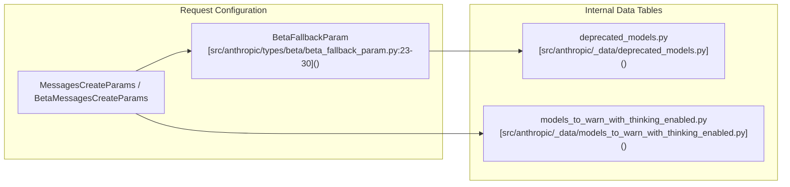

<!-- source: DeepWiki mcp.deepwiki.com · repo anthropics/anthropic-sdk-python · page 5.3 Prompt Caching and Cache Misses · fetched 2026-10-26 -->

# Prompt Caching and Cache Misses

<details>
<summary>Relevant source files</summary>

The following files were used as context for generating this wiki page:

- [src/anthropic/_data/__init__.py](src/anthropic/_data/__init__.py)
- [src/anthropic/_data/deprecated_models.py](src/anthropic/_data/deprecated_models.py)
- [src/anthropic/_data/models_to_warn_with_thinking_enabled.py](src/anthropic/_data/models_to_warn_with_thinking_enabled.py)
- [src/anthropic/types/beta/beta_cache_miss_messages_changed.py](src/anthropic/types/beta/beta_cache_miss_messages_changed.py)
- [src/anthropic/types/beta/beta_cache_miss_model_changed.py](src/anthropic/types/beta/beta_cache_miss_model_changed.py)
- [src/anthropic/types/beta/beta_cache_miss_previous_message_not_found.py](src/anthropic/types/beta/beta_cache_miss_previous_message_not_found.py)
- [src/anthropic/types/beta/beta_cache_miss_system_changed.py](src/anthropic/types/beta/beta_cache_miss_system_changed.py)
- [src/anthropic/types/beta/beta_cache_miss_tools_changed.py](src/anthropic/types/beta/beta_cache_miss_tools_changed.py)
- [src/anthropic/types/beta/beta_cache_miss_unavailable.py](src/anthropic/types/beta/beta_cache_miss_unavailable.py)
- [src/anthropic/types/beta/beta_fallback_param.py](src/anthropic/types/beta/beta_fallback_param.py)
- [src/anthropic/types/cache_miss_messages_changed.py](src/anthropic/types/cache_miss_messages_changed.py)
- [src/anthropic/types/cache_miss_model_changed.py](src/anthropic/types/cache_miss_model_changed.py)
- [src/anthropic/types/cache_miss_previous_message_not_found.py](src/anthropic/types/cache_miss_previous_message_not_found.py)
- [src/anthropic/types/cache_miss_system_changed.py](src/anthropic/types/cache_miss_system_changed.py)
- [src/anthropic/types/cache_miss_tools_changed.py](src/anthropic/types/cache_miss_tools_changed.py)
- [src/anthropic/types/cache_miss_unavailable.py](src/anthropic/types/cache_miss_unavailable.py)

</details>


## Purpose and Scope

This page documents the implementation and data structures for **Prompt Caching** and **Cache Diagnostics** within the Anthropic Python SDK. Prompt caching allows developers to cache large prefixes (such as extensive system instructions, documents, or conversation history) to reduce latency and input token costs. When cache misses occur, the SDK parses diagnostic reason types returned by the API to help developers identify changes in their requests. Additionally, this page covers deprecated model data tables and model warning configurations utilized across model parameter validation and fallback mechanisms [src/anthropic/_data/deprecated_models.py](), [src/anthropic/_data/models_to_warn_with_thinking_enabled.py]().

---

## Prompt Caching and `cache_control`

Prompt caching in Anthropic models is controlled via `cache_control` configuration blocks attached to cacheable elements like system prompts, tool definitions, or message content blocks. The ephemeral cache type enables short-lived caching of prompt prefixes.

### Ephemeral Blocks and TTLs
When configuring requests via `messages.create()` or `beta.messages.create()`, content blocks and system parameters accept a `cache_control` dictionary specifying an ephemeral caching strategy. 

```python
response = client.messages.create(
    model="claude-3-5-sonnet-20241022",
    max_tokens=1024,
    system=[
        {
            "type": "text",
            "text": "Long system prompt...",
            "cache_control": {"type": "ephemeral"}
        }
    ],
    messages=[{"role": "user", "content": "Hello"}]
)
```

**Sources**: [src/anthropic/types/cache_miss_unavailable.py:8-18]()

---

## Cache-Miss Reason Types

When a prompt caching request fails to hit the cache, the API response contains diagnostics detailing why the cache missed. The SDK provides strongly typed Pydantic models for both stable and beta namespaces corresponding to each cache-miss reason type.

Title: Cache Miss Diagnostics Architecture

```mermaid
graph TB
    subgraph "API Response Diagnostics"
        Response["API Response / Usage Metrics"]
    end

    subgraph "Cache Miss Reason Models [src/anthropic/types/]"
        ToolsChanged["CacheMissToolsChanged<br/>type: 'tools_changed'<br/>[src/anthropic/types/cache_miss_tools_changed.py:8-21]()"]
        SystemChanged["CacheMissSystemChanged<br/>type: 'system_changed'<br/>[src/anthropic/types/cache_miss_system_changed.py:8-21]()"]
        MessagesChanged["CacheMissMessagesChanged<br/>type: 'messages_changed'<br/>[src/anthropic/types/cache_miss_messages_changed.py:8-21]()"]
        ModelChanged["CacheMissModelChanged<br/>type: 'model_changed'<br/>[src/anthropic/types/cache_miss_model_changed.py:8-21]()"]
        Unavailable["CacheMissUnavailable<br/>type: 'unavailable'<br/>[src/anthropic/types/cache_miss_unavailable.py:8-18]()"]
        PrevNotFound["CacheMissPreviousMessageNotFound<br/>type: 'previous_message_not_found'<br/>[src/anthropic/types/cache_miss_previous_message_not_found.py:8-17]()"]
    end

    Response --> ToolsChanged
    Response --> SystemChanged
    Response --> MessagesChanged
    Response --> ModelChanged
    Response --> Unavailable
    Response --> PrevNotFound
```


### Summary of Cache-Miss Reason Classes

| Reason Class Name | Literal `type` | Description & Code Pointer |
|-------------------|----------------|----------------------------|
| `CacheMissToolsChanged` | `"tools_changed"` | Tools differ from previous request (added, removed, reordered) [src/anthropic/types/cache_miss_tools_changed.py:8-21]() |
| `CacheMissSystemChanged` | `"system_changed"` | System prompt differs from previous request [src/anthropic/types/cache_miss_system_changed.py:8-21]() |
| `CacheMissMessagesChanged` | `"messages_changed"` | Messages differ in an earlier entry instead of only having entries appended [src/anthropic/types/cache_miss_messages_changed.py:8-21]() |
| `CacheMissModelChanged` | `"model_changed"` | Model or inference speed differs from previous request [src/anthropic/types/cache_miss_model_changed.py:8-21]() |
| `CacheMissUnavailable` | `"unavailable"` | API cannot provide a diagnosis (e.g., parameter like `thinking` or `tool_choice` differs) [src/anthropic/types/cache_miss_unavailable.py:8-18]() |
| `CacheMissPreviousMessageNotFound` | `"previous_message_not_found"` | Stored record of the referenced previous message ID not found [src/anthropic/types/cache_miss_previous_message_not_found.py:8-17]() |

Beta equivalents are also defined under `src/anthropic/types/beta/` (e.g., `BetaCacheMissToolsChanged`, `BetaCacheMissSystemChanged`, `BetaCacheMissMessagesChanged`, `BetaCacheMissModelChanged`, `BetaCacheMissUnavailable`, `BetaCacheMissPreviousMessageNotFound`) [src/anthropic/types/beta/beta_cache_miss_tools_changed.py:8-21](), [src/anthropic/types/beta/beta_cache_miss_unavailable.py:8-18](), [src/anthropic/types/beta/beta_cache_miss_previous_message_not_found.py:8-17](), [src/anthropic/types/beta/beta_cache_miss_system_changed.py:8-21](), [src/anthropic/types/beta/beta_cache_miss_model_changed.py:8-21]().

**Sources**: [src/anthropic/types/cache_miss_tools_changed.py:8-21](), [src/anthropic/types/cache_miss_unavailable.py:8-18](), [src/anthropic/types/cache_miss_previous_message_not_found.py:8-17](), [src/anthropic/types/cache_miss_system_changed.py:8-21](), [src/anthropic/types/cache_miss_messages_changed.py:8-21](), [src/anthropic/types/cache_miss_model_changed.py:8-21](), [src/anthropic/types/beta/beta_cache_miss_tools_changed.py:8-21](), [src/anthropic/types/beta/beta_cache_miss_unavailable.py:8-18](), [src/anthropic/types/beta/beta_cache_miss_previous_position/beta_cache_miss_previous_message_not_found.py:8-17]()

---

## Fallback Parameters and Model Data Tables

The SDK maintains internal data tables for tracking deprecated models and models requiring special handling or warnings when specific parameters (such as `thinking` or server-side fallbacks) are enabled.

### Fallback Chains (`BetaFallbackParam`)
When executing requests with server-side fallbacks (`server-side-fallback-2026-07-01`), `BetaFallbackParam` defines fallback attempt rules [src/anthropic/types/beta/beta_fallback_param.py:23-30]():
- `model`: Required model identifier for the fallback attempt [src/anthropic/types/beta/beta_fallback_param.py:32-37]().
- `max_tokens`: Override for max token generation [src/anthropic/types/beta/beta_fallback_param.py:39-48]().
- `output_config`: Combined output parameters (format, effort, task budget) [src/anthropic/types/beta/beta_fallback_param.py:50-70]().
- `speed`: Inference speed mode (`standard` or `fast`) [src/anthropic/types/beta/beta_fallback_param.py:72-83]().
- `thinking`: Thinking configuration override [src/anthropic/types/beta/beta_fallback_param.py:85-100]().

Title: Model Data and Fallback Configuration Flow


**Sources**: [src/anthropic/types/beta/beta_fallback_param.py:23-100](), [src/anthropic/_data/deprecated_models.py](), [src/anthropic/_data/models_to_warn_with_thinking_enabled.py]()

---

