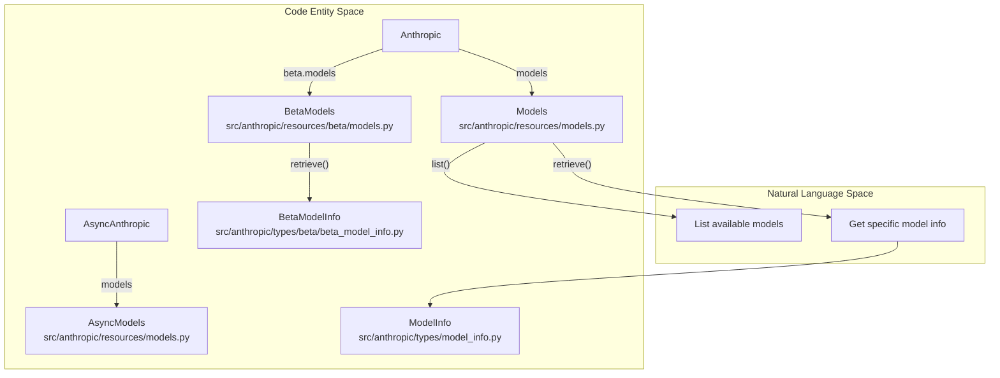
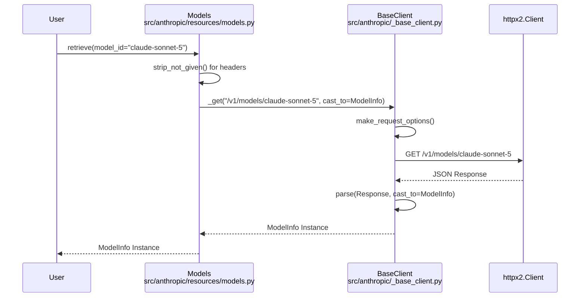

<!-- source: DeepWiki mcp.deepwiki.com · repo anthropics/anthropic-sdk-python · page 5.4 Models API · fetched 2026-10-26 -->

# Models API

<details>
<summary>Relevant source files</summary>

The following files were used as context for generating this wiki page:

- [src/anthropic/resources/beta/files.py](src/anthropic/resources/beta/files.py)
- [src/anthropic/resources/beta/models.py](src/anthropic/resources/beta/models.py)
- [src/anthropic/resources/models.py](src/anthropic/resources/models.py)
- [src/anthropic/types/beta/beta_managed_agents_model.py](src/anthropic/types/beta/beta_managed_agents_model.py)
- [src/anthropic/types/beta/beta_managed_agents_model_param.py](src/anthropic/types/beta/beta_managed_agents_model_param.py)
- [src/anthropic/types/beta/beta_model_info.py](src/anthropic/types/beta/beta_model_info.py)
- [src/anthropic/types/beta/model_list_params.py](src/anthropic/types/beta/model_list_params.py)
- [src/anthropic/types/model.py](src/anthropic/types/model.py)
- [src/anthropic/types/model_info.py](src/anthropic/types/model_info.py)
- [src/anthropic/types/model_list_params.py](src/anthropic/types/model_list_params.py)
- [src/anthropic/types/model_param.py](src/anthropic/types/model_param.py)
- [tests/api_resources/beta/test_models.py](tests/api_resources/beta/test_models.py)
- [tests/api_resources/test_models.py](tests/api_resources/test_models.py)
- [tests/conftest.py](tests/conftest.py)

</details>


The Models API provides read-only access to information about available Claude models. It allows you to programmatically discover which models are available and retrieve metadata about specific models, including their capabilities, context window sizes, and identifiers.

For creating messages with models, see [Messages API](#5.1). For batch processing, see [Message Batches](#5.5).

## Overview

The Models API is an informational resource that exposes two primary operations: listing all available models and retrieving details about a specific model via `client.models` [src/anthropic/resources/models.py:25-165]() or the beta namespace via `client.beta.models` [src/anthropic/resources/beta/models.py:26-166]().

### Code Entity Relationship

The following diagram illustrates how the natural language concept of querying models maps to the SDK's internal resource classes and data models.



Sources: [src/anthropic/resources/models.py:25-165](), [src/anthropic/resources/beta/models.py:26-166]()

## Stable Models Resource

The stable Models API provides access to production-ready model information through the `Models` and `AsyncModels` resource classes [src/anthropic/resources/models.py:25]().

### retrieve() Method

Retrieves metadata for a specific model by its identifier or alias.

**Method Signature:**
```python
client.models.retrieve(
    model_id: str,
    *,
    workspace_id: str | Omit = omit,
    extra_headers: Headers | None = None,
    extra_query: Query | None = None,
    extra_body: Body | None = None,
    timeout: float | httpx2.Timeout | None | NotGiven = not_given,
) -> ModelInfo
```

**Implementation Details:**
- **Validation:** Validates that `model_id` is a non-empty string, raising a `ValueError` otherwise [src/anthropic/resources/models.py:81-82]().
- **Headers:** Automatically handles the `anthropic-workspace-id` header when provided [src/anthropic/resources/models.py:83]().
- **Endpoint:** Performs a `GET` request to `/v1/models/{model_id}` [src/anthropic/resources/models.py:84-96]().

### list() Method

Lists all available models with pagination support. More recently released models are listed first [src/anthropic/resources/models.py:114-117]().

**Method Signature:**
```python
client.models.list(
    *,
    after_id: str | Omit = omit,
    before_id: str | Omit = omit,
    lifecycle: List[Literal["active", "deprecated", "retired"]] | Omit = omit,
    limit: int | Omit = omit,
    workspace_id: str | Omit = omit,
    ...
) -> SyncPage[ModelInfo]
```

**Implementation Details:**
- **Pagination:** Returns a `SyncPage[ModelInfo]` or `AsyncPage[ModelInfo]` wrapping pagination cursors (`after_id`, `before_id`) [src/anthropic/resources/models.py:112]().
- **Lifecycle Filtering:** Accepts a `lifecycle` list containing any combination of `"active"`, `"deprecated"`, or `"retired"` [src/anthropic/resources/models.py:103]().
- **Endpoint:** Performs a `GET` request to `/v1/models` [src/anthropic/resources/models.py:151-165]().

Sources: [src/anthropic/resources/models.py:45-165]()

## Beta Models Resource

The beta Models API (`src/anthropic/resources/beta/models.py`) enables querying model information while passing experimental beta flags and parameters [src/anthropic/resources/beta/models.py:46-166]().

### Differences from Stable API
- **Beta Headers & Endpoints:** Methods accept a `betas` parameter to populate the `anthropic-beta` request header and append `?beta=true` to the request path (e.g., `/v1/models/{model_id}?beta=true`) [src/anthropic/resources/beta/models.py:50-97]().
- **Return Types:** Returns `BetaModelInfo` instances containing extended capability fields [src/anthropic/resources/beta/models.py:58]().

Sources: [src/anthropic/resources/beta/models.py:46-166]()

## Model Identifiers and Capabilities

The SDK enforces typing for model identifiers and model metadata structures.

### Model and ModelParam Types

Model identifiers are defined as `TypeAlias` unions between `Literal` strings and a generic `str`, allowing IDE autocompletion for known models while supporting custom model names [src/anthropic/types/model.py:6-30](), [src/anthropic/types/model_param.py:8-32]().

| File | Type | Purpose |
| :--- | :--- | :--- |
| `src/anthropic/types/model.py` | `Model` | Used for response parsing and internal representation [src/anthropic/types/model.py:6-30]() |
| `src/anthropic/types/model_param.py` | `ModelParam` | Used for request parameters in methods like `messages.create` [src/anthropic/types/model_param.py:8-32]() |
| `src/anthropic/types/beta/beta_managed_agents_model_param.py` | `BetaManagedAgentsModelParam` | Used for managed agent configurations [src/anthropic/types/beta/beta_managed_agents_model_param.py:8-29]() |

### ModelInfo Structure
Model metadata returned by `retrieve()` and `list()` includes:
- `id`: Unique model identifier [src/anthropic/types/model_info.py:13]()
- `display_name`: Human-readable model name [src/anthropic/types/model_info.py:35]()
- `lifecycle`: Current lifecycle stage (`active`, `deprecated`, or `retired`) [src/anthropic/types/model_info.py:38]()
- `max_input_tokens`: Maximum input context window size [src/anthropic/types/model_info.py:57]()
- `max_tokens`: Maximum output tokens allowed per request [src/anthropic/types/model_info.py:60]()
- `capabilities`: Feature support mapping [src/anthropic/types/model_info.py:16]()

Sources: [src/anthropic/types/model.py:1-30](), [src/anthropic/types/model_param.py:1-32](), [src/anthropic/types/model_info.py:12-76](), [src/anthropic/types/beta/beta_model_info.py:12-83]()

## Data Flow and Request Lifecycle

The following sequence diagram traces a `models.retrieve()` call from user invocation through resource formatting, HTTP transport, and response parsing.



Sources: [src/anthropic/resources/models.py:81-96]()

## Usage Patterns

### Synchronous Retrieval
```python
from anthropic import Anthropic

client = Anthropic()
model_info = client.models.retrieve("claude-sonnet-5")
print(f"Model ID: {model_info.id}")
print(f"Max Input Tokens: {model_info.max_input_tokens}")
```

### Asynchronous Listing with Filtering
```python
from anthropic import AsyncAnthropic

client = AsyncAnthropic()

async def list_active_models():
    async for model in client.models.list(lifecycle=["active"], limit=10):
        print(model.id, model.display_name)
```

### Accessing Raw Responses
Both `retrieve()` and `list()` support `.with_raw_response` and `.with_streaming_response` prefixes for inspecting HTTP headers and transport metadata [src/anthropic/resources/models.py:27-43](), [tests/api_resources/test_models.py:35-55]().

```python
response = client.models.with_raw_response.retrieve("claude-sonnet-5")
print(response.headers.get("x-request-id"))
model_info = response.parse()
```

Sources: [src/anthropic/resources/models.py:27-43](), [tests/api_resources/test_models.py:20-55]()

---

