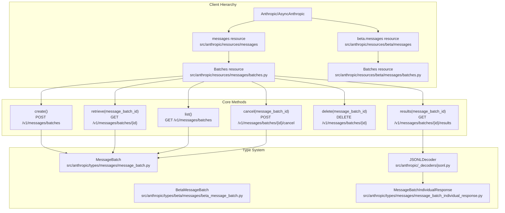
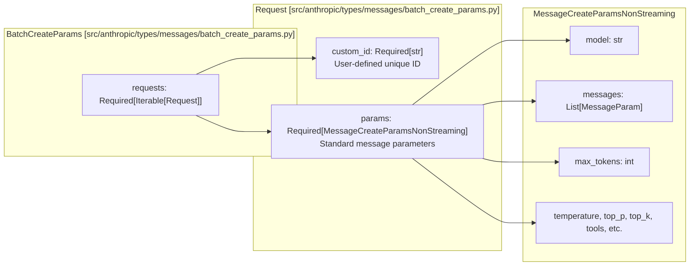
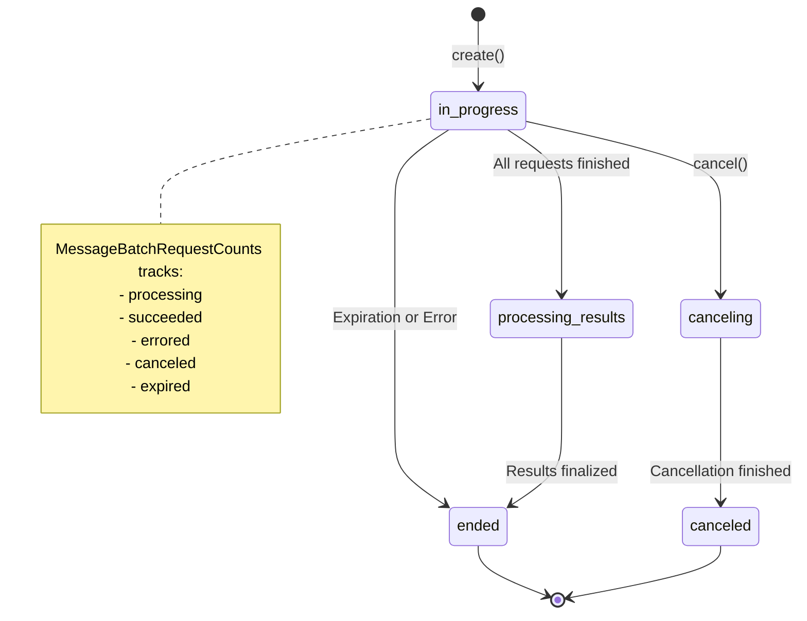
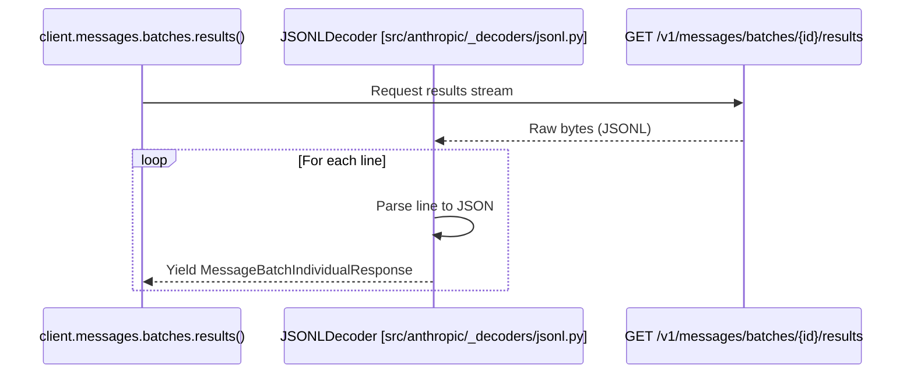

<!-- source: DeepWiki mcp.deepwiki.com · repo anthropics/anthropic-sdk-python · page 5.5 Message Batches · fetched 2026-10-26 -->

# Message Batches

<details>
<summary>Relevant source files</summary>

The following files were used as context for generating this wiki page:

- [src/anthropic/resources/beta/messages/batches.py](src/anthropic/resources/beta/messages/batches.py)
- [src/anthropic/resources/messages/batches.py](src/anthropic/resources/messages/batches.py)
- [src/anthropic/types/beta/beta_message_tokens_count.py](src/anthropic/types/beta/beta_message_tokens_count.py)
- [src/anthropic/types/beta/messages/batch_create_params.py](src/anthropic/types/beta/messages/batch_create_params.py)
- [src/anthropic/types/beta/messages/beta_message_batch_individual_response.py](src/anthropic/types/beta/messages/beta_message_batch_individual_response.py)
- [src/anthropic/types/beta/messages/beta_message_batch_request_counts.py](src/anthropic/types/beta/messages/beta_message_batch_request_counts.py)
- [src/anthropic/types/message_tokens_count.py](src/anthropic/types/message_tokens_count.py)
- [src/anthropic/types/messages/batch_create_params.py](src/anthropic/types/messages/batch_create_params.py)
- [src/anthropic/types/messages/message_batch_individual_response.py](src/anthropic/types/messages/message_batch_individual_response.py)
- [src/anthropic/types/messages/message_batch_request_counts.py](src/anthropic/types/messages/message_batch_request_counts.py)
- [tests/api_resources/beta/messages/test_batches.py](tests/api_resources/beta/messages/test_batches.py)
- [tests/api_resources/beta/test_messages.py](tests/api_resources/beta/test_messages.py)
- [tests/api_resources/messages/test_batches.py](tests/api_resources/messages/test_batches.py)
- [tests/api_resources/test_messages.py](tests/api_resources/test_messages.py)

</details>


Message Batches provide asynchronous batch processing for Claude API requests, allowing multiple message creation requests to be submitted together and processed in the background. This system enables cost-effective bulk processing with results retrieved when ready.

For individual synchronous message creation, see [Messages API](#5.1). For beta-specific batch features, see [Beta Messages API](#5.2).

## Overview

The batch processing system allows submitting multiple message creation requests in a single API call. Each request in the batch is processed asynchronously, and results can be retrieved when processing completes. The system supports both the stable API (`client.messages.batches`) [src/anthropic/resources/messages/batches.py:30-122]() and beta API (`client.beta.messages.batches`) [src/anthropic/resources/beta/messages/batches.py:32-131]() with identical interfaces, with the beta namespace injecting the required `anthropic-beta: message-batches-2024-09-24` header and `beta=true` query parameter [src/anthropic/resources/beta/messages/batches.py:102-116]().

**Key characteristics:**
- Asynchronous processing of multiple requests.
- Individual result tracking per request via `custom_id` [src/anthropic/types/messages/batch_create_params.py:37-45]().
- JSONL (JSON Lines) format for results streaming via `JSONLDecoder` and `AsyncJSONLDecoder` [src/anthropic/resources/messages/batches.py:22-22]().
- Status tracking (in_progress, ended, processing results) via `MessageBatchRequestCounts` [src/anthropic/types/messages/message_batch_request_counts.py:6-32]().
- Cancellation and deletion support.

Sources: `[src/anthropic/resources/messages/batches.py:50-68]()`, `[src/anthropic/resources/beta/messages/batches.py:52-71]()`, `[src/anthropic/types/messages/batch_create_params.py:11-35]()`, `[src/anthropic/_decoders/jsonl.py:13-34]()`

## Batch Resource Structure

The following diagram maps the SDK's resource classes to the underlying API operations and type models.

### Diagram: Batch Resource Hierarchy and Code Entities


Sources: `[src/anthropic/resources/messages/batches.py:30-122]()`, `[src/anthropic/resources/beta/messages/batches.py:32-131]()`, `[src/anthropic/types/messages/message_batch_individual_response.py:7-27]()`, `[src/anthropic/_decoders/jsonl.py:13-34]()`

## Creating Batches

Batches are created by submitting an array of request objects. Each request contains a `custom_id` used to match results to requests and `params` which follow the `MessageCreateParamsNonStreaming` schema [src/anthropic/types/messages/batch_create_params.py:47-53]().

### Diagram: Batch Creation Parameter Mapping


**Example batch creation:**

```python
batch = client.messages.batches.create(
    requests=[
        {
            "custom_id": "request-1",
            "params": {
                "model": "claude-3-5-sonnet-20241022",
                "max_tokens": 1024,
                "messages": [{"role": "user", "content": "Explain quantum entanglement"}]
            }
        }
    ]
)
```

Sources: `[src/anthropic/types/messages/batch_create_params.py:11-53]`, `[src/anthropic/resources/messages/batches.py:50-122]`, `[tests/api_resources/messages/test_batches.py:39-57]`

## Batch Lifecycle and Status

The API transitions batches through several states. The `MessageBatch` object contains a `processing_status` field to track this lifecycle, and `MessageBatchRequestCounts` tracks the breakdown of individual sub-requests [src/anthropic/types/messages/message_batch_request_counts.py:6-32]().

### Status Transitions



Sources: `[src/anthropic/resources/messages/batches.py:124-163]`, `[src/anthropic/types/messages/message_batch_request_counts.py:6-33]`

## Retrieving and Listing Batches

### Retrieve Single Batch
The `retrieve` method is idempotent and used to poll for batch completion [src/anthropic/resources/messages/batches.py:124-163]().

```python
batch = client.messages.batches.retrieve("msgbatch_123")
```

### List Batches
The `list` method returns a `SyncPage[MessageBatch]` supporting cursor-based pagination [src/anthropic/resources/messages/batches.py:17-18]().

```python
page = client.messages.batches.list(limit=5)
for batch in page:
    print(batch.id, batch.processing_status)
```

Sources: `[src/anthropic/resources/messages/batches.py:124-210]`, `[tests/api_resources/messages/test_batches.py:100-104]`

## Results Retrieval with JSONL Streaming

The `results()` method returns a `JSONLDecoder` (or `AsyncJSONLDecoder`) that streams individual request results in JSON Lines format [src/anthropic/_decoders/jsonl.py:13-34]().

### Results Streaming Flow



### Usage Example

```python
# Stream results
result_stream = client.messages.batches.results("msgbatch_123")
for result in result_stream:
    # result is a MessageBatchIndividualResponse
    print(f"ID: {result.custom_id}, Result: {result.result.type}")
```

Sources: `[src/anthropic/_decoders/jsonl.py:13-68]`, `[src/anthropic/types/messages/message_batch_individual_response.py:7-27]`

## Cancellation and Deletion

### Cancel Batch
Cancels a batch that is currently `in_progress`. Cancellation is asynchronous; the batch will eventually transition to `canceled` [src/anthropic/resources/messages/batches.py:212-250]().

```python
batch = client.messages.batches.cancel("msgbatch_123")
```

### Delete Batch
Permanently deletes a batch and its results. This can only be done for batches that have ended [src/anthropic/resources/messages/batches.py:252-290]().

```python
deleted_info = client.messages.batches.delete("msgbatch_123")
# deleted_info is a DeletedMessageBatch
```

Sources: `[src/anthropic/resources/messages/batches.py:212-290]`, `[tests/api_resources/messages/test_batches.py:172-220]`

## Beta vs Stable Batches

The SDK provides batch functionality in both the stable `messages.batches` [src/anthropic/resources/messages/batches.py:30-122]() and beta `beta.messages.batches` namespaces [src/anthropic/resources/beta/messages/batches.py:32-131]().

| Feature | Stable (`messages.batches`) | Beta (`beta.messages.batches`) |
| :--- | :--- | :--- |
| **Endpoint** | `/v1/messages/batches` | `/v1/messages/batches?beta=true` |
| **Beta Header** | None | `anthropic-beta: message-batches-2024-09-24` |
| **Parameters** | Standard `MessageCreateParams` | `BetaMessageCreateParams` (includes `mcp_servers`, `speed`, etc.) |

The beta implementation explicitly injects the `anthropic-beta` header and `beta=true` query parameter [src/anthropic/resources/beta/messages/batches.py:102-116]().

Sources: `[src/anthropic/resources/messages/batches.py:106-121]`, `[src/anthropic/resources/beta/messages/batches.py:102-131]`, `[src/anthropic/types/beta/messages/batch_create_params.py:12-38]`

## Async Support

All batch methods have asynchronous equivalents via `AsyncAnthropic.messages.batches` or `AsyncAnthropic.beta.messages.batches`. These return `AsyncPage` for listing and `AsyncJSONLDecoder` for results streaming [src/anthropic/_decoders/jsonl.py:70-124]().

```python
# Async results streaming
result_stream = await async_client.messages.batches.results("msgbatch_123")
async for result in result_stream:
    print(result.custom_id)
```

Sources: `[src/anthropic/resources/messages/batches.py:30-30]`, `[src/anthropic/resources/beta/messages/batches.py:32-32]`, `[src/anthropic/_decoders/jsonl.py:70-124]`

---

