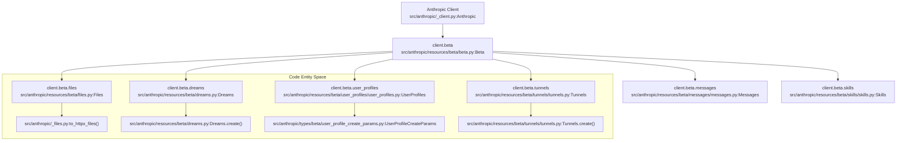
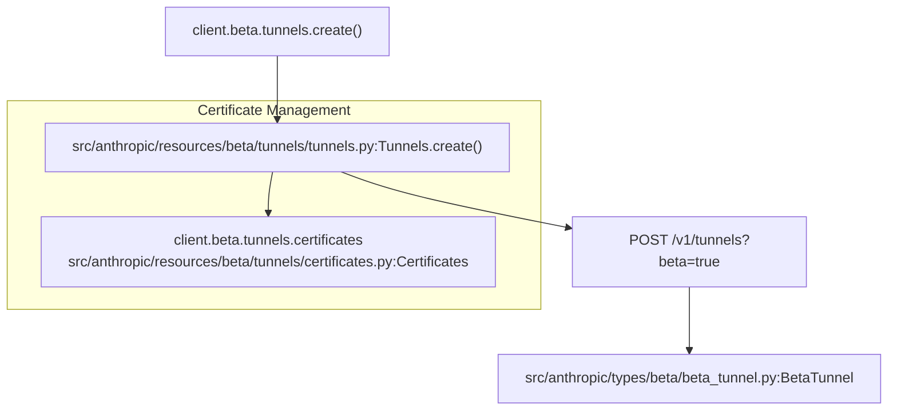
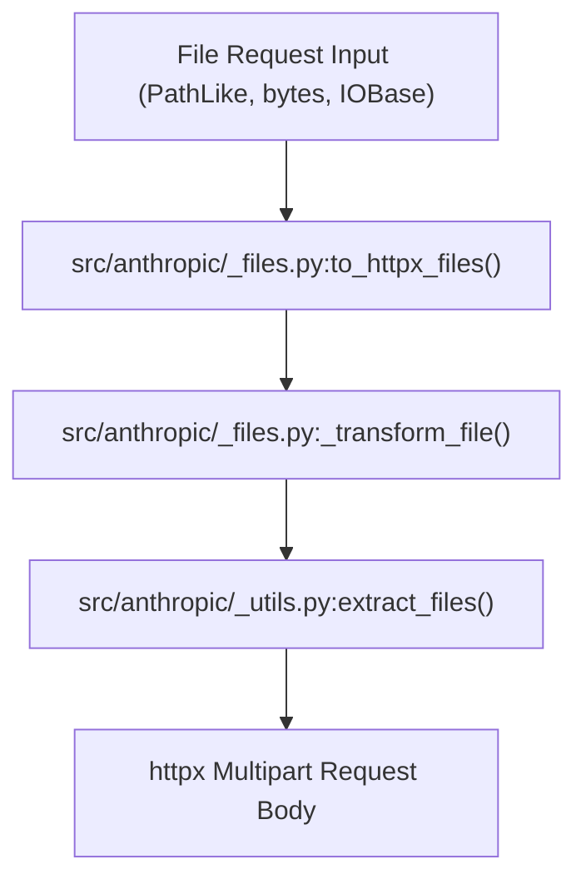
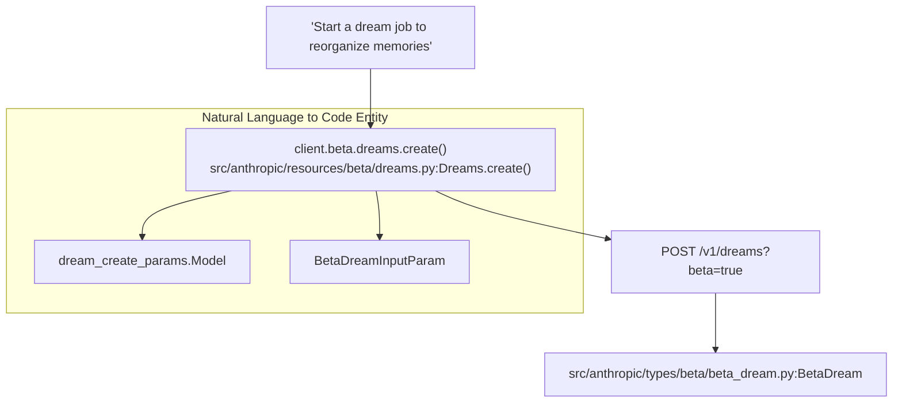
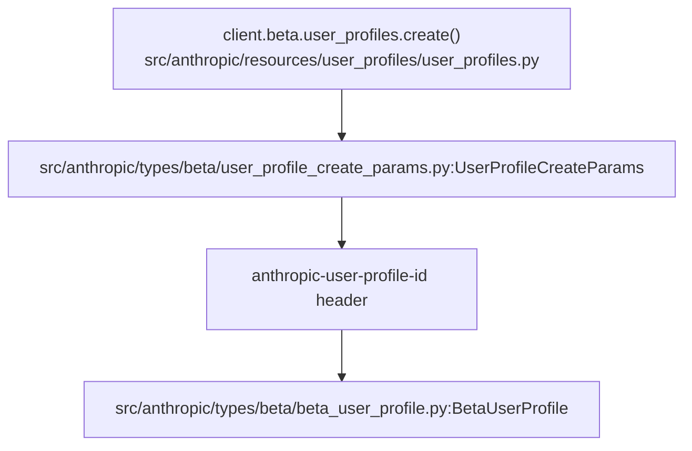

<!-- source: DeepWiki mcp.deepwiki.com · repo anthropics/anthropic-sdk-python · page 5.6 Beta Features and Capabilities · fetched 2026-10-26 -->

# Beta Features and Capabilities

Relevant source files

The following files were used as context for generating this wiki page:

- [src/anthropic/_files.py](src/anthropic/_files.py)
- [src/anthropic/resources/beta/dreams.py](src/anthropic/resources/beta/dreams.py)
- [src/anthropic/resources/beta/organization/__init__.py](src/anthropic/resources/beta/organization/__init__.py)
- [src/anthropic/resources/beta/organization/organization.py](src/anthropic/resources/beta/organization/organization.py)
- [src/anthropic/resources/beta/organization/webhooks.py](src/anthropic/resources/beta/organization/webhooks.py)
- [src/anthropic/resources/beta/skills/skills.py](src/anthropic/resources/beta/skills/skills.py)
- [src/anthropic/resources/beta/skills/versions.py](src/anthropic/resources/beta/skills/versions.py)
- [src/anthropic/resources/beta/tunnels/certificates.py](src/anthropic/resources/beta/tunnels/certificates.py)
- [src/anthropic/resources/beta/tunnels/tunnels.py](src/anthropic/resources/beta/tunnels/tunnels.py)
- [src/anthropic/resources/user_profiles/user_profiles.py](src/anthropic/resources/user_profiles/user_profiles.py)
- [src/anthropic/types/beta/beta_dream.py](src/anthropic/types/beta/beta_dream.py)
- [src/anthropic/types/beta/beta_dream_memory_store_input.py](src/anthropic/types/beta/beta_dream_memory_store_input.py)
- [src/anthropic/types/beta/beta_dream_memory_store_input_param.py](src/anthropic/types/beta/beta_dream_memory_store_input_param.py)
- [src/anthropic/types/beta/beta_dream_output.py](src/anthropic/types/beta/beta_dream_output.py)
- [src/anthropic/types/beta/beta_dream_sessions_input.py](src/anthropic/types/beta/beta_dream_sessions_input.py)
- [src/anthropic/types/beta/beta_dream_sessions_input_param.py](src/anthropic/types/beta/beta_dream_sessions_input_param.py)
- [src/anthropic/types/beta/beta_output_behavior_create_new.py](src/anthropic/types/beta/beta_output_behavior_create_new.py)
- [src/anthropic/types/beta/beta_output_behavior_create_new_param.py](src/anthropic/types/beta/beta_output_behavior_create_new_param.py)
- [src/anthropic/types/beta/beta_output_behavior_update_existing.py](src/anthropic/types/beta/beta_output_behavior_update_existing.py)
- [src/anthropic/types/beta/beta_output_behavior_update_existing_param.py](src/anthropic/types/beta/beta_output_behavior_update_existing_param.py)
- [src/anthropic/types/beta/beta_tunnel.py](src/anthropic/types/beta/beta_tunnel.py)
- [src/anthropic/types/beta/beta_user_profile.py](src/anthropic/types/beta/beta_user_profile.py)
- [src/anthropic/types/beta/beta_user_profile_enrollment_url.py](src/anthropic/types/beta/beta_user_profile_enrollment_url.py)
- [src/anthropic/types/beta/beta_webhook_event_data.py](src/anthropic/types/beta/beta_webhook_event_data.py)
- [src/anthropic/types/beta/beta_webhook_user_profile_enforcement_action_opened_event_data.py](src/anthropic/types/beta/beta_webhook_user_profile_enforcement_action_opened_event_data.py)
- [src/anthropic/types/beta/dream_create_params.py](src/anthropic/types/beta/dream_create_params.py)
- [src/anthropic/types/beta/dream_list_params.py](src/anthropic/types/beta/dream_list_params.py)
- [src/anthropic/types/beta/environment_update_params.py](src/anthropic/types/beta/environment_update_params.py)
- [src/anthropic/types/beta/file_upload_params.py](src/anthropic/types/beta/file_upload_params.py)
- [src/anthropic/types/beta/memory_stores/__init__.py](src/anthropic/types/beta/memory_stores/__init__.py)
- [src/anthropic/types/beta/memory_stores/beta_managed_agents_actor.py](src/anthropic/types/beta/memory_stores/beta_managed_agents_actor.py)
- [src/anthropic/types/beta/memory_stores/memory_delete_params.py](src/anthropic/types/beta/memory_stores/memory_delete_params.py)
- [src/anthropic/types/beta/user_profile_create_params.py](src/anthropic/types/beta/user_profile_create_params.py)
- [src/anthropic/types/beta/user_profile_list_params.py](src/anthropic/types/beta/user_profile_list_params.py)
- [src/anthropic/types/beta/user_profile_update_params.py](src/anthropic/types/beta/user_profile_update_params.py)
- [src/anthropic/types/user_profile.py](src/anthropic/types/user_profile.py)
- [src/anthropic/types/user_profile_enforcement_action.py](src/anthropic/types/user_profile_enforcement_action.py)
- [src/anthropic/types/user_profile_enforcement_action_ban.py](src/anthropic/types/user_profile_enforcement_action_ban.py)
- [src/anthropic/types/user_profile_enforcement_action_next_step.py](src/anthropic/types/user_profile_enforcement_action_next_step.py)
- [src/anthropic/types/user_profile_enforcement_action_reason.py](src/anthropic/types/user_profile_enforcement_action_reason.py)
- [src/anthropic/types/user_profile_enforcement_action_restriction.py](src/anthropic/types/user_profile_enforcement_action_restriction.py)
- [src/anthropic/types/user_profile_list_params.py](src/anthropic/types/user_profile_list_params.py)
- [tests/api_resources/beta/skills/test_versions.py](tests/api_resources/beta/skills/test_versions.py)
- [tests/api_resources/beta/test_dreams.py](tests/api_resources/beta/test_dreams.py)
- [tests/api_resources/beta/test_files.py](tests/api_resources/beta/test_files.py)
- [tests/api_resources/beta/test_skills.py](tests/api_resources/beta/test_skills.py)
- [tests/api_resources/beta/test_user_profiles.py](tests/api_resources/beta/test_user_profiles.py)
- [tests/api_resources/test_user_profiles.py](tests/api_resources/test_user_profiles.py)
- [tests/test_extract_files.py](tests/test_extract_files.py)
- [tests/test_files.py](tests/test_files.py)

This page provides an in-commerce overview and technical deep-dive into beta-exclusive features and capabilities available in the Anthropic Python SDK. These include Model Context Protocol (MCP) integration and MCP tunnels (`Tunnels`), context compaction, the skills and files APIs (`Files`), computer use tools, fine-grained tool streaming, webhooks, asynchronous dreams (`Dreams`), and user profiles (`BetaUserProfile`).

For stable messaging capabilities, see [Messages API](#5.1). For beta-specific messaging configurations, see [Beta Messages API](#5.2).

## Overview and Access

Beta features are accessed via the `client.beta` namespace and require specific header flags sent via `anthropic-beta`. The SDK's underlying resources manage these headers automatically or allow explicit overrides.

### Beta Namespace Structure

**Sources:** [src/anthropic/resources/beta/dreams.py:31-151](), [src/anthropic/resources/beta/tunnels/tunnels.py:35-130](), [src/anthropic/types/beta/user_profile_create_params.py:13-81]()

### Beta Headers Reference

| Beta Header Value | Feature Enabled | Code Entity / Module |
|-------------------|-----------------|----------------------|
| `prompt-caching-2024-07-31` | Prompt caching | `src/anthropic/types/beta/message_create_params.py` |
| `computer-use-2025-01-24` | Computer use tools | `src/anthropic/types/beta/beta_tool_computer_use_20250124_param.py` |
| `context-management-2025-06-27` | Context compaction | `src/anthropic/types/beta/beta_compaction_block.py` |
| `files-api-2025-04-14` | Files API support | `src/anthropic/resources/beta/files.py` |
| `skills-2025-10-02` | Skills API support | `src/anthropic/resources/beta/skills/skills.py` |
| `mcp-client-2025-11-20` | MCP client support | `src/anthropic/types/beta/beta_mcp_toolset_param.py` |
| `mcp-tunnels-2026-06-22` | MCP Tunnels preview | `src/anthropic/resources/beta/tunnels/tunnels.py` |
| `dreaming-2026-04-21` | Dreams API preview | `src/anthropic/resources/beta/dreams.py` |
| `user-profiles-2026-03-24` | User Profiles v1 | `src/anthropic/types/beta/beta_user_profile.py` |

**Sources:** [src/anthropic/types/anthropic_beta_param.py:10-42](), [src/anthropic/resources/beta/tunnels/tunnels.py:72-115]()

---

## MCP Integration and MCP Tunnels

Model Context Protocol (MCP) enables secure client-server connectivity for external tools and resources. The research-preview Tunnels API (`client.beta.tunnels`) supersedes legacy organization endpoints and allocates hostnames for secure MCP traffic bridging.

**Sources:** [src/anthropic/resources/beta/tunnels/tunnels.py:59-130](), [src/anthropic/types/beta/beta_tunnel.py]()

---

## Context Management and Compaction

Context management configurations allow the model to manage large dialogue histories automatically via server-side compaction blocks (`BetaCompactionBlock`).

- Configured using `context_management` parameters in `src/anthropic/types/beta/message_create_params.py`.
- Yields summarized content blocks parsed into SDK model types upon reaching token boundaries.

**Sources:** [src/anthropic/types/beta/beta_compaction_block.py:13-22](), [src/anthropic/types/beta/message_create_params.py:134-139]()

---

## Files API and Utility Pipeline

The Files API (`client.beta.files`) provides asynchronous or synchronous file uploading, content downloading, and deletion. File inputs are processed through helper functions in `src/anthropic/_files.py`.

### Key File Functions
- `to_httpx_files(files)`: Converts client-side file parameters into `httpx`-compatible tuples and byte arrays [src/anthropic/_files.py:49-60]().
- `async_to_httpx_files(files)`: Asynchronous equivalent utilizing `anyio` file reading [src/anthropic/_files.py:106-117]().
- `deepcopy_with_paths(item, paths)`: Guards file payloads against in-place mutation during extraction [src/anthropic/_files.py:144-161]().

**Sources:** [src/anthropic/_files.py:1-189](), [tests/test_files.py:1-174](), [tests/api_resources/beta/test_files.py:24-177]()

---

## Dreams API

The Dreams API (`client.beta.dreams`) runs asynchronous jobs that read past sessions and memory stores, producing reorganized memory structures [src/anthropic/types/beta/beta_dream.py:17-26]().

**Sources:** [src/anthropic/resources/beta/dreams.py:51-151](), [src/anthropic/types/beta/beta_dream.py:17-113]()

---

## User Profiles API

User profiles (`client.beta.user_profiles`) attribute API requests and manage end-user or reseller tenant metadata via the `anthropic-user-profile-id` header [src/anthropic/types/beta/beta_user_profile.py:12-17]().

### Key Parameters in `UserProfileCreateParams`
- `access_type`: Differentiates between `"application"` (end-user) and `"passthrough"` (resold corporate entity) [src/anthropic/types/beta/user_profile_create_params.py:13-26]().
- `external_id` / `external_user_details`: Platform-specific tenant reference tracking [src/anthropic/types/beta/user_profile_create_params.py:28-43]().
- `metadata`: Key-value dictionaries up to 16 pairs [src/anthropic/types/beta/user_profile_create_params.py:55-60]().

**Sources:** [src/anthropic/types/beta/user_profile_create_params.py:13-81](), [src/anthropic/types/beta/beta_user_profile.py:12-93](), [tests/api_resources/beta/test_user_profiles.py:21-166]()

---

## Advanced Tools and Webhooks

Beta capabilities also include specialized tools and unparsed webhook processing for agents:
- **Computer Use Tools**: `BetaToolComputerUse20250124Param` [src/anthropic/types/beta/beta_tool_computer_use_20250124_param.py]()
- **Code Execution & Bash Tools**: `BetaCodeExecutionTool20250825Param`
- **Webhooks**: Unwraps event types like `session.created` and `deployment.run_failed` using `BetaWebhookEventData` [src/anthropic/types/beta/beta_webhook_event_data.py:46-86]().

**Sources:** [src/anthropic/types/beta/beta_webhook_event_data.py:1-86]()

---

