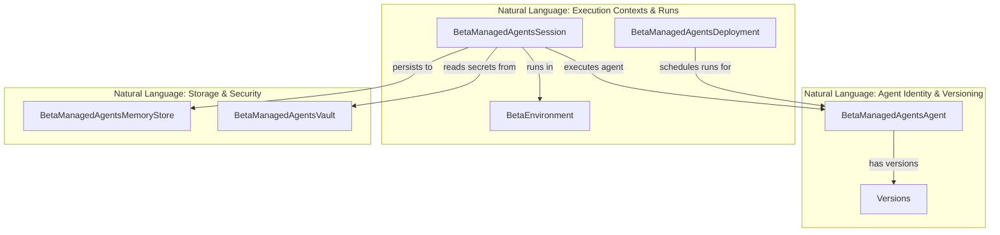
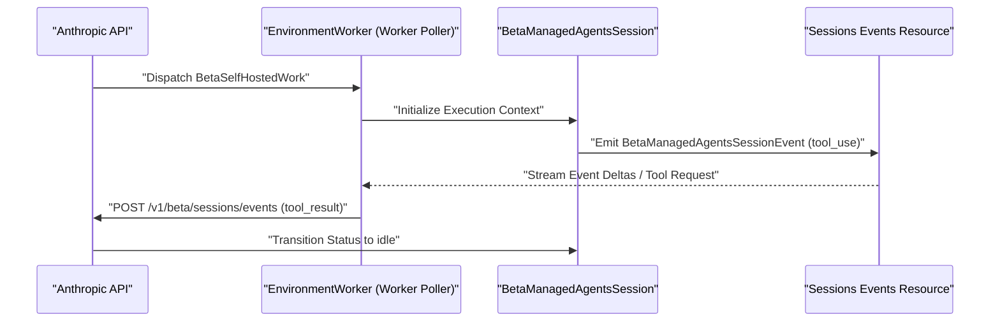

<!-- source: DeepWiki mcp.deepwiki.com · repo anthropics/anthropic-sdk-python · page 5.7 Managed Agents · fetched 2026-10-26 -->

# Managed Agents

Relevant source files

The following files were used as context for generating this wiki page:

- [src/anthropic/resources/beta/agents/agents.py](src/anthropic/resources/beta/agents/agents.py)
- [src/anthropic/resources/beta/deployment_runs.py](src/anthropic/resources/beta/deployment_runs.py)
- [src/anthropic/resources/beta/deployments.py](src/anthropic/resources/beta/deployments.py)
- [src/anthropic/resources/beta/sessions/resources.py](src/anthropic/resources/beta/sessions/resources.py)
- [src/anthropic/resources/beta/sessions/sessions.py](src/anthropic/resources/beta/sessions/sessions.py)
- [src/anthropic/resources/beta/sessions/threads/threads.py](src/anthropic/resources/beta/sessions/threads/threads.py)
- [src/anthropic/types/beta/agent_create_params.py](src/anthropic/types/beta/agent_create_params.py)
- [src/anthropic/types/beta/agent_list_params.py](src/anthropic/types/beta/agent_list_params.py)
- [src/anthropic/types/beta/agent_update_params.py](src/anthropic/types/beta/agent_update_params.py)
- [src/anthropic/types/beta/beta_managed_agents_agent_with_overrides_params.py](src/anthropic/types/beta/beta_managed_agents_agent_with_overrides_params.py)
- [src/anthropic/types/beta/deployment_list_params.py](src/anthropic/types/beta/deployment_list_params.py)
- [src/anthropic/types/beta/deployment_run_list_params.py](src/anthropic/types/beta/deployment_run_list_params.py)
- [src/anthropic/types/beta/session_list_params.py](src/anthropic/types/beta/session_list_params.py)
- [src/anthropic/types/beta/sessions/resource_list_params.py](src/anthropic/types/beta/sessions/resource_list_params.py)
- [src/anthropic/types/beta/sessions/thread_list_params.py](src/anthropic/types/beta/sessions/thread_list_params.py)
- [tests/api_resources/beta/agents/test_versions.py](tests/api_resources/beta/agents/test_versions.py)
- [tests/api_resources/beta/environments/test_work.py](tests/api_resources/beta/environments/test_work.py)
- [tests/api_resources/beta/memory_stores/test_memories.py](tests/api_resources/beta/memory_stores/test_memories.py)
- [tests/api_resources/beta/memory_stores/test_memory_versions.py](tests/api_resources/beta/memory_stores/test_memory_versions.py)
- [tests/api_resources/beta/sessions/test_events.py](tests/api_resources/beta/sessions/test_events.py)
- [tests/api_resources/beta/sessions/test_threads.py](tests/api_resources/beta/sessions/test_threads.py)
- [tests/api_resources/beta/sessions/threads/test_events.py](tests/api_resources/beta/sessions/threads/test_events.py)
- [tests/api_resources/beta/test_agents.py](tests/api_resources/beta/test_agents.py)
- [tests/api_resources/beta/test_deployment_runs.py](tests/api_resources/beta/test_deployment_runs.py)
- [tests/api_resources/beta/test_deployments.py](tests/api_resources/beta/test_deployments.py)
- [tests/api_resources/beta/test_memory_stores.py](tests/api_resources/beta/test_memory_stores.py)
- [tests/api_resources/beta/test_sessions.py](tests/api_resources/beta/test_sessions.py)

## Purpose and Scope

This wiki page provides a high-level architectural overview of the Managed Agents system within the Anthropic Python SDK. The managed agents infrastructure enables the orchestration of long-running, stateful, and event-driven agentic tasks involving Claude, persistent memory, secure vaults, isolated environments, and scheduled deployments. 

Managed Agents features are accessed via the `client.beta` namespace and require the `managed-agents-2026-04-01` beta header [src/anthropic/types/anthropic_beta_param.py:36-36](). Because this is a parent overview page, detailed implementation specifics are covered in the linked child pages.

Sources: [src/anthropic/types/anthropic_beta_param.py:36-36](), [src/anthropic/resources/beta/agents/agents.py:69-90]()

---

## System Architecture Overview

The Managed Agents system coordinates identities, execution contexts, storage, and runtime workers across multiple cooperating SDK resource classes. 

Title: Managed Agents Entity Relationships (Natural Language Space to Code Entity Space)

Sources: [src/anthropic/resources/beta/agents/agents.py:44-48](), [src/anthropic/types/beta/beta_managed_agents_agent.py:12-15](), [tests/api_resources/beta/test_deployments.py:12-15](), [tests/api_resources/beta/test_sessions.py:12-15]()

---

## Sub-Topics and Child Pages

The managed agents system spans several functional domains, each detailed in its respective child page:

### 1. Agents, Deployments, and Environments
Agents act as versioned templates defining system prompts, toolsets, and multiagent coordinators [src/anthropic/types/beta/agent_create_params.py:20-87](). Deployments and deployment runs trigger agent executions automatically on schedules or via external triggers [tests/api_resources/beta/test_deployments.py:24-85](). Environments define the execution runtime, supporting a self-hosted environment worker and polling pattern for executing local tools and heartbeating leases.

For details, see [Agents, Deployments, and Environments](#5.7.1).

Sources: [src/anthropic/types/beta/agent_create_params.py:20-87](), [tests/api_resources/beta/test_deployments.py:24-85]()

### 2. Sessions, Threads, and Events
Sessions manage active execution instances and maintain multi-threaded conversations [tests/api_resources/beta/test_sessions.py:24-67](). Threads group individual message exchanges, while the event-driven architecture streams state transitions—such as tool usage, status changes, refusals, and repository errors—back to clients [tests/api_resources/beta/beta/sessions/threads/test_events.py:20-96]().

For details, see [Sessions, Threads, and Events](#5.7.2).

Sources: [tests/api_resources/beta/test_sessions.py:24-67](), [tests/api_resources/beta/beta/sessions/threads/test_events.py:20-96]()

### 3. Memory Stores and Vaults
Memory stores provide persistent, structured retention across sessions, supporting versioned memories, path prefixes, and actor attribution [tests/api_resources/beta/memory_stores/test_memories.py:24-43](). Vaults manage secure credentials, environment variables, and Model Context Protocol (MCP) OAuth flows [src/anthropic/types/beta/vaults/__init__.py:1-20]().

For details, see [Memory Stores and Vaults](#5.7.3).

Sources: [tests/api_resources/beta/memory_stores/test_memories.py:24-43](), [src/anthropic/types/beta/vaults/__init__.py:1-20]()

---

## Event-Driven Execution Flow

Long-running agentic tasks rely on asynchronous event streams and worker polling to execute tool calls and synchronize state with the Anthropic API.

Title: Event-Driven Worker Dispatch Flow (Natural Language Space to Code Entity Space)

Sources: [tests/api_resources/beta/environments/test_work.py:1-40](), [tests/api_resources/beta/sessions/test_events.py:80-94]()

---

