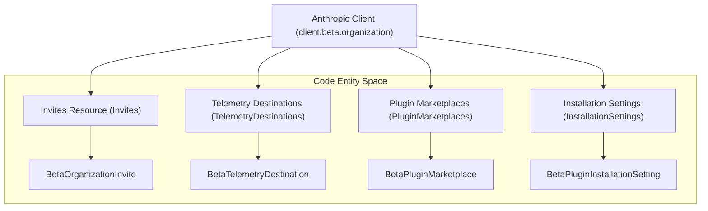

<!-- source: DeepWiki mcp.deepwiki.com · repo anthropics/anthropic-sdk-python · page 5.8 Organization and Admin APIs · fetched 2026-10-26 -->

# Organization and Admin APIs

Relevant source files

The following files were used as context for generating this wiki page:

- [src/anthropic/resources/beta/organization/compliance_settings.py](src/anthropic/resources/beta/organization/compliance_settings.py)
- [src/anthropic/resources/beta/organization/invites.py](src/anthropic/resources/beta/organization/invites.py)
- [src/anthropic/resources/beta/organization/plugin_marketplaces.py](src/anthropic/resources/beta/organization/plugin_marketplaces.py)
- [src/anthropic/resources/beta/organization/plugins/installation_settings.py](src/anthropic/resources/beta/organization/plugins/installation_settings.py)
- [src/anthropic/resources/beta/organization/plugins/plugins.py](src/anthropic/resources/beta/organization/plugins/plugins.py)
- [src/anthropic/resources/beta/organization/plugins/versions.py](src/anthropic/resources/beta/organization/plugins/versions.py)
- [src/anthropic/resources/beta/organization/telemetry_destinations/telemetry_destinations.py](src/anthropic/resources/beta/organization/telemetry_destinations/telemetry_destinations.py)
- [src/anthropic/resources/beta/organization/users.py](src/anthropic/resources/beta/organization/users.py)
- [src/anthropic/resources/beta/organization/workspaces/workspaces.py](src/anthropic/resources/beta/organization/workspaces/workspaces.py)
- [src/anthropic/resources/organization/invites.py](src/anthropic/resources/organization/invites.py)
- [src/anthropic/resources/organization/users.py](src/anthropic/resources/organization/users.py)
- [src/anthropic/resources/organization/workspaces/workspaces.py](src/anthropic/resources/organization/workspaces/workspaces.py)
- [src/anthropic/types/beta/organization/__init__.py](src/anthropic/types/beta/organization/__init__.py)
- [src/anthropic/types/beta/organization/beta_compliance_settings.py](src/anthropic/types/beta/organization/beta_compliance_settings.py)
- [src/anthropic/types/beta/organization/beta_compliance_settings_state.py](src/anthropic/types/beta/organization/beta_compliance_settings_state.py)
- [src/anthropic/types/beta/organization/beta_compliance_settings_state_param.py](src/anthropic/types/beta/organization/beta_compliance_settings_state_param.py)
- [src/anthropic/types/beta/organization/beta_plugin.py](src/anthropic/types/beta/organization/beta_plugin.py)
- [src/anthropic/types/beta/organization/beta_plugin_marketplace.py](src/anthropic/types/beta/organization/beta_plugin_marketplace.py)
- [src/anthropic/types/beta/organization/beta_rbac_role.py](src/anthropic/types/beta/organization/beta_rbac_role.py)
- [src/anthropic/types/beta/organization/beta_telemetry_destination_test_failure.py](src/anthropic/types/beta/organization/beta_telemetry_destination_test_failure.py)
- [src/anthropic/types/beta/organization/beta_telemetry_destination_test_response.py](src/anthropic/types/beta/organization/beta_telemetry_destination_test_response.py)
- [src/anthropic/types/beta/organization/beta_telemetry_destination_test_result.py](src/anthropic/types/beta/organization/beta_telemetry_destination_test_result.py)
- [src/anthropic/types/beta/organization/beta_telemetry_destination_test_success.py](src/anthropic/types/beta/organization/beta_telemetry_destination_test_success.py)
- [src/anthropic/types/beta/organization/compliance_setting_update_params.py](src/anthropic/types/beta/organization/compliance_setting_update_params.py)
- [src/anthropic/types/beta/organization/invite_create_params.py](src/anthropic/types/beta/organization/invite_create_params.py)
- [src/anthropic/types/beta/organization/plugin_marketplace_validate_repository_params.py](src/anthropic/types/beta/organization/plugin_marketplace_validate_repository_params.py)
- [src/anthropic/types/beta/organization/plugins/beta_plugin_installation_setting.py](src/anthropic/types/beta/organization/plugins/beta_plugin_installation_setting.py)
- [src/anthropic/types/beta/organization/plugins/beta_plugin_version.py](src/anthropic/types/beta/organization/plugins/beta_plugin_version.py)
- [src/anthropic/types/beta/organization/user_update_params.py](src/anthropic/types/beta/organization/user_update_params.py)
- [src/anthropic/types/beta/organization/workspace_list_params.py](src/anthropic/types/beta/organization/workspace_list_params.py)
- [src/anthropic/types/organization/invite_create_params.py](src/anthropic/types/organization/invite_create_params.py)
- [src/anthropic/types/organization/user_update_params.py](src/anthropic/types/organization/user_update_params.py)
- [src/anthropic/types/organization/workspace_list_params.py](src/anthropic/types/organization/workspace_list_params.py)
- [tests/api_resources/beta/organization/test_compliance_settings.py](tests/api_resources/beta/organization/test_compliance_settings.py)
- [tests/api_resources/beta/organization/test_telemetry_destinations.py](tests/api_resources/beta/organization/test_telemetry_destinations.py)
- [tests/api_resources/beta/organization/test_workspaces.py](tests/api_resources/beta/organization/test_workspaces.py)
- [tests/api_resources/organization/test_workspaces.py](tests/api_resources/organization/test_workspaces.py)

## Purpose and Scope
The Organization and Admin APIs provide a programmatic interface for managing organizational infrastructure within the Anthropic SDK. Scoped primarily under `client.beta.organization`, these administrative utilities enable enterprise and console administrators to provision resources, control security and compliance parameters, manage workspace boundaries, configure telemetry export pipelines, and orchestrate user membership. 

As a parent page, this document outlines the high-level architecture of organization-scoped administration. For deep dives into quantitative constraints and reporting, see [Rate Limits and Spend Limits](#5.8.1) and [Analytics and Usage Reporting](#5.8.2).

Sources: `src/anthropic/types/beta/organization/__init__.py:1-89` [src/anthropic/types/beta/organization/__init__.py]()

---

## Administrative Resource Architecture

The organization-scoped admin API layer bridges high-level administrative concepts (such as user invites, security roles, compliance settings, and telemetry collectors) to concrete Python resource classes and data models within the SDK.

*Figure 1: Organization Admin Resource Architecture.*

Sources: `src/anthropic/resources/beta/organization/invites.py:26-107` [src/anthropic/resources/beta/organization/invites.py](), `src/anthropic/resources/beta/organization/telemetry_destinations/telemetry_destinations.py:46-85` [src/anthropic/resources/beta/organization/telemetry_destinations/telemetry_destinations.py](), `src/anthropic/resources/beta/organization/plugin_marketplaces.py:29-61` [src/anthropic/resources/beta/organization/plugin_marketplaces.py]()

---

## Core Administrative Resource Groups

Organization administration spans several functional domains, each represented by dedicated SDK resource modules and typed Pydantic models.

### Users, Invites, and Service Accounts
Administrators can manage organization membership, issue or revoke invitations, and provision service accounts.
* **Invites**: Handled via `client.beta.organization.invites` [src/anthropic/resources/beta/organization/invites.py:26-107](), supporting creation (`Invites.create()`), retrieval, listing, and deletion. Invites automatically draw from seat pools based on configured user roles (`user`, `managed`, `developer`, `billing`, etc.) [src/anthropic/resources/beta/organization/invites.py:50-77]().
* **Users & Service Accounts**: Managed via dedicated models such as `BetaOrganizationUser` [src/anthropic/types/beta/organization/__init__.py:34]() and `BetaServiceAccount` [src/anthropic/types/beta/organization/__init__.py:21]().

### Workspaces and API Keys
* **Workspaces**: Grouping boundaries for API keys and resources, managed via `BetaWorkspace` models [src/anthropic/types/beta/organization/__init__.py:6]() and workspace list/create/update parameter builders [src/anthropic/types/beta/organization/__init__.py:33, 47, 48]().
* **API Keys**: Scoped credential management supported by `BetaAPIKey` [src/anthropic/types/beta/organization/__init__.py:4](), workspace scopes `BetaAPIKeyWorkspaceScope` [src/anthropic/types/beta/organization/__init__.py:71](), and update/list parameters [src/anthropic/types/beta/organization/__init__.py:15, 26].

### Federation, RBAC Roles, and Compliance
* **RBAC Roles & Groups**: Role-based access control definitions are represented through `BetaRBACRole` [src/anthropic/types/beta/organization/beta_rbac_role.py:9-31]() and `BetaRBACGroup` [src/anthropic/types/beta/organization/__init__.py:7]().
* **Federation & Compliance**: Includes external key configurations for AWS, GCP, and Azure (`BetaAWSExternalKeyConfig`, `BetaGCPExternalKeyConfig`, `BetaAzureExternalKeyConfig`) [src/anthropic/types/beta/organization/__init__.py:72, 73, 89](), alongside compliance settings models (`BetaComplianceSettings`) [src/anthropic/types/beta/organization/__init__.py:50]().

### Plugins and Marketplaces
Organization-owned plugins and marketplaces allow enterprise governance over tools and extensions available to Claude users.
* **Plugin Marketplaces**: Managed via `PluginMarketplaces` [src/anthropic/resources/beta/organization/plugin_marketplaces.py:29-61]() to retrieve and validate marketplace sources, repository refs, and installation preferences.
* **Plugins and Installation Settings**: The `InstallationSettings` resource [src/anthropic/resources/beta/organization/plugins/installation_settings.py:30-65]() enables listing, updating, and removing plugin installation bindings across organizations and RBAC groups (`BetaPluginInstallationSetting`) [src/anthropic/types/beta/organization/plugins/beta_plugin_installation_setting.py:18-50]().

### Telemetry Destinations
Organizations can register OpenTelemetry destinations to export traces and metrics securely.
* **TelemetryDestinations**: Managed through `client.beta.organization.telemetry_destinations` [src/anthropic/resources/beta/organization/telemetry_destinations/telemetry_destinations.py:46-85](). The `.create()` method accepts an `endpoint_url`, workspace scopes (`BetaTelemetryDestinationWorkspacesParams`), trace filtering configurations, and encrypted delivery headers.

Sources: `src/anthropic/resources/beta/organization/invites.py:26-107` [src/anthropic/resources/beta/organization/invites.py](), `src/anthropic/types/beta/organization/beta_rbac_role.py:9-32` [src/anthropic/types/beta/organization/beta_rbac_role.py](), `src/anthropic/resources/beta/organization/plugin_marketplaces.py:29-61` [src/anthropic/resources/beta/organization/plugin_marketplaces.py](), `src/anthropic/resources/beta/organization/plugins/installation_settings.py:30-65` [src/anthropic/resources/beta/organization/plugins/installation_settings.py](), `src/anthropic/types/beta/organization/plugins/beta_plugin_installation_setting.py:18-51` [src/anthropic/types/beta/organization/plugins/beta_plugin_installation_setting.py](), `src/anthropic/resources/beta/organization/telemetry_destinations/telemetry_destinations.py:46-85` [src/anthropic/resources/beta/organization/telemetry_destinations/telemetry_destinations.py]()

---

## Child Pages & Further Reading

For specific details regarding quantitative enforcement and telemetry exports, consult the following child pages:
- **Rate Limits and Spend Limits**: For documentation on organization-wide and workspace-level rate limits, effective spend limits, and usage tier scopes, see [Rate Limits and Spend Limits](#5.8.1).
- **Analytics and Usage Reporting**: For details on cost/usage reports, bucketed results, activity summaries, cowork metrics, and cursor pagination, see [Analytics and Usage Reporting](#5.8.2).

Sources: `src/anthropic/types/beta/organization/__init__.py:8, 11, 41, 46, 74` [src/anthropic/types/beta/organization/__init__.py]()

---

