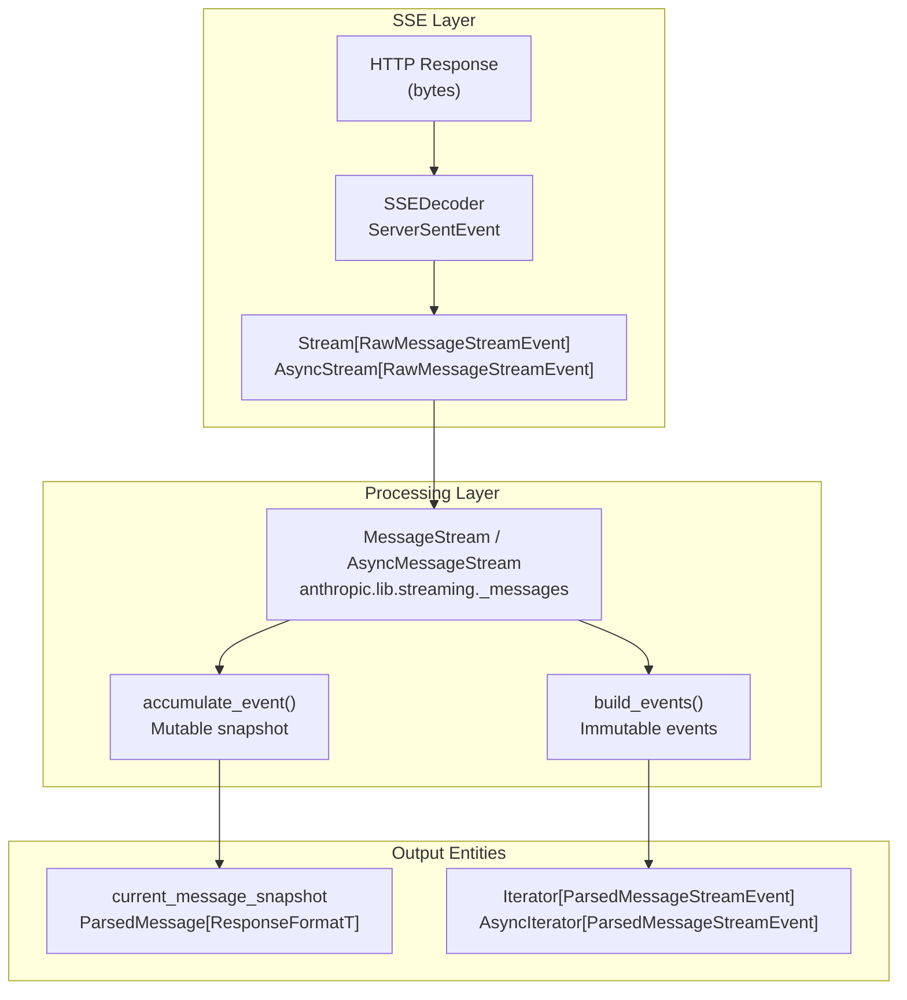
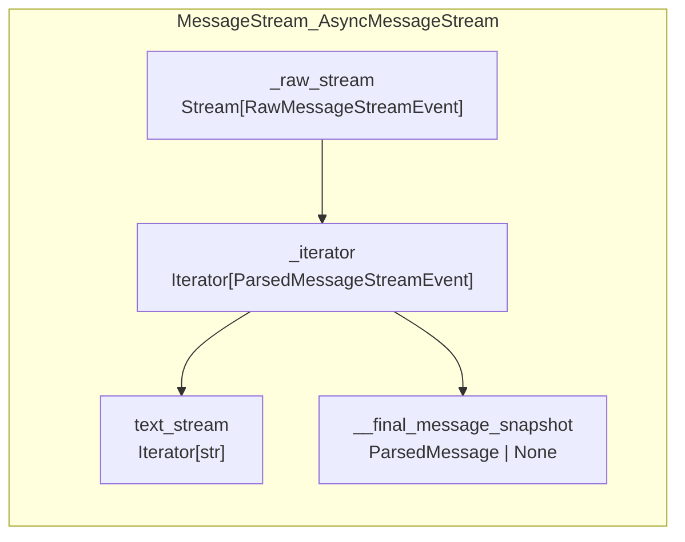

<!-- source: DeepWiki mcp.deepwiki.com · repo anthropics/anthropic-sdk-python · page 6 Streaming · fetched 2026-10-26 -->

# Streaming

<details>
<summary>Relevant source files</summary>

The following files were used as context for generating this wiki page:

- [examples/web_search.py](examples/web_search.py)
- [examples/web_search_stream.py](examples/web_search_stream.py)
- [src/anthropic/lib/streaming/__init__.py](src/anthropic/lib/streaming/__init__.py)
- [src/anthropic/lib/streaming/_beta_messages.py](src/anthropic/lib/streaming/_beta_messages.py)
- [src/anthropic/lib/streaming/_beta_types.py](src/anthropic/lib/streaming/_beta_types.py)
- [src/anthropic/lib/streaming/_messages.py](src/anthropic/lib/streaming/_messages.py)
- [src/anthropic/lib/streaming/_types.py](src/anthropic/lib/streaming/_types.py)
- [src/anthropic/types/beta/parsed_beta_message.py](src/anthropic/types/beta/parsed_beta_message.py)
- [src/anthropic/types/parsed_message.py](src/anthropic/types/parsed_message.py)
- [tests/lib/_parse/test_messages.py](tests/lib/_parse/test_messages.py)
- [tests/lib/streaming/test_beta_messages.py](tests/lib/streaming/test_beta_messages.py)
- [tests/lib/streaming/test_messages.py](tests/lib/streaming/test_messages.py)
- [tests/lib/streaming/test_parsed_content_blocks.py](tests/lib/streaming/test_parsed_content_blocks.py)
- [tests/lib/streaming/test_partial_json.py](tests/lib/streaming/test_partial_json.py)
- [tests/lib/test_output_format_helpers.py](tests/lib/test_output_format_helpers.py)
- [tests/test_middleware.py](tests/test_middleware.py)
- [tests/test_open_telemetry.py](tests/test_open_telemetry.py)
- [tests/types/__init__.py](tests/types/__init__.py)
- [tests/types/test_to_param.py](tests/types/test_to_param.py)

</details>


The SDK provides server-sent event (SSE) streaming for real-time message generation from Claude models. This document covers the streaming architecture, core classes, and the dual-path event processing system.

## Purpose and Scope

This page explains the streaming infrastructure that enables incremental message delivery from the Claude API. It covers:

- The dual-path event processing architecture.
- Core streaming classes (`MessageStream`, `AsyncMessageStream`, and their managers).
- How raw SSE events become typed Python events.
- Message snapshot accumulation and JSON buffering.
- Differences between stable and beta streaming implementations.

This page provides architectural context. For detailed implementation patterns, context managers, and raw event types, see [Stream Managers and Event Processing](#6.1). For structured output parsing, see [Structured Output Parsing in Streams](#6.2). For tool input and partial JSON handling, see [Tool Input Streaming and Partial JSON](#6.3).

Sources: `src/anthropic/lib/streaming/_messages.py` [src/anthropic/lib/streaming/_messages.py:1-519](), `src/anthropic/lib/streaming/_beta_messages.py` [src/anthropic/lib/streaming/_beta_messages.py:1-556](), `src/anthropic/_streaming.py` [src/anthropic/_streaming.py:45-170]()

## Server-Sent Events Overview

The Claude API supports streaming responses via server-sent events (SSE). Instead of waiting for a complete message, the API sends incremental chunks as the model generates text or tool inputs.

The SDK processes these SSE events through a layered architecture:

1. Raw HTTP bytes arrive from the API.
2. `SSEDecoder` parses the SSE protocol into `ServerSentEvent` objects [src/anthropic/_streaming.py:78-84]().
3. `Stream`/`AsyncStream` deserialize events into `RawMessageStreamEvent` objects [src/anthropic/_streaming.py:86-167]().
4. `MessageStream`/`AsyncMessageStream` process events into both mutable snapshots and typed events [src/anthropic/lib/streaming/_messages.py:128-139]().

Sources: `src/anthropic/lib/streaming/_messages.py` [src/anthropic/lib/streaming/_messages.py:1-519](), `src/anthropic/lib/streaming/_beta_messages.py` [src/anthropic/lib/streaming/_beta_messages.py:1-556](), `src/anthropic/_streaming.py` [src/anthropic/_streaming.py:45-170]()

## Core Architecture: Dual-Path Event Processing

The streaming system implements a dual-path architecture that processes each SSE event through two simultaneous pipelines:

Title: "Streaming Data Flow Architecture"


The **accumulator path** maintains a single mutable `ParsedMessage` object (the "snapshot") that grows as events arrive. The **builder path** generates immutable typed events (like `TextEvent`, `InputJsonEvent`) for consumption by application code. For deeper details on how `MessageStreamManager` context managers and raw events map to `ParsedMessageStreamEvent` objects, see [Stream Managers and Event Processing](#6.1).

Sources: `src/anthropic/lib/streaming/_messages.py` [src/anthropic/lib/streaming/_messages.py:128-139](), `src/anthropic/lib/streaming/_beta_messages.py` [src/anthropic/lib/streaming/_beta_messages.py:131-142]()

## Stream Classes

The streaming system provides classes organized by synchronous/asynchronous execution and lifecycle management:

| Class | Type | Purpose | Context Manager |
|-------|------|---------|-----------------|
| `MessageStream` | Sync | Processes events and maintains snapshot | Yes (`__enter__`/`__exit__`) |
| `AsyncMessageStream` | Async | Async version of `MessageStream` | Yes (`__aenter__`/`__aexit__`) |
| `MessageStreamManager` | Sync | Wraps `MessageStream` for `.stream()` calls | Yes |
| `AsyncMessageStreamManager` | Async | Wraps `AsyncMessageStream` for `.stream()` calls | Yes |

### MessageStream and AsyncMessageStream

These classes are the core streaming interfaces. They iterate over `ParsedMessageStreamEvent` objects and maintain the current message snapshot.

Title: "Stream Class Internals"


**Key Properties & Methods:**
- `response`: The underlying `httpx2.Response` [src/anthropic/lib/streaming/_messages.py:59-60]().
- `text_stream`: Iterator over just the text deltas [src/anthropic/lib/streaming/_messages.py:34-43]().
- `get_final_message()`: Blocks until the stream is read to completion and returns the accumulated `ParsedMessage` [src/anthropic/lib/streaming/_messages.py:96-103]().
- `current_message_snapshot`: Accesses the current state of the message during streaming [src/anthropic/lib/streaming/_messages.py:130-132]().

Sources: `src/anthropic/lib/streaming/_messages.py` [src/anthropic/lib/streaming/_messages.py:33-144](), [src/anthropic/lib/streaming/_messages.py:164-192]()

### Stream Managers

Managers (`MessageStreamManager`, `AsyncMessageStreamManager`) handle the lifecycle of the stream. They defer the API request until the context is entered, ensuring connections are closed even if errors occur or the stream is partially consumed [src/anthropic/lib/streaming/_messages.py:164-192]().

For further details on stream managers, context protocols, and event processing patterns, see [Stream Managers and Event Processing](#6.1).

Sources: `src/anthropic/lib/streaming/_messages.py` [src/anthropic/lib/streaming/_messages.py:164-192]()

## Event Types and Flow

The SDK transforms raw SSE events into higher-level typed events.

| Event Type | Class Name | Description |
|------------|------------|-------------|
| `text` | `TextEvent` | Incremental text delta and the current full text snapshot [src/anthropic/lib/streaming/_types.py:22-33](). |
| `input_json` | `InputJsonEvent` | Incremental JSON delta for tool inputs and the current parsed object [src/anthropic/lib/streaming/_types.py:60-76](). |
| `thinking` | `ThinkingEvent` | Incremental thinking/reasoning delta [src/anthropic/lib/streaming/_types.py:45-53](). |
| `citation` | `CitationEvent` | New citations added to the message [src/anthropic/lib/streaming/_types.py:35-43](). |
| `message_stop` | `ParsedMessageStopEvent` | Final event containing the completed `ParsedMessage` [src/anthropic/lib/streaming/_types.py:109-116](). |

Sources: `src/anthropic/lib/streaming/_types.py` [src/anthropic/lib/streaming/_types.py:1-142](), `src/anthropic/lib/streaming/_beta_types.py` [src/anthropic/lib/streaming/_beta_types.py:1-121]()

## Structured Output Parsing in Streams

The SDK supports structured output validation during streaming via `output_format` and `output_config` parameters. The internal `_parse` transform layer validates JSON schemas as chunks arrive, enabling type-safe access to structured payloads before stream completion. 

For full details on schema validation, the `_parse` layer, and accessing parsed outputs, see [Structured Output Parsing in Streams](#6.2).

Sources: `src/anthropic/lib/streaming/_messages.py` [src/anthropic/lib/streaming/_messages.py:34-56](), `tests/lib/_parse/test_messages.py` [tests/lib/_parse/test_messages.py:180-190]()

## Tool Input Streaming and Partial JSON

Tool inputs require special handling because they arrive as partial JSON strings. The SDK maintains an internal JSON buffer system (`__json_bufs`) and uses the `jiter` library to perform partial parsing on every delta. This supports both standard mode and fine-grained tool streaming (`fine-grained-tool-streaming-2025-05-14`), handling thinking/signature deltas and incremental tool parameter accumulation.

For more details on JSON buffering, partial parsing modes, and tool input accumulation, see [Tool Input Streaming and Partial JSON](#6.3).

Sources: `src/anthropic/lib/streaming/_messages.py` [src/anthropic/lib/streaming/_messages.py:54](), `tests/lib/streaming/test_partial_json.py` [tests/lib/streaming/test_partial_json.py:14-107]()

## Stable vs Beta Streaming

The SDK provides a parallel implementation for beta features in `anthropic.lib.streaming._beta_messages`.

| Feature | Stable | Beta |
|---------|--------|------|
| **Event Classes** | `ParsedMessageStreamEvent` | `ParsedBetaMessageStreamEvent` |
| **Stream Classes** | `MessageStream` | `BetaMessageStream` |
| **Additional Events** | N/A | `compaction`, `signature` [src/anthropic/lib/streaming/_beta_types.py:53-85]() |
| **Tool Blocks** | `ToolUseBlock` | `BetaToolUseBlock`, `BetaMCPToolUseBlock` [src/anthropic/lib/streaming/_beta_messages.py:11-13]() |

Sources: `src/anthropic/lib/streaming/_messages.py` [src/anthropic/lib/streaming/_messages.py:1-519](), `src/anthropic/lib/streaming/_beta_messages.py` [src/anthropic/lib/streaming/_beta_messages.py:1-556](), `src/anthropic/lib/streaming/_beta_types.py` [src/anthropic/lib/streaming/_beta_types.py:103-121]()

## Usage Patterns

### Text Streaming
```python
with client.messages.stream(
    max_tokens=1024,
    messages=[{"role": "user", "content": "Hello"}],
    model="claude-3-5-sonnet-latest",
) as stream:
    for text in stream.text_stream:
        print(text, end="", flush=True)
```

### Tool Use Streaming
```python
with client.messages.stream(...) as stream:
    for event in stream:
        if event.type == "input_json":
            # event.snapshot contains the partially parsed tool input dict
            print(event.snapshot)
```

Sources: `tests/lib/streaming/test_messages.py` [tests/lib/streaming/test_messages.py:76-87](), `tests/lib/streaming/test_beta_messages.py` [tests/lib/streaming/test_beta_messages.py:58-70](), `examples/web_search_stream.py` [examples/web_search_stream.py:13-39]()

---

