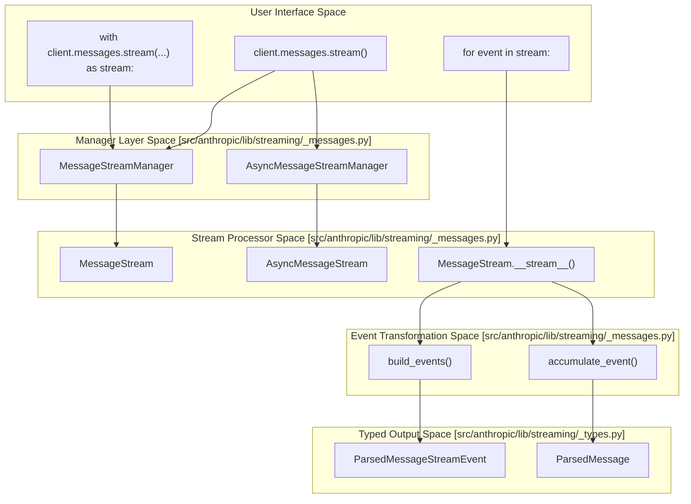
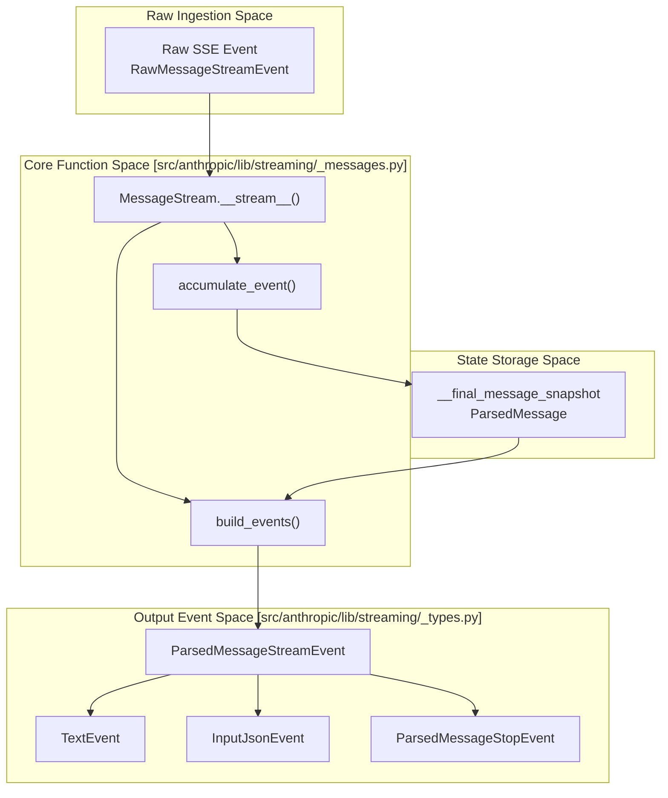

<!-- source: DeepWiki mcp.deepwiki.com · repo anthropics/anthropic-sdk-python · page 6.1 Stream Managers and Event Processing · fetched 2026-10-26 -->

# Stream Managers and Event Processing

<details>
<summary>Relevant source files</summary>

The following files were used as context for generating this wiki page:

- [examples/web_search.py](examples/web_search.py)
- [examples/web_search_stream.py](examples/web_search_stream.py)
- [src/anthropic/lib/streaming/_beta_messages.py](src/anthropic/lib/streaming/_beta_messages.py)
- [src/anthropic/lib/streaming/_messages.py](src/anthropic/lib/streaming/_messages.py)
- [src/anthropic/types/beta/beta_raw_content_block_delta.py](src/anthropic/types/beta/beta_raw_content_block_delta.py)
- [src/anthropic/types/beta/beta_raw_content_block_delta_event.py](src/anthropic/types/beta/beta_raw_content_block_delta_event.py)
- [src/anthropic/types/content_block_delta_event.py](src/anthropic/types/content_block_delta_event.py)
- [src/anthropic/types/content_block_start_event.py](src/anthropic/types/content_block_start_event.py)
- [src/anthropic/types/content_block_stop_event.py](src/anthropic/types/content_block_stop_event.py)
- [src/anthropic/types/message_delta_event.py](src/anthropic/types/message_delta_event.py)
- [src/anthropic/types/message_delta_usage.py](src/anthropic/types/message_delta_usage.py)
- [src/anthropic/types/message_start_event.py](src/anthropic/types/message_start_event.py)
- [src/anthropic/types/message_stop_event.py](src/anthropic/types/message_stop_event.py)
- [src/anthropic/types/message_stream_event.py](src/anthropic/types/message_stream_event.py)
- [src/anthropic/types/raw_content_block_delta.py](src/anthropic/types/raw_content_block_delta.py)
- [src/anthropic/types/raw_content_block_delta_event.py](src/anthropic/types/raw_content_block_delta_event.py)
- [src/anthropic/types/usage.py](src/anthropic/types/usage.py)
- [tests/lib/_parse/test_messages.py](tests/lib/_parse/test_messages.py)
- [tests/lib/streaming/__init__.py](tests/lib/streaming/__init__.py)
- [tests/lib/streaming/fixtures/basic_response.txt](tests/lib/streaming/fixtures/basic_response.txt)
- [tests/lib/streaming/fixtures/tool_use_response.txt](tests/lib/streaming/fixtures/tool_use_response.txt)
- [tests/lib/streaming/helpers.py](tests/lib/streaming/helpers.py)
- [tests/lib/streaming/test_beta_messages.py](tests/lib/streaming/test_beta_messages.py)
- [tests/lib/streaming/test_messages.py](tests/lib/streaming/test_messages.py)
- [tests/lib/streaming/test_partial_json.py](tests/lib/streaming/test_partial_json.py)
- [tests/test_open_telemetry.py](tests/test_open_telemetry.py)

</details>


## Purpose and Scope

This page details the streaming infrastructure for real-time response processing in the Anthropic Python SDK (`https://github.com/anthropics/anthropic-sdk-python`). It covers `MessageStreamManager` and `AsyncMessageStreamManager` context managers (`[src/anthropic/lib/streaming/_messages.py]()`, `[src/anthropic/lib/streaming/_beta_messages.py]()`), the dual-path event processing system (`accumulate_event` vs `build_events`), raw Server-Sent Event (SSE) types (`[src/anthropic/types/raw_message_stream_event.py]()`), and how raw stream events transform into typed `ParsedMessageStreamEvent` objects (`[src/anthropic/lib/streaming/_types.py]()`).

For structured output parsing during streams, see [6.2 Structured Output Parsing in Streams](). For tool input streaming and partial JSON parsing, see [6.3 Tool Input Streaming and Partial JSON]().

---

## Stream Architecture and Code Entity Mapping

The streaming system bridges high-level user context management (`client.messages.stream()`) with low-level HTTP SSE iteration via concrete classes and functions in `src/anthropic/lib/streaming/_messages.py` and `src/anthropic/lib/streaming/_types.py`.

**Diagram: Natural Language to Code Entity Space - Stream Lifecycle**

Sources: `[src/anthropic/lib/streaming/_messages.py:34-192]()`, `[src/anthropic/lib/streaming/_types.py:1-140]()`

---

## Stream Manager Classes

Stream managers are context manager wrappers returned by `.stream()` methods (`[src/anthropic/lib/streaming/_messages.py:164-192]()`). They lazily initiate the underlying API request when entering the context and ensure proper cleanup (`close()`) upon exit.

### MessageStreamManager and AsyncMessageStreamManager

`MessageStreamManager[ResponseFormatT]` wraps `MessageStream` for synchronous execution, while `AsyncMessageStreamManager[ResponseFormatT]` manages asynchronous streams (`[src/anthropic/lib/streaming/_messages.py:164-210]()`).

| Manager Class | Module | Context Protocol | Underlying Stream |
|--------------|--------|------------------|-------------------|
| `MessageStreamManager` | `anthropic.lib.streaming` | `__enter__` / `__exit__` | `MessageStream` |
| `AsyncMessageStreamManager` | `anthropic.lib.streaming` | `__aenter__` / `__aexit__` | `AsyncMessageStream` |

**Implementation Flow:**
```python
# Synchronous Entry (`[src/anthropic/lib/streaming/_messages.py:184-188]()`)
def __enter__(self) -> MessageStream[ResponseFormatT]:
    raw_stream = self.__api_request()
    self.__stream = MessageStream(raw_stream, output_format=self.__output_format)
    return self.__stream
```

Sources: `[src/anthropic/lib/streaming/_messages.py:164-210]()`, `[src/anthropic/lib/streaming/_beta_messages.py:168-210]()`

---

## Dual-Path Event Processing: accumulate_event vs build_events

The core innovation in `MessageStream.__stream__()` (`[src/anthropic/lib/streaming/_messages.py:137-157]`) is separating state accumulation (`accumulate_event`) from event emission (`build_events`).

**Diagram: Natural Language to Code Entity Space - Event Processing Pipeline**

Sources: `[src/anthropic/lib/streaming/_messages.py:137-157]()`, `[src/anthropic/lib/streaming/_messages.py:433-518]()`, `[src/anthropic/lib/streaming/_types.py:1-140]()`

### accumulate_event

`accumulate_event()` (`[src/anthropic/lib/streaming/_messages.py:433-518]()`) takes a raw SSE event and the current message snapshot, modifying or constructing an updated `ParsedMessage` object:
- `message_start`: Initializes a new `ParsedMessage` instance (`[src/anthropic/lib/streaming/_messages.py:440-455]()`).
- `content_block_start`: Appends a new content block (`[src/anthropic/lib/streaming/_messages.py:456-468]()`).
- `content_block_delta`: Dispatches based on delta type (`text_delta`, `input_json_delta`, `thinking_delta`, `citations_delta`, `signature_delta`) to update text buffers or partial JSON (`[src/anthropic/lib/streaming/_messages.py:469-502]()`).
- `message_delta`: Updates `stop_reason`, `stop_sequence`, and usage statistics (`[src/anthropic/lib/streaming/_messages.py:510-518]()`).

### build_events

`build_events()` (`[src/anthropic/lib/streaming/_messages.py:331-422]()`) takes the raw event and the updated message snapshot, translating raw protocol events into high-level typed events (`ParsedMessageStreamEvent`) enriched with current accumulator context.

Sources: `[src/anthropic/lib/streaming/_messages.py:137-157]`, `[src/anthropic/lib/streaming/_messages.py:331-518]()`

---

## Raw Stream Event Types and Parsed Message Stream Events

Raw events received from the API map directly to Pydantic models defined across the SDK types package (`[src/anthropic/types/raw_message_stream_event.py]()`). 

### ParsedMessageStreamEvent Union

In `[src/anthropic/lib/streaming/_types.py]()`, events are defined as discriminated unions combining raw events and parsed event variants:

| Event Wrapper / Class | Base Raw Event | Description |
|----------------------|----------------|-------------|
| `TextEvent` | `content_block_delta` (text) | Text delta with accumulated snapshot text |
| `InputJsonEvent` | `content_block_delta` (input_json) | JSON delta with parsed partial object (`snapshot`) |
| `ThinkingEvent` | `content_block_delta` (thinking) | Thinking block delta |
| `CitationEvent` | `content_block_delta` (citations) | Citation reference block delta |
| `ParsedMessageStopEvent` | `message_stop` | Terminal event containing full `ParsedMessage` snapshot |

Sources: `[src/anthropic/lib/streaming/_types.py:1-140]()`, `[src/anthropic/types/raw_message_stream_event.py:1-24]()`

---

## Beta Streaming Extensions

Beta endpoints (`client.beta.messages.stream`) utilize parallel infrastructure located in `[src/anthropic/lib/streaming/_beta_messages.py]()` and `[src/anthropic/lib/streaming/_beta_types.py]()`.

### Beta Specifics
- **Tracked Tool Inputs**: `TRACKS_TOOL_INPUT` includes `BetaToolUseBlock`, `BetaServerToolUseBlock`, and `BetaMCPToolUseBlock` (`[src/anthropic/lib/streaming/_beta_messages.py:18]()`).
- **Compaction Blocks**: Handles `compaction` and encrypted content blocks (`[src/anthropic/lib/streaming/_beta_messages.py:461-468]()`).
- **Fine-Grained Tool Streaming**: Supports `fine-grained-tool-streaming-2025-05-14` headers for enhanced trailing-string JSON buffer recovery (`[tests/lib/streaming/test_partial_json.py:14-107]()`).

Sources: `[src/anthropic/lib/streaming/_beta_messages.py:1-603]()`, `[src/anthropic/lib/streaming/_beta_types.py:1-120]()`, `[tests/lib/streaming/test_partial_json.py:1-107]()`

---

