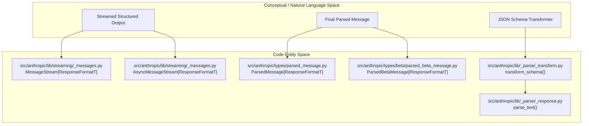
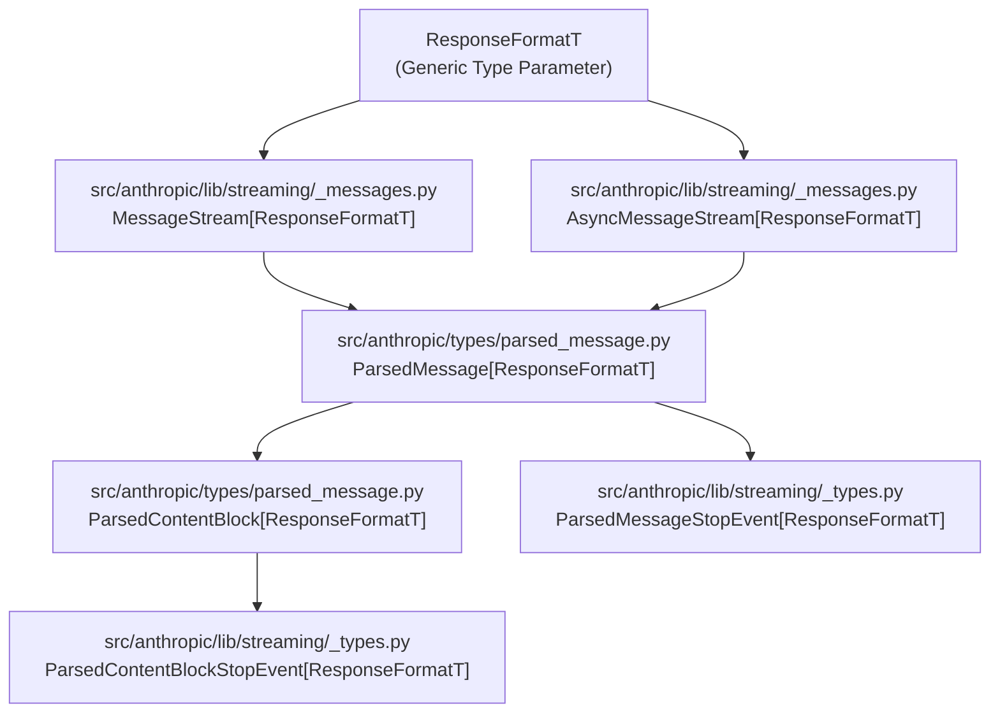
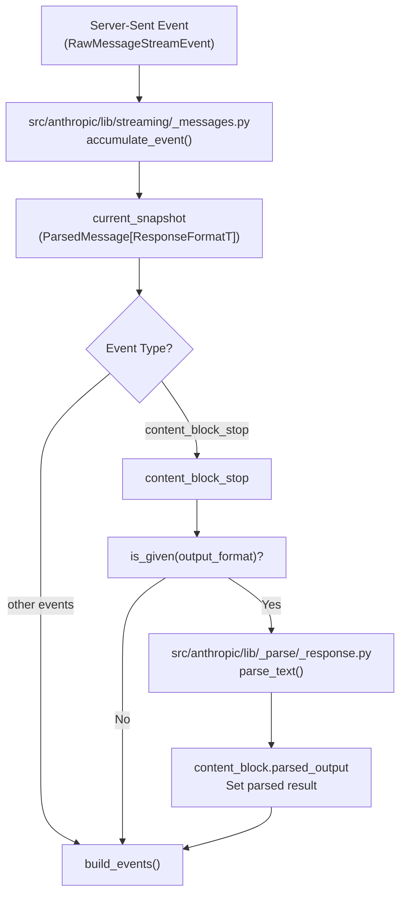

<!-- source: DeepWiki mcp.deepwiki.com · repo anthropics/anthropic-sdk-python · page 6.2 Structured Output Parsing in Streams · fetched 2026-10-26 -->

# Structured Output Parsing in Streams

<details>
<summary>Relevant source files</summary>

The following files were used as context for generating this wiki page:

- [examples/agents.py](examples/agents.py)
- [examples/agents_with_files.py](examples/agents_with_files.py)
- [examples/structured_outputs.py](examples/structured_outputs.py)
- [examples/structured_outputs_streaming.py](examples/structured_outputs_streaming.py)
- [src/anthropic/lib/_parse/_transform.py](src/anthropic/lib/_parse/_transform.py)
- [src/anthropic/lib/streaming/__init__.py](src/anthropic/lib/streaming/__init__.py)
- [src/anthropic/lib/streaming/_beta_types.py](src/anthropic/lib/streaming/_beta_types.py)
- [src/anthropic/lib/streaming/_types.py](src/anthropic/lib/streaming/_types.py)
- [src/anthropic/types/beta/parsed_beta_message.py](src/anthropic/types/beta/parsed_beta_message.py)
- [src/anthropic/types/parsed_message.py](src/anthropic/types/parsed_message.py)
- [tests/lib/_parse/test_transform.py](tests/lib/_parse/test_transform.py)
- [tests/lib/streaming/test_parsed_content_blocks.py](tests/lib/streaming/test_parsed_content_blocks.py)
- [tests/lib/test_output_format_helpers.py](tests/lib/test_output_format_helpers.py)
- [tests/test_middleware.py](tests/test_middleware.py)
- [tests/types/__init__.py](tests/types/__init__.py)
- [tests/types/test_to_param.py](tests/types/test_to_param.py)

</details>


This document explains how output formatting and structured parsing integrate with the streaming infrastructure in the Anthropic Python SDK. It covers how `output_format` and `output_config` affect stream parsing, the `_parse` transform layer (`src/anthropic/lib/_parse/_transform.py`), JSON schema validation during streaming, and accessing parsed structured outputs from stream objects and final messages.

For information about overall streaming architecture and event processing, see [Stream Managers and Event Processing](6.1). For details about tool input streaming and partial JSON parsing, see [Tool Input Streaming and Partial JSON](6.3). For non-streaming structured output parsing, see [Beta Messages API](5.2).

## Overview and Generic Typing

The SDK's streaming classes support structured output parsing through a generic type parameter `ResponseFormatT` that flows through the entire streaming pipeline. When an `output_format` is specified, the stream automatically parses text content blocks into the requested structured format when the content block completes.

Key characteristics:
- **Generic Typing**: Stream classes are parameterized by `ResponseFormatT` for type-safe structured outputs [src/anthropic/lib/streaming/_messages.py:33]().
- **Lazy Parsing**: Parsing occurs at the `content_block_stop` event, not during real-time text accumulation [src/anthropic/lib/streaming/_messages.py:499-502]().
- **Automatic Integration**: No additional code is needed beyond passing the `output_format` parameter to client methods [src/anthropic/lib/streaming/_messages.py:168]().
- **Access Points**: Parsed output is available through `get_final_message()` and individual stream events [src/anthropic/lib/streaming/_messages.py:89-95]().

The diagram below bridges the conceptual entities of structured output streaming to their concrete code implementations in the SDK.

Title: Natural Language to Code Entity Mapping for Streaming Parsers


Sources: [src/anthropic/lib/streaming/_messages.py:33-53](), [src/anthropic/types/parsed_message.py:30-38](), [src/anthropic/lib/_parse/_transform.py:54-76]()

## Stream Generic Type Propagation

All streaming classes in the SDK are generic over `ResponseFormatT`, which represents the type of structured output expected (typically a Pydantic model class). This generic parameter propagates through:

- Sync and async stream classes: `MessageStream[ResponseFormatT]`, `AsyncMessageStream[ResponseFormatT]` [src/anthropic/lib/streaming/_messages.py:33](), [src/anthropic/lib/streaming/_messages.py:181]()
- Beta stream classes: `BetaMessageStream[ResponseFormatT]`, `BetaAsyncMessageStream[ResponseFormatT]` [src/anthropic/lib/streaming/_beta_messages.py:36](), [src/anthropic/lib/streaming/_beta_messages.py:185]()
- Message types: `ParsedMessage[ResponseFormatT]`, `ParsedContentBlock[ResponseFormatT]` [src/anthropic/types/parsed_message.py:30]()
- Event types: `ParsedMessageStopEvent[ResponseFormatT]`, `ParsedContentBlockStopEvent[ResponseFormatT]` [src/anthropic/lib/streaming/_types.py:110-123]()

Title: Stream Generic Type Propagation


Sources: [src/anthropic/lib/streaming/_messages.py:33-53](), [src/anthropic/lib/streaming/_messages.py:181-201](), [src/anthropic/types/parsed_message.py:30-76](), [src/anthropic/lib/streaming/_types.py:110-123]()

## Stream Initialization with output_format

The `output_format` parameter flows through the stream initialization chain, ensuring that the underlying manager and streams hold references to the expected target schema.

1. **Manager Creation**: `MessageStreamManager` or `AsyncMessageStreamManager` stores the `output_format` parameter [src/anthropic/lib/streaming/_messages.py:156-165]().
2. **Stream Creation**: When entering the context manager via `__enter__`, the raw stream is created and wrapped in a `MessageStream` instantiated with `output_format` [src/anthropic/lib/streaming/_messages.py:166-169]().
3. **Stream Storage**: The stream stores `output_format` in the private `self.__output_format` attribute [src/anthropic/lib/streaming/_messages.py:53]().

The same pattern applies to beta streams through `BetaMessageStreamManager` and `BetaAsyncMessageStreamManager` [src/anthropic/lib/streaming/_beta_messages.py:150-183]().

Sources: [src/anthropic/lib/streaming/_messages.py:146-169](), [src/anthropic/lib/streaming/_messages.py:44-53](), [src/anthropic/lib/streaming/_beta_messages.py:46-55]()

## Event Accumulation and the _parse Transform Layer

The `accumulate_event` function processes each incoming Server-Sent Event and updates the message snapshot [src/anthropic/lib/streaming/_messages.py:433](). Structured output parsing occurs specifically at the `content_block_stop` event using helper functions from `anthropic.lib._parse`.

Title: Event Accumulation and Parsing Pipeline


### Parsing Trigger Conditions

Parsing is triggered when all of the following conditions are met:
1. The event type is `content_block_stop` [src/anthropic/lib/streaming/_messages.py:499]().
2. The content block type is `text` [src/anthropic/lib/streaming/_messages.py:501]().
3. `output_format` is provided (not `NOT_GIVEN`) [src/anthropic/lib/streaming/_messages.py:501]().

Implementation detail in stable Messages API [src/anthropic/lib/streaming/_messages.py:499-502]():
```python
elif event.type == "content_block_stop":
    content_block = current_snapshot.content[event.index]
    if content_block.type == "text" and is_given(output_format):
        content_block.parsed_output = parse_text(content_block.text, output_format)
```

Sources: [src/anthropic/lib/streaming/_messages.py:433-518](), [src/anthropic/lib/streaming/_beta_messages.py:438-540]()

## JSON Schema Validation and Transformation

When a Pydantic model or schema is passed as `output_format`, the SDK uses `transform_schema` to ensure the generated JSON schema conforms strictly to API expectations [src/anthropic/lib/_parse/_transform.py:54-174]().

Key transformations performed by `transform_schema`:
- Sets `additionalProperties: False` for objects [src/anthropic/lib/_parse/_transform.py:133]().
- Normalizes `oneOf` or `anyOf` schema variants [src/anthropic/lib/_parse/_transform.py:104-107]().
- Appends unsupported JSON schema properties to the `description` field so the model can attempt to follow them [src/anthropic/lib/_parse/_transform.py:165-172]().
- Ensures string schemas without a format default to `text` via `get_transformed_string` [src/anthropic/lib/_parse/_transform.py:35-51]().

Sources: [src/anthropic/lib/_parse/_transform.py:54-174](), [tests/lib/_parse/test_transform.py:102-124]()

## Accessing Parsed Structured Outputs

Parsed structured outputs can be accessed in two primary ways during and after streaming.

### Method 1: From Stream Events
During iteration, the `content_block_stop` event contains the parsed output on the completed block [src/anthropic/lib/streaming/_types.py:118-125]().

```python
with client.messages.stream(
    model="claude-sonnet-5-5",
    max_tokens=1024,
    messages=[{"role": "user", "content": "Extract order details..."}],
    output_format=Order,
) as stream:
    for event in stream:
        if event.type == "content_block_stop":
            content_block = event.content_block
            if content_block.type == "text":
                parsed_data = content_block.parsed_output
```

### Method 2: From Final Message
After consuming the stream, `get_final_message()` returns the accumulated `ParsedMessage` object, which exposes `parsed_output` [src/anthropic/lib/streaming/_messages.py:89-95](), [src/anthropic/types/parsed_message.py:77-82]().

```python
with client.messages.stream(
    model="claude-sonnet-5-5",
    max_tokens=1024,
    messages=[{"role": "user", "content": "Extract order details..."}],
    output_format=Order,
) as stream:
    for event in stream:
        pass
    final_message = stream.get_final_message()
    print(final_message.parsed_output)
```

Sources: [src/anthropic/lib/streaming/_messages.py:89-95](), [src/anthropic/types/parsed_message.py:71-82](), [examples/structured_outputs_streaming.py:19-30]()

## Beta vs Stable API Differences

Both the stable and beta streaming APIs support structured output parsing with identical underlying parsing semantics.

| Aspect | Stable API | Beta API |
|--------|-----------|----------|
| **Stream Classes** | `MessageStream`, `AsyncMessageStream` [src/anthropic/lib/streaming/_messages.py:33](), [src/anthropic/lib/streaming/_messages.py:181]() | `BetaMessageStream`, `BetaAsyncMessageStream` [src/anthropic/lib/streaming/_beta_messages.py:36](), [src/anthropic/lib/streaming/_beta_messages.py:185]() |
| **Message Types** | `ParsedMessage[ResponseFormatT]` [src/anthropic/types/parsed_message.py:71]() | `ParsedBetaMessage[ResponseFormatT]` [src/anthropic/types/beta/parsed_beta_message.py:83]() |
| **Parsing Logic** | [src/anthropic/lib/streaming/_messages.py:499-502]() | [src/anthropic/lib/streaming/_beta_messages.py:519-522]() |

Sources: [src/anthropic/lib/streaming/_messages.py:499-502](), [src/anthropic/lib/streaming/_beta_messages.py:519-522](), [src/anthropic/types/parsed_message.py:71-82](), [src/anthropic/types/beta/parsed_beta_message.py:83-94]()

---

