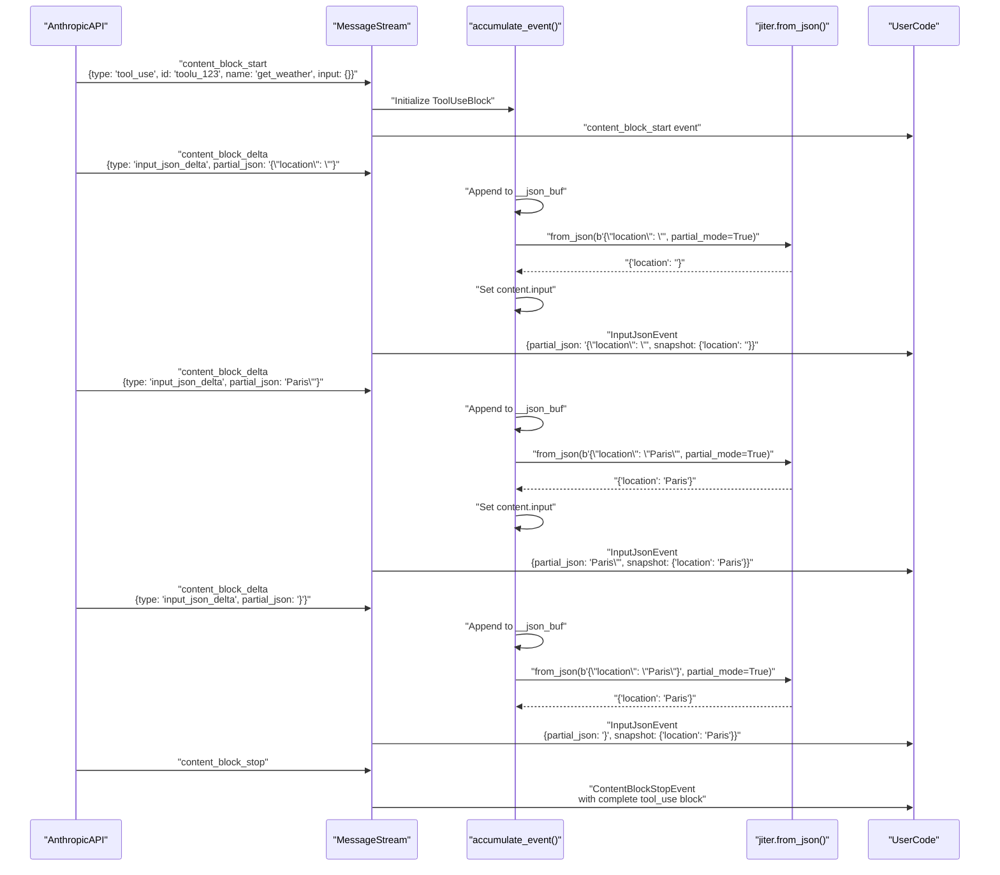
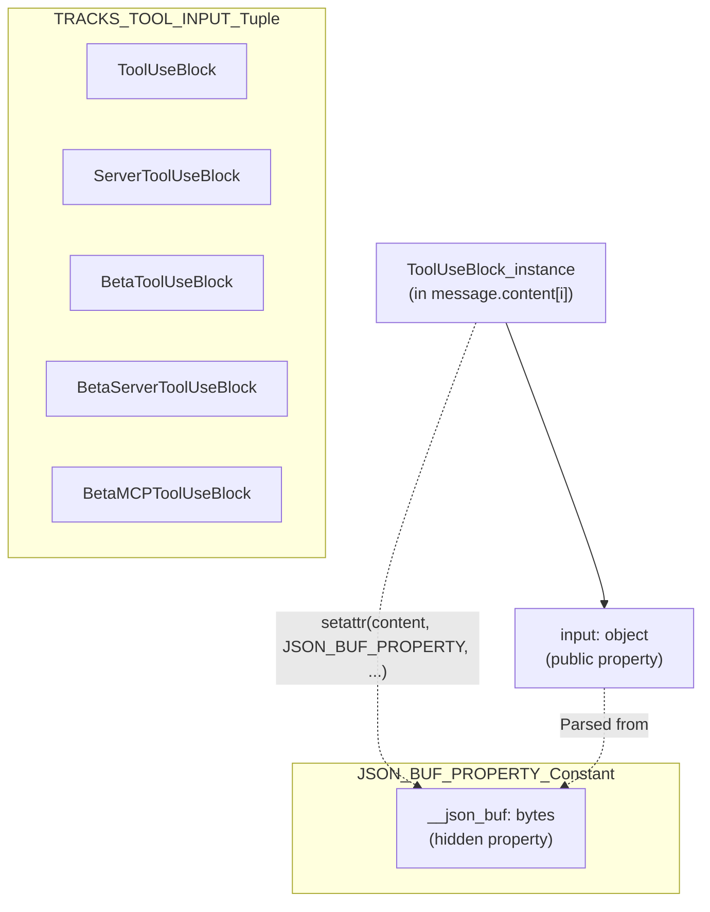
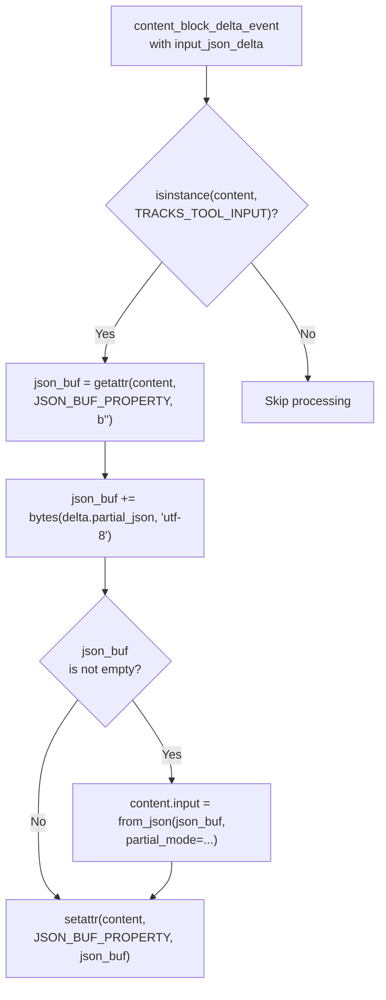
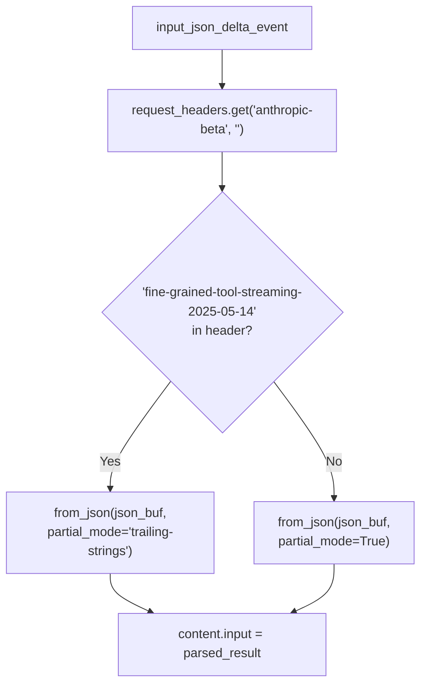

<!-- source: DeepWiki mcp.deepwiki.com · repo anthropics/anthropic-sdk-python · page 6.3 Tool Input Streaming and Partial JSON · fetched 2026-10-26 -->

# Tool Input Streaming and Partial JSON

<details>
<summary>Relevant source files</summary>

The following files were used as context for generating this wiki page:

- [examples/web_search.py](examples/web_search.py)
- [examples/web_search_stream.py](examples/web_search_stream.py)
- [src/anthropic/lib/streaming/_beta_messages.py](src/anthropic/lib/streaming/_beta_messages.py)
- [src/anthropic/lib/streaming/_messages.py](src/anthropic/lib/streaming/_messages.py)
- [src/anthropic/types/beta/beta_redacted_thinking_block.py](src/anthropic/types/beta/beta_redacted_thinking_block.py)
- [src/anthropic/types/beta/beta_redacted_thinking_block_param.py](src/anthropic/types/beta/beta_redacted_thinking_block_param.py)
- [src/anthropic/types/beta/beta_signature_delta.py](src/anthropic/types/beta/beta_signature_delta.py)
- [src/anthropic/types/beta/beta_thinking_block.py](src/anthropic/types/beta/beta_thinking_block.py)
- [src/anthropic/types/beta/beta_thinking_block_param.py](src/anthropic/types/beta/beta_thinking_block_param.py)
- [src/anthropic/types/beta/beta_thinking_delta.py](src/anthropic/types/beta/beta_thinking_delta.py)
- [src/anthropic/types/redacted_thinking_block.py](src/anthropic/types/redacted_thinking_block.py)
- [src/anthropic/types/redacted_thinking_block_param.py](src/anthropic/types/redacted_thinking_block_param.py)
- [src/anthropic/types/signature_delta.py](src/anthropic/types/signature_delta.py)
- [src/anthropic/types/thinking_block.py](src/anthropic/types/thinking_block.py)
- [src/anthropic/types/thinking_block_param.py](src/anthropic/types/thinking_block_param.py)
- [tests/lib/_parse/test_messages.py](tests/lib/_parse/test_messages.py)
- [tests/lib/streaming/test_beta_messages.py](tests/lib/streaming/test_beta_messages.py)
- [tests/lib/streaming/test_messages.py](tests/lib/streaming/test_messages.py)
- [tests/lib/streaming/test_partial_json.py](tests/lib/streaming/test_partial_json.py)
- [tests/test_open_telemetry.py](tests/test_open_telemetry.py)

</details>


## Purpose and Scope

This document explains how tool inputs are streamed incrementally in the Anthropic Python SDK. When Claude invokes a tool, the tool parameters arrive as fragmented JSON strings via `input_json_delta` events. The SDK must accumulate these fragments into a byte buffer and continuously re-parse the incomplete JSON to provide real-time access to tool parameters as they stream. This page covers the JSON buffer strategy, partial JSON parsing with the `jiter` library, the `fine-grained-tool-streaming-2025-05-14` beta feature enabling granular string streaming, and how thinking and signature deltas are accumulated.

For general streaming concepts, see [Streaming](6). For structured output parsing, see [Structured Output Parsing in Streams](6.2). For information about the tool system, see [Tool System](7).

Sources: [src/anthropic/lib/streaming/_messages.py:34-124](), [src/anthropic/lib/streaming/_beta_messages.py:37-127]()

---

## Tool Input Streaming Overview

When Claude decides to use a tool during a streaming response, the tool parameters are sent incrementally as JSON fragments rather than as a complete object. This allows users to see and react to tool invocations in real-time before all parameters are finalized.

### Tool Use Event Sequence

Title: "ToolUseStreamLifecycle"


Sources: [src/anthropic/lib/streaming/_messages.py:125-157](), [src/anthropic/lib/streaming/_beta_messages.py:140-161]()

---

## The JSON Buffer Strategy

To parse incomplete JSON incrementally, the SDK maintains a hidden byte buffer on each tool use content block. This buffer grows with each `input_json_delta` event and is re-parsed in its entirety to produce the current snapshot.

### Buffer Property and Type Tracking

Title: "JsonBufferStorageMechanism"


Sources: [src/anthropic/lib/streaming/_messages.py:425-430](), [src/anthropic/lib/streaming/_beta_messages.py:429-435]()

The `JSON_BUF_PROPERTY` constant defines the name of the hidden buffer attribute:

[src/anthropic/lib/streaming/_messages.py:425-425]()
```python
JSON_BUF_PROPERTY = "__json_buf"
```

The `TRACKS_TOOL_INPUT` tuple identifies which content block types have an `input` property requiring JSON accumulation:

[src/anthropic/lib/streaming/_messages.py:427-430]()
```python
TRACKS_TOOL_INPUT = (
    ToolUseBlock,
    ServerToolUseBlock,
)
```

For the beta API, this includes additional tool types:

[src/anthropic/lib/streaming/_beta_messages.py:431-435]()
```python
TRACKS_TOOL_INPUT = (
    BetaToolUseBlock,
    BetaServerToolUseBlock,
    BetaMCPToolUseBlock,
)
```

Sources: [src/anthropic/lib/streaming/_messages.py:425-430](), [src/anthropic/lib/streaming/_beta_messages.py:429-435]()

### Accumulation Logic

Title: "JsonFragmentAccumulationDataFlow"


Sources: [src/anthropic/lib/streaming/_messages.py:469-482](), [src/anthropic/lib/streaming/_beta_messages.py:479-502]()

---

## Partial JSON Parsing with jiter

The SDK uses the [`jiter`](https://github.com/pydantic/jiter) library to parse incomplete JSON strings. `jiter` supports partial parsing modes required for real-time streaming.

### Partial Mode Types

| Mode | Behavior | Use Case |
|------|----------|----------|
| `partial_mode=True` | Omits incomplete string values | Standard tool streaming |
| `partial_mode="trailing-strings"` | Includes incomplete string values | Fine-grained beta streaming |

Sources: [src/anthropic/lib/streaming/_messages.py:480-480](), [src/anthropic/lib/streaming/_beta_messages.py:490-500]()

In standard mode (`partial_mode=True`), `jiter` omits incomplete string values:

[src/anthropic/lib/streaming/_messages.py:469-482]()
```python
elif event.delta.type == "input_json_delta":
    if isinstance(content, TRACKS_TOOL_INPUT):
        from jiter import from_json

        json_buf = cast(bytes, getattr(content, JSON_BUF_PROPERTY, b""))
        json_buf += bytes(event.delta.partial_json, "utf-8")

        if json_buf:
            content.input = from_json(json_buf, partial_mode=True)

        setattr(content, JSON_BUF_PROPERTY, json_buf)
```

Sources: [src/anthropic/lib/streaming/_messages.py:469-482]()

---

## Fine-Grained Tool Streaming Beta Feature

The `fine-grained-tool-streaming-2025-05-14` beta feature enables more granular streaming of string values within tool parameters.

### Trailing Strings Mode Selection

Title: "ParsingModeSelectionArchitecture"


Sources: [src/anthropic/lib/streaming/_beta_messages.py:490-500]()

The beta `accumulate_event()` function detects the beta header to switch parsing modes:

[src/anthropic/lib/streaming/_beta_messages.py:490-500]()
```python
try:
    anthropic_beta = request_headers.get("anthropic-beta", "") if request_headers else ""

    if "fine-grained-tool-streaming-2025-05-14" in anthropic_beta:
        content.input = from_json(json_buf, partial_mode="trailing-strings")
    else:
        content.input = from_json(json_buf, partial_mode=True)
except ValueError as e:
    raise ValueError(
        f"Unable to parse tool parameter JSON from model. Please retry your request or adjust your prompt. Error: {e}. JSON: {json_buf.decode('utf-8')}"
    ) from e
```

Sources: [src/anthropic/lib/streaming/_beta_messages.py:490-500](), [tests/lib/streaming/test_partial_json.py:14-106]()

---

## Thinking and Signature Deltas

In addition to tool inputs and text, Claude's extended thinking blocks stream incremental updates via `thinking_delta` events and `signature_delta` events. These are accumulated into `ThinkingBlock` or `RedactedThinkingBlock` instances.

- `ThinkingDelta` / `BetaThinkingDelta`: Delivers incremental `thinking` text fragments and optional `estimated_tokens` metrics (when `thinking-token-count-2026-05-13` beta is enabled) [src/anthropic/types/beta/beta_thinking_delta.py:9-29]()
- `SignatureDelta` / `BetaSignatureDelta`: Delivers signature fragments verifying model-generated thinking blocks.

The stream accumulator aggregates these deltas into the block's `thinking` and `signature` attributes, yielding `ThinkingEvent` and `SignatureEvent` to consuming client code.

Sources: [src/anthropic/types/beta/beta_thinking_delta.py:1-29](), [src/anthropic/lib/streaming/_messages.py:137-157]()

---

## InputJsonEvent Structure and Event Building

When `input_json_delta` events are processed, the SDK emits `InputJsonEvent` instances (or `BetaInputJsonEvent` in beta) providing both the raw delta and the parsed snapshot.

### Event Properties

| Field | Type | Description |
|-------|------|-------------|
| `type` | `Literal["input_json"]` | Event type discriminator |
| `partial_json` | `str` | The raw JSON fragment received in this delta |
| `snapshot` | `object` | The current accumulated parsed object |

Sources: [src/anthropic/lib/streaming/_types.py:63-78](), [src/anthropic/lib/streaming/_beta_types.py:61-76]()

The `build_events()` function creates these instances from raw `content_block_delta` events:

[src/anthropic/lib/streaming/_messages.py:362-371]()
```python
elif event.delta.type == "input_json_delta":
    if isinstance(content, TRACKS_TOOL_INPUT):
        events.append(
            InputJsonEvent(
                partial_json=event.delta.partial_json,
                snapshot=content.input,
            )
        )
```

Sources: [src/anthropic/lib/streaming/_messages.py:362-371](), [src/anthropic/lib/streaming/_beta_messages.py:368-377]()

---

## Incomplete JSON Handling

If the model stops generating (e.g., due to `max_tokens`) while in the middle of a tool parameter, the SDK provides the best-effort partial object accumulated so far.

[tests/lib/streaming/fixtures/incomplete_partial_json_response.txt:34-42]()
```text
event: content_block_delta
data: {"type":"content_block_delta","index":1,"delta":{"type":"input_json_delta","partial_json":"{\"filename\": \"taxes.txt"}   }

event: content_block_delta
data: {"type":"content_block_delta","index":1,"delta":{"type":"input_json_delta","partial_json":"\", \"lines_of_text\": [\n\"# COMPREHENSIVE TAX GUIDE ..."}        }

event: message_delta
data: {"type":"message_delta","delta":{"stop_reason":"max_tokens",...}}
```

Sources: [tests/lib/streaming/fixtures/incomplete_partial_json_response.txt:34-42](), [tests/lib/streaming/test_beta_messages.py:101-134]()

---

