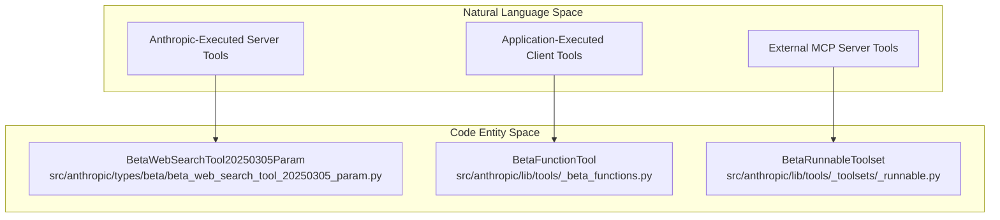
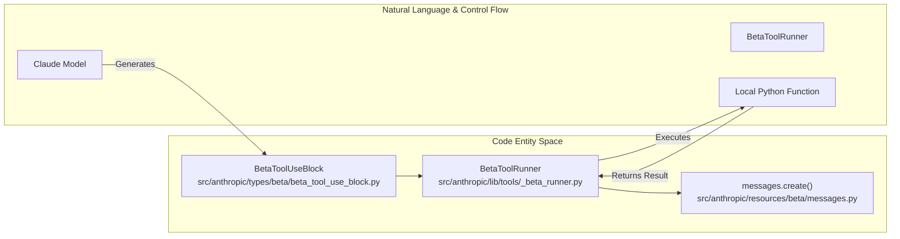

<!-- source: DeepWiki mcp.deepwiki.com · repo anthropics/anthropic-sdk-python · page 7 Tool System · fetched 2026-10-26 -->

# Tool System

Relevant source files

The following files were used as context for generating this wiki page:

- [src/anthropic/lib/tools/_beta_runner.py](src/anthropic/lib/tools/_beta_runner.py)
- [src/anthropic/types/beta/beta_tool_param.py](src/anthropic/types/beta/beta_tool_param.py)
- [src/anthropic/types/beta/beta_web_search_tool_20250305_param.py](src/anthropic/types/beta/beta_web_search_tool_20250305_param.py)
- [src/anthropic/types/tool_param.py](src/anthropic/types/tool_param.py)
- [src/anthropic/types/user_location_param.py](src/anthropic/types/user_location_param.py)
- [src/anthropic/types/web_search_tool_20250305_param.py](src/anthropic/types/web_search_tool_20250305_param.py)
- [src/anthropic/types/web_search_tool_20260209_param.py](src/anthropic/types/web_search_tool_20260209_param.py)
- [src/anthropic/types/web_search_tool_request_error_param.py](src/anthropic/types/web_search_tool_request_error_param.py)
- [src/anthropic/types/web_search_tool_result_error.py](src/anthropic/types/web_search_tool_result_error.py)
- [tests/lib/tools/test_runners.py](tests/lib/tools/test_runners.py)
- [tools.md](tools.md)

The Tool System enables Claude to interact with external functionality through a structured interface. Tools can be **Server Tools** (executed by Anthropic's infrastructure), **Client Tools** (executed by your application), or **MCP-based Tools** (Model Context Protocol). This document provides a high-level overview of the tool ecosystem, definitions, versioning, and the execution lifecycle.

For detailed information on defining tools and parameter structures, see [Tool Definitions and Parameters](#7.1). For information about executing tools using SDK helpers and runners, see [Tool Runners and MCP Integration](#7.2).

## Tool Categories

The SDK supports three distinct categories of tools, bridging natural language intent to code entities:

- **Server Tools**: Managed directly by Anthropic infrastructure (such as web search, code execution, and bash). Defined using parameter structures like `BetaWebSearchTool20250305Param` [src/anthropic/types/beta/beta_web_search_tool_20250305_param.py:13-57]().
- **Client Tools**: Defined by your application via decorators like `@beta_tool`, wrapped in classes like `BetaFunctionTool` [src/anthropic/lib/tools/_beta_functions.py:67](), and executed locally.
- **MCP Tools**: Integrated via the Model Context Protocol using toolsets and remote server configurations [src/anthropic/lib/tools/_toolsets/_runnable.py:76-83]().

Sources: [src/anthropic/types/beta/beta_web_search_tool_20250305_param.py:13-57](), [src/anthropic/lib/tools/_beta_functions.py:67-73](), [src/anthropic/lib/tools/_toolsets/_runnable.py:76-83]()

## Tool Definitions and Parameters

Tools are configured using `TypedDict` parameter structures (`ToolParam` and `BetaToolUnionParam`) that specify the tool name, description, and JSON schema inputs [src/anthropic/types/tool_param.py:31-82](). Advanced tool parameters support features like strict mode, input streaming optimization, and call restrictions.

For a comprehensive breakdown of `ToolParam`, server tools (bash, text editor, code execution, web search, web fetch, computer use), tool result blocks, and tool versioning patterns, see [Tool Definitions and Parameters](#7.1).

Sources: [src/anthropic/types/tool_param.py:31-82](), [src/anthropic/types/beta/beta_tool_param.py:28-79]()

## Tool Execution Lifecycle and Runners

The tool execution lifecycle involves alternating turns between Claude requesting tool invocations via `tool_use` blocks and the application or runner returning tool results.

The SDK automates this loop using `BetaToolRunner` and `BetaStreamingToolRunner`, managing iterative turns, stop reasons (such as `"tool_use"`, `"end_turn"`, or `"pause_turn"`), and error handling [src/anthropic/lib/tools/_beta_runner.py:115-194](), [tools.md:64-77]().

For detailed documentation on runners, the `BetaFunctionTool`/`BetaRunnableTool` patterns, MCP integration, memory tools, and agent toolsets, see [Tool Runners and MCP Integration](#7.2).

Sources: [src/anthropic/lib/tools/_beta_runner.py:115-194](), [tools.md:64-140]()

## Tool Versioning

Tools in the Anthropic ecosystem are versioned by release date (e.g., `20250305`) to enable evolution of server capabilities without breaking existing client integrations [src/anthropic/types/web_search_tool_20250305_param.py:20](). Both stable and beta namespaces maintain versioned variations of server-side capabilities like web search and code execution.

For detailed patterns on tool versioning and parameter evolution, see [Tool Definitions and Parameters](#7.1).

Sources: [src/anthropic/types/web_search_tool_20250305_param.py:13-21](), [src/anthropic/types/beta/beta_web_search_tool_20250305_param.py:13-21]()

---

