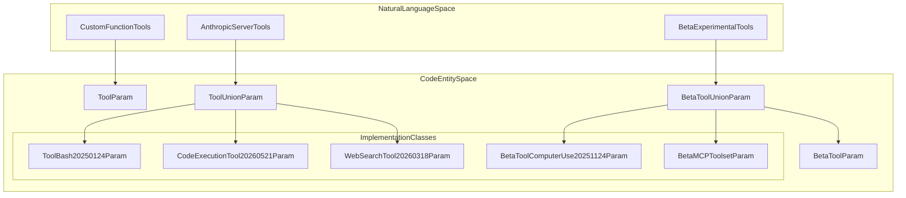
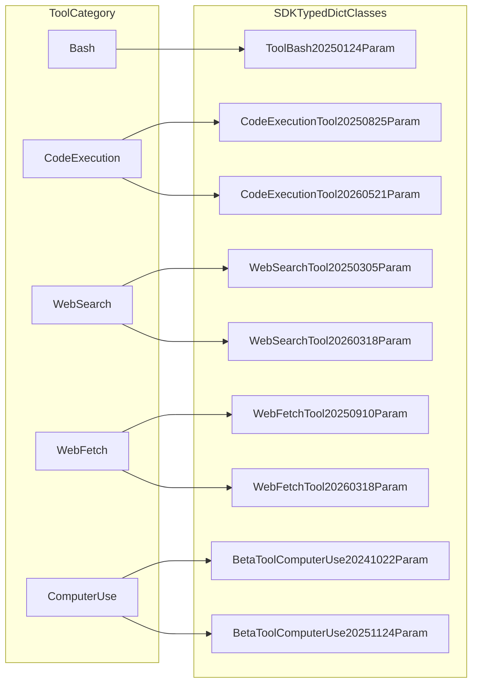

<!-- source: DeepWiki mcp.deepwiki.com · repo anthropics/anthropic-sdk-python · page 7.1 Tool Definitions and Parameters · fetched 2026-10-26 -->

# Tool Definitions and Parameters

Relevant source files

The following files were used as context for generating this wiki page:

- [src/anthropic/types/beta/beta_content_block.py](src/anthropic/types/beta/beta_content_block.py)
- [src/anthropic/types/beta/beta_content_block_param.py](src/anthropic/types/beta/beta_content_block_param.py)
- [src/anthropic/types/beta/beta_raw_content_block_start_event.py](src/anthropic/types/beta/beta_raw_content_block_start_event.py)
- [src/anthropic/types/beta/beta_tool_bash_20241022_param.py](src/anthropic/types/beta/beta_tool_bash_20241022_param.py)
- [src/anthropic/types/beta/beta_tool_bash_20250124_param.py](src/anthropic/types/beta/beta_tool_bash_20250124_param.py)
- [src/anthropic/types/beta/beta_tool_computer_use_20241022_param.py](src/anthropic/types/beta/beta_tool_computer_use_20241022_param.py)
- [src/anthropic/types/beta/beta_tool_computer_use_20250124_param.py](src/anthropic/types/beta/beta_tool_computer_use_20250124_param.py)
- [src/anthropic/types/beta/beta_tool_param.py](src/anthropic/types/beta/beta_tool_param.py)
- [src/anthropic/types/beta/beta_tool_text_editor_20241022_param.py](src/anthropic/types/beta/beta_tool_text_editor_20241022_param.py)
- [src/anthropic/types/beta/beta_tool_text_editor_20250124_param.py](src/anthropic/types/beta/beta_tool_text_editor_20250124_param.py)
- [src/anthropic/types/beta/beta_tool_union_param.py](src/anthropic/types/beta/beta_tool_union_param.py)
- [src/anthropic/types/beta/beta_web_search_tool_20250305_param.py](src/anthropic/types/beta/beta_web_search_tool_20250305_param.py)
- [src/anthropic/types/message_count_tokens_tool_param.py](src/anthropic/types/message_count_tokens_tool_param.py)
- [src/anthropic/types/tool_param.py](src/anthropic/types/tool_param.py)
- [src/anthropic/types/tool_text_editor_20250429_param.py](src/anthropic/types/tool_text_editor_20250429_param.py)
- [src/anthropic/types/tool_union_param.py](src/anthropic/types/tool_union_param.py)
- [src/anthropic/types/user_location_param.py](src/anthropic/types/user_location_param.py)
- [src/anthropic/types/web_search_tool_20250305_param.py](src/anthropic/types/web_search_tool_20250305_param.py)
- [src/anthropic/types/web_search_tool_20260209_param.py](src/anthropic/types/web_search_tool_20260209_param.py)
- [src/anthropic/types/web_search_tool_request_error_param.py](src/anthropic/types/web_search_tool_request_error_param.py)
- [src/anthropic/types/web_search_tool_result_error.py](src/anthropic/types/web_search_tool_result_error.py)

This page documents the structure of tool definitions in the Anthropic SDK, including type hierarchies, parameter schemas, versioned server tools, input validation structures, and tool result block formats. Tool definitions specify the capabilities that Claude can invoke during message generation.

For information about executing tools and integrating with Model Context Protocol (MCP) servers, see [Tool Runners and MCP Integration](7.2). For the broader tool execution lifecycle and usage patterns, see [Tool System](7).

## Tool Definition Structure

Tools in the SDK are defined using strongly-typed parameter schemas that specify the tool's name, version, capabilities, and constraints. The SDK provides two primary type hierarchies:

- **Stable API**: `ToolParam` and `ToolUnionParam` types defined in `[src/anthropic/types/tool_param.py:31]()` and `[src/anthropic/types/tool_union_param.py:30]().`
- **Beta API**: `BetaToolParam` and `BetaToolUnionParam` types defined in `[src/anthropic/types/beta/beta_tool_param.py:28]()` and `[src/anthropic/types/beta/beta_tool_union_param.py:37]().`

### Type Hierarchy and Entity Mapping

The following diagram bridges the Natural Language tool concepts to the specific Code Entities used in the SDK.

Sources: `[src/anthropic/types/tool_param.py:31]()`, `[src/anthropic/types/tool_union_param.py:30-52]()`, `[src/anthropic/types/beta/beta_tool_param.py:28]()`, `[src/anthropic/types/beta/beta_tool_union_param.py:37-66]()`

## Tool Parameter Schema

All tools, whether custom or server-side, share a common parameter structure defined in `ToolParam` and `BetaToolParam`.

### Required Fields

| Field | Type | Description |
|-------|------|-------------|
| `name` | `Required[str]` | Tool identifier used in `tool_use` blocks. For server tools, this is often a `Literal` like `"web_search"`. `[src/anthropic/types/tool_param.py:39]()` |
| `input_schema` | `Required[InputSchema]` | [JSON schema](https://json-schema.org/draft/2020-12) defining the shape of the `input` the tool accepts. `[src/anthropic/types/tool_param.py:32]()` |

### Configuration Fields

| Field | Type | Description |
|-------|------|-------------|
| `allowed_callers` | `List[Literal]` | Restricts which contexts can invoke the tool (e.g., `"direct"`, `"code_execution_20260521"`). `[src/anthropic/types/tool_param.py:45-47]()` |
| `cache_control` | `CacheControlEphemeralParam` | Creates a cache breakpoint at this content block. `[src/anthropic/types/tool_param.py:49]()` |
| `defer_loading` | `bool` | If true, tool is excluded from initial system prompt; loaded on-demand via `tool_reference`. `[src/anthropic/types/tool_param.py:52-56]()` |
| `strict` | `bool` | When true, guarantees schema validation on tool names and inputs. `[src/anthropic/types/tool_param.py:79-80]()` |
| `eager_input_streaming`| `Optional[bool]` | Enables incremental streaming of tool input parameters as they are generated. `[src/anthropic/types/tool_param.py:67-75]()` |

Sources: `[src/anthropic/types/tool_param.py:31-83()`, `[src/anthropic/types/beta/beta_tool_param.py:28-79]()`

## Server Tool Catalog

Server tools are Claude-native capabilities managed by the Anthropic platform. Each tool type follows a strict versioning pattern `{tool_name}_{YYYYMMDD}`.

### Versioned Implementation Mapping

The SDK uses specific `TypedDict` definitions for each version of a server tool to ensure type safety for parameters unique to that version.

Sources: `[src/anthropic/types/tool_union_param.py:30-52()`, `[src/anthropic/types/beta/beta_tool_union_param.py:37-66]()`

### Web Search Tool

Performs web searches and returns relevant results. It supports geographic context and domain filtering.

**Type Identifiers**:
- `WebSearchTool20250305Param` `[src/anthropic/types/web_search_tool_20250305_param.py:13]()`
- `WebSearchTool20260209Param` `[src/anthropic/types/tool_union_param.py:45]()`
- `WebSearchTool20260318Param` `[src/anthropic/types/tool_union_param.py:48]()`

**Special Parameters**:
| Parameter | Type | Description |
|-----------|------|-------------|
| `allowed_domains` | `Optional[SequenceNotStr[str]]` | Whitelist of domains for results. `[src/anthropic/types/web_search_tool_20250305_param.py:26()` |
| `blocked_domains` | `Optional[SequenceNotStr[str]]` | Blacklist of domains for results. `[src/anthropic/types/web_search_tool_20250305_param.py:32()` |
| `user_location` | `Optional[UserLocationParam]` | Geographic context for localized results. `[src/anthropic/types/web_search_tool_20250305_param.py:53()` |
| `max_uses` | `Optional[int]` | Maximum number of times the tool can be used in the request. `[src/anthropic/types/web_search_tool_20250305_param.py:47()` |

Sources: `[src/anthropic/types/web_search_tool_20250305_param.py:13-60()`, `[src/anthropic/types/beta/beta_web_search_tool_20250305_param.py:13-57]()`

### Code Execution Tool

Executes Python code in a sandboxed environment. Versions provide different levels of capability and caller restrictions.

**Type Identifiers**:
- `CodeExecutionTool20250522Param` `[src/anthropic/types/tool_union_param.py:33]()`
- `CodeExecutionTool20250825Param` `[src/anthropic/types/tool_union_param.py:34]()`
- `CodeExecutionTool20260120Param` `[src/anthropic/types/tool_union_param.py:35]()`
- `CodeExecutionTool20260521Param` `[src/anthropic/types/tool_union_param.py:36]()`

Sources: `[src/anthropic/types/tool_union_param.py:33-36]()`

### Computer Use Tool (Beta Only)

Enables Claude to interact with computer interfaces through screenshots and mouse/keyboard actions. Available via the Beta API namespace.

**Type Identifiers**:
- `BetaToolComputerUse20241022Param` `[src/anthropic/types/beta/beta_tool_computer_use_20241022_param.py:11()`
- `BetaToolComputerUse20250124Param` `[src/anthropic/types/beta/beta_tool_union_param.py:48()`
- `BetaToolComputerUse20251124Param` `[src/anthropic/types/beta/beta_tool_union_param.py:50()`

Sources: `[src/anthropic/types/beta/beta_tool_computer_use_20241022_param.py:11-46()`, `[src/anthropic/types/beta/beta_tool_union_param.py:46-50]()`

## Input Schema Definition

The `InputSchema` defines the structure of the JSON payload that the model will generate when executing a tool call.

- **Implementation**: Defined as a `Union` of `InputSchemaTyped` and raw `Dict[str, object]`. `[src/anthropic/types/tool_param.py:28]()`
- **Structure**: Requires `type: Literal["object"]` and permits optional `properties` and `required` fields. `[src/anthropic/types/tool_param.py:19-23]()`
- **Flexibility**: `InputSchemaTyped` is configured to allow extra fields via `set_pydantic_config(InputSchemaTyped, {"extra": "allow"})`. `[src/anthropic/types/tool_param.py:26]()`

Sources: `[src/anthropic/types/tool_param.py:13-28()`, `[src/anthropic/types/beta/beta_tool_param.py:12-25]()`

## Tool Results and Content Blocks

When a tool is invoked, the model emits tool use blocks. The execution outputs are returned to the model using specific content block parameter structures.

### Tool Result Structures

- **Content Block Unions**: Content blocks are managed through typed unions such as `BetaContentBlockParam` and `BetaContentBlock`. `[src/anthropic/types/beta/beta_content_block_param.py:34()`, `[src/anthropic/types/beta/beta_content_block.py:26]()`
- **Result Block Types**: Specialized result blocks exist for various server tools, including web search results, code execution results, bash outputs, and text editor outputs. `[src/anthropic/types/beta/beta_content_block_param.py:28-30()`

Sources: `[src/anthropic/types/beta/beta_content_block_param.py:34-60()`, `[src/anthropic/types/beta/beta_content_block.py:26-48]()`

---

