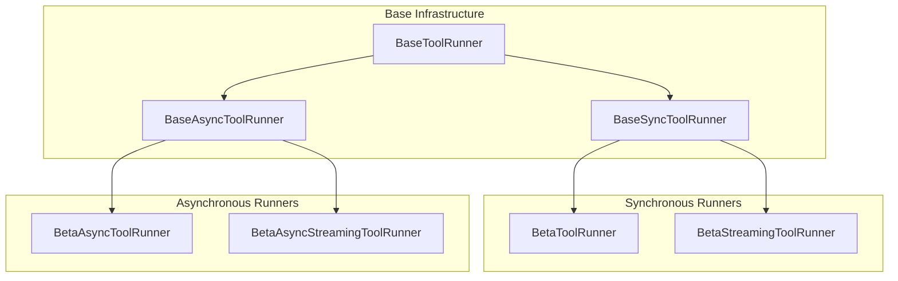
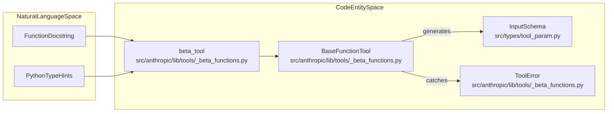
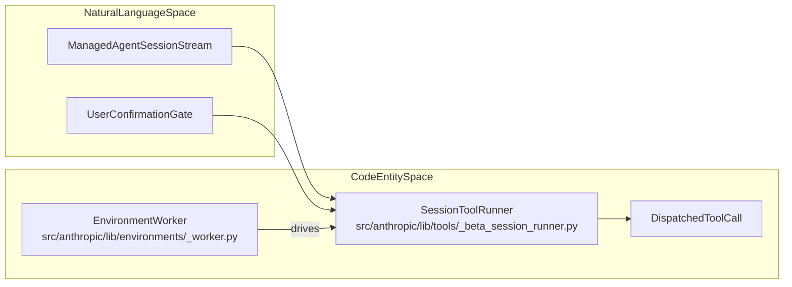

<!-- source: DeepWiki mcp.deepwiki.com · repo anthropics/anthropic-sdk-python · page 7.2 Tool Runners and MCP Integration · fetched 2026-10-26 -->

# Tool Runners and MCP Integration

Relevant source files

The following files were used as context for generating this wiki page:

- [examples/agents_comprehensive.py](examples/agents_comprehensive.py)
- [examples/managed-agents-observe-tool-calls.py](examples/managed-agents-observe-tool-calls.py)
- [examples/managed-agents-self-hosted-sandbox-worker.py](examples/managed-agents-self-hosted-sandbox-worker.py)
- [examples/managed-agents-worker-dispatch.py](examples/managed-agents-worker-dispatch.py)
- [examples/memory/basic.py](examples/memory/basic.py)
- [src/anthropic/lib/_scoped_client.py](src/anthropic/lib/_scoped_client.py)
- [src/anthropic/lib/environments/__init__.py](src/anthropic/lib/environments/__init__.py)
- [src/anthropic/lib/environments/_poller.py](src/anthropic/lib/environments/_poller.py)
- [src/anthropic/lib/environments/_worker.py](src/anthropic/lib/environments/_worker.py)
- [src/anthropic/lib/tools/__init__.py](src/anthropic/lib/tools/__init__.py)
- [src/anthropic/lib/tools/_beta_builtin_memory_tool.py](src/anthropic/lib/tools/_beta_builtin_memory_tool.py)
- [src/anthropic/lib/tools/_beta_functions.py](src/anthropic/lib/tools/_beta_functions.py)
- [src/anthropic/lib/tools/_beta_runner.py](src/anthropic/lib/tools/_beta_runner.py)
- [src/anthropic/lib/tools/_beta_session_runner.py](src/anthropic/lib/tools/_beta_session_runner.py)
- [src/anthropic/lib/tools/_files.py](src/anthropic/lib/tools/_files.py)
- [src/anthropic/lib/tools/_skills.py](src/anthropic/lib/tools/_skills.py)
- [src/anthropic/lib/tools/_tool_dispatch.py](src/anthropic/lib/tools/_tool_dispatch.py)
- [src/anthropic/lib/tools/_tool_params.py](src/anthropic/lib/tools/_tool_params.py)
- [src/anthropic/lib/tools/agent_toolset.py](src/anthropic/lib/tools/agent_toolset.py)
- [src/anthropic/lib/tools/mcp.py](src/anthropic/lib/tools/mcp.py)
- [src/anthropic/resources/beta/environments/work.py](src/anthropic/resources/beta/environments/work.py)
- [src/anthropic/tools/__init__.py](src/anthropic/tools/__init__.py)
- [src/anthropic/tools/memory.py](src/anthropic/tools/memory.py)
- [tests/lib/environments/test_poller.py](tests/lib/environments/test_poller.py)
- [tests/lib/environments/test_poller_method.py](tests/lib/environments/test_poller_method.py)
- [tests/lib/environments/test_worker.py](tests/lib/environments/test_worker.py)
- [tests/lib/test_scoped_client.py](tests/lib/test_scoped_client.py)
- [tests/lib/tools/memory_tools/test_filesystem.py](tests/lib/tools/memory_tools/test_filesystem.py)
- [tests/lib/tools/test_agent_toolset.py](tests/lib/tools/test_agent_toolset.py)
- [tests/lib/tools/test_files.py](tests/lib/tools/test_files.py)
- [tests/lib/tools/test_functions.py](tests/lib/tools/test_functions.py)
- [tests/lib/tools/test_runners.py](tests/lib/tools/test_runners.py)
- [tests/lib/tools/test_session_runner.py](tests/lib/tools/test_session_runner.py)
- [tests/lib/tools/test_skills.py](tests/lib/tools/test_skills.py)
- [tools.md](tools.md)

## Purpose and Scope

Tool runners provide the execution infrastructure for client-side tools, enabling automatic tool invocation, error catching, and response handling during message creation. The SDK provides synchronous and streaming runner variants that execute tools defined as Python functions. MCP (Model Context Protocol) integration extends this capability by allowing Claude to invoke tools hosted on external MCP servers. For managed agents and self-hosted environments, the SDK provides a dedicated agent toolset (`bash`, `read`, `write`, `edit`, `glob`, `grep`) and a `SessionToolRunner` to bridge agent events to local execution.

Sources: [src/anthropic/lib/tools/_beta_runner.py:1-194](), [src/anthropic/lib/tools/_beta_session_runner.py:1-16](), [src/anthropic/lib/tools/agent_toolset.py:1-31]()

## Tool Runner Architecture

The SDK provides runner classes (`BetaToolRunner`, `BetaStreamingToolRunner`, and their async equivalents) that manage the multi-turn conversational loop: invoking the API, executing requested client tools, appending results, and continuing until a terminal stop reason is reached.

### Tool Runner Class Hierarchy

Sources: [src/anthropic/lib/tools/_beta_runner.py:185-194](), [tools.md:64-105]()

### Runner Execution Loop and Control Flow

The runner evaluates assistant turn stop reasons using `_determine_next_step_from_stop_reason()`:
- `"tool_use"`: Executes requested client tools, appends tool results, and continues the loop.
- `"pause_turn"` or `"compaction"`: Resumes or handles compaction turns accordingly.
- Terminal reasons (`"end_turn"`, `"stop_sequence"`, `"max_tokens"`, `"refusal"`): Stop iteration and yield the final message.

With streaming enabled and `run_tools_eagerly=True`, tools execute as soon as the model finishes writing each call. Callers can inspect or defer tool execution using `runner.defer_tool_call()` during stream consumption.

Sources: [src/anthropic/lib/tools/_beta_runner.py:111-139](), [tools.md:64-110]()

## Function Tool Patterns

The SDK wraps Python functions into tool definitions consumable by Claude via decorators and schema generators.

### Tool Definition Helpers

| Entity | Role |
|--------|------|
| `@beta_tool` / `@beta_async_tool` | Decorator inspecting signatures and docstrings to generate JSON schemas via Pydantic v2. |
| `BetaFunctionTool` / `BetaAsyncFunctionTool` | Wrapper classes for synchronous and asynchronous user-defined functions. |
| `BetaBuiltinFunctionTool` / `BetaAsyncBuiltinFunctionTool` | Abstract base classes for built-in or specialized tool types. |
| `ToolError` | Exception raised inside a tool to return structured error content with `is_error: True` to the model. |

Sources: [src/anthropic/lib/tools/_beta_functions.py:30-107](), [src/anthropic/lib/tools/_beta_functions.py:147-186](), [tools.md:1-23]()

### Natural Language to Code Entity Mapping: Tool Definitions

Sources: [src/anthropic/lib/tools/_beta_functions.py:30-65](), [src/anthropic/lib/tools/_beta_functions.py:147-186]()

## MCP Toolset Integration

The Model Context Protocol (MCP) integration module (`src/anthropic/lib/tools/mcp.py`) provides helper functions to convert MCP types into Anthropic-compatible tool definitions and content blocks.

- `mcp_content()`: Converts MCP `TextContent`, `ImageContent`, and `EmbeddedResource` blocks into Anthropic content blocks.
- `UnsupportedMCPValueError`: Raised when an unsupported MCP value type (such as audio or resource links) is encountered.

Sources: [src/anthropic/lib/tools/mcp.py:1-161]()

## Memory Tool for Persistent State

The memory tool system (`src/anthropic/lib/tools/_beta_builtin_memory_tool.py`) allows Claude to maintain state across sessions via abstract base classes (`BetaAbstractMemoryTool`, `BetaAsyncAbstractMemoryTool`) that process structured memory commands (`view`, `create`, `str_replace`, `insert`, `delete`, `rename`).

Sources: [src/anthropic/lib/tools/_beta_builtin_memory_tool.py:56-170]()

## Agent Toolset (Bash/Read/Write/Edit/Glob/Grep)

The agent toolset (`src/anthropic/lib/tools/agent_toolset.py`) provides sandbox-compatible file and shell tools under `beta_agent_toolset_20260401`.

| Tool Name | Factory Function | Purpose |
|-----------|------------------|---------|
| `bash` | `beta_bash_tool` | Executes shell commands in a persistent `/bin/bash` subprocess. |
| `read` | `beta_read_tool` | Reads files or binary media (images/PDFs) with size bounds. |
| `write` | `beta_write_tool` | Creates or overwrites files within `workdir`. |
| `edit` | `beta_edit_tool` | Performs precise `old_string` to `new_string` replacements. |
| `glob` | `beta_glob_tool` | Locates files matching patterns. |
| `grep` | `beta_grep_tool` | Searches file contents using regular expressions. |

`AgentToolContext` manages the working directory boundaries and symlink-aware path resolution via `resolve_path()`.

Sources: [src/anthropic/lib/tools/agent_toolset.py:1-31](), [src/anthropic/lib/tools/agent_toolset.py:76-93]()

## Skills Tools

The skills module (`src/anthropic/lib/tools/_skills.py`) handles downloading and managing session-specific skill definitions into environment working directories.

Sources: [src/anthropic/lib/tools/agent_toolset.py:56-58]()

## SessionToolRunner and Managed Agents

`SessionToolRunner` (`src/anthropic/lib/tools/_beta_session_runner.py`) provides event-driven tool execution for Managed Agents. It attaches to session event streams, dispatches `agent.tool_use` and `agent.custom_tool_use` events against a local tool registry, handles user confirmation gates (`evaluated_permission` `ask`), and posts back `user.tool_result` / `user.custom_tool_result` events.

Sources: [src/anthropic/lib/tools/_beta_session_runner.py:1-96]()

### Natural Language to Code Entity Mapping: Session Tool Execution

Sources: [src/anthropic/lib/tools/_beta_session_runner.py:1-83](), [src/anthropic/lib/environments/_worker.py:1-25]()

---

