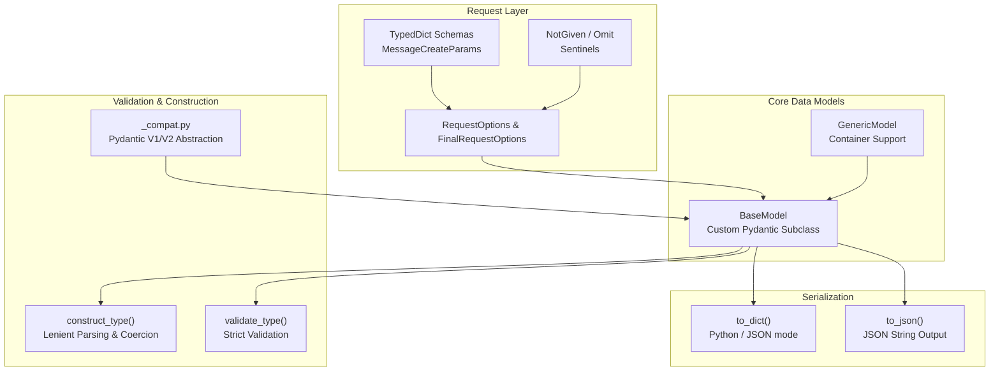

<!-- source: DeepWiki mcp.deepwiki.com · repo anthropics/anthropic-sdk-python · page 8 Data Models and Type System · fetched 2026-10-26 -->

# Data Models and Type System

Relevant source files

The following files were used as context for generating this wiki page:

- [.stats.yml](.stats.yml)
- [api.md](api.md)
- [scripts/mock-spec.json.gz](scripts/mock-spec.json.gz)
- [src/anthropic/_compat.py](src/anthropic/_compat.py)
- [src/anthropic/_models.py](src/anthropic/_models.py)
- [src/anthropic/_utils/__init__.py](src/anthropic/_utils/__init__.py)
- [src/anthropic/_utils/_reflection.py](src/anthropic/_utils/_reflection.py)
- [src/anthropic/_utils/_sync.py](src/anthropic/_utils/_sync.py)
- [src/anthropic/_utils/_typing.py](src/anthropic/_utils/_typing.py)
- [src/anthropic/_utils/_utils.py](src/anthropic/_utils/_utils.py)
- [src/anthropic/types/__init__.py](src/anthropic/types/__init__.py)
- [src/anthropic/types/anthropic_beta_param.py](src/anthropic/types/anthropic_beta_param.py)
- [src/anthropic/types/beta/__init__.py](src/anthropic/types/beta/__init__.py)
- [tests/test_models.py](tests/test_models.py)

The Anthropic Python SDK features a robust data model and type system built on top of Pydantic. It provides cross-version compatibility, lenient construction for evolving data or partial responses, strict validation options, custom serialization, and sophisticated request/response parameter typing [src/anthropic/_models.py:1-150](), [src/anthropic/_compat.py:1-60]().

As a parent page, this document provides a high-level overview of the type system's components and architecture. For deep technical details, refer to the child pages linked throughout.

## Type System Architecture

The type system bridges user inputs, request options, and API response payloads using custom Pydantic extensions, helper utilities, and abstraction layers.

**Sources:** [src/anthropic/_models.py:107-210](), [src/anthropic/_compat.py:1-135](), [src/anthropic/_types.py:120-161]()

---

## BaseModel and Type Construction

The SDK defines a custom `BaseModel` class extending Pydantic's `BaseModel` [src/anthropic/_models.py:107-114]() to support extra fields, custom serialization options, and public request metadata properties such as `_request_id` and `_workspace_id` [src/anthropic/_models.py:126-150](). 

For lenient parsing, the `construct_type()` helper recursively constructs nested models, handles discriminated unions via metadata caching, and coerces basic types without raising strict validation errors on malformed fields [src/anthropic/_models.py:498-615]().

For details on model construction pipelines, lenient parsing, and discriminated unions, see [BaseModel and Type Construction](#8.1).

**Sources:** [src/anthropic/_models.py:107-150](), [src/anthropic/_models.py:498-615]()

---

## Type Validation and Serialization

When parsing API responses or validating inputs, the SDK offers two distinct paths: `validate_type()` for strict Pydantic core schema validation [src/anthropic/_models.py:748-753](), and `construct_type()` for resilient, lenient parsing [src/anthropic/_models.py:498-615](). Response validation can be configured via strict response validation flags.

For serialization, models provide `to_dict()` and `to_json()` methods [src/anthropic/_models.py:152-210]() that support output modes (`python` vs `json`), field exclusions (`exclude_unset`, `exclude_none`), and preservation of API field aliases (`use_api_names=True`) [src/anthropic/_models.py:152-199]().

For details on validation strategies, strict response validation, and serialization options, see [Type Validation and Serialization](#8.2).

**Sources:** [src/anthropic/_models.py:152-210](), [src/anthropic/_models.py:498-615](), [src/anthropic/_models.py:748-753]()

---

## Pydantic V1/V2 Compatibility

To maintain compatibility with both Pydantic v1 and v2 ecosystems without forcing downstream dependency conflicts, the SDK implements an abstraction layer in `_compat.py` [src/anthropic/_compat.py:1-135](). 

The module detects the active Pydantic version (`PYDANTIC_V1`) [src/anthropic/_compat.py:20]() and normalizes core operations such as object dumping (`model_dump`) [src/anthropic/_compat.py:139-168](), model validation (`parse_obj`) [src/anthropic/_compat.py:75-79](), field inspection [src/anthropic/_compat.py:82-103](), and generic model definitions [src/anthropic/_compat.py:177-191]().

For details on the compatibility layer and version detection, see [Pydantic V1/V2 Compatibility](#8.3).

**Sources:** [src/anthropic/_compat.py:1-191]()

---

## Request and Response Types

Request parameters are primarily defined using `TypedDict` schemas (such as `MessageCreateParams` [src/anthropic/types/message_create_params.py]()) which provide static type checking and IDE autocomplete without runtime overhead. 

The SDK also utilizes special sentinels (`NotGiven` and `Omit`) [src/anthropic/_types.py:131-161]() to distinguish between unset parameters and explicit `null` values. These options flow into `RequestOptions` and `FinalRequestOptions` models before transmission across the HTTP layer [src/anthropic/_models.py:856-918]().

For details on request/response parameter schemas, sentinels, and their lifecycle through the request pipeline, see [Request and Response Types](#8.4).

**Sources:** [src/anthropic/_types.py:120-161](), [src/anthropic/_models.py:856-918]()

---

