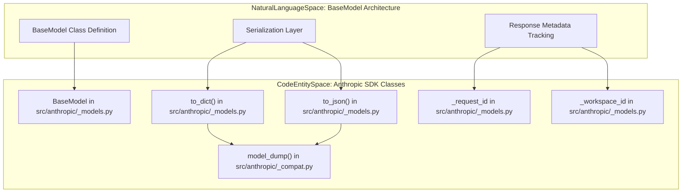
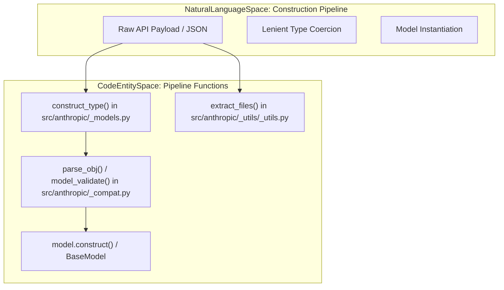

<!-- source: DeepWiki mcp.deepwiki.com · repo anthropics/anthropic-sdk-python · page 8.1 BaseModel and Type Construction · fetched 2026-10-26 -->

# BaseModel and Type Construction

Relevant source files

The following files were used as context for generating this wiki page:

- [src/anthropic/_compat.py](src/anthropic/_compat.py)
- [src/anthropic/_models.py](src/anthropic/_models.py)
- [src/anthropic/_utils/__init__.py](src/anthropic/_utils/__init__.py)
- [src/anthropic/_utils/_reflection.py](src/anthropic/_utils/_reflection.py)
- [src/anthropic/_utils/_sync.py](src/anthropic/_utils/_sync.py)
- [src/anthropic/_utils/_typing.py](src/anthropic/_utils/_typing.py)
- [src/anthropic/_utils/_utils.py](src/anthropic/_utils/_utils.py)
- [tests/test_models.py](tests/test_models.py)

This document describes the custom `BaseModel` class, the `construct_type()` function for lenient parsing, discriminated unions, `EagerIterable`, and the model construction pipeline used throughout the Anthropic SDK.

**Scope**: This page covers the model construction pipeline, lenient type parsing, and custom data container classes. For strict validation and serialization options, see [Type Validation and Serialization](8.2). For Pydantic version compatibility, see [Pydantic V1/V2 Compatibility](8.3).

## BaseModel Class

The SDK defines a custom `BaseModel` class that extends Pydantic's `BaseModel` with additional functionality needed for robust API client behavior, such as cross-version support, extra field allowance, and request tracking.

### Core Design

The `BaseModel` class is defined in [src/anthropic/_models.py:114-129]() and provides:
- **Extra field support**: Configured with `extra="allow"` to preserve unknown fields returned by the API [src/anthropic/_models.py:123-128]().
- **Cross-version compatibility**: Adapts between Pydantic v1 and v2 via `PYDANTIC_V1` and `ConfigDict` [src/anthropic/_models.py:115-128]().
- **Enhanced serialization**: Provides `to_dict()` and `to_json()` convenience wrappers [src/anthropic/_models.py:152-210]().
- **Request tracking**: Exposes public `_request_id` and `_workspace_id` attributes on top-level response objects [src/anthropic/_models.py:130-150]().

### System Architecture: BaseModel Components

**Sources**: [src/anthropic/_models.py:114-210](), [src/anthropic/_compat.py:139-168]()

### Serialization Methods

`BaseModel` implements helper methods that wrap Pydantic's underlying dump routines:
- `to_dict()`: Recursively generates a dictionary representation using API alias names by default (`use_api_names=True`) and excluding unset fields (`exclude_unset=True`) [src/anthropic/_models.py:152-188]().
- `to_json()`: Serializes the model into an indented JSON string format [src/anthropic/_models.py:190-210]().

**Sources**: [src/anthropic/_models.py:114-210]()

---

## The Model Construction Pipeline

The model construction pipeline handles incoming API payloads, transforming raw dictionaries and JSON responses into strongly-typed SDK models without raising validation errors on unexpected or missing fields.

### Pipeline Execution Flow

**Sources**: [src/anthropic/_models.py:114-129](), [src/anthropic/_compat.py:75-80](), [src/anthropic/_utils/_utils.py:37-58]()

---

## Lenient Type Parsing with construct_type()

The `construct_type()` function provides lenient type parsing across the SDK. It attempts to coerce data into expected types but falls back gracefully to returning raw values if parsing fails, preventing client crashes due to evolving API schemas.

### Key Coercion Behaviors
- **Union and Discriminated Union Handling**: Inspects union definitions and matches payloads using discriminator metadata [src/anthropic/_models.py:541-576]().
- **Collection Coercion**: Recursively constructs items in lists, tuples, and dictionaries [src/anthropic/_models.py:578-604]().
- **Primitive Coercion**: Safely coerces integer-to-float values and parses ISO datetime/date strings [src/anthropic/_models.py:606-625]().

**Sources**: [src/anthropic/_models.py:510-627]()

---

## Discriminated Unions and Caching

Complex API responses (such as message content blocks or streaming events) use discriminated unions where a field like `type` determines the concrete model class.

### Discriminator Caching

The SDK maintains a `DISCRIMINATOR_CACHE` implemented as a `weakref.WeakKeyDictionary` [src/anthropic/_models.py:635]() to store `DiscriminatorDetails` mapping [src/anthropic/_models.py:638-676](). The helper function `_build_discriminated_union_meta()` inspects union definitions to map literal discriminator values to model types [src/anthropic/_models.py:679-736]().

| Union Type | Discriminator Field | Target Variants |
|------------|---------------------|-----------------|
| `BetaContentBlock` | `type` | `BetaTextBlock`, `BetaThinkingBlock`, `BetaToolUseBlock`, etc. |
| `ContentBlock` | `type` | `BetaTextBlock`, `BetaThinkingBlock`, etc. |

**Sources**: [src/anthropic/_models.py:635-736]()

---

## EagerIterable Class

The `EagerIterable` class [tests/test_models.py:12]() handles iterable response data where collection evaluation needs to occur eagerly or wrap streaming/paginated items into a concrete list structure while preserving iterator interfaces.

**Sources**: [tests/test_models.py:1-13]()

---

