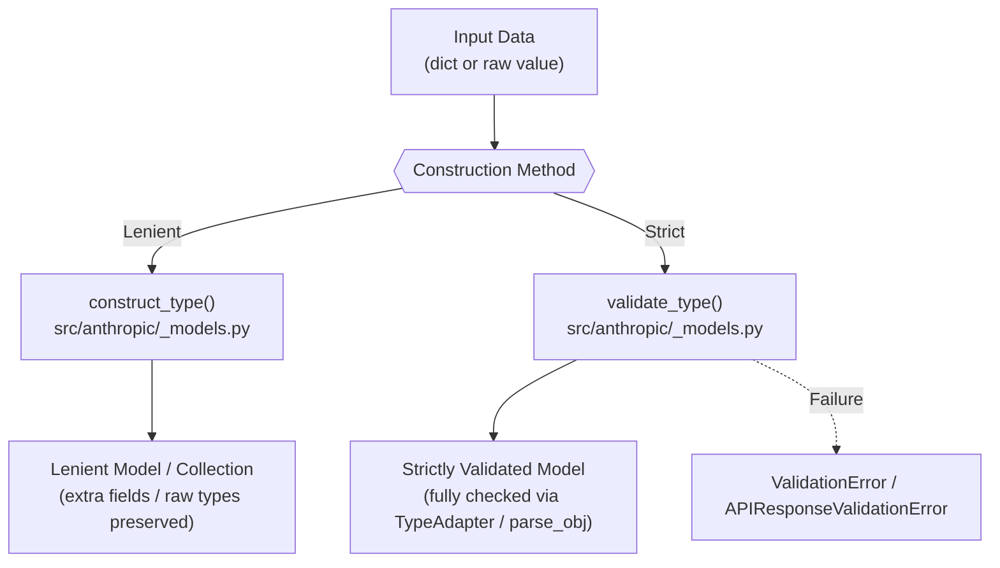
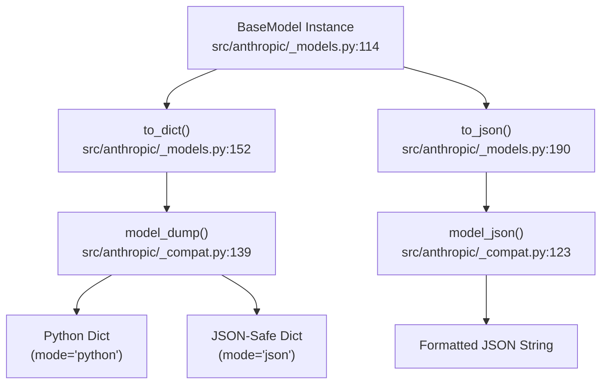

<!-- source: DeepWiki mcp.deepwiki.com · repo anthropics/anthropic-sdk-python · page 8.2 Type Validation and Serialization · fetched 2026-10-26 -->

# Type Validation and Serialization

<details>
<summary>Relevant source files</summary>

The following files were used as context for generating this wiki page:

- [examples/batch_results.py](examples/batch_results.py)
- [src/anthropic/_compat.py](src/anthropic/_compat.py)
- [src/anthropic/_decoders/jsonl.py](src/anthropic/_decoders/jsonl.py)
- [src/anthropic/_exceptions.py](src/anthropic/_exceptions.py)
- [src/anthropic/_models.py](src/anthropic/_models.py)
- [src/anthropic/_response.py](src/anthropic/_response.py)
- [src/anthropic/_streaming.py](src/anthropic/_streaming.py)
- [src/anthropic/_utils/__init__.py](src/anthropic/_utils/__init__.py)
- [src/anthropic/_utils/_reflection.py](src/anthropic/_utils/_reflection.py)
- [src/anthropic/_utils/_sync.py](src/anthropic/_utils/_sync.py)
- [src/anthropic/_utils/_typing.py](src/anthropic/_utils/_typing.py)
- [src/anthropic/_utils/_utils.py](src/anthropic/_utils/_utils.py)
- [src/anthropic/resources/beta/messages/__init__.py](src/anthropic/resources/beta/messages/__init__.py)
- [tests/decoders/test_jsonl.py](tests/decoders/test_jsonl.py)
- [tests/test_models.py](tests/test_models.py)
- [tests/test_response.py](tests/test_response.py)
- [tests/test_streaming.py](tests/test_streaming.py)
- [tests/utils.py](tests/utils.py)

</details>


## Purpose and Scope

This document covers the validation and serialization mechanisms in the Anthropic Python SDK's type system. It explains how data is strictly validated using `validate_type()` versus leniently constructed using `construct_type()`, how strict response validation behaves, and how model instances are serialized to dictionaries or JSON strings using `to_dict()` and `to_json()` with various configuration options.

For information about model construction and type building, see [8.1 BaseModel and Type Construction](). For details on the Pydantic V1/V2 compatibility layer that enables these methods to operate across versions, see [8.3 Pydantic V1/V2 Compatibility]().

---

## Validation System: `validate_type()` vs `construct_type()`

The SDK provides two distinct mechanisms for instantiating and checking data against data models:

1. **`construct_type()` (Lenient Construction)**: Used primarily when ingesting external API payloads where robustness against schema drift is required. It avoids raising validation errors on unexpected types or extra fields, recursively coercing or preserving foreign structures [tests/test_models.py:21-35]().
2. **`validate_type()` (Strict Validation)**: Enforces strict adherence to type annotations. If input data fails to match the expected schema or types, a Pydantic `ValidationError` or `APIResponseValidationError` is raised [src/anthropic/_exceptions.py:57-65]().



Sources: [src/anthropic/_models.py:1-1051](), [tests/test_models.py:1-1096]()

---

## Strict Response Validation

By default, the SDK attempts to parse and validate incoming API responses into strongly-typed SDK models (such as `Message`, `Model`, etc.). When `strict_response_validation` is enabled or configured on the client/request options, response payloads undergo rigorous schema validation [src/anthropic/_response.py:32-65]().

If the payload returned by the Anthropic API violates the expected Pydantic schema (e.g. missing required fields or type mismatches), the SDK catches the validation failure and raises an `APIResponseValidationError` [src/anthropic/_exceptions.py:57-65](), bundling the raw response `httpx2.Response` [src/anthropic/_response.py:58]() and failure details to aid debugging.

```mermaid
sequenceDiagram
    participant API as Anthropic API
    participant Client as BaseClient / APIResponse
    participant Parser as _parse() / validate_type()
    participant User as Caller Code

    API->>Client: HTTP 200 OK (JSON Body)
    Client->>Parser: response.parse(to=ModelClass)
    
    alt Strict Validation / Standard Parse
        Parser->>Parser: model_validate() / validate_type()
        alt Schema Matches
            Parser--->User: Typed BaseModel Instance
        else Schema Mismatch
            Parser--->Client: ValidationError
            Client--->User: Raise APIResponseValidationError
        end
    end
```

Sources: [src/anthropic/_response.py:130-199](), [src/anthropic/_exceptions.py:57-65]()

---

## Serialization Methods: `to_dict()` and `to_json()`

Subclasses of `BaseModel` provide built-in serialization methods that abstract underlying Pydantic version differences (`model_dump()` / `model_dump_json()`) via `_compat.py` [src/anthropic/_compat.py:117-127]() [src/anthropic/_models.py:152-210]().



Sources: [src/anthropic/_models.py:114-210](), [src/anthropic/_compat.py:117-127]()

### `to_dict()` Parameters

The `to_dict()` method generates a dictionary representation of the model with fine-grained control over naming conventions and field inclusion [src/anthropic/_models.py:152-188]().

| Parameter | Type | Default | Description |
|-----------|------|---------|-------------|
| `mode` | `Literal["json", "python"]` | `"python"` | If `"json"`, converts non-JSON types (like `datetime`) to serializable primitives [src/anthropic/_models.py:155](). |
| `use_api_names` | `bool` | `True` | Whether to use API response aliases (e.g., camelCase) instead of Python property names [src/anthropic/_models.py:156](). |
| `exclude_unset` | `bool` | `True` | Excludes fields that were not explicitly set or received from the API [src/anthropic/_models.py:157](). |
| `exclude_defaults` | `bool` | `False` | Excludes fields that match their default values [src/anthropic/_models.py:158](). |
| `exclude_none` | `bool` | `False` | Excludes fields whose value is `None` [src/anthropic/_models.py:159](). |
| `warnings` | `bool` | `True` | Logs warnings when invalid fields are encountered (supported in Pydantic v2) [src/anthropic/_models.py:160](). |

Sources: [src/anthropic/_models.py:152-188]()

### `to_json()` Parameters

The `to_json()` method serializes the model directly into a JSON string [src/anthropic/_models.py:190-210]().

| Parameter | Type | Default | Description |
|-----------|------|---------|-------------|
| `indent` | `int \| None` | `2` | Indentation spacing for formatted JSON output; pass `None` for compact representation [src/anthropic/_models.py:193](). |
| `use_api_names` | `bool` | `True` | Uses API field aliases in the generated JSON string [src/anthropic/_models.py:194](). |
| `exclude_unset` | `bool` | `True` | Excludes fields not explicitly set [src/anthropic/_models.py:195](). |
| `exclude_defaults` | `bool` | `False` | Excludes fields set to their default value [src/anthropic/_models.py:196](). |
| `exclude_none` | `bool` | `False` | Excludes fields with `None` values [src/anthropic/_models.py:197](). |
| `warnings` | `bool` | `True` | Controls serialization warnings [src/anthropic/_models.py:198](). |

Sources: [src/anthropic/_models.py:190-210]()

---

## Pydantic Compatibility Layer for Serialization

Because the SDK supports both Pydantic V1 and V2 simultaneously, serialization calls are routed through compatibility helpers in `src/anthropic/_compat.py` [src/anthropic/_compat.py:117-174]().

- **`model_dump()`**: Wraps model dictionary exportation, translating Pydantic v1 `.dict()` calls into v2 `.model_dump()` equivalents while handling custom JSON modes [src/anthropic/_compat.py:139-168]().
- **`model_json()`**: Wraps string serialization, dispatching to model `.json()` in V1 and `.model_dump_json()` in V2 [src/anthropic/_compat.py:123-127]().

Sources: [src/anthropic/_compat.py:117-174]()

---

