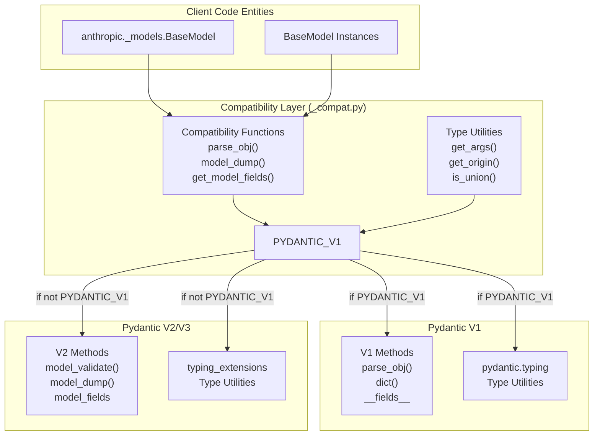
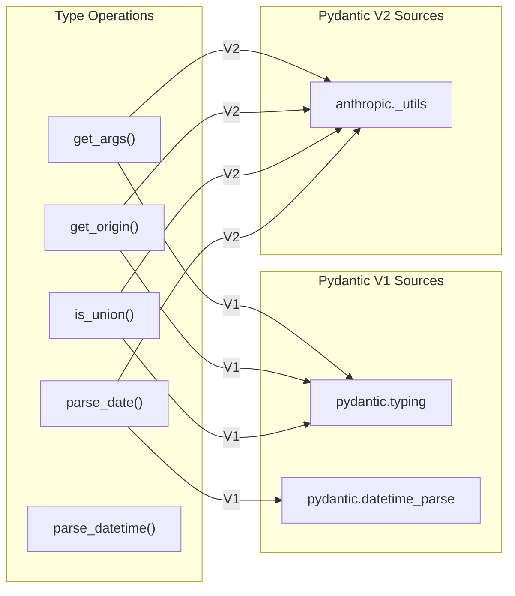
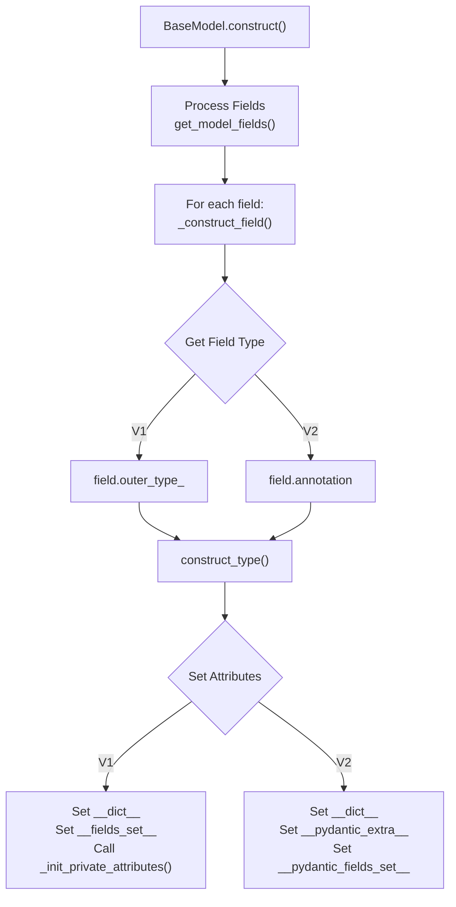

<!-- source: DeepWiki mcp.deepwiki.com · repo anthropics/anthropic-sdk-python · page 8.3 Pydantic V1/V2 Compatibility · fetched 2026-10-26 -->

# Pydantic V1/V2 Compatibility

<details>
<summary>Relevant source files</summary>

The following files were used as context for generating this wiki page:

- [.release-please-manifest.json](.release-please-manifest.json)
- [CHANGELOG.md](CHANGELOG.md)
- [pyproject.toml](pyproject.toml)
- [requirements-dev.lock](requirements-dev.lock)
- [src/anthropic/_compat.py](src/anthropic/_compat.py)
- [src/anthropic/_models.py](src/anthropic/_models.py)
- [src/anthropic/_utils/__init__.py](src/anthropic/_utils/__init__.py)
- [src/anthropic/_utils/_reflection.py](src/anthropic/_utils/_reflection.py)
- [src/anthropic/_utils/_sync.py](src/anthropic/_utils/_sync.py)
- [src/anthropic/_utils/_typing.py](src/anthropic/_utils/_typing.py)
- [src/anthropic/_utils/_utils.py](src/anthropic/_utils/_utils.py)
- [src/anthropic/_version.py](src/anthropic/_version.py)
- [tests/test_models.py](tests/test_models.py)
- [uv.lock](uv.lock)

</details>


## Purpose and Scope

This document explains the Pydantic compatibility layer that enables the Anthropic Python SDK to work seamlessly with both Pydantic v1 and v2/v3. The SDK detects the installed Pydantic version at runtime and adapts its behavior accordingly, providing a unified API surface regardless of the underlying Pydantic version.

For information about the BaseModel type system and validation, see [8.1 BaseModel and Type Construction](). For details on serialization methods, see [8.2 Type Validation and Serialization]().

---

## Version Detection

The SDK determines which Pydantic version is installed using a version string check in `src/anthropic/_compat.py`.

[src/anthropic/_compat.py:20-20]()

```python
PYDANTIC_V1 = pydantic.VERSION.startswith("1.")
```

This `PYDANTIC_V1` boolean flag is imported throughout the codebase (e.g., in `src/anthropic/_models.py` [src/anthropic/_models.py:71-83]()) and used to conditionally execute version-specific code paths. The detection happens once at import time, ensuring consistent behavior throughout the application lifecycle.

**Sources:** [src/anthropic/_compat.py:20-20](), [src/anthropic/_models.py:71-83]()

---

## Compatibility Layer Architecture

The compatibility layer provides a unified interface for operations that differ between Pydantic versions. The architecture consists of three main components:

**Diagram: Pydantic Compatibility Abstraction**


**Sources:** [src/anthropic/_compat.py:1-227]()

---

## Method Mapping and Aliases

The compatibility layer provides wrapper functions that route to the appropriate Pydantic version's methods.

| Operation | Pydantic V1 | Pydantic V2/V3 | Compatibility Function |
|-----------|-------------|----------------|------------------------|
| Parse object | `model.parse_obj(value)` | `model.model_validate(value)` | `parse_obj(model, value)` [src/anthropic/_compat.py:75-80]() |
| Serialize to dict | `model.dict()` | `model.model_dump()` | `model_dump(model, ...)` [src/anthropic/_compat.py:139-168]() |
| Serialize to JSON | `model.json()` | `model.model_dump_json()` | `model_json(model, ...)` [src/anthropic/_compat.py:123-127]() |
| Parse JSON | `model.parse_raw(data)` | `model.model_validate_json(data)` | `model_parse_json(model, data)` [src/anthropic/_compat.py:129-133]() |
| Copy model | `model.copy()` | `model.model_copy()` | `model_copy(model, ...)` [src/anthropic/_compat.py:117-121]() |
| Get fields | `model.__fields__` | `model.model_fields` | `get_model_fields(model)` [src/anthropic/_compat.py:111-115]() |
| Get config | `model.__config__` | `model.model_config` | `get_model_config(model)` [src/anthropic/_compat.py:105-109]() |
| Check required | `field.required` | `field.is_required()` | `field_is_required(field)` [src/anthropic/_compat.py:82-86]() |
| Get default | `field.get_default()` | `field.get_default()` (with `PydanticUndefined` handling) | `field_get_default(field)` [src/anthropic/_compat.py:88-97]() |
| Get field type | `field.outer_type_` | `field.annotation` | `field_outer_type(field)` [src/anthropic/_compat.py:99-103]() |

**Sources:** [src/anthropic/_compat.py:75-174]()

---

## Type Utility Compatibility

Type introspection utilities are sourced from different modules depending on the Pydantic version.

**Diagram: Type Utility Routing**


The imports are conditionally defined in `src/anthropic/_compat.py`:

[src/anthropic/_compat.py:44-60]()

- **Pydantic V1:** Imports from `pydantic.typing` and `pydantic.datetime_parse`.
- **Pydantic V2/V3:** Imports from `anthropic._utils` which wraps `typing_extensions`.

**Sources:** [src/anthropic/_compat.py:22-61]()

---

## BaseModel Version-Specific Configuration

The `BaseModel` class in `src/anthropic/_models.py` adapts its configuration and methods based on the Pydantic version.

### Configuration Differences

[src/anthropic/_models.py:114-129]()

```python
class BaseModel(pydantic.BaseModel):
    if PYDANTIC_V1:

        @property
        @override
        def model_fields_set(self) -> set[str]:
            # a forwards-compat shim for pydantic v2
            return self.__fields_set__  # type: ignore

        class Config(pydantic.BaseConfig):  # pyright: ignore[reportDeprecated]
            extra: Any = pydantic.Extra.allow  # type: ignore
    else:
        model_config: ClassVar[ConfigDict] = ConfigDict(
            extra="allow", defer_build=coerce_boolean(os.environ.get("DEFER_PYDANTIC_BUILD", "true"))
        )
```

**Key differences:**
- **V1:** Uses nested `Config` class with `pydantic.Extra.allow` [src/anthropic/_models.py:123-124]().
- **V2:** Uses `model_config` class variable with `ConfigDict` [src/anthropic/_models.py:126-128]().
- **V1 Shim:** Provides `model_fields_set` property as a shim for Pydantic V2's property name, mapping to `__fields_set__` [src/anthropic/_models.py:117-121]().

**Sources:** [src/anthropic/_models.py:114-129]()

---

## Model Construction Compatibility

The `construct()` method handles model construction without validation differently between versions.

**Diagram: Model Construction Flow**


The implementation in `src/anthropic/_models.py` shows:

1. **Field Type Access:** Uses `field_outer_type()` for V1 compatibility.
2. **Extra Fields:** V1 stores in model dict, V2 uses `__pydantic_extra__`.
3. **Fields Set Tracking:** V1 uses `__fields_set__`, V2 uses `__pydantic_fields_set__`.

**Sources:** [src/anthropic/_models.py](), [src/anthropic/_compat.py:99-103]()

---

## Serialization Compatibility

The `model_dump()` compatibility function handles parameter differences between versions.

| Parameter | Pydantic V1 | Pydantic V2/V3 | Notes |
|-----------|-------------|----------------|-------|
| `mode` | ❌ Not supported natively | ✅ `"json"` or `"python"` | V1 implementation uses internal dictionaries |
| `by_alias` | ✅ Supported | ✅ Supported | Same in both versions |
| `exclude_unset` | ✅ Supported | ✅ Supported | Same in both versions |
| `warnings` | ❌ Ignored/Defaulted | ✅ Supported | Forced to `True` in Pydantic v1 [src/anthropic/_compat.py:159]() |

The `model_dump()` function in `src/anthropic/_compat.py` provides a unified interface:

[src/anthropic/_compat.py:139-168]()

```python
def model_dump(
    model: pydantic.BaseModel,
    *,
    exclude: IncEx | None = None,
    exclude_unset: bool = False,
    exclude_defaults: bool = False,
    warnings: bool = True,
    mode: Literal["json", "python"] = "python",
    by_alias: bool | None = None,
) -> dict[str, Any]:
    if (not PYDANTIC_V1) or hasattr(model, "model_dump"):
        # ... logic for V2
    return cast(
        "dict[str, Any]",
        model.dict(...)
    )
```

**Sources:** [src/anthropic/_compat.py:139-168](), [src/anthropic/_models.py:152-188]()

---

## GenericModel Compatibility

Generic models require different base classes depending on the version.

[src/anthropic/_compat.py:182-191]()

**Pydantic V1:**
```python
if PYDANTIC_V1:
    import pydantic.generics
    class GenericModel(pydantic.generics.GenericModel, pydantic.BaseModel): ...
```

**Pydantic V2/V3:**
```python
else:
    # there no longer needs to be a distinction in v2 but
    # we still have to create our own subclass to avoid
    # inconsistent MRO ordering errors
    class GenericModel(pydantic.BaseModel): ...
```

This allows the SDK's `GenericModel` in `src/anthropic/_models.py` to inherit correctly without MRO errors.

**Sources:** [src/anthropic/_compat.py:177-191](), [src/anthropic/_models.py:74]()

---

## Testing Across Versions

The SDK's test suite and dependency management configurations explicitly handle differences in how Pydantic versions represent data or perform conversions. Dependencies and conflicts are defined in `pyproject.toml` to prevent mixed-version environments:

[pyproject.toml:60-69]()

```toml
conflicts = [
    [
      { group = "pydantic-v1" },
      { group = "pydantic-v2" },
    ],
    [
      { group = "pydantic-v1" },
      { extra = "mcp" },
    ],
]
```

**Sources:** [pyproject.toml:60-69](), [tests/test_models.py:11-12]()

---

## Configuration Dictionary Compatibility

The `ConfigDict` type only exists in Pydantic V2. The compatibility layer handles this for type checkers and runtime:

[src/anthropic/_compat.py:64-72]()

```python
if TYPE_CHECKING:
    from pydantic import ConfigDict as ConfigDict
else:
    if PYDANTIC_V1:
        # TODO: provide an error message here?
        ConfigDict = None
    else:
        from pydantic import ConfigDict as ConfigDict
```

**Sources:** [src/anthropic/_compat.py:64-72]()

---

