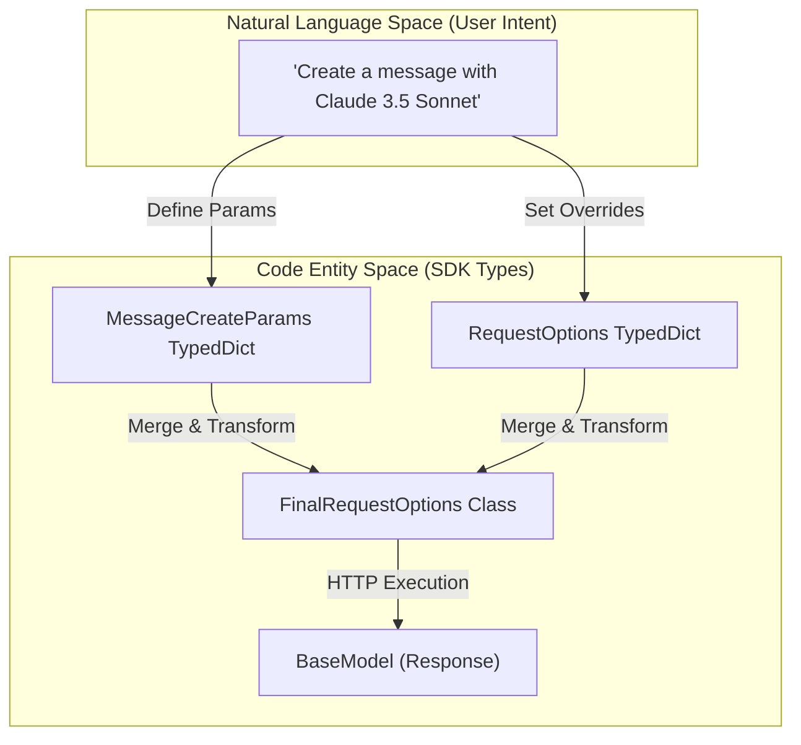
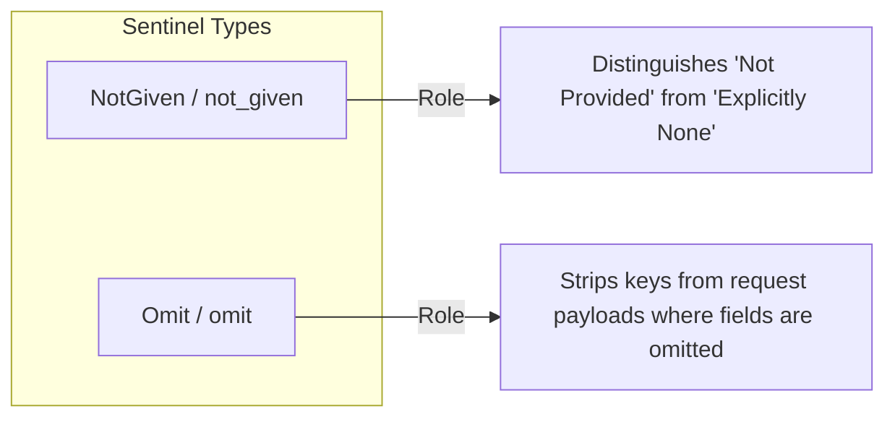
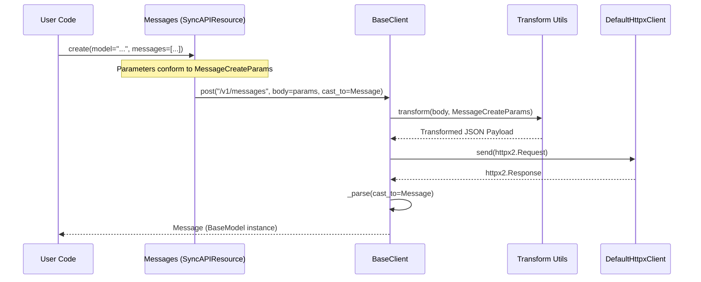

<!-- source: DeepWiki mcp.deepwiki.com · repo anthropics/anthropic-sdk-python · page 8.4 Request and Response Types · fetched 2026-10-26 -->

# Request and Response Types

<details>
<summary>Relevant source files</summary>

The following files were used as context for generating this wiki page:

- [CONTRIBUTING.md](CONTRIBUTING.md)
- [README.md](README.md)
- [scripts/utils/ruffen-docs.py](scripts/utils/ruffen-docs.py)
- [src/anthropic/__init__.py](src/anthropic/__init__.py)
- [src/anthropic/_base_client.py](src/anthropic/_base_client.py)
- [src/anthropic/_client.py](src/anthropic/_client.py)
- [src/anthropic/_constants.py](src/anthropic/_constants.py)
- [src/anthropic/_types.py](src/anthropic/_types.py)
- [src/anthropic/resources/beta/messages/messages.py](src/anthropic/resources/beta/messages/messages.py)
- [src/anthropic/resources/messages/messages.py](src/anthropic/resources/messages/messages.py)
- [src/anthropic/types/beta/message_count_tokens_params.py](src/anthropic/types/beta/message_count_tokens_params.py)
- [src/anthropic/types/beta/message_create_params.py](src/anthropic/types/beta/message_create_params.py)
- [src/anthropic/types/message_count_tokens_params.py](src/anthropic/types/message_count_tokens_params.py)
- [src/anthropic/types/message_create_params.py](src/anthropic/types/message_create_params.py)
- [tests/test_client.py](tests/test_client.py)

</details>


This page documents the request configuration system, sentinel types, parameter schemas, and response modeling used throughout the Anthropic Python SDK. It covers `RequestOptions`, `FinalRequestOptions`, TypedDict parameter schemas like `MessageCreateParams`, sentinel values (`NotGiven`, `Omit`), and how data flows through the request and response pipeline.

## Overview

The SDK bridges user-facing requests and HTTP-level payloads by leveraging static `TypedDict` parameter schemas for type checking, sentinel values to distinguish omitted arguments from explicit `None` values, and Pydantic-based `BaseModel` classes for response parsing.



Sources: [src/anthropic/_models.py:85-86](), [src/anthropic/_types.py:41-72](), [src/anthropic/types/message_create_params.py:34-48]()

## Request Configuration Types

### RequestOptions
`RequestOptions` is a user-facing `TypedDict` utilized to override per-request configuration such as extra headers, query parameters, request bodies, and timeouts without altering client-level defaults.

Sources: [src/anthropic/_types.py:64](), [src/anthropic/_client.py:11-18]()

### FinalRequestOptions
Internally, client methods consolidate client defaults, method parameters, and `RequestOptions` into an instance of `FinalRequestOptions`. This object holds the normalized state required to construct an underlying HTTP request.

| Field | Type | Role |
|-------|------|------|
| `method` | `str` | HTTP method verb (e.g., `"post"`) |
| `url` | `str` | Target endpoint path |
| `params` | `Query` | Merged URL query parameters |
| `headers` | `Headers` | Merged HTTP headers including sentinels |
| `json_data` | `Body` | Primary JSON payload data |
| `extra_json` | `AnyMapping` | Additional fields merged into the payload body |

Sources: [src/anthropic/_models.py:85-86](), [src/anthropic/_base_client.py:48-49]()

## Sentinel System (`NotGiven` and `Omit`)

The SDK defines custom sentinel types to distinguish between a parameter that was omitted by the caller (allowing defaults to take effect) versus a parameter explicitly provided with a `None` value.



- **`NotGiven` / `not_given`**: Used in function signatures to indicate optional arguments where omitting the argument differs from passing `None`. [src/anthropic/_types.py:57]()
- **`Omit` / `omit`**: Used to strip specific fields from serialized request dictionaries. [src/anthropic/_types.py:53]()

Sources: [src/anthropic/_types.py:51-72](), [src/anthropic/_base_client.py:70-71]()

## TypedDict Schemas (Request Params)

API resource methods accept strict `TypedDict` schemas to validate parameters at compile-time and runtime. 

### MessageCreateParams
The stable Messages API relies on `MessageCreateParams` (and its base/streaming variants) to define the schema for `client.messages.create()`.

```python
class MessageCreateParamsBase(TypedDict, total=False):
    max_tokens: Required[int]
    messages: Required[Iterable[MessageParam]]
    model: Required[ModelParam]
    # ... additional optional parameters
```

Similarly, beta endpoints use corresponding schemas such as `BetaMessageCreateParams` located in beta namespaces.

Sources: [src/anthropic/types/message_create_params.py:34-48](), [src/anthropic/types/beta/message_create_params.py:36-50]()

## Response Types and BaseModel

All SDK response models inherit from `anthropic._models.BaseModel`, which extends Pydantic to provide lenient type construction, serialization hooks, and request tracking.

### Key Features of BaseModel
- **Lenient Construction**: Employs `construct_type()` for fault-tolerant parsing of incoming API payloads. [src/anthropic/_models.py:85]()
- **Serialization**: Provides `to_dict()` and `to_json()` methods respecting camelCase/snake_case mapping. [src/anthropic/_base_client.py:84]()
- **Pydantic Compatibility Layer**: Abstracts differences between Pydantic v1 and v2 via `_compat.py`. [src/anthropic/_compat.py:84]()

Sources: [src/anthropic/_models.py:85-86](), [src/anthropic/_compat.py:84]()

## Data Flow Pipeline

The sequence below traces how user parameters flow through TypedDict schemas, transformation utilities, and internal option objects before reaching the HTTP layer.



Sources: [src/anthropic/_base_client.py:1-250](), [src/anthropic/resources/messages/messages.py:122-150]()

---

