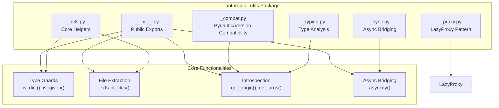
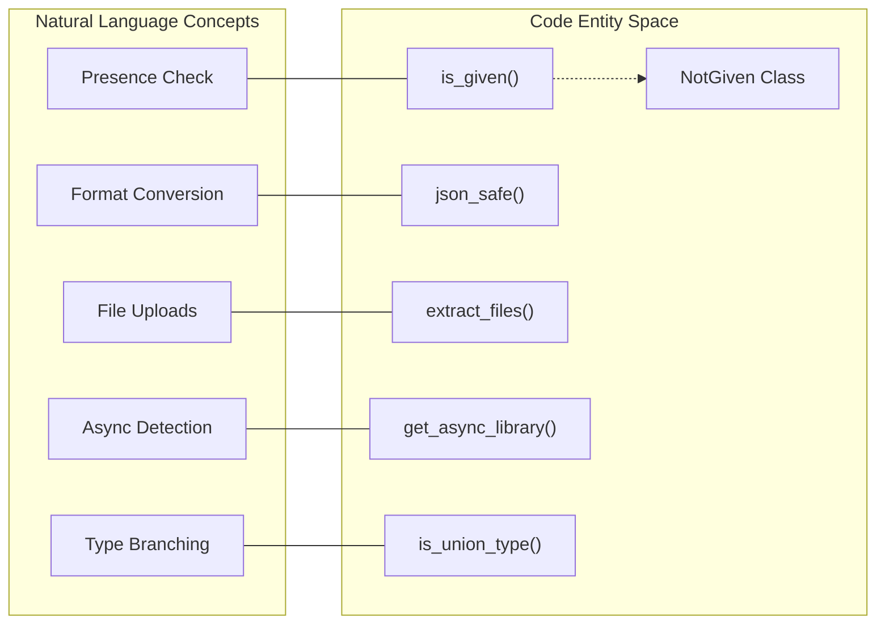

<!-- source: DeepWiki mcp.deepwiki.com · repo anthropics/anthropic-sdk-python · page 9 Utilities and Helper Functions · fetched 2026-10-26 -->

# Utilities and Helper Functions

Relevant source files

The following files were used as context for generating this wiki page:

- [src/anthropic/_compat.py](src/anthropic/_compat.py)
- [src/anthropic/_models.py](src/anthropic/_models.py)
- [src/anthropic/_utils/__init__.py](src/anthropic/_utils/__init__.py)
- [src/anthropic/_utils/_proxy.py](src/anthropic/_utils/_proxy.py)
- [src/anthropic/_utils/_reflection.py](src/anthropic/_utils/_reflection.py)
- [src/anthropic/_utils/_sync.py](src/anthropic/_utils/_sync.py)
- [src/anthropic/_utils/_typing.py](src/anthropic/_utils/_typing.py)
- [src/anthropic/_utils/_utils.py](src/anthropic/_utils/_utils.py)
- [src/anthropic/lib/aws/__init__.py](src/anthropic/lib/aws/__init__.py)
- [src/anthropic/lib/aws/_auth.py](src/anthropic/lib/aws/_auth.py)
- [src/anthropic/lib/aws/_credentials.py](src/anthropic/lib/aws/_credentials.py)
- [src/anthropic/lib/bedrock/_auth.py](src/anthropic/lib/bedrock/_auth.py)
- [tests/lib/test_aws_auth.py](tests/lib/test_aws_auth.py)
- [tests/lib/tools/test_mcp_tool.py](tests/lib/tools/test_mcp_tool.py)
- [tests/test_models.py](tests/test_models.py)
- [tests/test_utils/test_proxy.py](tests/test_utils/test_proxy.py)

This document provides an overview of the utility and helper function layer within the Anthropic Python SDK. This layer, primarily located in the `_utils` package, provides the foundational logic for data transformation, runtime type validation, file processing, and asynchronous bridging used throughout the library.

**Scope**: This page serves as a high-level entry point. For deep technical details on specific utility categories, refer to the following child pages:

- [Data Transformation Pipeline](#9.1) — Explains `transform()`, `maybe_transform()`, `strip_not_given()`, and `json_safe()` for request/response processing.
- [Type Guards and Introspection](#9.2) — Documents runtime type checking (`is_dict`, `is_list`) and compile-time type introspection (`is_union_type`, `extract_type_arg`).
- [File Handling and Extraction](#9.3) — Details recursive file extraction from complex structures using `extract_files()` and the `<array>` sentinel.
- [Async and String Utilities](#9.4) — Documents `asyncify()`, `get_async_library()`, iterator consumption, and string helpers like `human_join`.

## Utility Module Architecture

The `_utils` package is composed of specialized modules that separate concerns such as compatibility, reflection, and data transformation. It acts as a shared library for both the synchronous and asynchronous client implementations.

Sources: [src/anthropic/_utils/__init__.py:1-69](), [src/anthropic/_utils/_utils.py:1-207]()

## Natural Language to Code Mapping

The following diagram bridges high-level utility concepts to the specific code entities that implement them within the SDK.

Sources: [src/anthropic/_utils/_utils.py:37-44](), [src/anthropic/_utils/_utils.py:156-157](), [src/anthropic/_types.py:131-159](), [src/anthropic/_utils/_typing.py:40-41]()

## Core Utility Categories

### Data Transformation and Pipeline
The SDK relies on a transformation pipeline to convert Python-native objects (like `datetime` or `Pydantic` models) into API-compatible JSON. Key functions include `strip_not_given()`, which removes keys associated with the `NotGiven` sentinel to prevent them from being serialized as `null`. This is critical for maintaining API compatibility where `null` and "missing" have different semantics.

For details, see [Data Transformation Pipeline](#9.1).

Sources: [src/anthropic/_utils/_utils.py:24-24](), [src/anthropic/_utils/__init__.py:53-59](), [src/anthropic/_types.py:131-159]()

### Type Guards and Introspection
Because the SDK handles highly dynamic input, it uses `TypeGuard` and `TypeIs` functions to safely narrow types at runtime. These utilities allow the code to distinguish between dictionaries, sequences, and the `NotGiven` sentinel while maintaining full static type safety for tools like Pyright. Additionally, patterns like `LazyProxy` enable deferred loading of components [src/anthropic/_utils/_proxy.py:10-65]().

| Function | Role | Source |
| :--- | :--- | :--- |
| `is_dict(obj)` | Narrows `object` to `dict[object, object]` | [src/anthropic/_utils/_utils.py:194-195]() |
| `is_list(obj)` | Narrows `object` to `list[object]` | [src/anthropic/_utils/_utils.py:198-199]() |
| `is_given(obj)` | Checks if a value is not `NotGiven` or `Omit` | [src/anthropic/_utils/_utils.py:156-157]() |
| `is_union_type(typ)` | Identifies if a type hint is a `Union` | [src/anthropic/_utils/_typing.py:40-41]() |
| `is_type_alias_type(tp)` | Detects PEP 695 type aliases | [src/anthropic/_utils/_typing.py:59-71]() |

For details, see [Type Guards and Introspection](#9.2).

Sources: [src/anthropic/_utils/_utils.py:156-204](), [src/anthropic/_utils/_typing.py:40-71](), [src/anthropic/_utils/_proxy.py:10-65]()

### File Handling and Extraction
The `extract_files()` utility is a specialized recursive function that navigates complex request dictionaries to find file-like objects (e.g., for multipart uploads). It supports a unique `<array>` sentinel to indicate that the utility should traverse every item in a list at that path segment. This allows the SDK to support nested file structures within standard request parameters.

For details, see [File Handling and Extraction](#9.3).

Sources: [src/anthropic/_utils/_utils.py:37-58](), [src/anthropic/_utils/_utils.py:133-150]()

### Async and String Utilities
The SDK includes bridge functions like `asyncify()` to run synchronous code in a thread pool and `get_async_library()` to detect if the environment is using `asyncio` or `trio` via `sniffio`. Additionally, string utilities like `human_join()` help format error messages by joining lists with natural language separators.

For details, see [Async and String Utilities](#9.4).

Sources: [src/anthropic/_utils/_sync.py:28-58](), [src/anthropic/_utils/_utils.py:22-22]()

## Performance and Compatibility
The utility layer also manages cross-version compatibility. `_compat.py` provides a unified interface for Pydantic V1 and V2, abstracting away differences in model serialization (`model_dump` vs `dict`) and field inspection. Performance-critical operations, such as `strip_annotated_type()`, utilize `lru_cache` to minimize overhead during repetitive type resolution in the request/response lifecycle.

Sources: [src/anthropic/_compat.py:20-127](), [src/anthropic/_utils/_typing.py:75-80]()

---

