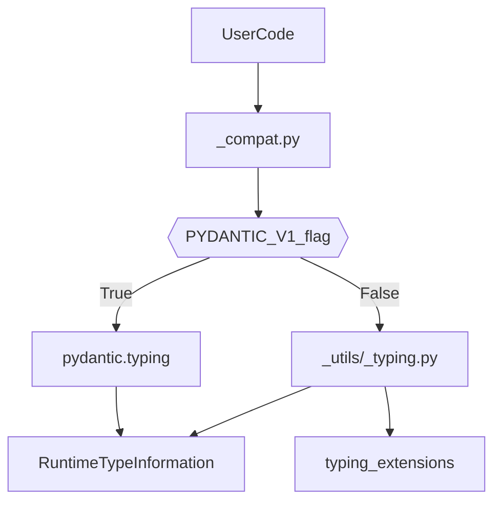
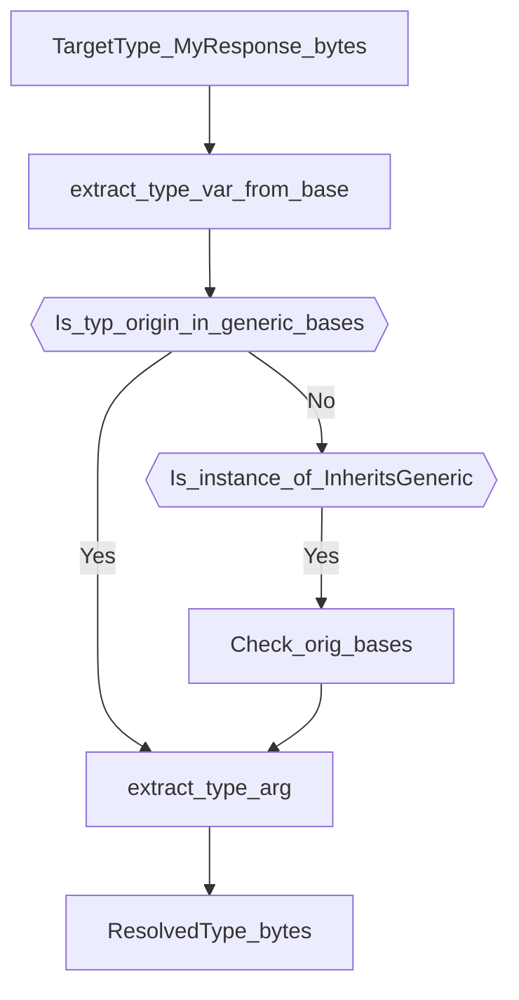

<!-- source: DeepWiki mcp.deepwiki.com · repo anthropics/anthropic-sdk-python · page 9.2 Type Guards and Introspection · fetched 2026-10-26 -->

# Type Guards and Introspection

<details>
<summary>Relevant source files</summary>

The following files were used as context for generating this wiki page:

- [src/anthropic/_compat.py](src/anthropic/_compat.py)
- [src/anthropic/_models.py](src/anthropic/_models.py)
- [src/anthropic/_utils/__init__.py](src/anthropic/_utils/__init__.py)
- [src/anthropic/_utils/_proxy.py](src/anthropic/_utils/_proxy.py)
- [src/anthropic/_utils/_reflection.py](src/anthropic/_utils/_reflection.py)
- [src/anthropic/_utils/_sync.py](src/anthropic/_utils/_sync.py)
- [src/anthropic/_utils/_typing.py](src/anthropic/_utils/_typing.py)
- [src/anthropic/_utils/_utils.py](src/anthropic/_utils/_utils.py)
- [src/anthropic/lib/aws/__init__.py](src/anthropic/lib/aws/__init__.py)
- [src/anthropic/lib/aws/_auth.py](src/anthropic/lib/aws/_auth.py)
- [src/anthropic/lib/aws/_credentials.py](src/anthropic/lib/aws/_credentials.py)
- [src/anthropic/lib/bedrock/_auth.py](src/anthropic/lib/bedrock/_auth.py)
- [tests/lib/test_aws_auth.py](tests/lib/test_aws_auth.py)
- [tests/lib/tools/test_mcp_tool.py](tests/lib/tools/test_mcp_tool.py)
- [tests/test_models.py](tests/test_models.py)
- [tests/test_utils/test_proxy.py](tests/test_utils/test_proxy.py)

</details>


This document covers the type guard functions, compile-time introspection utilities, and the `LazyProxy` pattern that enable runtime type checking, type narrowing, and generic type resolution throughout the SDK. These utilities form the foundation for data validation, API response parsing, cross-Pydantic-version compatibility, and lazy resource loading.

For information about data transformation and serialization, see [Data Transformation Pipeline](9.1). For Pydantic compatibility abstractions, see [Pydantic V1/V2 Compatibility](8.3).

## Purpose and Scope

The SDK provides runtime and compile-time type utilities grouped into several core categories:

1.  **Type Guards**: Functions that perform runtime type checks and enable static type narrowing via `TypeGuard` return annotations.
2.  **Type Introspection**: Functions that extract metadata from complex generic types, including origin types, type arguments, and generic base resolution.
3.  **Lazy Proxies**: The `LazyProxy` pattern for deferred object initialization and transparent attribute forwarding.

These utilities are critical for:
-   Safe type narrowing in union type handling.
-   Distinguishing between "not provided" (`NotGiven`) and `None` values.
-   Resolving generic type parameters at runtime.
-   Supporting both Pydantic v1 and v2 type systems.
-   Lazy-loading modules or heavy client components.

Sources: [src/anthropic/_utils/_utils.py:156-204](), [src/anthropic/_utils/_typing.py:21-156](), [src/anthropic/_utils/_proxy.py:10-65]()

## Type Guard Functions

### Basic Type Guards

The SDK provides a set of type guard functions that perform runtime type checks and enable static type checkers to narrow types within conditional blocks.

**Core Type Guards** [src/anthropic/_utils/_utils.py:170-204]():

```python
def is_tuple(obj: object) -> TypeGuard[tuple[object, ...]]
def is_list(obj: object) -> TypeGuard[list[object]]
def is_dict(obj: object) -> TypeGuard[dict[object, object]]
def is_mapping(obj: object) -> TypeGuard[Mapping[str, object]]
def is_sequence(obj: object) -> TypeGuard[Sequence[object]]
def is_iterable(obj: object) -> TypeGuard[Iterable[object]]
```

Each guard returns `True` if the object matches the specified type and provides a `TypeGuard` return annotation that allows static type checkers (mypy, pyright) to narrow the type in the conditional block.

**Example Usage Pattern**:

When the SDK processes nested structures (e.g., during file extraction), it uses these guards to safely navigate:

```python
# Based on src/anthropic/_utils/_utils.py:109-133
if is_dict(obj):
    # Type checker knows obj is dict[object, object] here
    item = obj[key]
    ...
elif is_list(obj):
    # Type checker knows obj is list[object] here
    for array_index, item in enumerate(obj):
        ...
```

Sources: [src/anthropic/_utils/_utils.py:170-204](), [src/anthropic/_utils/_utils.py:75-153]()

### TypeVar-Bound Type Guards

For cases where you need to narrow from a known union type to a specific variant (rather than from `object`), the SDK provides TypeVar-bound variants:

**TypeVar Guards** [src/anthropic/_utils/_utils.py:174-191]():

```python
def is_tuple_t(obj: _TupleT | object) -> TypeGuard[_TupleT]
def is_sequence_t(obj: _SequenceT | object) -> TypeGuard[_SequenceT]
def is_mapping_t(obj: _MappingT | object) -> TypeGuard[_MappingT]
```

These preserve the specific generic parameters of the input type while narrowing, which is useful when working with typed data structures.

Sources: [src/anthropic/_utils/_utils.py:174-191]()

### Special Type Guards

**is_given Guard** [src/anthropic/_utils/_utils.py:156-157]():

```python
def is_given(obj: _T | NotGiven | Omit) -> TypeGuard[_T]
```

This guard distinguishes between three states:
-   **Value provided**: Returns `True` and narrows to `_T`.
-   **Not provided**: `NotGiven` sentinel, returns `False`.
-   **Explicitly omitted**: `Omit` sentinel, returns `False`.

This is critical for API parameter handling where the distinction between "user passed `None`" and "user didn't pass anything" matters.

**Usage in Item Extraction** [src/anthropic/_utils/_utils.py:86-88]():

```python
if not is_given(obj):
    # no value was provided - we can safely ignore
    return []
```

Sources: [src/anthropic/_utils/_utils.py:156-157](), [src/anthropic/_utils/_utils.py:75-153]()

## Type Introspection Utilities

### Core Introspection Functions

The SDK provides cross-Pydantic-version type introspection through a compatibility layer in `_compat.py`.

Diagram: Pydantic Compatibility Bridge

Sources: [src/anthropic/_compat.py:20-65]()

**Compatibility Layer Exports** [src/anthropic/_compat.py:47-65]():

```python
get_origin(t: type[Any]) -> type[Any] | None
get_args(t: type[Any]) -> tuple[Any, ...]
is_union(tp: type[Any] | None) -> bool
is_literal_type(type_: type[Any]) -> bool
```

Sources: [src/anthropic/_compat.py:20-65]()

### Type Analysis Functions

**Type Classification** [src/anthropic/_utils/_typing.py:21-52]():

```python
is_annotated_type(typ: type) -> bool        # Annotated[T, ...]
is_list_type(typ: type) -> bool             # list[T]
is_sequence_type(typ: type) -> bool         # Sequence[T]
is_iterable_type(typ: type) -> bool         # Iterable[T]
is_union_type(typ: type) -> bool            # T | U or Union[T, U]
is_required_type(typ: type) -> bool         # Required[T]
is_type_alias_type(tp: Any) -> TypeIs[...]  # type X = Y syntax (Python 3.12+)
```

Sources: [src/anthropic/_utils/_typing.py:21-52]()

### Type Extraction and Stripping

-   **`extract_type_arg()`** [src/anthropic/_utils/_typing.py:83-88](): Extracts a specific type argument from a generic type by index. Used to find inner types of lists or dictionaries.
-   **`strip_annotated_type()`** [src/anthropic/_utils/_typing.py:75-80](): Recursively removes `Annotated` and `Required` wrappers to extract the underlying type. This is LRU-cached for performance.

Sources: [src/anthropic/_utils/_typing.py:75-88]()

## Advanced Type Resolution

### Generic Type Variable Extraction

The utility `extract_type_var_from_base` resolves generic type parameters from base classes, supporting deep inheritance and generic subclasses.

Diagram: Generic Resolution Flow

Sources: [src/anthropic/_utils/_typing.py:91-156]()

**Function Signature** [src/anthropic/_utils/_typing.py:91-156]():

```python
def extract_type_var_from_base(
    typ: type,
    *,
    generic_bases: tuple[type, ...],
    index: int,
    failure_message: str | None = None,
) -> type
```

This function is essential for handling generic response models and stream types where the inner data type is specified via generic parameters.

Sources: [src/anthropic/_utils/_typing.py:91-156]()

## The LazyProxy Pattern

The SDK implements the `LazyProxy` pattern (`src/anthropic/_utils/_proxy.py`) to defer loading or instantiation of heavy objects or resources until they are explicitly accessed [src/anthropic/_utils/_proxy.py:10-65]().

### Core Implementation

`LazyProxy` is an abstract base class inheriting from `Generic[T], ABC` that intercepts attribute access, string formatting, type checking, and directory listings [src/anthropic/_utils/_proxy.py:10-65]():

```python
class LazyProxy(Generic[T], ABC):
    def __getattr__(self, attr: str) -> object:
        proxied = self.__get_proxied__()
        if isinstance(proxied, LazyProxy):
            return proxied
        return getattr(proxied, attr)

    @abstractmethod
    def __load__(self) -> T: ...
```

### Key Behaviors

-   **Attribute Forwarding (`__getattr__`)**: Automatically calls `__load__()` (via `__get_proxied__()`) on first access and delegates subsequent attribute lookups to the underlying object [src/anthropic/_utils/_proxy.py:19-23]().
-   **Recursive Proxies**: Handles cases where a proxy itself returns a proxy, supporting chainable property accesses like `proxy.foo.bar.baz` [src/anthropic/_utils/_proxy.py:16-23]().
-   **Transparent Class and Repr (`__class__`, `__repr__`, `__str__`)**: Overrides `__class__` and inspection methods to pretend to be the underlying loaded class, preventing type-checking or formatting issues when passed into third-party code [src/anthropic/_utils/_proxy.py:26-56]().

Sources: [src/anthropic/_utils/_proxy.py:10-65]()

## Type Guard and Introspection Reference

| Function | Module | Purpose |
|----------|--------|---------|
| `is_dict()` | `_utils._utils` | Runtime dict check with type narrowing |
| `is_list()` | `_utils._utils` | Runtime list check with type narrowing |
| `is_given()` | `_utils._utils` | Check if value is not `NotGiven` or `Omit` |
| `is_mapping_t()` | `_utils._utils` | TypeVar-preserving mapping guard |
| `get_origin()` | `_compat` | Extract origin type (e.g., `list` from `list[str]`) |
| `is_union()` | `_compat` | Check if type is a Union |
| `is_union_type()` | `_utils._typing` | Utility wrapper for `is_union` |
| `is_annotated_type()` | `_utils._typing` | Check for `Annotated` types |
| `is_type_alias_type()` | `_utils._typing` | Check for Python 3.12+ `TypeAliasType` |
| `extract_type_arg()` | `_utils._typing` | Extract inner type from generic by index |
| `extract_type_var_from_base()` | `_utils._typing` | Resolve generic parameters from inheritance chain |
| `LazyProxy` | `_utils._proxy` | Abstract base class for deferred proxy objects |

Sources: [src/anthropic/_utils/__init__.py:4-51](), [src/anthropic/_utils/_utils.py:156-204](), [src/anthropic/_utils/_typing.py:21-156](), [src/anthropic/_utils/_proxy.py:10-65]()

---

