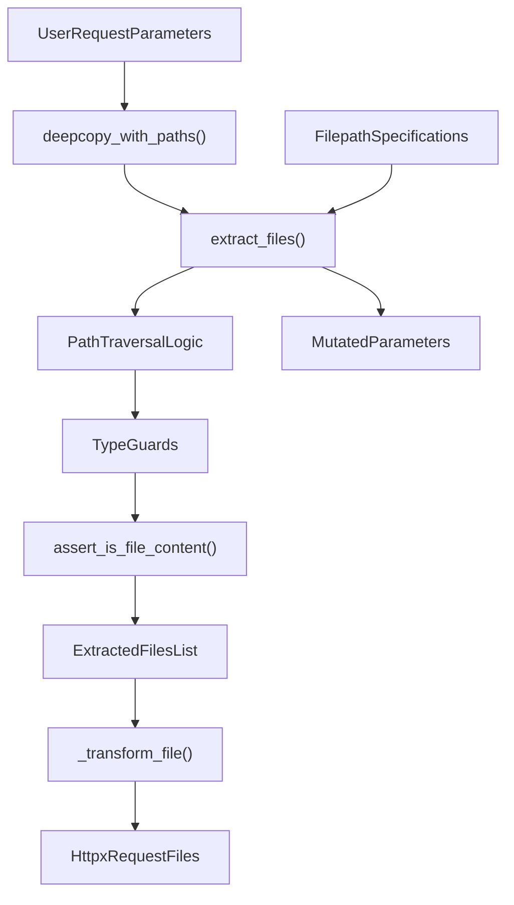
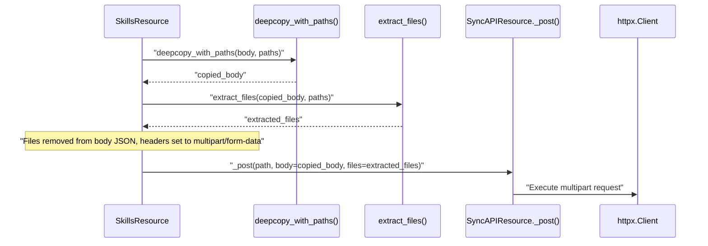

<!-- source: DeepWiki mcp.deepwiki.com · repo anthropics/anthropic-sdk-python · page 9.3 File Handling and Extraction · fetched 2026-10-26 -->

# File Handling and Extraction

<details>
<summary>Relevant source files</summary>

The following files were used as context for generating this wiki page:

- [src/anthropic/_files.py](src/anthropic/_files.py)
- [src/anthropic/resources/beta/skills/skills.py](src/anthropic/resources/beta/skills/skills.py)
- [src/anthropic/resources/beta/skills/versions.py](src/anthropic/resources/beta/skills/versions.py)
- [src/anthropic/types/beta/environment_update_params.py](src/anthropic/types/beta/environment_update_params.py)
- [src/anthropic/types/beta/file_upload_params.py](src/anthropic/types/beta/file_upload_params.py)
- [src/anthropic/types/beta/memory_stores/__init__.py](src/anthropic/types/beta/memory_stores/__init__.py)
- [src/anthropic/types/beta/memory_stores/beta_managed_agents_actor.py](src/anthropic/types/beta/memory_stores/beta_managed_agents_actor.py)
- [tests/api_resources/beta/skills/test_versions.py](tests/api_resources/beta/skills/test_versions.py)
- [tests/api_resources/beta/test_files.py](tests/api_resources/beta/test_files.py)
- [tests/api_resources/beta/test_skills.py](tests/api_resources/beta/test_skills.py)
- [tests/test_extract_files.py](tests/test_extract_files.py)
- [tests/test_files.py](tests/test_files.py)

</details>


## Purpose and Scope

This document describes the file handling and extraction system used to prepare file uploads and multipart requests in the Anthropic Python SDK. The system recursively traverses nested Python data structures to extract file content, preparing it for multipart form data transmission while maintaining a clean JSON body for the rest of the request parameters.

The extraction and transformation logic primarily resides in `src/anthropic/_utils/_utils.py` and `src/anthropic/_files.py`, while resource-level uploads are implemented in beta endpoints such as skills and files.

**Sources:** [src/anthropic/_files.py:1-189](), [src/anthropic/resources/beta/skills/skills.py:69-148]()

## Overview

The SDK handles file uploads for operations such as vision capabilities, document analysis, message batches, and beta upload resources like `Files` and `Skills`. Rather than requiring manual separation of file content from request parameters, the SDK provides an automated extraction system that:

1.  **Recursively traverses** nested dictionaries and lists.
2.  **Identifies file content** based on specified path sequences.
3.  **Mutates the original structure** by removing extracted files to prevent large binary data from being serialized into the JSON request body.
4.  **Flattens keys** into a format compatible with multipart form-data standards (e.g., `documents[][file]`).

**Sources:** [src/anthropic/_files.py:25-78](), [src/anthropic/resources/beta/skills/skills.py:122-137]()

## File Extraction Architecture

The following diagram illustrates the flow from request parameter definitions to code entities responsible for file extraction and multipart preparation.



**Sources:** [src/anthropic/_files.py:25-78](), [src/anthropic/_files.py:144-189]()

## Core Extraction Components

### extract_files()

The `extract_files()` function is the primary entry point for separating files from request bodies. It accepts a mapping of parameters and a sequence of paths, mutating the input dictionary to remove binary content before the remaining JSON payload is transmitted.

**Sources:** [tests/test_extract_files.py:11-37]()

### deepcopy_with_paths()

Because `extract_files()` mutates data, the SDK uses `deepcopy_with_paths()` (`[src/anthropic/_files.py:144-162]()`) to create a partial copy of the request body. This utility only copies containers (dictionaries and lists) that lie along specified file paths, returning all other data structures by reference to optimize memory usage.

```python
def deepcopy_with_paths(item: _T, paths: Sequence[Sequence[str]]) -> _T:
    ...
```

**Sources:** [src/anthropic/_files.py:144-162](), [tests/test_files.py:115-173]()

### Path Specification and the `<array>` Sentinel

Paths are defined as sequences of strings. The special `<array>` sentinel indicates that extraction should iterate over every element in a list container.

| Path Component | Logic | Example Path |
| :--- | :--- | :--- |
| `string` | Dictionary key lookup | `["metadata", "image"]` |
| `"<array>"` | List iteration | `["documents", "<array>", "file"]` |

**Sources:** [tests/test_extract_files.py:29-41]()

## Key Flattening and Array Formats

As traversal proceeds, the SDK constructs flattened string keys for the multipart form-data payload. The `ArrayFormat` (defaulting to `"brackets"`) dictates how list indices are encoded.

| Structure | Path | Flattened Key (`brackets`) |
| :--- | :--- | :--- |
| `{"file": b"..."}` | `["file"]` | `"file"` |
| `{"nested": {"f": b"..."}}` | `["nested", "f"]` | `"nested[f]"` |
| `{"docs": [b"a", b"b"]}` | `["docs", "<array>"]` | `"docs[]"` |
| `{"items": [{"f": b"a"}]}` | `["items", "<array>", "f"]` | `"items[][f]"` |

**Sources:** [tests/test_extract_files.py:73-91]()

## File Utility Functions and Multipart Serialization

The SDK provides helper functions to process file types, read paths, and map contents into structures understood by `httpx`.

### to_httpx_files() and async_to_httpx_files()

`to_httpx_files()` (`[src/anthropic/_files.py:49-60]`) and its asynchronous counterpart `async_to_httpx_files()` (`[src/anthropic/_files.py:106-117]`) transform SDK file mappings or sequences into `HttpxRequestFiles`. They handle reading filesystem paths (`os.PathLike` or `anyio.Path`) into raw bytes and assigning filenames.

```python
def to_httpx_files(files: RequestFiles | None) -> HttpxRequestFiles | None:
    ...
```

**Sources:** [src/anthropic/_files.py:49-117]()

### File Transformation Helpers

Individual files are processed via `_transform_file()` (`[src/anthropic/_files.py:63-78]`) or `_async_transform_file()` (`[src/anthropic/_files.py:120-135]()`), which inspects whether the file input is raw bytes, an open file stream (`io.IOBase`), a path, or a tuple specifying custom MIME types and headers.

**Sources:** [src/anthropic/_files.py:63-142]()

## Files and Skills Upload Resources

The SDK exposes beta resources that heavily rely on file handling and multipart serialization:

1. **Files API (`client.beta.files`)**: Supports operations like listing (`list()`), deletion (`delete()`), and content downloading (`download()`) which returns a `BinaryAPIResponse` (`[tests/api_resources/beta/test_files.py:113-124]()`).
2. **Skills and Versions API (`client.beta.skills`)**: Allows uploading directories of files (such as `SKILL.md` bundles) via `client.beta.skills.create()` and `client.beta.skills.versions.create()` (`[src/anthropic/resources/beta/skills/skills.py:69-148]()`, `[src/anthropic/resources/beta/skills/versions.py:65-141]()`). These methods utilize `deepcopy_with_paths` on the `files` array and extract them into multipart form payloads:

```python
body = deepcopy_with_paths(
    {
        "files": files,
        "display_name": display_name,
    },
    [["files", "<array>"]],
)
extracted_files = extract_files(cast(Mapping[str, object], body), paths=[["files", "<array>"]])
extra_headers = {"Content-Type": "multipart/form-data", **(extra_headers or {})}
```

**Sources:** [src/anthropic/resources/beta/skills/skills.py:113-137](), [tests/api_resources/beta/test_files.py:113-124]()

## Request Lifecycle Integration

The following sequence diagram illustrates how resource methods prepare payloads, invoke extraction utilities, and hand off multipart content to the HTTP layer.



**Sources:** [src/anthropic/resources/beta/skills/skills.py:122-137](), [src/anthropic/_files.py:144-162]()

## Type Definitions

### FileTypes and FileContent

The SDK supports flexible file input typing via `FileTypes` and `FileContent`:
*   `bytes`: Raw file data.
*   `io.IOBase`: Open file streams.
*   `os.PathLike`: Filesystem paths (`pathlib.Path` or `anyio.Path`).
*   `tuple`: Custom file representations including filenames, content, content types, and extra headers.

**Sources:** [src/anthropic/_files.py:1-20](), [src/anthropic/types/beta/file_upload_params.py:12-20]()

### FileUploadParams

For typed parameters governing file uploads, `FileUploadParams` defines required `file` entries along with optional `expires_in_seconds`, `betas`, and `workspace_id` headers.

**Sources:** [src/anthropic/types/beta/file_upload_params.py:12-38]()

## Implementation Details

### Mutation Logic
Extraction mutates the working dictionary in-place to strip binary items before JSON serialization. When a target path matches, items are popped:

```python
if all(p == "<array>" for p in path[index:]):
    item = obj.pop(key)
```

**Sources:** [src/anthropic/_files.py:144-189]()

### Error Handling
The SDK checks file validity using `assert_is_file_content()` (`[src/anthropic/_files.py:33-39]()`). If an expected file input is invalid or receives an unsupported type (such as a plain string rather than bytes, stream, or path), a `RuntimeError` or `TypeError` is raised.

**Sources:** [src/anthropic/_files.py:33-39](), [tests/test_files.py:101-107]()

---

