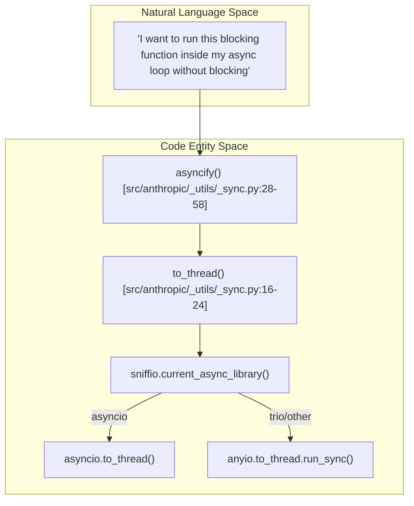
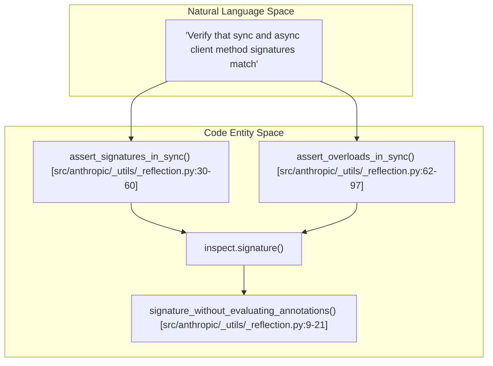

<!-- source: DeepWiki mcp.deepwiki.com · repo anthropics/anthropic-sdk-python · page 9.4 Async and String Utilities · fetched 2026-10-26 -->

# Async and String Utilities

<details>
<summary>Relevant source files</summary>

The following files were used as context for generating this wiki page:

- [src/anthropic/_compat.py](src/anthropic/_compat.py)
- [src/anthropic/_models.py](src/anthropic/_models.py)
- [src/anthropic/_utils/__init__.py](src/anthropic/_utils/__init__.py)
- [src/anthropic/_utils/_reflection.py](src/anthropic/_utils/_reflection.py)
- [src/anthropic/_utils/_sync.py](src/anthropic/_utils/_sync.py)
- [src/anthropic/_utils/_typing.py](src/anthropic/_utils/_typing.py)
- [src/anthropic/_utils/_utils.py](src/anthropic/_utils/_utils.py)
- [tests/test_models.py](tests/test_models.py)

</details>


This document covers the asynchronous utility functions, string manipulation helpers, iterator consumption handlers, and reflection tools provided by the SDK. These utilities bridge synchronous and asynchronous code execution, manage stream lifecycles, and provide runtime introspection for validation and signature checking.

## Purpose and Scope

The utility modules provide core infrastructure for the SDK's request pipeline, async execution patterns, and meta-programming tasks:

- **Async Utilities** (`_sync.py`, `_streams.py`): Enable blocking functions to run safely in async contexts via thread pools and handle iterator exhaustion.
- **String and Formatting Utilities** (`_utils.py`): Handle common formatting tasks like joining lists for human-readable error messages and string prefix/suffix transformations.
- **Reflection Helpers** (`_reflection.py`): Provide safe signature inspection, argument checks, and synchronization assertions between sync and async client signatures.

**Sources:** [src/anthropic/_utils/_sync.py:1-58](), [src/anthropic/_utils/_utils.py:1-223](), [src/anthropic/_utils/_reflection.py:1-96](), [src/anthropic/_utils/__init__.py:1-69]()

---

## Async Utilities

The SDK provides utilities to execute synchronous code safely from asynchronous contexts and to detect the active asynchronous library via `sniffio`.

### Execution Bridging: `asyncify()` and `to_thread()`

The `asyncify()` function converts a blocking function into an asynchronous one by offloading its execution to a thread pool worker. This prevents the event loop from stalling during I/O-bound operations.


*Figure 1: Bridging Natural Language Intent to Code Entities for `asyncify()` execution.*

| Function | Role | Implementation |
| :--- | :--- | :--- |
| `to_thread()` | Executes a callable in a worker thread. | Uses `sniffio` to detect the loop. Calls `asyncio.to_thread` or `anyio.to_thread.run_sync`. [src/anthropic/_utils/_sync.py:16-24]() |
| `asyncify()` | A decorator/wrapper for blocking callables. | Returns an `async` wrapper function that executes via `to_thread()`. [src/anthropic/_utils/_sync.py:28-58]() |
| `get_async_library()` | Detects the active async framework. | Wrapper returning `sniffio.current_async_library()`. [src/anthropic/_utils/__init__.py:28]() |

**Sources:** [src/anthropic/_utils/_sync.py:16-58](), [src/anthropic/_utils/__init__.py:28]()

---

## Iterator Consumption Functions

The SDK includes helper utilities to fully exhaust iterators, which is frequently used in internal testing and stream cleanup routines.

- **`consume_sync_iterator(iterator)`**: Iterates through a synchronous iterable until exhaustion. [src/anthropic/_utils/__init__.py:52]()
- **`consume_async_iterator(iterator)`**: Awaits and consumes every item in an asynchronous iterable until completion. [src/anthropic/_utils/__init__.py:52]()

**Sources:** [src/anthropic/_utils/__init__.py:52]()

---

## String and Formatting Utilities

The SDK implements string utilities to ensure consistent formatting across error messages and payloads.

### Human-Readable Joins

The `human_join()` function formats a sequence of strings into a grammatically correct listing (e.g., `"a, b, or c"`).

```python
# Implementation Logic [src/anthropic/_utils/_utils.py:207-218]
def human_join(seq: Sequence[str], *, delim: str = ", ", final: str = "or") -> str:
    size = len(seq)
    if size == 0:
        return ""
    if size == 1:
        return seq[0]
    if size == 2:
        return f"{seq[0]} {final} {seq[1]}"
    return delim.join(seq[:-1]) + f" {final} {seq[-1]}"
```

**Sources:** [src/anthropic/_utils/_utils.py:207-218]()

### String Manipulation Helpers

| Function | Description |
| :--- | :--- |
| `removeprefix(s, prefix)` | Removes a prefix from a string if present. [src/anthropic/_utils/__init__.py:19]() |
| `removesuffix(s, suffix)` | Removes a suffix from a string if present. [src/anthropic/_utils/__init__.py:20]() |

**Sources:** [src/anthropic/_utils/__init__.py:19-20]()

---

## Reflection and Introspection Helpers

The SDK includes reflection utilities in `_reflection.py` to inspect signatures safely across Python versions (especially handling lazy evaluation in Python 3.14+) and to ensure synchronous and asynchronous client APIs remain in lockstep.


*Figure 2: Bridging API Signature Verification Intent to Reflection Code Entities.*

### Key Reflection Functions

| Function | Purpose | Implementation Details |
| :--- | :--- | :--- |
| `signature_without_evaluating_annotations()` | Safe inspection for Python 3.14+ lazy evaluation. | Uses `annotationlib.Format.STRING` on Python 3.14+ to avoid `NameError` for `TYPE_CHECKING` imports. [src/anthropic/_utils/_reflection.py:9-21]() |
| `function_has_argument()` | Checks if a callable accepts a specific parameter name. | Inspects signature parameters using `signature_without_evaluating_annotations()`. [src/anthropic/_utils/_reflection.py:24-28]() |
| `assert_signatures_in_sync()` | Asserts parameter parity and matching type annotations between two methods. | Compares `inspect.signature` objects and raises `AssertionError` on discrepancies. [src/anthropic/_utils/_reflection.py:30-60]() |
| `assert_overloads_in_sync()` | Ensures all `@overload` definitions of a function match source parameter specs. | Iterates over `typing_extensions.get_overloads()` and checks parameter presence/annotations. [src/anthropic/_utils/_reflection.py:62-96]() |

**Sources:** [src/anthropic/_utils/_reflection.py:1-96]()

---

