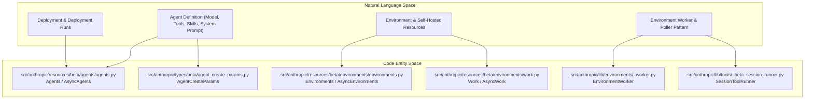
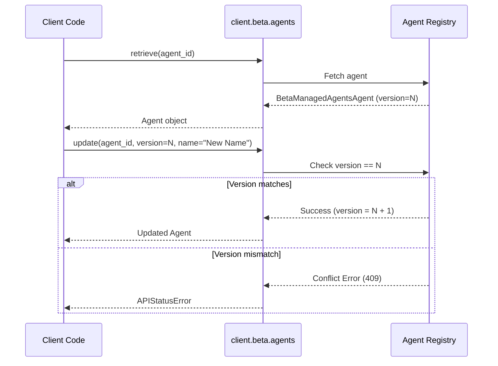
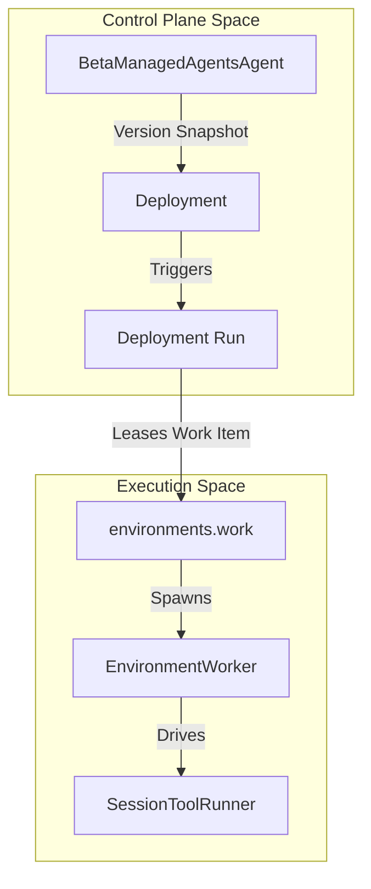
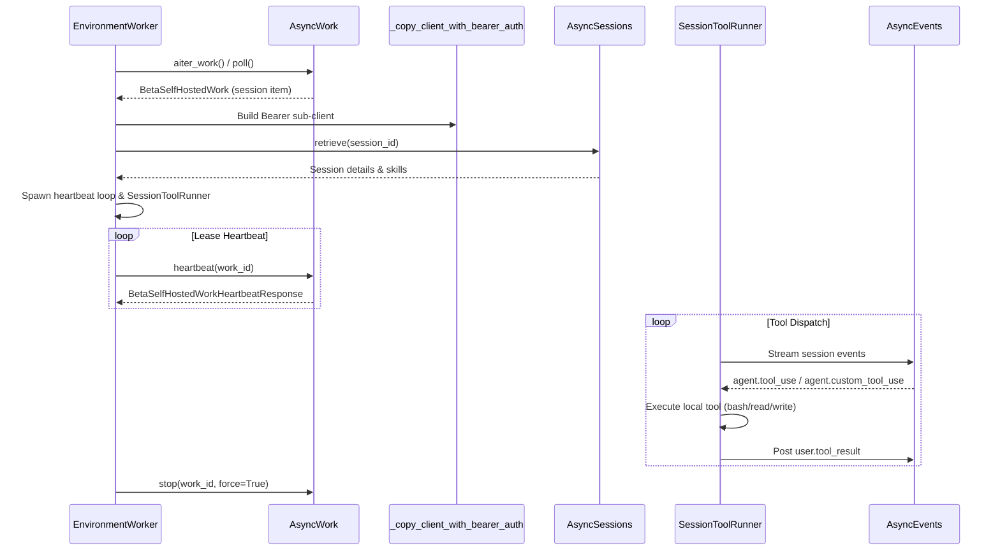

<!-- source: DeepWiki mcp.deepwiki.com · repo anthropics/anthropic-sdk-python · extra page Agents, Deployments, and Environments · fetched 2026-10-26 -->

# Agents, Deployments, and Environments

<details>
<summary>Relevant source files</summary>

The following files were used as context for generating this wiki page:

- [examples/managed-agents-observe-tool-calls.py](examples/managed-agents-observe-tool-calls.py)
- [src/anthropic/lib/_scoped_client.py](src/anthropic/lib/_scoped_client.py)
- [src/anthropic/lib/environments/__init__.py](src/anthropic/lib/environments/__init__.py)
- [src/anthropic/lib/environments/_poller.py](src/anthropic/lib/environments/_poller.py)
- [src/anthropic/lib/environments/_worker.py](src/anthropic/lib/environments/_worker.py)
- [src/anthropic/lib/tools/_beta_session_runner.py](src/anthropic/lib/tools/_beta_session_runner.py)
- [src/anthropic/lib/tools/_files.py](src/anthropic/lib/tools/_files.py)
- [src/anthropic/lib/tools/_skills.py](src/anthropic/lib/tools/_skills.py)
- [src/anthropic/lib/tools/_tool_dispatch.py](src/anthropic/lib/tools/_tool_dispatch.py)
- [src/anthropic/lib/tools/agent_toolset.py](src/anthropic/lib/tools/agent_toolset.py)
- [src/anthropic/resources/beta/agents/agents.py](src/anthropic/resources/beta/agents/agents.py)
- [src/anthropic/resources/beta/environments/environments.py](src/anthropic/resources/beta/environments/environments.py)
- [src/anthropic/resources/beta/environments/work.py](src/anthropic/resources/beta/environments/work.py)
- [src/anthropic/types/beta/agent_create_params.py](src/anthropic/types/beta/agent_create_params.py)
- [src/anthropic/types/beta/agent_update_params.py](src/anthropic/types/beta/agent_update_params.py)
- [src/anthropic/types/beta/beta_managed_agents_agent_with_overrides_params.py](src/anthropic/types/beta/beta_managed_agents_agent_with_overrides_params.py)
- [src/anthropic/types/beta/environment_create_params.py](src/anthropic/types/beta/environment_create_params.py)
- [src/anthropic/types/beta/environments/work_heartbeat_params.py](src/anthropic/types/beta/environments/work_heartbeat_params.py)
- [src/anthropic/types/beta/environments/work_list_params.py](src/anthropic/types/beta/environments/work_list_params.py)
- [src/anthropic/types/beta/environments/work_poll_params.py](src/anthropic/types/beta/environments/work_poll_params.py)
- [src/anthropic/types/beta/environments/work_stop_params.py](src/anthropic/types/beta/environments/work_stop_params.py)
- [src/anthropic/types/beta/environments/work_update_params.py](src/anthropic/types/beta/environments/work_update_params.py)
- [tests/lib/environments/test_poller.py](tests/lib/environments/test_poller.py)
- [tests/lib/environments/test_poller_method.py](tests/lib/environments/test_poller_method.py)
- [tests/lib/environments/test_worker.py](tests/lib/environments/test_worker.py)
- [tests/lib/test_scoped_client.py](tests/lib/test_scoped_client.py)
- [tests/lib/tools/test_agent_toolset.py](tests/lib/tools/test_agent_toolset.py)
- [tests/lib/tools/test_files.py](tests/lib/tools/test_files.py)
- [tests/lib/tools/test_session_runner.py](tests/lib/tools/test_session_runner.py)
- [tests/lib/tools/test_skills.py](tests/lib/tools/test_skills.py)

</details>


This page documents the technical implementation of managed agents, deployments, environment resources, and the self-hosted environment worker/poller pattern in the Anthropic Python SDK [src/anthropic/lib/environments/_worker.py](). It covers agent creation, versioning, overrides, deployments and deployment runs, environment provisioning, and the worker loop pattern used to coordinate self-hosted execution environments.

---

## 1. Architecture Overview: Natural Language Space to Code Entity Space

Managed agents and environments bridge declarative control-plane configurations with imperative worker execution. The system coordinates agent state, environment reservations, work-item leasing, and session tool dispatching across asynchronous client boundaries.


*Sources: [src/anthropic/resources/beta/agents/agents.py](), [src/anthropic/types/beta/agent_create_params.py](), [src/anthropic/resources/beta/environments/environments.py](), [src/anthropic/resources/beta/environments/work.py](), [src/anthropic/lib/environments/_worker.py](), [src/anthropic/lib/tools/_beta_session_runner.py]()*

---

## 2. Agent Creation, Versioning, and Overrides

Managed agents are configured via the `client.beta.agents` namespace [src/anthropic/resources/beta/agents/agents.py](). Agents encapsulate model parameters, system prompts, toolsets (including MCP servers and custom tools), and skills.

### Creation and Parameter Schemas
Agents are created using `client.beta.agents.create()` [src/anthropic/resources/beta/agents/agents.py:](). The request payload conforms to `AgentCreateParams` [src/anthropic/types/beta/agent_create_params.py:]():

```python
agent = client.beta.agents.create(
    model="claude-opus-5-5",
    name="Code Analysis Agent",
    description="Analyzes repositories and executes tools in sandboxed environments.",
    system="You are an expert software engineer.",
    tools=[
        {
            "type": "agent_toolset_20260401",
            "tools": ["bash", "read", "write", "edit", "glob", "grep"]
        }
    ],
    betas=["managed-agents-2026-04-01"]
)
```
*Sources: [src/anthropic/resources/beta/agents/agents.py](), [src/anthropic/types/beta/agent_create_params.py]()*

### Versioning and Concurrency Control
Agents support optimistic concurrency control via a `version` field during updates [src/anthropic/types/beta/agent_update_params.py:]():


*Sources: [src/anthropic/resources/beta/agents/agents.py](), [src/anthropic/types/beta/agent_update_params.py]()*

When calling `client.beta.agents.versions` [src/anthropic/resources/beta/agents/versions.py](), immutable snapshots of agent configurations can be queried or restored.

---

## 3. Deployments and Deployment Runs

Deployments bind a specific version of an agent to a runtime deployment target. Deployment runs execute these agents within managed sessions, linking execution threads to environment containers.


*Sources: [src/anthropic/resources/beta/agents/agents.py](), [src/anthropic/resources/beta/environments/work.py](), [src/anthropic/lib/environments/_worker.py](), [src/anthropic/lib/tools/_beta_session_runner.py]()*

---

## 4. Environment Resources

Environments provide the network and compute boundaries for agent execution. The SDK exposes environment management through `client.beta.environments` [src/anthropic/resources/beta/environments/environments.py]() and work orchestration through `client.beta.environments.work` [src/anthropic/resources/beta/environments/work.py]().

### Environment Configuration & Methods
* `client.beta.environments.create()`: Provisions a new environment container or sandbox configuration [src/anthropic/resources/beta/environments/environments.py:]().
* `client.beta.environments.retrieve()`: Queries environment status and limits [src/anthropic/resources/beta/environments/environments.py:]().
* `client.beta.environments.work.retrieve()`: Inspects active work items [src/anthropic/resources/beta/environments/work.py:]().
* `client.beta.environments.work.heartbeat()`: Extends leases for claimed work items [tests/lib/environments/test_worker.py:]().
* `client.beta.environments.work.stop()`: Force-stops work item executions [tests/lib/environments/test_worker.py:]().

*Sources: [src/anthropic/resources/beta/environments/environments.py](), [src/anthropic/resources/beta/environments/work.py](), [tests/lib/environments/test_worker.py]()*

---

## 5. Self-Hosted Environment Worker and Poller Pattern

The self-hosted environment worker pattern is implemented in `EnvironmentWorker` [src/anthropic/lib/environments/_worker.py]() and paired with `SessionToolRunner` [src/anthropic/lib/tools/_beta_session_runner.py](). The worker polls for session work items, establishes secure bearer authentication sub-clients, downloads required skills, and runs tool dispatching while heartbeating the work lease in parallel.


*Sources: [src/anthropic/lib/environments/_worker.py](), [src/anthropic/lib/tools/_beta_session_runner.py](), [src/anthropic/lib/_scoped_client.py]()*

### Implementation Details

1. **Lease Management (`_Lease` & `_heartbeat_loop`)**: The worker maintains lease heartbeats at fixed intervals (`_HEARTBEAT_DEFAULT = 30.0`) [src/anthropic/lib/environments/_worker.py:](). If a heartbeat receives a `412 Precondition Failed` error [tests/lib/environments/test_worker.py:]() or exceeds the lease TTL (`_HEARTBEAT_TTL_DEFAULT = 90.0`) [src/anthropic/lib/environments/_worker.py:](), the lease is marked as lost (`_LeaseEndReason.LEASE_LOST`) [src/anthropic/lib/environments/_worker.py:](), terminating the session run safely without conflicting with other workers.
2. **Sub-Client Scoping (`_copy_client_with_bearer_auth`)**: Helpers use a scoped client that overrides the parent API key with a bearer token derived from the environment secret, injecting the `x-stainless-helper` header automatically [src/anthropic/lib/_scoped_client.py:]().
3. **Session Tool Execution (`SessionToolRunner`)**: Drives tool dispatching for `agent_toolset_20260401` tools (`bash`, `read`, `write`, `edit`, `glob`, `grep`), handling user confirmation gates (`evaluated_permission == "ask"`) and idle timeouts (`DEFAULT_MAX_IDLE = 60.0`) [src/anthropic/lib/tools/_beta_session_runner.py:]().

*Sources: [src/anthropic/lib/environments/_worker.py](), [src/anthropic/lib/tools/_beta_session_runner.py](), [src/anthropic/lib/_scoped_client.py](), [tests/lib/environments/test_worker.py]()*

---

## Sources
- [src/anthropic/resources/beta/agents/agents.py]()
- [src/anthropic/types/beta/agent_create_params.py]()
- [src/anthropic/types/beta/agent_update_params.py]()
- [src/anthropic/resources/beta/environments/environments.py]()
- [src/anthropic/resources/beta/environments/work.py]()
- [src/anthropic/lib/environments/_worker.py]()
- [src/anthropic/lib/tools/_beta_session_runner.py]()
- [src/anthropic/lib/_scoped_client.py]()
- [tests/lib/environments/test_worker.py]()

---

