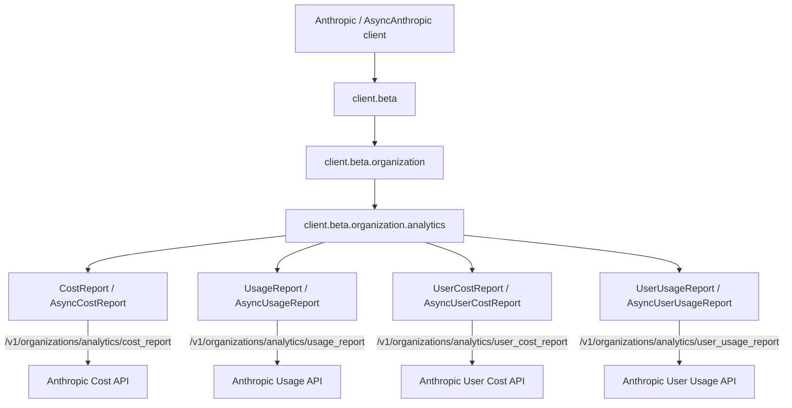
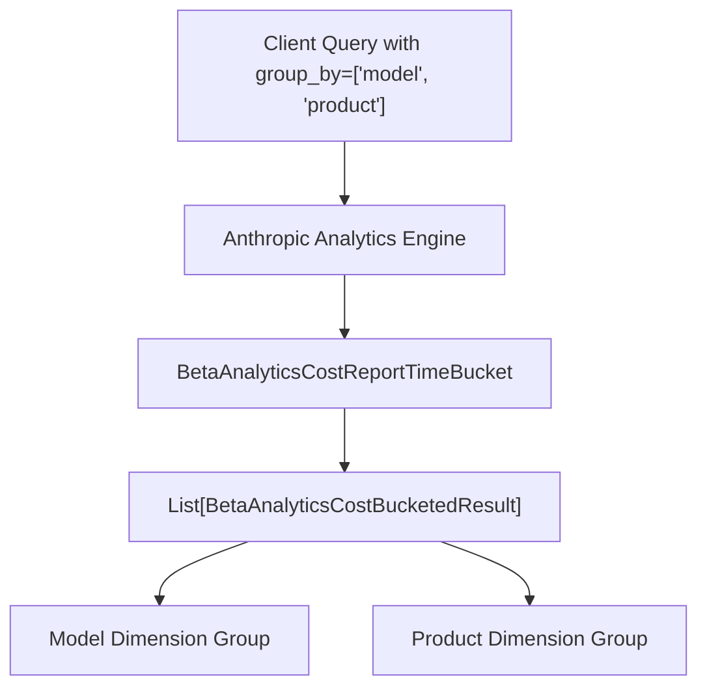
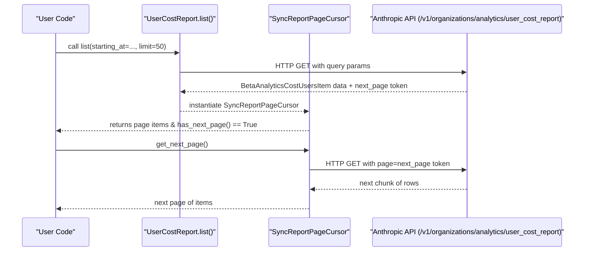

<!-- source: DeepWiki mcp.deepwiki.com · repo anthropics/anthropic-sdk-python · extra page Analytics and Usage Reporting · fetched 2026-10-26 -->

# Analytics and Usage Reporting

<details>
<summary>Relevant source files</summary>

The following files were used as context for generating this wiki page:

- [src/anthropic/pagination.py](src/anthropic/pagination.py)
- [src/anthropic/resources/beta/organization/analytics/__init__.py](src/anthropic/resources/beta/organization/analytics/__init__.py)
- [src/anthropic/resources/beta/organization/analytics/analytics.py](src/anthropic/resources/beta/organization/analytics/analytics.py)
- [src/anthropic/resources/beta/organization/analytics/cost_report.py](src/anthropic/resources/beta/organization/analytics/cost_report.py)
- [src/anthropic/resources/beta/organization/analytics/usage_report.py](src/anthropic/resources/beta/organization/analytics/usage_report.py)
- [src/anthropic/resources/beta/organization/analytics/user_cost_report.py](src/anthropic/resources/beta/organization/analytics/user_cost_report.py)
- [src/anthropic/resources/beta/organization/analytics/user_usage_report.py](src/anthropic/resources/beta/organization/analytics/user_usage_report.py)
- [src/anthropic/types/beta/organization/analytics/__init__.py](src/anthropic/types/beta/organization/analytics/__init__.py)
- [src/anthropic/types/beta/organization/analytics/user_cost_report_list_params.py](src/anthropic/types/beta/organization/analytics/user_cost_report_list_params.py)
- [src/anthropic/types/beta/organization/analytics/user_usage_report_list_params.py](src/anthropic/types/beta/organization/analytics/user_usage_report_list_params.py)
- [src/anthropic/types/beta/organization/beta_analytics_chat_cowork_unified_chat_metrics.py](src/anthropic/types/beta/organization/beta_analytics_chat_cowork_unified_chat_metrics.py)
- [src/anthropic/types/beta/organization/beta_analytics_chat_cowork_unified_sessions_metrics.py](src/anthropic/types/beta/organization/beta_analytics_chat_cowork_unified_sessions_metrics.py)
- [src/anthropic/types/beta/organization/beta_analytics_connector_activity.py](src/anthropic/types/beta/organization/beta_analytics_connector_activity.py)
- [src/anthropic/types/beta/organization/beta_analytics_connector_chat_cowork_unified_chat_metrics.py](src/anthropic/types/beta/organization/beta_analytics_connector_chat_cowork_unified_chat_metrics.py)
- [src/anthropic/types/beta/organization/beta_analytics_connector_chat_cowork_unified_sessions_metrics.py](src/anthropic/types/beta/organization/beta_analytics_connector_chat_cowork_unified_sessions_metrics.py)
- [src/anthropic/types/beta/organization/beta_analytics_cost_bucketed_result.py](src/anthropic/types/beta/organization/beta_analytics_cost_bucketed_result.py)
- [src/anthropic/types/beta/organization/beta_analytics_cost_users_item.py](src/anthropic/types/beta/organization/beta_analytics_cost_users_item.py)
- [src/anthropic/types/beta/organization/beta_analytics_single_day_activity_summary.py](src/anthropic/types/beta/organization/beta_analytics_single_day_activity_summary.py)
- [src/anthropic/types/beta/organization/beta_analytics_skill_activity.py](src/anthropic/types/beta/organization/beta_analytics_skill_activity.py)
- [src/anthropic/types/beta/organization/beta_analytics_skill_chat_cowork_unified_chat_metrics.py](src/anthropic/types/beta/organization/beta_analytics_skill_chat_cowork_unified_chat_metrics.py)
- [src/anthropic/types/beta/organization/beta_analytics_usage_bucketed_result.py](src/anthropic/types/beta/organization/beta_analytics_usage_bucketed_result.py)
- [src/anthropic/types/beta/organization/beta_analytics_usage_users_item.py](src/anthropic/types/beta/organization/beta_analytics_usage_users_item.py)
- [src/anthropic/types/beta/organization/beta_analytics_user_activity.py](src/anthropic/types/beta/organization/beta_analytics_user_activity.py)
- [tests/api_resources/beta/organization/analytics/test_cost_report.py](tests/api_resources/beta/organization/analytics/test_cost_report.py)
- [tests/api_resources/beta/organization/analytics/test_usage_report.py](tests/api_resources/beta/organization/analytics/test_usage_report.py)
- [tests/api_resources/beta/organization/analytics/test_user_cost_report.py](tests/api_resources/beta/organization/analytics/test_user_cost_report.py)
- [tests/api_resources/beta/organization/analytics/test_user_usage_report.py](tests/api_resources/beta/organization/analytics/test_user_usage_report.py)

</details>


## Purpose and Scope

This document provides complete technical documentation for the Analytics and Usage Reporting APIs within the Anthropic Python SDK (`anthropics/anthropic-sdk-python`). The Analytics namespace (`client.beta.organization.analytics`) exposes organizational cost metrics, token usage tracking (both organization-wide and per-user), time-bucketed aggregations, activity summaries, and specialized chat/cowork productivity metrics. These beta reporting endpoints rely on specialized cursor pagination (`SyncReportPageCursor` and `AsyncReportPageCursor`) to handle large-scale enterprise telemetry streams.

---

## 1. Analytics Architecture and Namespace Organization

The analytics features are structured under the beta organization administrative layer. Clients interact with these reports through distinct resource classes mapped onto specific beta endpoints. Available to organizations on a Claude Enterprise plan, these methods require API keys provisioned with the `read:analytics` scope.



Sources: [src/anthropic/resources/beta/organization/analytics/cost_report.py:29-91](), [src/anthropic/resources/beta/organization/analytics/usage_report.py:29-89](), [src/anthropic/resources/beta/organization/analytics/user_cost_report.py:29-94](), [src/anthropic/resources/beta/organization/analytics/user_usage_report.py:29-92]()

---

## 2. Cost and Usage Reports (Org-Wide vs. Per-User)

The analytics system separates telemetry into organization-wide aggregated time buckets and per-user granular breakdowns.

### Organization-Wide Reports
* **`CostReport`**: Retrieves cost in USD over time across a date range [src/anthropic/resources/beta/organization/analytics/cost_report.py:93-98](). Results are bucketed by minute (`1h`), hour (`1h`), or day (`1d`).
* **`UsageReport`**: Retrieves token usage over time across a date range [src/anthropic/resources/beta/organization/analytics/usage_report.py:91-96](). Tracks input, output, cache read, and cache creation token metrics across time buckets.

### Per-User Reports
* **`UserCostReport`**: Returns per-user cost in USD across a date range [src/anthropic/resources/beta/organization/analytics/user_cost_report.py:96-103](). Returns one row per user ranked by spend, accounting for seat-attributed costs.
* **`UserUsageReport`**: Returns per-user token usage across a date range [src/anthropic/resources/beta/organization/analytics/user_usage_report.py:94-101](). Ranks members by token consumption or request volume.

Sources: [src/anthropic/resources/beta/organization/analytics/cost_report.py:29-98](), [src/anthropic/resources/beta/organization/analytics/usage_report.py:29-96](), [src/anthropic/resources/beta/organization/analytics/user_cost_report.py:29-104](), [src/anthropic/resources/beta/organization/analytics/user_usage_report.py:29-102]()

---

## 3. Bucketed Results and Grouping Dimensions

Both organization-wide time-series reports and user-scoped reports support dimensional slicing via the `group_by` parameter and comprehensive filtering options.

### Grouping Dimensions
The `group_by` parameter accepts lists of literal identifiers to partition metrics:
* `claude_tag_category`: Partitions by Claude Tag (Claude in Slack) categories (`engaged`, `proactive`, `scheduled`, `monitoring`, `dm`) [src/anthropic/types/beta/organization/beta_analytics_cost_users_item.py:22-32]().
* `claude_tag_user_id`: Slack user ID attribution [src/anthropic/types/beta/organization/beta_analytics_cost_users_item.py:34-43]().
* `context_window`: Pricing tier categorization (e.g., `0-200k`) [src/anthropic/types/beta/organization/beta_analytics_cost_users_item.py:45-50]().
* `cost_type` / `token_type`: Granular component breakdowns [src/anthropic/types/beta/organization/beta_analytics_cost_users_item.py:52-54]().
* `inference_geo`: Region filtering (`global`, `us`) [src/anthropic/types/beta/organization/beta_analytics_cost_users_item.py:64-70]().
* `model`: Specific model identifiers (e.g., `claude-opus-5-5`) [src/anthropic/types/beta/organization/beta_analytics_cost_users_item.py:75-81]().
* `product`: Surface areas (`chat`, `claude_code`, `cowork`, `office_agent`, `claude-tag`, `chat_cowork_unified`, etc.) [src/anthropic/types/beta/organization/beta_analytics_cost_users_item.py:83-95]().
* `rbac_group_id`: Team or department RBAC group attribution [src/anthropic/types/beta/organization/beta_analytics_cost_users_item.py:97-108]().



Sources: [src/anthropic/types/beta/organization/beta_analytics_cost_users_item.py:15-140](), [src/anthropic/types/beta/organization/beta_analytics_cost_bucketed_result.py:13-125]()

---

## 4. Cursor Pagination in Analytics

Analytics endpoints return pages wrapped in report-specific cursors (`SyncReportPageCursor` and `AsyncReportPageCursor`), utilizing opaque page tokens rather than standard ID ranges.



### Implementation Details
The pagination infrastructure relies on base cursor definitions in the pagination module. For example, `SyncPageCursor` and `AsyncPageCursor` manage `next_page` string parameters passed through query string serialization:

```python
class SyncPageCursor(BaseSyncPage[_T], BasePage[_T], Generic[_T]):
    data: List[_T]
    next_page: Optional[str] = None

    @override
    def next_page_info(self) -> Optional[PageInfo]:
        next_page = self.next_page
        if not next_page:
            return None
        return PageInfo(params={"page": next_page})
```

Sources: [src/anthropic/pagination.py:155-201](), [src/anthropic/resources/beta/organization/analytics/user_cost_report.py:94-94]()

---

## 5. Activity Summaries and Chat/Cowork Metrics

Beyond pure cost and token accounting, the analytics backend supports activity tracking and productivity metrics:
* **User & Skill Activities**: Tracks usage events across user sessions, custom skills (`BetaAnalyticsSkillActivity`), and connectors (`BetaAnalyticsConnectorActivity`).
* **Single-Day Activity Summaries**: Aggregates daily engagement footprints (`BetaAnalyticsSingleDayActivitySummary`).
* **Chat and Cowork Metrics**: Evaluates specialized assistant interaction patterns inside claude.ai, including unified chat-cowork session metrics (`BetaAnalyticsChatCoworkUnifiedChatMetrics`, `BetaAnalyticsChatCoworkUnifiedSessionsMetrics`).

Sources: [src/anthropic/types/beta/organization/beta_analytics_skill_activity.py:1](), [src/anthropic/types/beta/organization/beta_analytics_single_day_activity_summary.py:1](), [src/anthropic/types/beta/organization/beta_analytics_chat_cowork_unified_chat_metrics.py:1]()

---

