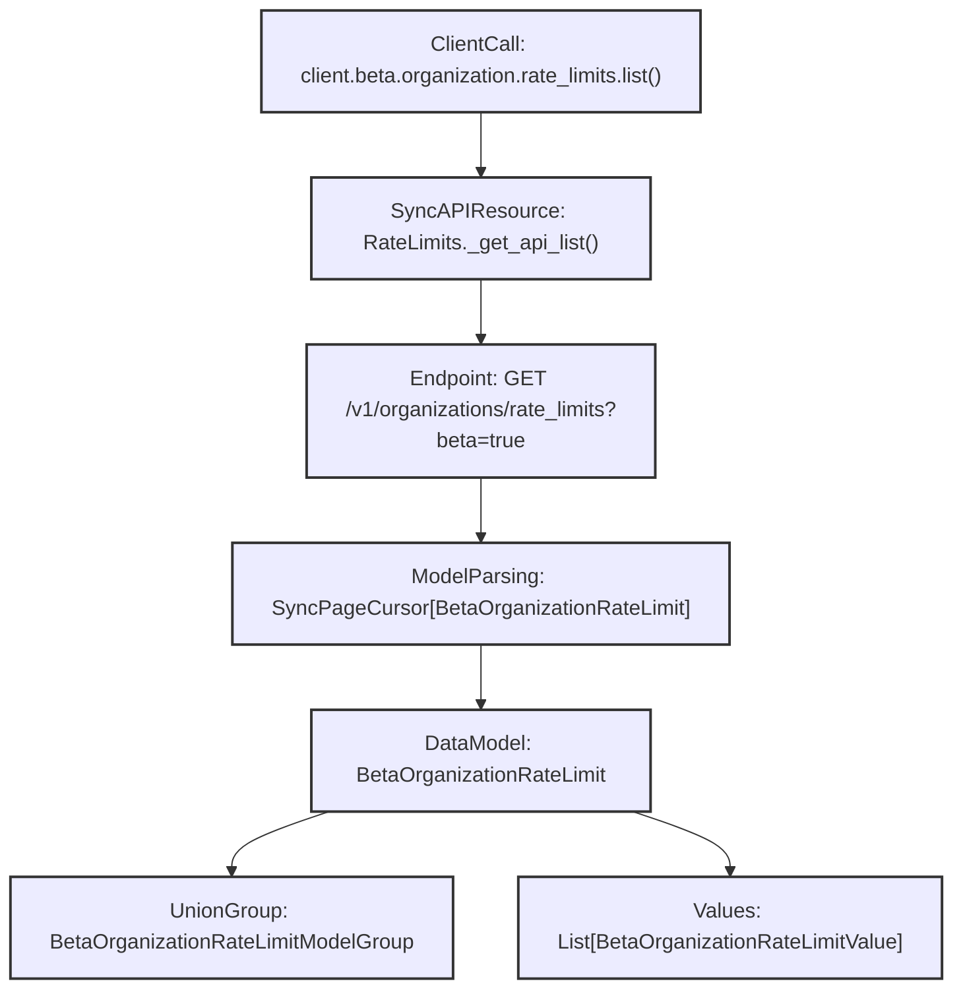
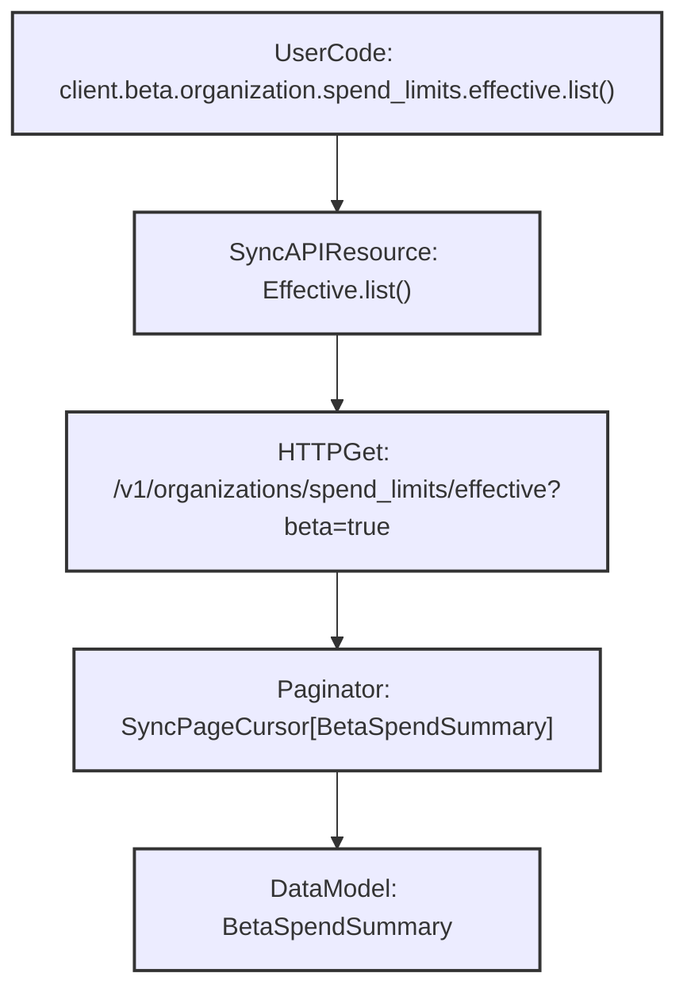

<!-- source: DeepWiki mcp.deepwiki.com · repo anthropics/anthropic-sdk-python · extra page Rate Limits and Spend Limits · fetched 2026-10-26 -->

# Rate Limits and Spend Limits

<details>
<summary>Relevant source files</summary>

The following files were used as context for generating this wiki page:

- [src/anthropic/resources/beta/organization/rate_limits.py](src/anthropic/resources/beta/organization/rate_limits.py)
- [src/anthropic/resources/beta/organization/spend_limits/effective.py](src/anthropic/resources/beta/organization/spend_limits/effective.py)
- [src/anthropic/resources/beta/organization/spend_limits/spend_limits.py](src/anthropic/resources/beta/organization/spend_limits/spend_limits.py)
- [src/anthropic/resources/beta/organization/workspaces/rate_limits.py](src/anthropic/resources/beta/organization/workspaces/rate_limits.py)
- [src/anthropic/resources/organization/rate_limits.py](src/anthropic/resources/organization/rate_limits.py)
- [src/anthropic/resources/organization/workspaces/rate_limits.py](src/anthropic/resources/organization/workspaces/rate_limits.py)
- [src/anthropic/types/beta/organization/beta_organization_rate_limit.py](src/anthropic/types/beta/organization/beta_organization_rate_limit.py)
- [src/anthropic/types/beta/organization/beta_spend_limit.py](src/anthropic/types/beta/organization/beta_spend_limit.py)
- [src/anthropic/types/beta/organization/beta_spend_limit_usage_tier_scope.py](src/anthropic/types/beta/organization/beta_spend_limit_usage_tier_scope.py)
- [src/anthropic/types/beta/organization/beta_spend_summary.py](src/anthropic/types/beta/organization/beta_spend_summary.py)
- [src/anthropic/types/beta/organization/rate_limit_list_params.py](src/anthropic/types/beta/organization/rate_limit_list_params.py)
- [src/anthropic/types/beta/organization/spend_limit_list_params.py](src/anthropic/types/beta/organization/spend_limit_list_params.py)
- [src/anthropic/types/beta/organization/workspaces/__init__.py](src/anthropic/types/beta/organization/workspaces/__init__.py)
- [src/anthropic/types/beta/organization/workspaces/beta_workspace_rate_limit_organization_source.py](src/anthropic/types/beta/organization/workspaces/beta_workspace_rate_limit_organization_source.py)
- [src/anthropic/types/beta/organization/workspaces/beta_workspace_rate_limit_type.py](src/anthropic/types/beta/organization/workspaces/beta_workspace_rate_limit_type.py)
- [src/anthropic/types/beta/organization/workspaces/beta_workspace_rate_limit_update_value_param.py](src/anthropic/types/beta/organization/workspaces/beta_workspace_rate_limit_update_value_param.py)
- [src/anthropic/types/beta/organization/workspaces/beta_workspace_rate_limit_value.py](src/anthropic/types/beta/organization/workspaces/beta_workspace_rate_limit_value.py)
- [src/anthropic/types/beta/organization/workspaces/beta_workspace_rate_limit_workspace_source.py](src/anthropic/types/beta/organization/workspaces/beta_workspace_rate_limit_workspace_source.py)
- [src/anthropic/types/beta/organization/workspaces/rate_limit_list_params.py](src/anthropic/types/beta/organization/workspaces/rate_limit_list_params.py)
- [src/anthropic/types/beta/organization/workspaces/rate_limit_update_params.py](src/anthropic/types/beta/organization/workspaces/rate_limit_update_params.py)
- [src/anthropic/types/organization/organization_rate_limit.py](src/anthropic/types/organization/organization_rate_limit.py)
- [tests/api_resources/beta/organization/test_spend_limits.py](tests/api_resources/beta/organization/test_spend_limits.py)
- [tests/api_resources/beta/organization/workspaces/test_rate_limits.py](tests/api_resources/beta/organization/workspaces/test_rate_limits.py)

</details>


### Purpose and Scope
This page documents the SDK interface for managing organization-level and workspace-level rate limits, rate limit value sources, and spend limits (including effective limits and usage tier scopes). These features are exposed primarily under the beta organization administration namespace.

---

## 1. Organization-Level Rate Limits

The organization rate limits resource allows administrators to inspect the rate-limit groups configured for an organization. Each entry corresponds to either a model family or an API-surface category (such as batch processing or web search).

Organization rate limits are queried using the `RateLimits` resource class [src/anthropic/resources/beta/organization/rate_limits.py:24-110]():

```python
# Listing organization rate limits
response = client.beta.organization.rate_limits.list(
    group_type="model_group",
    limit=50
)
```

Each item returned is represented by the `BetaOrganizationRateLimit` data model [src/anthropic/types/beta/organization/beta_organization_rate_limit.py:28-50](), which encapsulates:
- `id`: Stable identifier within the organization.
- `group`: A tagged union (`Group`) representing rate limit categories (`BetaOrganizationRateLimitModelGroup`, `BetaOrganizationRateLimitBatchGroup`, etc.).
- `limits`: A list of `BetaOrganizationRateLimitValue` objects detailing specific limit thresholds (e.g., requests per minute, tokens per minute).
- `models`: Optional list of model identifiers or aliases to which the entry applies.


*Diagram 1: Organization Rate Limits Request Flow and Code Mapping*

Sources: `src/anthropic/resources/beta/organization/rate_limits.py`, `src/anthropic/types/beta/organization/beta_organization_rate_limit.py`

---

## 2. Workspace-Level Rate Limits and Overrides

Workspaces can have fine-grained rate limit overrides configured against specific rate-limit groups. Workspace rate limits are managed via `anthropic.resources.beta.organization.workspaces.rate_limits.RateLimits` [src/anthropic/resources/beta/organization/workspaces/rate_limits.py:28-112]().

### Updating Workspace Overrides
Administrators call `.update()` to set or clear overrides for a specific rate-limit group in a workspace:

```python
updated_limit = client.beta.organization.workspaces.rate_limits.update(
    rate_limit_id="rl_01234",
    workspace_id="wrkspc_01234",
    limits=[
        {
            "type": "input_tokens_per_minute",
            value: 1000000
        }
    ]
)
```

Limiter types are governed by `BetaWorkspaceRateLimitType`, which defines standard telemetry and enforcement metrics [src/anthropic/types/beta/organization/workspaces/beta_workspace_rate_limit_type.py:5-15]():
- `fast_itpmca`
- `fast_otpm`
- `input_tokens_per_minute`
- `input_tokens_per_minute_cache_aware`
- `output_tokens_per_minute`
- `requests_per_minute`
- `tokens_per_day`
- `tokens_per_minute`
- `tool_uses_per_second`

Sources: `src/anthropic/resources/beta/organization/workspaces/rate_limits.py`, `src/anthropic/types/beta/organization/workspaces/beta_workspace_rate_limit_type.py`

---

## 3. Spend Limits API and Effective Spend

The spend limits API manages organization metered spending caps, periods, and scope bindings. 

### SpendLimits Resource Methods
The `SpendLimits` class exposes retrieval, listing, setting, and deletion of spend limits [src/anthropic/resources/beta/organization/spend_limits/spend_limits.py:46-113]():
- `retrieve(spend_limit_id)`: Fetches a specific spend limit by its tagged ID (`spl_...`).
- `list(...)`: Enumerates configured limits, supporting scope filters (`usage_tier`, `workspace`, `user`, `rbac_group`, etc.) [src/anthropic/types/beta/organization/spend_limit_list_params.py:11-42]().

The underlying data model `BetaSpendLimit` defines spend limit parameters, currency units (cents), and scope unions [src/anthropic/types/beta/organization/beta_spend_limit.py:31-74]():

| Field | Type | Description |
| :--- | :--- | :--- |
| `id` | `str` | Tagged ID (`spl_...`) |
| `amount` | `Optional[str]` | Non-negative integer decimal string in minor currency units (e.g., `"50000"` for $500.00) |
| `currency` | `str` | ISO 4217 billing currency code |
| `is_enabled` | `bool` | Read-only flag reflecting extra usage state |
| `period` | `BetaSpendLimitPeriod` | Reset period (`daily`, `weekly`, `monthly`) |
| `scope` | `Scope` | Tagged union identifying what the limit applies to |

### Effective Spend Summaries
For Claude Enterprise organizations, member-level effective limits and period-to-date spend are queried via `Effective` [src/anthropic/resources/beta/organization/spend_limits/effective.py:24-104]():

```python
# Listing effective member spend summaries
for summary in client.beta.organization.spend_limits.effective.list(period=["monthly"]):
    print(summary.user_id, summary.amount)
```


*Diagram 2: Effective Spend Limits Resolution Flow and Code Mapping*

Sources: `src/anthropic/resources/beta/organization/spend_limits/spend_limits.py`, `src/anthropic/resources/beta/organization/spend_limits/effective.py`, `src/anthropic/types/beta/organization/beta_spend_limit.py`, `src/anthropic/types/beta/organization/spend_limit_list_params.py`

---

