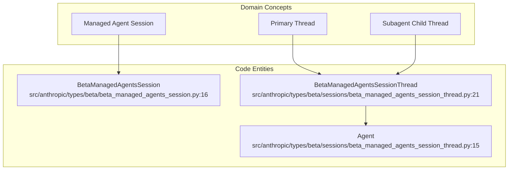
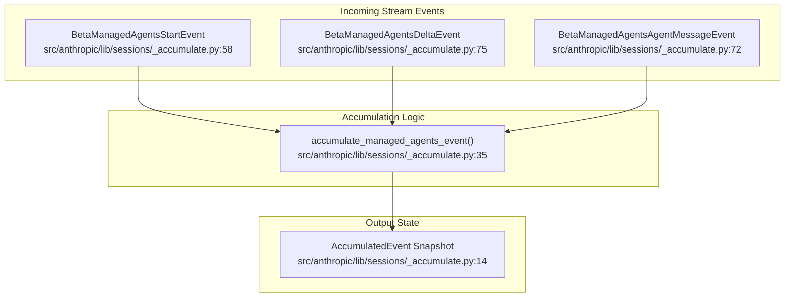

<!-- source: DeepWiki mcp.deepwiki.com · repo anthropics/anthropic-sdk-python · extra page Sessions, Threads, and Events · fetched 2026-10-26 -->

# Sessions, Threads, and Events

<details>
<summary>Relevant source files</summary>

The following files were used as context for generating this wiki page:

- [examples/managed-agents-streaming-deltas-manual.py](examples/managed-agents-streaming-deltas-manual.py)
- [src/anthropic/lib/sessions/_accumulate.py](src/anthropic/lib/sessions/_accumulate.py)
- [src/anthropic/resources/beta/sessions/events.py](src/anthropic/resources/beta/sessions/events.py)
- [src/anthropic/types/beta/beta_managed_agents_deployment_run.py](src/anthropic/types/beta/beta_managed_agents_deployment_run.py)
- [src/anthropic/types/beta/beta_managed_agents_multiagent_params.py](src/anthropic/types/beta/beta_managed_agents_multiagent_params.py)
- [src/anthropic/types/beta/beta_managed_agents_session.py](src/anthropic/types/beta/beta_managed_agents_session.py)
- [src/anthropic/types/beta/beta_managed_agents_user_tool_result_event.py](src/anthropic/types/beta/beta_managed_agents_user_tool_result_event.py)
- [src/anthropic/types/beta/sessions/__init__.py](src/anthropic/types/beta/sessions/__init__.py)
- [src/anthropic/types/beta/sessions/beta_managed_agents_agent_custom_tool_use_event.py](src/anthropic/types/beta/sessions/beta_managed_agents_agent_custom_tool_use_event.py)
- [src/anthropic/types/beta/sessions/beta_managed_agents_agent_evaluated_permission.py](src/anthropic/types/beta/sessions/beta_managed_agents_agent_evaluated_permission.py)
- [src/anthropic/types/beta/sessions/beta_managed_agents_agent_mcp_tool_use_event.py](src/anthropic/types/beta/sessions/beta_managed_agents_agent_mcp_tool_use_event.py)
- [src/anthropic/types/beta/sessions/beta_managed_agents_agent_tool_use_event.py](src/anthropic/types/beta/sessions/beta_managed_agents_agent_tool_use_event.py)
- [src/anthropic/types/beta/sessions/beta_managed_agents_repository_authentication_error.py](src/anthropic/types/beta/sessions/beta_managed_agents_repository_authentication_error.py)
- [src/anthropic/types/beta/sessions/beta_managed_agents_repository_checkout_error.py](src/anthropic/types/beta/sessions/beta_managed_agents_repository_checkout_error.py)
- [src/anthropic/types/beta/sessions/beta_managed_agents_repository_clone_error.py](src/anthropic/types/beta/sessions/beta_managed_agents_repository_clone_error.py)
- [src/anthropic/types/beta/sessions/beta_managed_agents_repository_forbidden_error.py](src/anthropic/types/beta/sessions/beta_managed_agents_repository_forbidden_error.py)
- [src/anthropic/types/beta/sessions/beta_managed_agents_repository_not_found_error.py](src/anthropic/types/beta/sessions/beta_managed_agents_repository_not_found_error.py)
- [src/anthropic/types/beta/sessions/beta_managed_agents_session_error_event.py](src/anthropic/types/beta/sessions/beta_managed_agents_session_error_event.py)
- [src/anthropic/types/beta/sessions/beta_managed_agents_session_event_type.py](src/anthropic/types/beta/sessions/beta_managed_agents_session_event_type.py)
- [src/anthropic/types/beta/sessions/beta_managed_agents_session_refusal.py](src/anthropic/types/beta/sessions/beta_managed_agents_session_refusal.py)
- [src/anthropic/types/beta/sessions/beta_managed_agents_session_refusal_stop_details.py](src/anthropic/types/beta/sessions/beta_managed_agents_session_refusal_stop_details.py)
- [src/anthropic/types/beta/sessions/beta_managed_agents_session_status_idle_event.py](src/anthropic/types/beta/sessions/beta_managed_agents_session_status_idle_event.py)
- [src/anthropic/types/beta/sessions/beta_managed_agents_session_thread.py](src/anthropic/types/beta/sessions/beta_managed_agents_session_thread.py)
- [src/anthropic/types/beta/sessions/beta_managed_agents_session_thread_created_event.py](src/anthropic/types/beta/sessions/beta_managed_agents_session_thread_created_event.py)
- [src/anthropic/types/beta/sessions/beta_managed_agents_session_thread_status_idle_event.py](src/anthropic/types/beta/sessions/beta_managed_agents_session_thread_status_idle_event.py)
- [src/anthropic/types/beta/sessions/beta_managed_agents_user_custom_tool_result_event.py](src/anthropic/types/beta/sessions/beta_managed_agents_user_custom_tool_result_event.py)
- [src/anthropic/types/beta/sessions/beta_managed_agents_user_custom_tool_result_event_params.py](src/anthropic/types/beta/sessions/beta_managed_agents_user_custom_tool_result_event_params.py)
- [src/anthropic/types/beta/sessions/beta_managed_agents_user_tool_confirmation_event.py](src/anthropic/types/beta/sessions/beta_managed_agents_user_tool_confirmation_event.py)
- [src/anthropic/types/beta/sessions/event_list_params.py](src/anthropic/types/beta/sessions/event_list_params.py)
- [src/anthropic/types/beta/vaults/beta_managed_agents_refresh_object.py](src/anthropic/types/beta/vaults/beta_managed_agents_refresh_object.py)
- [tests/lib/sessions/test_accumulate.py](tests/lib/sessions/test_accumulate.py)

</details>


## Purpose and Scope

This document details the managed-agents sessions, threads, and event handling architecture within the Anthropic Python SDK. It covers the session lifecycle states, hierarchical execution threads (`BetaManagedAgentsSessionThread`), the event type hierarchy (including tool interactions, status idle transitions, refusals, and repository errors), event query pagination via `Events.list()`, and client-side stream event accumulation implemented in `lib/sessions/_accumulate.py`.

Sources: `src/anthropic/types/beta/beta_managed_agents_session.py:1-81`(), `src/anthropic/types/beta/sessions/beta_managed_agents_session_thread.py:1-73`(), `src/anthropic/lib/sessions/_accumulate.py:1-108`()

---

## Session Lifecycle and Threads

Sessions represent long-running managed-agent execution environments. Each session maintains a snapshot of its agent configuration, spend budgets, execution metrics, and an array of execution threads.

### Session Status and Lifecycle

Sessions are modeled by `BetaManagedAgentsSession` (`[src/anthropic/types/beta/beta_managed_agents_session.py:16-80]()`) and traverse the following operational states defined by `status`:
- `rescheduling`: A transient error has occurred and the session is being retried automatically.
- `running`: The agent is actively executing tasks or processing inputs.
- `idle`: The agent is waiting for input, user messages, or tool confirmations/results. Sessions initialize in this state.
- `terminated`: The session has concluded due to completion, cancellation, or unrecoverable error.

### Execution Threads

Within a session, execution is structured into primary and child threads via `BetaManagedAgentsSessionThread` (`[src/anthropic/types/beta/sessions/beta_managed_agents_session_thread.py:21-72]()`). Each thread maintains its own status (`BetaManagedAgentsSessionThreadStatus`), token usage metrics (`BetaManagedAgentsSessionThreadUsage`), and timing statistics.



Sources: `src/anthropic/types/beta/beta_managed_agents_session.py:16-81`(), `src/anthropic/types/beta/sessions/beta_managed_agents_session_thread.py:21-73`()

---

## Session Event Type Hierarchy

Managed agents communicate through an event-driven architecture. Events represent state changes, tool requests, user inputs, errors, and agent outputs. The SDK defines models for each event category under `src/anthropic/types/beta/sessions/`:

1. **Tool Use Events**: 
   - Built-in agent tools: `BetaManagedAgentsAgentToolUseEvent` (`[src/anthropic/types/beta/sessions/beta_managed_agents_agent_tool_use_event.py:12-42]()`).
   - MCP tools: `BetaManagedAgentsAgentMCPToolUseEvent` (`[src/anthropic/types/beta/sessions/beta_managed_agents_agent_mcp_tool_use_event.py:12-45]()`).
   - Custom tools: `BetaManagedAgentsAgentCustomToolUseEvent` (`[src/anthropic/types/beta/sessions/beta_managed_agents_agent_custom_tool_use_event.py:10-37]()`).
2. **Tool Result Events**:
   - Custom tool results: `BetaManagedAgentsUserCustomToolResultEvent` (`[src/anthropic/types/beta/sessions/beta_managed_agents_user_custom_tool_result_event.py:24-53]()`) submitted via `BetaManagedAgentsUserCustomToolResultEventParams` (`[src/anthropic/types/beta/sessions/beta_managed_agents_user_custom_tool_result_event_params.py:21-38]()`).
3. **Status and Control Events**:
   - Status idle events indicating required user action or completion.
   - Refusal events (`BetaManagedAgentsSessionRefusal`) detailing policy or capability restrictions.
4. **Repository and System Errors**:
   - Repository-specific failures including clone errors (`BetaManagedAgentsRepositoryCloneError`), checkout errors (`BetaManagedAgentsRepositoryCheckoutError`), authentication errors, and forbidden errors.

Sources: `src/anthropic/types/beta/sessions/beta_managed_agents_agent_tool_use_event.py:12-42`(), `src/anthropic/types/beta/sessions/beta_managed_agents_agent_custom_tool_use_event.py:10-38`(), `src/anthropic/types/beta/sessions/beta_managed_agents_user_custom_tool_result_event.py:24-54`(), `src/anthropic/types/beta/sessions/beta_managed_agents_user_custom_tool_result_event_params.py:21-39`()

---

## Event Listing and API Integration

Clients query historical session events using the `Events` resource class (`[src/anthropic/resources/beta/sessions/events.py:40-154]()`). 

The `.list()` method supports filtering by processed timestamps (`created_at_gt`, `created_at_gte`, `created_at_lt`, `created_at_lte`), sorting order (`asc` or `desc`), pagination cursors (`page`), and specific event types (`types`).

```python
# Example usage pattern for listing session events
events_page = client.beta.sessions.events.list(
    session_id="session_011C...",
    types=["user.message", "agent.tool_use"],
    limit=50
)
```

Parameters are defined by `EventListParams` (`[src/anthropic/types/beta/sessions/event_list_params.py:13-70]()`), which ensures correct beta headers (`managed-agents-2026-04-01`) and workspace scoping are applied.

Sources: `src/anthropic/resources/beta/sessions/events.py:40-154`(), `src/anthropic/types/beta/sessions/event_list_params.py:13-71`()

---

## Client-Side Event Accumulation

When consuming streaming session events, the SDK provides state accumulation utilities in `src/anthropic/lib/sessions/_accumulate.py` (`[src/anthropic/lib/sessions/_accumulate.py:1-107]()`). 

The core accumulator function `accumulate_managed_agents_event()` (`[src/anthropic/lib/sessions/_accumulate.py:35-107]()`) folds preview events and deltas (`BetaManagedAgentsStreamSessionEvents`) into a canonical `AccumulatedEvent` (`[src/anthropic/lib/sessions/_accumulate.py:14-14]()`), which resolves to `BetaManagedAgentsAgentMessageEvent`.

### Accumulation Data Flow



### Accumulation Rules
- **`event_start`**: Initializes an empty snapshot with an epoch placeholder (`_UNPROCESSED`) for `processed_at` (`[src/anthropic/lib/sessions/_accumulate.py:58-66]()`).
- **`event_delta`**: Appends text fragments or content blocks at specific indices (`delta.index`), validating index sequence continuity to raise `AnthropicError` on gaps (`[src/anthropic/lib/sessions/_accumulate.py:75-104]()`).
- **Buffered Final Event (`agent.message`)**: Replaces the preview snapshot with a deep copy of the canonical final message event (`[src/anthropic/lib/sessions/_accumulate.py:72-73]()`).

Sources: `src/anthropic/lib/sessions/_accumulate.py:1-108`(), `tests/lib/sessions/test_accumulate.py:1-185`()

---

