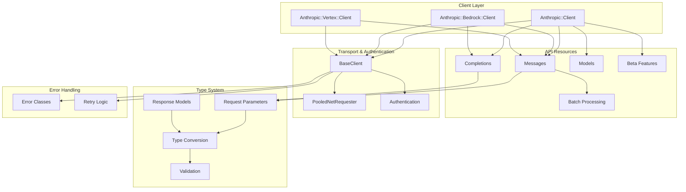
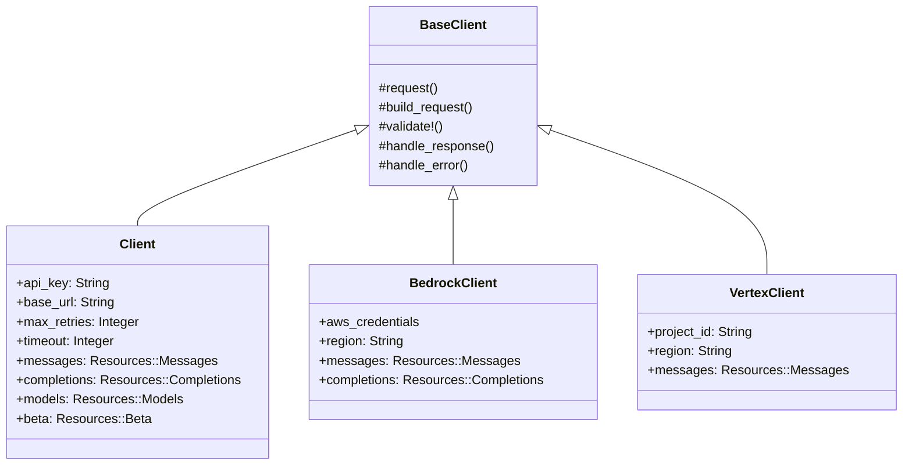
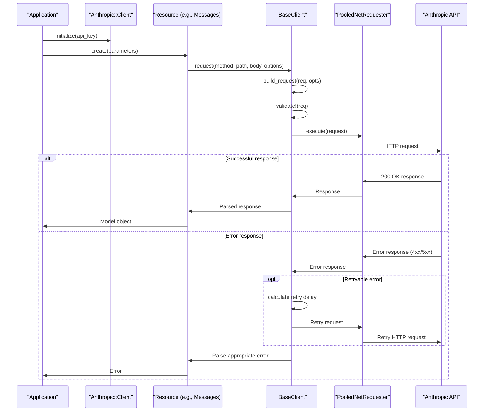
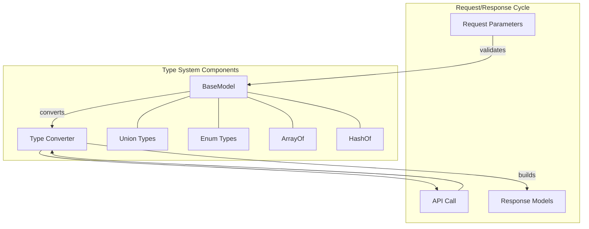
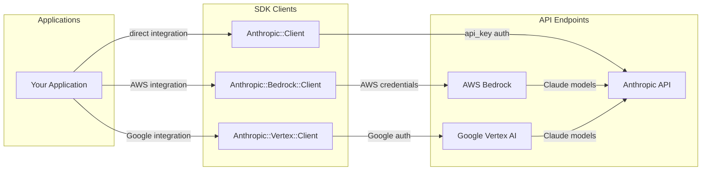

<!-- source: DeepWiki mcp.deepwiki.com · repo anthropics/anthropic-sdk-ruby · page 1 Overview · fetched 2026-10-26 -->

# Overview

<details>
<summary>Relevant source files</summary>

The following files were used as context for generating this wiki page:

- [.release-please-manifest.json](.release-please-manifest.json)
- [.stats.yml](.stats.yml)
- [CHANGELOG.md](CHANGELOG.md)
- [Gemfile](Gemfile)
- [Gemfile.lock](Gemfile.lock)
- [README.md](README.md)
- [lib/anthropic.rb](lib/anthropic.rb)
- [lib/anthropic/version.rb](lib/anthropic/version.rb)
- [test/anthropic/client_test.rb](test/anthropic/client_test.rb)
- [test/anthropic/test_helper.rb](test/anthropic/test_helper.rb)

</details>


The Anthropic Ruby SDK provides a clean, type-safe interface for Ruby applications to interact with Anthropic's Claude AI models. This library wraps Anthropic's REST API in an idiomatic Ruby package, offering a comprehensive set of tools for building AI-powered applications with Claude.

For detailed installation and authentication setup, see [Getting Started](#2).

Sources: [README.md:1-44]()

## Key Features

- **Complete API Coverage**: Access to all Anthropic API endpoints including Messages, Completions, and Models
- **Type Safety**: Robust parameter validation and conversion through a comprehensive type system
- **Streaming Support**: Real-time responses with Server-Sent Events (SSE)
- **Pagination**: Auto-paginating iterators for list endpoints
- **Error Handling**: Structured error hierarchy with detailed error information
- **Retry Logic**: Automatic retries with exponential backoff for certain error types
- **Cloud Provider Integration**: Native interfaces for AWS Bedrock and Google Vertex AI
- **Batch Processing**: Efficient handling of multiple message requests
- **Tool Usage**: Support for Claude's tools capability for external function calling
- **LSP Support**: Solargraph and Sorbet type definitions for better IDE integration

Sources: [README.md:26-46](), [README.md:47-231]()

## SDK Architecture



The SDK is organized into several layers that work together to provide a seamless experience. The Client Layer serves as the primary entry point, with different client implementations for direct API access and cloud provider integrations. Resources encapsulate specific API functionality, while the transport layer handles HTTP communications and authentication. The type system ensures proper data validation and conversion.

Sources: [lib/anthropic.rb:37-60](), [README.md:233-289]()

## Client Types

The SDK offers three client implementations to accommodate different integration scenarios:

1. **Anthropic::Client** - Direct integration with Anthropic's API
2. **Anthropic::Bedrock::Client** - Integration via AWS Bedrock
3. **Anthropic::Vertex::Client** - Integration via Google Vertex AI

Each client provides consistent access to the underlying functionality while handling the specific authentication and communication requirements of each platform.



Sources: [lib/anthropic.rb:57-59](), [README.md:233-289]()

## Core Resources

The SDK organizes its functionality into resource classes that provide methods for interacting with specific API endpoints:

| Resource | Purpose | Key Methods |
|----------|---------|-------------|
| Messages | Primary interface for Claude conversations | `create`, `stream_raw`, `count_tokens` |
| Messages::Batches | Process multiple message requests | `create`, `retrieve`, `list`, `delete`, `cancel` |
| Completions | Legacy API for text completion | `create`, `create_streaming` |
| Models | Information about available models | `retrieve`, `list` |
| Beta | Experimental API features | (Various beta endpoints) |

Sources: [lib/anthropic.rb:258-265](), [README.md:26-46]()

## Request Processing Flow



When your application makes a request using the SDK, it goes through several layers of processing before reaching the Anthropic API. The request is validated, authenticated, and potentially retried if certain errors occur. Responses are parsed into appropriate model objects before being returned to your application.

Sources: [README.md:94-122](), [lib/anthropic/client.rb](), [test/anthropic/client_test.rb:1-230]()

## Type System

The SDK uses a comprehensive type system to validate and convert data between Ruby objects and API formats. This ensures that requests are properly formed and responses are correctly parsed.



The type system is built around the `BaseModel` class, which provides structure and validation for request parameters and response models. It supports complex data types including unions, enums, arrays, and hashes.

Sources: [lib/anthropic.rb:37-53](), [README.md:180-207]()

## Basic Usage Example

Here's a simple example of using the SDK to create a message with Claude:

```ruby
# Initialize the client
anthropic = Anthropic::Client.new(
  api_key: "my-anthropic-api-key"  # defaults to ENV["ANTHROPIC_API_KEY"]
)

# Create a message
message = anthropic.messages.create(
  max_tokens: 1024,
  messages: [{
    role: "user",
    content: "Hello, Claude"
  }],
  model: "claude-3-5-sonnet-latest"
)

# Access the response content
puts(message.content)
```

For more advanced usage, including streaming, batch processing, and cloud provider integration, refer to the specific sections in this wiki.

Sources: [README.md:28-46]()

## Cloud Provider Integration

The SDK supports accessing Claude models through different cloud providers, giving you flexibility in how you deploy and use the models.



Each client handles its own authentication mechanism while providing a consistent API for interacting with Claude models:

- **Anthropic::Client**: Direct access using an API key
- **Anthropic::Bedrock::Client**: Access through AWS using AWS credentials
- **Anthropic::Vertex::Client**: Access through Google Cloud using Google authentication

Sources: [README.md:233-289](), [lib/anthropic.rb:57-59]()

## Related Topics

This overview provides a high-level introduction to the Anthropic Ruby SDK. For more detailed information on specific topics, refer to these sections:

- For installation and authentication setup, see [Getting Started](#2)
- For detailed client architecture, see [Client Architecture](#3)
- For using the Messages API, see [Messages API](#4)
- For batch processing, see [Batch Processing](#5)
- For cloud provider integration details, see [Cloud Provider Integration](#10)
- For error handling strategies, see [Error Handling](#3.2)

Sources: [README.md:1-10]()

---

