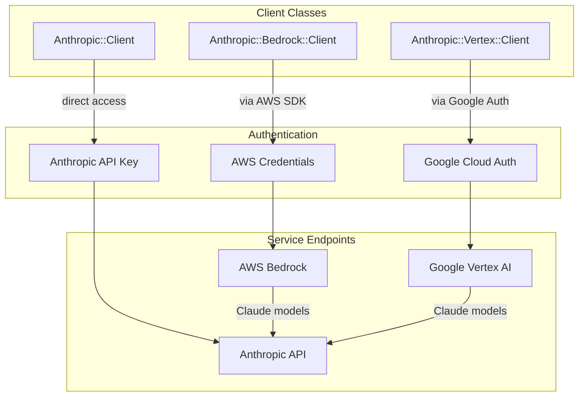
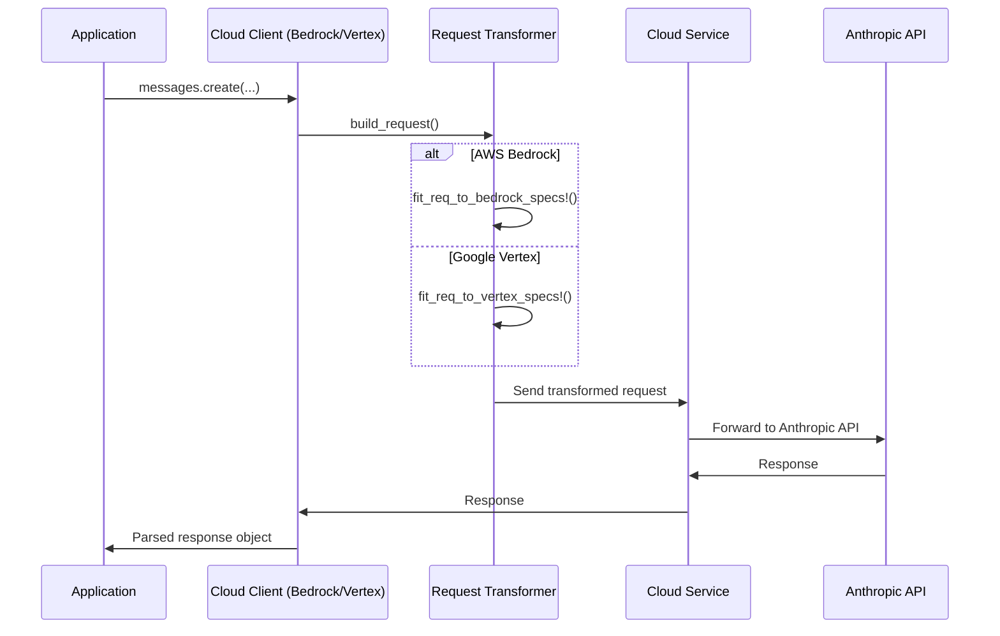
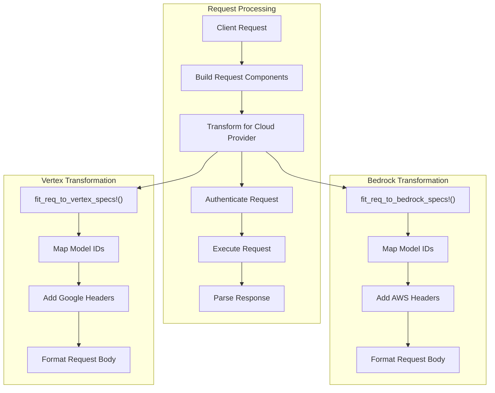

<!-- source: DeepWiki mcp.deepwiki.com · repo anthropics/anthropic-sdk-ruby · page 10 Cloud Provider Integration · fetched 2026-10-26 -->

# Cloud Provider Integration

<details>
<summary>Relevant source files</summary>

The following files were used as context for generating this wiki page:

- [.release-please-manifest.json](.release-please-manifest.json)
- [CHANGELOG.md](CHANGELOG.md)
- [Gemfile](Gemfile)
- [Gemfile.lock](Gemfile.lock)
- [README.md](README.md)
- [examples/sorbet_demo.rb](examples/sorbet_demo.rb)
- [lib/anthropic/version.rb](lib/anthropic/version.rb)
- [rbi/lib/anthropic/bedrock/client.rbi](rbi/lib/anthropic/bedrock/client.rbi)
- [rbi/lib/anthropic/vertex/client.rbi](rbi/lib/anthropic/vertex/client.rbi)
- [sig/anthropic/bedrock/client.rbs](sig/anthropic/bedrock/client.rbs)
- [sig/anthropic/vertex/client.rbs](sig/anthropic/vertex/client.rbs)

</details>


This page provides an overview of the Anthropic Ruby SDK's integration with cloud provider services that offer Claude AI capabilities. The SDK supports using Claude models through AWS Bedrock and Google Vertex AI, in addition to direct access through the Anthropic API.

For detailed information about specific cloud integrations, see:
- [AWS Bedrock Integration](#10.1)
- [Google Vertex Integration](#10.2)

## Integration Architecture

The Anthropic Ruby SDK provides three distinct client classes that serve as entry points for different deployment scenarios:



All three client classes provide a consistent interface for interacting with Claude models, but they handle authentication and request processing differently based on their respective cloud environments.

Sources: [README.md:233-258](), [rbi/lib/anthropic/bedrock/client.rbi](), [rbi/lib/anthropic/vertex/client.rbi]()

## Client Class Inheritance

The cloud-specific clients inherit from the base `Anthropic::Client` class, ensuring they maintain the same interface and resource structure while adding their cloud-specific functionality:

```mermaid
classDiagram
    class Anthropic::Client {
        +messages: Resources::Messages
        +completions: Resources::Completions
        +models: Resources::Models
        +beta: Resources::Beta
    }
    
    class Anthropic::Bedrock::Client {
        +DEFAULT_VERSION: String
        +aws_region: String
        +messages: Resources::Messages
        +completions: Resources::Completions
        +beta: Resources::Beta
        -build_request()
        -fit_req_to_bedrock_specs!()
    }
    
    class Anthropic::Vertex::Client {
        +DEFAULT_VERSION: String
        +region: String
        +project_id: String
        +messages: Resources::Messages
        +beta: Resources::Beta
        -build_request()
        -fit_req_to_vertex_specs!()
    }
    
    Anthropic::Client <|-- Anthropic::Bedrock::Client
    Anthropic::Client <|-- Anthropic::Vertex::Client
```

Each cloud client overrides internal methods like `build_request` to transform standard Anthropic API requests into the format expected by the respective cloud service.

Sources: [rbi/lib/anthropic/bedrock/client.rbi](), [rbi/lib/anthropic/vertex/client.rbi]()

## Request Transformation

When you make a request through a cloud provider client, the SDK handles the complexities of transforming your request to match the cloud provider's API specifications:



This transformation layer ensures that you can use the same SDK interface regardless of which cloud provider you're using to access Claude models.

Sources: [rbi/lib/anthropic/bedrock/client.rbi:14-26](), [rbi/lib/anthropic/vertex/client.rbi:14-21]()

## AWS Bedrock Integration

AWS Bedrock provides managed access to Claude models through Amazon's infrastructure. To use this integration, you need to install the `aws-sdk-bedrockruntime` gem alongside the Anthropic Ruby SDK.

### Key Features:
- Uses AWS credentials for authentication
- Supports both Claude messages and completions APIs
- Requires AWS-specific model IDs

### Basic Usage:

```ruby
require "anthropic"

# Uses AWS credential providers chain
anthropic = Anthropic::Bedrock::Client.new(
  aws_region: "us-east-1"  # Optional, defaults to AWS SDK region resolution
)

message = anthropic.messages.create(
  max_tokens: 1024,
  messages: [{
    role: "user",
    content: "Hello, Claude"
  }],
  model: "anthropic.claude-3-5-sonnet-20241022-v2:0"  # AWS model ID
)

puts message.content
```

For more details on configuring and using Bedrock integration, see [AWS Bedrock Integration](#10.1).

Sources: [README.md:233-262]()

## Google Vertex AI Integration

Google Vertex AI provides managed access to Claude models through Google Cloud infrastructure. To use this integration, you need to install the `googleauth` gem alongside the Anthropic Ruby SDK.

### Key Features:
- Uses Google Cloud authentication
- Supports the Claude messages API
- Requires region and project ID specification
- Uses Vertex AI model IDs

### Basic Usage:

```ruby
require "anthropic"

anthropic = Anthropic::Vertex::Client.new(
  region: "us-east5",
  project_id: "my-project-id"
)

message = anthropic.messages.create(
  max_tokens: 1024,
  messages: [{
    role: "user",
    content: "Hello, Claude"
  }],
  model: "claude-3-7-sonnet@20250219"  # Vertex AI model ID
)

puts message.content
```

For more details on configuring and using Vertex AI integration, see [Google Vertex Integration](#10.2).

Sources: [README.md:263-289]()

## Model ID Differences

Each cloud provider uses different model identifiers for Claude models. This table shows the differences:

| Provider | Example Model ID | Notes |
|----------|-----------------|-------|
| Anthropic API | `claude-3-5-sonnet-latest` | Uses standard Claude model identifiers |
| AWS Bedrock | `anthropic.claude-3-5-sonnet-20241022-v2:0` | Uses AWS's model ID format or inference profile IDs |
| Google Vertex | `claude-3-7-sonnet@20250219` | Uses Vertex AI model ID format |

When switching between providers, be sure to update your model identifiers accordingly.

Sources: [README.md:239-256](), [README.md:274-285]()

## Authentication Mechanisms

Each client uses a different authentication mechanism:

| Client | Authentication Method | Environment Variables | Additional Configuration |
|--------|------------------------|----------------------|--------------------------|
| `Anthropic::Client` | API Key | `ANTHROPIC_API_KEY` | Can be provided directly via `api_key` parameter |
| `Anthropic::Bedrock::Client` | AWS Credentials | AWS credential chain | Region, access keys, or profile name can be specified |
| `Anthropic::Vertex::Client` | Google Application Default Credentials | `CLOUD_ML_REGION`, `ANTHROPIC_VERTEX_PROJECT_ID` | Region and project ID required |

Sources: [README.md:32-34](), [rbi/lib/anthropic/bedrock/client.rbi:53-76](), [rbi/lib/anthropic/vertex/client.rbi:35-53]()

## Implementation Details

Both cloud provider clients extend the base client by:

1. Overriding the `build_request` method to transform requests
2. Providing cloud-specific authentication
3. Mapping standard Anthropic API requests to cloud-specific formats

The clients use private methods like `fit_req_to_bedrock_specs!` and `fit_req_to_vertex_specs!` to perform the necessary transformations.



Sources: [rbi/lib/anthropic/bedrock/client.rbi:14-50](), [rbi/lib/anthropic/vertex/client.rbi:14-22]()

## Usage Considerations

Consider these factors when choosing which client to use:

1. **Existing Infrastructure**: If you're already using AWS or Google Cloud, using their respective integrations may be more convenient.

2. **Compliance Requirements**: Each cloud provider offers different compliance certifications and data residency options.

3. **Pricing**: Cost structures differ between direct API access and cloud provider offerings.

4. **Feature Availability**: New Claude features may be available at different times across providers.

5. **Authentication Complexity**: Cloud providers use their standard authentication mechanisms, which may be easier to integrate in existing cloud environments.

Each integration provides the same core functionality while leveraging the specific benefits of its cloud environment.

Sources: [README.md:233-289]()

## Summary

The Anthropic Ruby SDK offers flexible options for accessing Claude models:

1. **Direct API access** via `Anthropic::Client` - simplest option requiring just an API key
2. **AWS Bedrock integration** via `Anthropic::Bedrock::Client` - leverages AWS infrastructure and authentication
3. **Google Vertex AI integration** via `Anthropic::Vertex::Client` - utilizes Google Cloud infrastructure and authentication

All three clients maintain a consistent interface, allowing you to switch between them with minimal code changes, primarily adjusting only authentication and model IDs.

For detailed implementation specifics, see the dedicated pages for [AWS Bedrock Integration](#10.1) and [Google Vertex Integration](#10.2).

---

