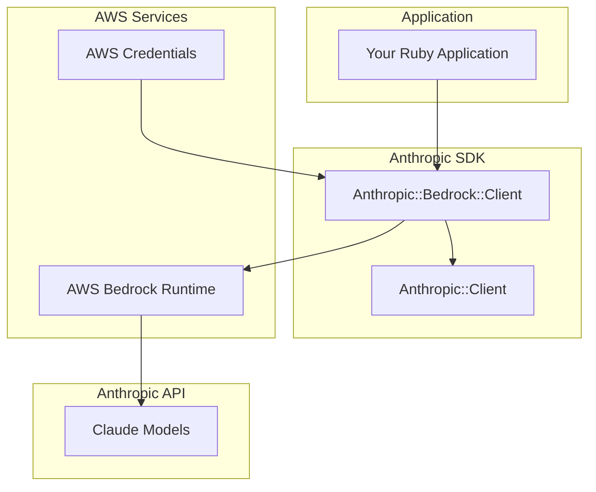
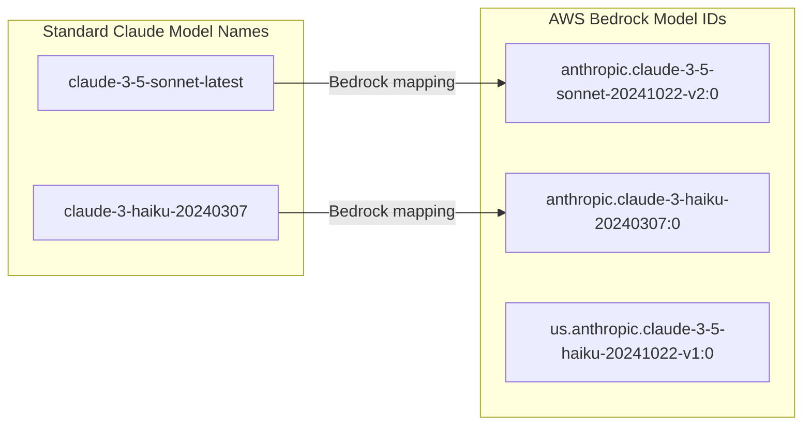
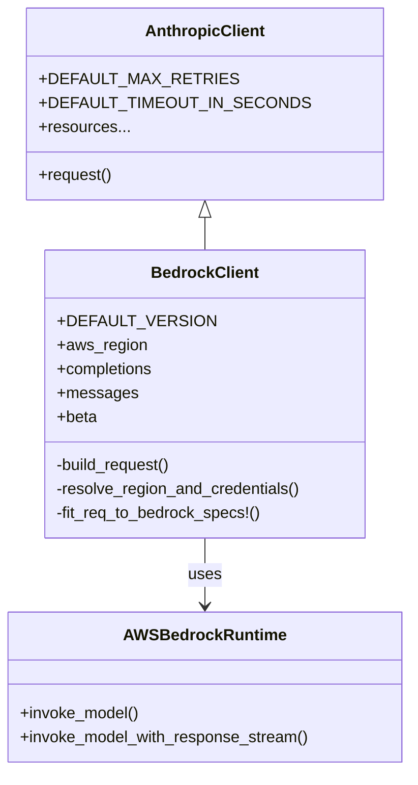

<!-- source: DeepWiki mcp.deepwiki.com · repo anthropics/anthropic-sdk-ruby · page 10.1 AWS Bedrock Integration · fetched 2026-10-26 -->

# AWS Bedrock Integration

<details>
<summary>Relevant source files</summary>

The following files were used as context for generating this wiki page:

- [.release-please-manifest.json](.release-please-manifest.json)
- [CHANGELOG.md](CHANGELOG.md)
- [Gemfile](Gemfile)
- [Gemfile.lock](Gemfile.lock)
- [README.md](README.md)
- [examples/sorbet_demo.rb](examples/sorbet_demo.rb)
- [lib/anthropic/version.rb](lib/anthropic/version.rb)
- [rbi/lib/anthropic/bedrock/client.rbi](rbi/lib/anthropic/bedrock/client.rbi)
- [rbi/lib/anthropic/vertex/client.rbi](rbi/lib/anthropic/vertex/client.rbi)
- [sig/anthropic/bedrock/client.rbs](sig/anthropic/bedrock/client.rbs)
- [sig/anthropic/vertex/client.rbs](sig/anthropic/vertex/client.rbs)

</details>


This page documents how to use Claude models through AWS Bedrock using the Anthropic Ruby SDK. The SDK provides a dedicated Bedrock client that handles authentication, request formatting, and communication with AWS's Bedrock runtime service. For information about Google Vertex AI integration, see [Google Vertex Integration](#10.2).

## Overview

The Anthropic Ruby SDK supports accessing Claude models via AWS Bedrock, which allows you to use Claude directly through your AWS account. This integration provides several benefits:

- **AWS Authentication**: Uses your existing AWS credentials for authentication
- **Regional Deployment**: Access Claude in various AWS regions where Bedrock is available
- **AWS Infrastructure**: Take advantage of AWS's security, compliance, and scalability features
- **Unified Billing**: Claude usage is billed through your AWS account



Sources: [README.md:233-262](), [rbi/lib/anthropic/bedrock/client.rbi:1-81]()

## Installation and Setup

### Prerequisites

To use the AWS Bedrock integration, you need:

1. The base `anthropic-sdk-beta` gem
2. The `aws-sdk-bedrockruntime` gem
3. AWS credentials configured with appropriate permissions for Bedrock

### Installation

Add both required gems to your Gemfile:

```ruby
gem "anthropic-sdk-beta", "~> 0.1.0.pre.beta.6"
gem "aws-sdk-bedrockruntime"
```

### AWS Authentication

The Bedrock client uses AWS's standard credential providers chain. You can configure credentials in several ways:

- Environment variables
- AWS credential files
- IAM roles
- Explicit credential parameters

The client will automatically locate and use available credentials unless you explicitly provide them during initialization.

Sources: [README.md:233-262](), [Gemfile:34-37]()

## Using the Bedrock Client

### Initializing the Client

Create an instance of the Bedrock client:

```ruby
require "anthropic"

# Basic initialization (uses default AWS credential providers)
anthropic = Anthropic::Bedrock::Client.new
```

The client accepts several initialization parameters:

| Parameter | Description | Default |
|-----------|-------------|---------|
| `aws_region` | AWS region to use | Auto-detected |
| `aws_access_key` | AWS access key ID | Auto-detected |
| `aws_secret_key` | AWS secret access key | Auto-detected |
| `aws_session_token` | AWS session token | Auto-detected |
| `aws_profile` | AWS profile name | Auto-detected |
| `max_retries` | Maximum number of retry attempts | 2 |
| `timeout` | Request timeout in seconds | 600 |

Example with explicit configuration:

```ruby
anthropic = Anthropic::Bedrock::Client.new(
  aws_region: "us-east-1",
  max_retries: 3,
  timeout: 30
)
```

Sources: [rbi/lib/anthropic/bedrock/client.rbi:46-77](), [README.md:233-262]()

### Model IDs

When using AWS Bedrock, you must use AWS's model identifiers instead of the standard Claude model names. These can be either:

1. AWS's model IDs for Anthropic models (e.g., `anthropic.claude-3-5-sonnet-20241022-v2:0`)
2. Inference profile IDs (e.g., `us.anthropic.claude-3-5-haiku-20241022-v1:0`)

AWS model IDs can be found in the [AWS Bedrock model catalog](https://docs.aws.amazon.com/bedrock/latest/userguide/models-supported.html).



Sources: [README.md:233-262]()

## Making API Calls

The Bedrock client shares the same API as the standard Anthropic client, supporting Messages, Completions, and Beta resources.

### Messages API

```ruby
message = anthropic.messages.create(
  max_tokens: 1024,
  messages: [
    {
      role: "user",
      content: "Hello, Claude"
    }
  ],
  model: "anthropic.claude-3-5-sonnet-20241022-v2:0"
)

puts message.content
```

### Completions API

```ruby
completion = anthropic.completions.create(
  max_tokens_to_sample: 1024, 
  model: "anthropic.claude-3-5-sonnet-20241022-v2:0",
  prompt: "\n\nHuman: Hello, Claude\n\nAssistant:"
)

puts completion.completion
```

### Streaming Responses

The Bedrock client also supports streaming responses:

```ruby
stream = anthropic.messages.stream_raw(
  max_tokens: 1024,
  messages: [
    {
      role: "user",
      content: "Hello, Claude"
    }
  ],
  model: "anthropic.claude-3-5-sonnet-20241022-v2:0"
)

stream.each do |chunk|
  puts chunk.type if chunk.type == "content_block_delta"
  puts chunk.delta.text if chunk.delta&.text
end
```

Sources: [README.md:233-262](), [rbi/lib/anthropic/bedrock/client.rbi:8-18]()

## Client Architecture

The Bedrock client extends the base Anthropic client, adapting requests to work with AWS Bedrock's API requirements.



### Request Processing Flow

When you make a request through the Bedrock client, it follows these steps:

1. Client receives a request to a resource (messages, completions)
2. The `build_request` method formats the request for AWS Bedrock
3. AWS credentials are resolved and applied to the request
4. The request is sent to AWS Bedrock Runtime service
5. The response is parsed and returned in the same format as the standard client

The core component that handles this transformation is the `fit_req_to_bedrock_specs!` method, which modifies request components to match AWS Bedrock's API requirements.

Sources: [rbi/lib/anthropic/bedrock/client.rbi:1-81](), [sig/anthropic/bedrock/client.rbs:1-42]()

## Error Handling

The Bedrock client handles both Anthropic API errors and AWS-specific errors. AWS errors are translated into the standard Anthropic error hierarchy:

| Error Type | Description |
|------------|-------------|
| `BadRequestError` | Invalid request parameters |
| `AuthenticationError` | AWS credentials are invalid or missing |
| `PermissionDeniedError` | Insufficient permissions to access the model |
| `NotFoundError` | Model not found or not available |
| `RateLimitError` | Exceeded AWS Bedrock quota limits |
| `InternalServerError` | Server-side error in AWS Bedrock |

Requests to AWS Bedrock follow the same retry logic as standard Anthropic API requests, with automatic retries for transient failures.

Sources: [README.md:113-128](), [README.md:129-153]()

## Practical Examples

### Basic Message Creation

```ruby
require "anthropic"

anthropic = Anthropic::Bedrock::Client.new(aws_region: "us-east-1")

message = anthropic.messages.create(
  max_tokens: 1024,
  messages: [
    {
      role: "user",
      content: "Explain quantum computing in simple terms"
    }
  ],
  model: "anthropic.claude-3-5-sonnet-20241022-v2:0"
)

puts message.content
```

### Using Tools with Bedrock

```ruby
require "anthropic"

anthropic = Anthropic::Bedrock::Client.new

# Define a tool
calculator_tool = {
  name: "calculator",
  description: "Evaluate mathematical expressions",
  input_schema: {
    type: "object",
    properties: {
      expression: {
        type: "string",
        description: "The mathematical expression to evaluate"
      }
    },
    required: ["expression"]
  }
}

# Create a message with tool access
message = anthropic.messages.create(
  max_tokens: 1024,
  messages: [
    {
      role: "user",
      content: "What is 354 * 982?"
    }
  ],
  model: "anthropic.claude-3-5-sonnet-20241022-v2:0",
  tools: [calculator_tool]
)

puts message.content
```

## Related Resources

- For standard Anthropic API access, see [Overview](#1)
- For Google Vertex AI integration, see [Google Vertex Integration](#10.2)
- For error handling details, see [Error Handling](#3.2)
- For information about the Messages API, see [Messages API](#4)

Sources: [README.md:233-262](), [rbi/lib/anthropic/bedrock/client.rbi:1-81]()

---

