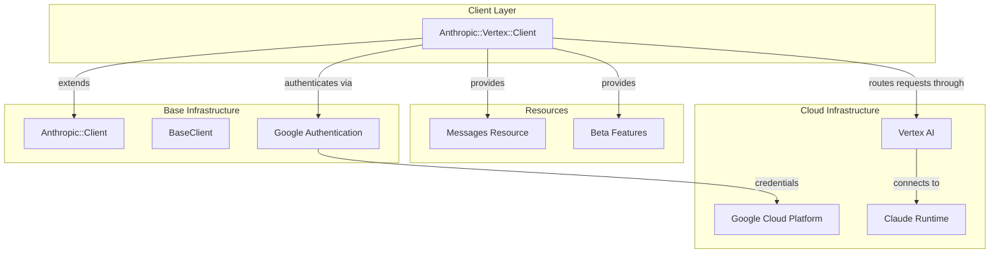
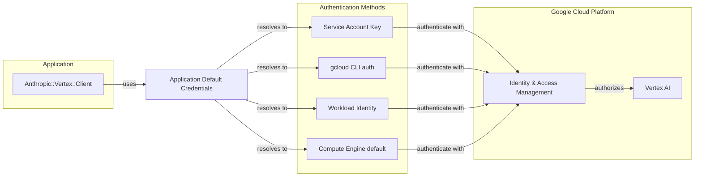
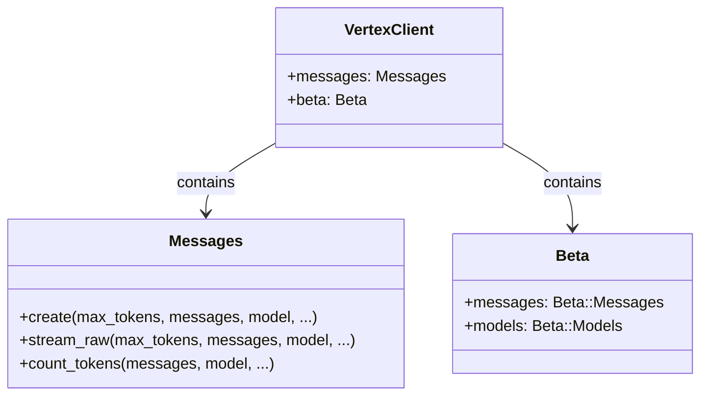

<!-- source: DeepWiki mcp.deepwiki.com · repo anthropics/anthropic-sdk-ruby · page 10.2 Google Vertex Integration · fetched 2026-10-26 -->

# Google Vertex Integration

<details>
<summary>Relevant source files</summary>

The following files were used as context for generating this wiki page:

- [.release-please-manifest.json](.release-please-manifest.json)
- [CHANGELOG.md](CHANGELOG.md)
- [Gemfile](Gemfile)
- [Gemfile.lock](Gemfile.lock)
- [README.md](README.md)
- [examples/sorbet_demo.rb](examples/sorbet_demo.rb)
- [lib/anthropic/version.rb](lib/anthropic/version.rb)
- [rbi/lib/anthropic/bedrock/client.rbi](rbi/lib/anthropic/bedrock/client.rbi)
- [rbi/lib/anthropic/vertex/client.rbi](rbi/lib/anthropic/vertex/client.rbi)
- [sig/anthropic/bedrock/client.rbs](sig/anthropic/bedrock/client.rbs)
- [sig/anthropic/vertex/client.rbs](sig/anthropic/vertex/client.rbs)

</details>


This document explains how to use the Anthropic Ruby SDK to access Claude models through Google Cloud Vertex AI. For direct API usage, see [Overview](#1), and for AWS Bedrock integration, see [AWS Bedrock Integration](#10.1).

## Introduction

The Anthropic Ruby SDK provides a specialized client for accessing Claude models through Google Cloud's Vertex AI service. This integration allows you to leverage Claude's AI capabilities while using Google Cloud for authentication, billing, and infrastructure.

The `Anthropic::Vertex::Client` class offers the same familiar interface as the standard client but routes requests through Google's Vertex AI platform.

Sources: [README.md:262-289]()

## Installation and Dependencies

To use the Vertex AI integration, you must install the SDK with the `googleauth` gem:

```ruby
# Add to your Gemfile
gem "anthropic-sdk-beta", "~> 0.1.0.pre.beta.6"
gem "googleauth"
```

This additional dependency enables Google Cloud authentication functionality required for Vertex AI integration.

Sources: [README.md:262-265](), [Gemfile:34-37](), [Gemfile.lock:79-90]()

## Client Architecture

The Vertex integration follows the same architectural patterns as the rest of the SDK but adapts requests to work with Google's Vertex AI endpoints.



The `Anthropic::Vertex::Client` inherits from `Anthropic::Client` and overrides specific functionality to:

1. Use Google Cloud authentication
2. Route requests through Vertex AI endpoints
3. Format requests according to Vertex AI specifications
4. Parse responses from Vertex AI format

Sources: [rbi/lib/anthropic/vertex/client.rbi:1-56](), [sig/anthropic/vertex/client.rbs:1-34]()

## Authentication Configuration

The Vertex client uses Google's Application Default Credentials (ADC) system for authentication. This allows for several authentication methods:

1. Service account key files
2. User credentials from Google Cloud SDK
3. Workload identity on Google Kubernetes Engine
4. Compute Engine default service accounts



The client respects standard Google Cloud environment variables such as `GOOGLE_APPLICATION_CREDENTIALS` for specifying authentication details.

Sources: [README.md:264-265](), [rbi/lib/anthropic/vertex/client.rbi:6-19]()

## Initializing the Vertex Client

The Vertex client requires Google Cloud-specific parameters:

```ruby
anthropic = Anthropic::Vertex::Client.new(
  region: "us-east5",              # Google Cloud region where Claude is available
  project_id: "my-project-id",     # Your Google Cloud project ID
  max_retries: 2,                  # Optional: default is 2
  timeout: 600                     # Optional: default is 600 seconds
)
```

Key initialization parameters:

| Parameter | Description | Default |
|-----------|-------------|---------|
| `region` | Google Cloud region where Claude is available | Value of `ENV["CLOUD_ML_REGION"]` |
| `project_id` | Your Google Cloud project ID | Value of `ENV["ANTHROPIC_VERTEX_PROJECT_ID"]` |
| `base_url` | Override the default Vertex API endpoint | `nil` (uses default) |
| `max_retries` | Maximum retry attempts for failed requests | `2` |
| `timeout` | Request timeout in seconds | `600` |

Sources: [README.md:271-274](), [rbi/lib/anthropic/vertex/client.rbi:28-53]()

## Using the Vertex Client

The Vertex client provides the same interface as the standard client, focusing primarily on the Messages API:

```ruby
# Create a message
message = anthropic.messages.create(
  max_tokens: 1024,
  messages: [
    {
      role: "user",
      content: "Hello, Claude"
    }
  ],
  model: "claude-3-7-sonnet@20250219"  # Note the Vertex model ID format
)

# Access the response
puts message.content
```

### Key Differences from Direct API

1. **Model IDs**: Vertex AI uses model identifiers with a different format, typically including `@` followed by a date (e.g., `claude-3-7-sonnet@20250219`)

2. **Authentication**: Uses Google Cloud's authentication system instead of API keys

3. **Request Routing**: Requests go through Google's infrastructure before reaching Anthropic's models

4. **Internal Request Processing**: The `fit_req_to_vertex_specs!` method adapts requests to the format expected by Vertex AI

Sources: [README.md:273-285](), [rbi/lib/anthropic/vertex/client.rbi:32-46]()

## Available Resources

The Vertex client currently supports two main resources:



The Vertex client does not currently support the Completions API or Models API available in the standard client.

Sources: [rbi/lib/anthropic/vertex/client.rbi:14-18](), [sig/anthropic/vertex/client.rbs:10-12]()

## Internal Implementation Details

When using the Vertex client, requests are intercepted and modified before being sent to Google's Vertex AI endpoints:

1. The `build_request` method overrides the standard client behavior to process requests for Vertex AI
2. `fit_req_to_vertex_specs!` transforms request components to match Vertex AI's expected format
3. Google authentication tokens are automatically added to requests

The client also handles response parsing from Vertex AI's format back to the standard structure expected by the SDK's resource classes.

Sources: [rbi/lib/anthropic/vertex/client.rbi:21-32](), [sig/anthropic/vertex/client.rbs:14-21]()

## Troubleshooting

Common issues when using the Vertex integration:

1. **Authentication Errors**: Ensure you have properly configured Google Cloud credentials
   - Run `gcloud auth application-default login` if using local development
   - Check `GOOGLE_APPLICATION_CREDENTIALS` environment variable if using service accounts

2. **Region Issues**: Not all Claude models are available in all GCP regions
   - Check the Google Cloud Console for model availability in your region

3. **Permission Errors**: Ensure your GCP account has appropriate IAM permissions for Vertex AI

4. **Model Naming**: Double-check the model name format, which differs from direct API usage
   - Vertex model names include the version date (e.g., `@20250219` suffix)

Sources: [README.md:271-289]()

## Advanced Configuration

The Vertex client supports the same advanced configuration options as the standard client:

### Timeouts and Retries

```ruby
anthropic = Anthropic::Vertex::Client.new(
  region: "us-east5",
  project_id: "my-project-id",
  max_retries: 5,                  # More retries than default
  timeout: 120,                    # Shorter timeout than default
  initial_retry_delay: 0.5,        # Time to wait before first retry
  max_retry_delay: 30.0            # Maximum time between retries
)
```

### Request-level Options

```ruby
message = anthropic.messages.create(
  max_tokens: 1024,
  messages: [{role: "user", content: "Hello, Claude"}],
  model: "claude-3-7-sonnet@20250219",
  request_options: {
    timeout: 300,
    max_retries: 3
  }
)
```

Sources: [README.md:129-153](), [rbi/lib/anthropic/vertex/client.rbi:34-53]()

## Comparison with Other Access Methods

| Feature | Direct API | Vertex AI | AWS Bedrock |
|---------|------------|-----------|-------------|
| **Authentication** | API Key | Google Cloud IAM | AWS IAM |
| **Billing** | Anthropic directly | Through Google Cloud | Through AWS |
| **Model Access** | All public models | Region-specific availability | Region-specific availability |
| **Client Class** | `Anthropic::Client` | `Anthropic::Vertex::Client` | `Anthropic::Bedrock::Client` |
| **Model ID Format** | `claude-3-5-sonnet-latest` | `claude-3-7-sonnet@20250219` | `anthropic.claude-3-5-sonnet-20241022-v2:0` |
| **Required Gems** | Base SDK only | `googleauth` | `aws-sdk-bedrockruntime` |

Sources: [README.md:233-289]()

## Examples

For full examples of using the Vertex client, see the examples directory in the repository: `examples/vertex`.

Sources: [README.md:289]()

---

