<!-- source: DeepWiki mcp.deepwiki.com · repo anthropics/anthropic-sdk-ruby · page 11 Type System · fetched 2026-10-26 -->

# Type System

<details>
<summary>Relevant source files</summary>

The following files were used as context for generating this wiki page:

- [lib/anthropic/internal/type/base_model.rb](lib/anthropic/internal/type/base_model.rb)
- [lib/anthropic/internal/type/boolean.rb](lib/anthropic/internal/type/boolean.rb)
- [lib/anthropic/internal/type/converter.rb](lib/anthropic/internal/type/converter.rb)
- [lib/anthropic/internal/type/enum.rb](lib/anthropic/internal/type/enum.rb)
- [lib/anthropic/internal/type/io_like.rb](lib/anthropic/internal/type/io_like.rb)
- [lib/anthropic/internal/type/request_parameters.rb](lib/anthropic/internal/type/request_parameters.rb)
- [lib/anthropic/internal/type/union.rb](lib/anthropic/internal/type/union.rb)
- [rbi/lib/anthropic/internal/type/boolean.rbi](rbi/lib/anthropic/internal/type/boolean.rbi)
- [sig/anthropic/internal/type/boolean.rbs](sig/anthropic/internal/type/boolean.rbs)
- [test/anthropic/internal/type/base_model_test.rb](test/anthropic/internal/type/base_model_test.rb)

</details>


The Anthropic Ruby SDK implements a sophisticated type system that handles conversion, validation, and serialization of data between the Ruby application and Anthropic's APIs. This system ensures type safety, provides helpful error messages, and makes it easier to work with the API's request parameters and response models.

This page documents the internal type system architecture and behavior. For information on using the SDK's public models and parameter types, see [Messages API](#4) and [Completions API](#6).

## Overview of the Type System

The type system serves several critical functions in the SDK:

1. **Type Definition** - Defines structured models for requests and responses
2. **Type Conversion** - Intelligently converts between Ruby and API representations
3. **Type Validation** - Ensures data conforms to expected formats and constraints
4. **Serialization** - Handles conversion to/from JSON for API communication

The type system is designed to operate invisibly to SDK users in most cases, while providing rich debugging information when necessary.

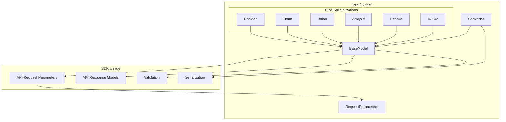

Sources: [lib/anthropic/internal/type/base_model.rb:1-380](), [lib/anthropic/internal/type/converter.rb:1-247]()

## Core Type System Components

The type system is built around several key components that work together to provide type safety and conversion capabilities.

### BaseModel

The `BaseModel` class serves as the foundation for all structured data models in the SDK, including request parameters and API responses. It provides a way to define fields with specific types and validation rules.

Key features of `BaseModel`:
- Defines required and optional fields with specific types
- Handles validation and conversion of field values
- Supports field mapping between API and SDK representations
- Provides serialization to JSON and other formats
- Supports pattern matching through `deconstruct_keys`

```mermaid
classDiagram
    class BaseModel {
        +known_fields()
        +fields()
        +required(name, type, spec)
        +optional(name, type, spec)
        +request_only(block)
        +response_only(block)
        +coerce(value, state)
        +dump(value, state)
        +[](key)
        +to_h()
        +to_json()
        +initialize(data)
    }
    
    class ModelInstance {
        +field_accessor1
        +field_accessor2
        +[](key)
        +to_h()
        +to_json()
    }
    
    BaseModel <|-- "UserDefinedModel"
    "UserDefinedModel" ..> ModelInstance : instantiates
```

Sources: [lib/anthropic/internal/type/base_model.rb:4-380]()

### Converter

The `Converter` module provides the core type conversion functionality in the SDK. It's responsible for converting Ruby values to and from their API representations:

- **coerce**: Converts API data to appropriate Ruby types
- **dump**: Converts Ruby objects to API-compatible representations

The converter handles both simple primitive types and complex nested structures.

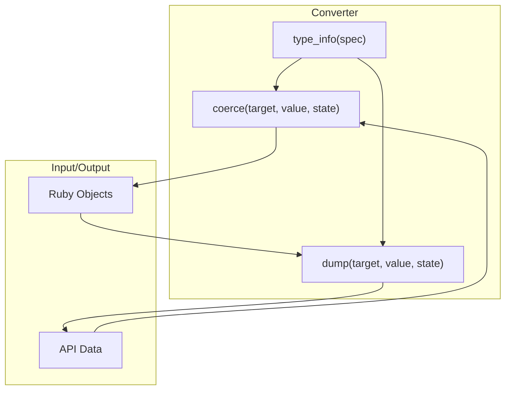

Sources: [lib/anthropic/internal/type/converter.rb:7-246]()

### Type Specializations

The type system includes several specialized type handlers for different data types:

- **Boolean**: Handles boolean values (true/false)
- **Enum**: Handles enumerated values with predefined sets of options
- **Union**: Handles values that can be one of several different types
- **ArrayOf**: Handles arrays of values with specific item types
- **HashOf**: Handles hashes with specific key and value types
- **IOLike**: Handles IO-like objects (Pathname, StringIO, etc.)

These specializations provide type-specific conversion and validation logic.

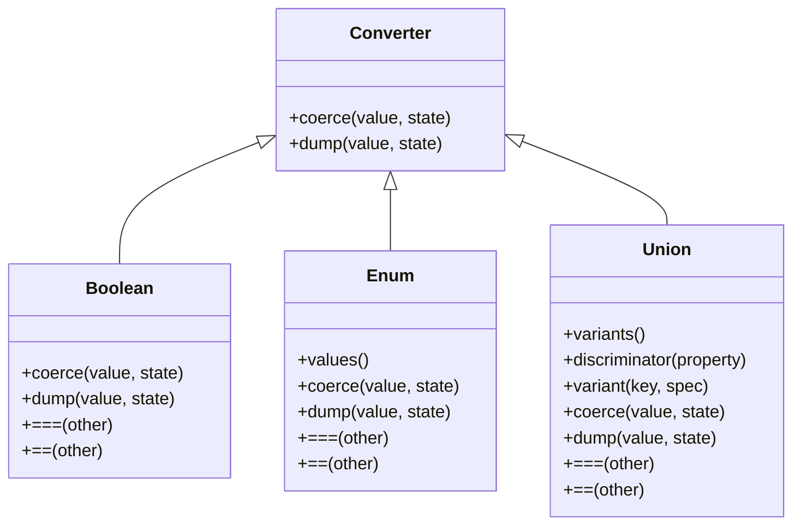

Sources: [lib/anthropic/internal/type/boolean.rb:1-59](), [lib/anthropic/internal/type/enum.rb:1-114](), [lib/anthropic/internal/type/union.rb:1-217]()

## Type Conversion Process

The type system performs two main conversion operations:

1. **Coercion** - Converting from API data to Ruby objects
2. **Dumping** - Converting from Ruby objects to API data

### Coercion Process

The coercion process converts values from API representations to Ruby objects, applying type-specific conversion rules and validation.

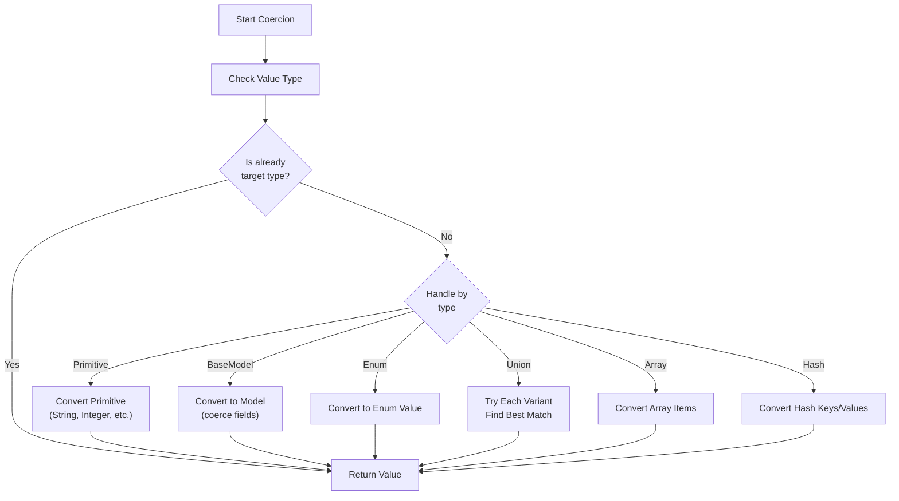

Sources: [lib/anthropic/internal/type/converter.rb:12-222](), [lib/anthropic/internal/type/base_model.rb:186-253]()

### Dumping Process

The dumping process converts Ruby objects to API-compatible representations, preparing them for transmission to the API.

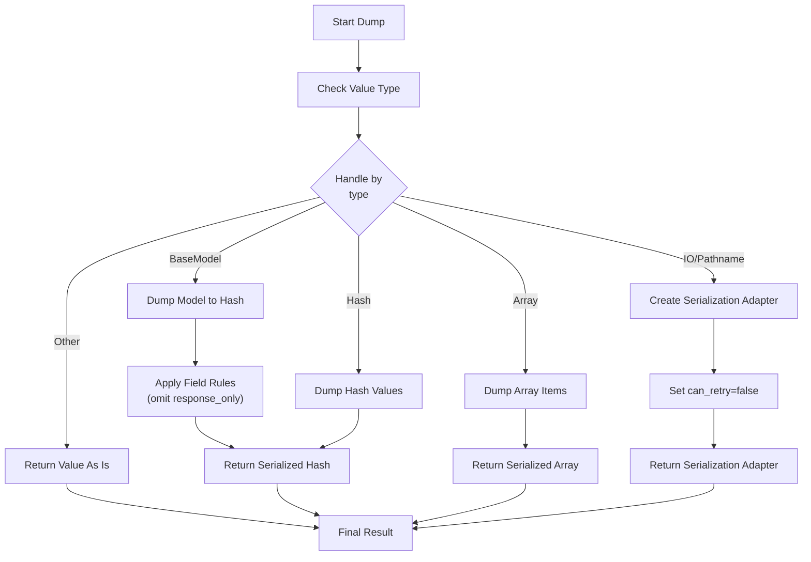

Sources: [lib/anthropic/internal/type/converter.rb:33-50](), [lib/anthropic/internal/type/base_model.rb:255-295]()

## Model Definition

The type system provides a declarative way to define structured models with field types and validation rules.

### Field Definition

Models define fields using `required` and `optional` methods, specifying the field name, type, and additional options.

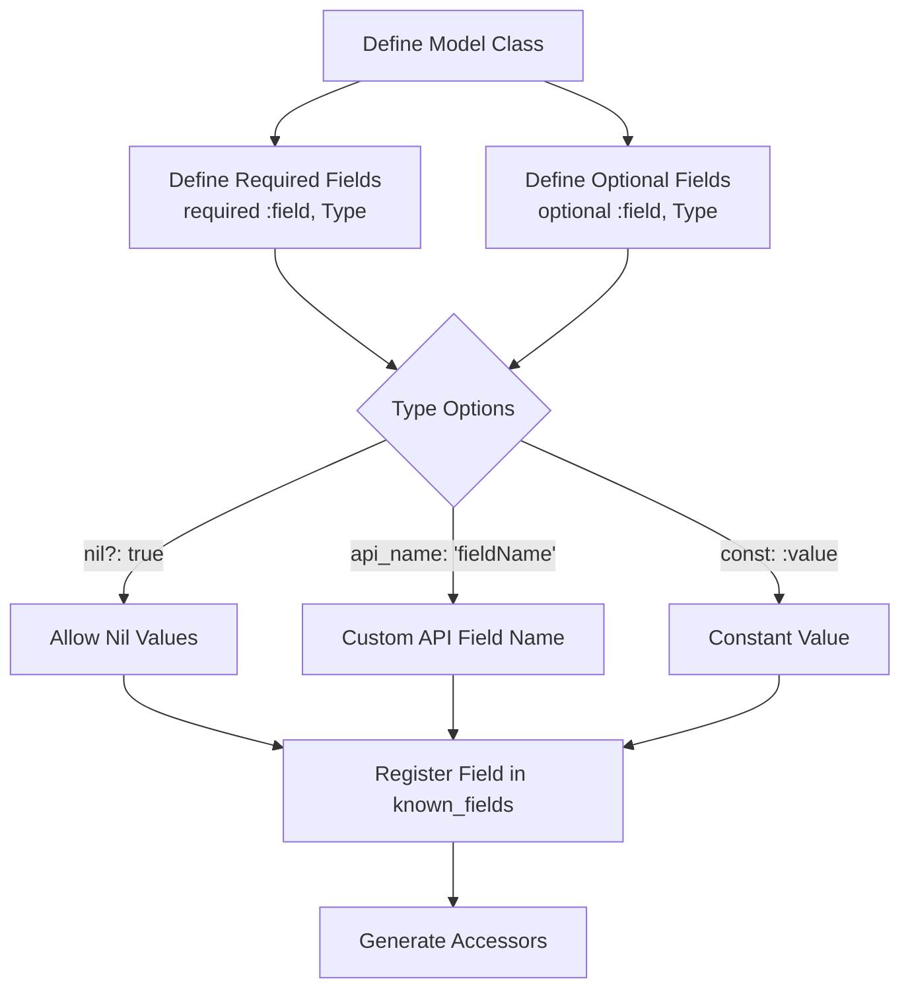

Sources: [lib/anthropic/internal/type/base_model.rb:43-145]()

### Request vs Response Fields

The type system allows designating fields specifically for requests or responses using the `request_only` and `response_only` blocks:

- `request_only`: Fields included when sending requests but not expected in responses
- `response_only`: Fields expected in responses but not included in requests

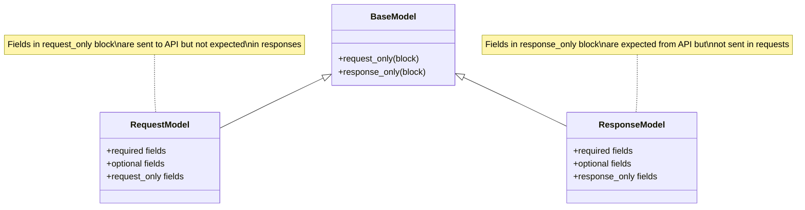

Sources: [lib/anthropic/internal/type/base_model.rb:147-170]()

## Advanced Type Features

The type system includes several advanced features for handling complex data structures and constraints.

### Union Types

Union types allow a field to accept values of different types, with automatic type detection and conversion. The system can use a discriminator field to determine the appropriate type.

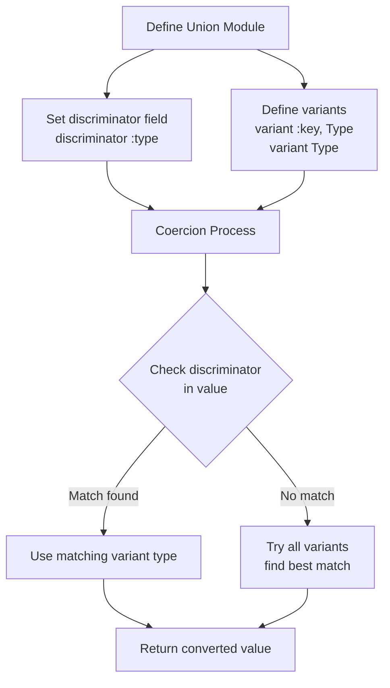

Sources: [lib/anthropic/internal/type/union.rb:32-216]()

### Enum Types

Enum types provide a way to define a constrained set of valid values for a field, mapping between different representations.

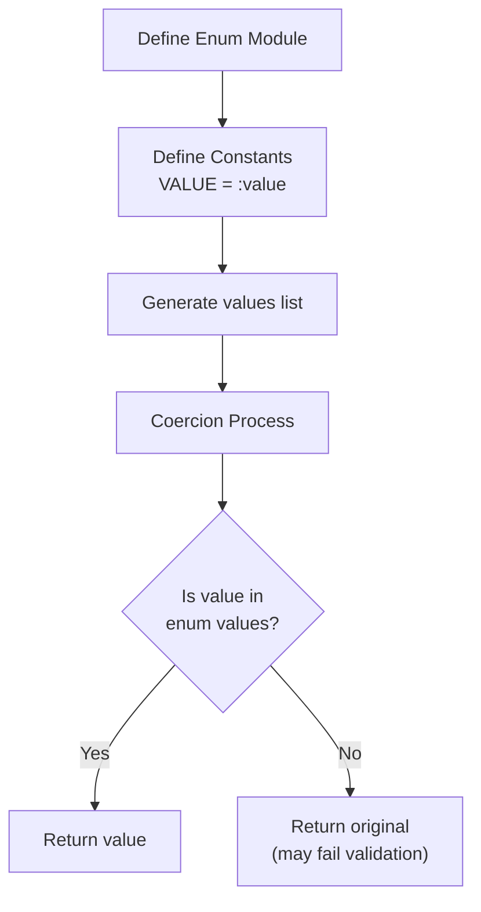

Sources: [lib/anthropic/internal/type/enum.rb:6-113]()

### Collection Types (ArrayOf and HashOf)

The type system provides special handlers for collections with type constraints on their elements:

- `ArrayOf`: Arrays where all elements must be of a specific type
- `HashOf`: Hashes with constraints on keys and/or values

These types recursively apply type conversion and validation to collection elements.

Sources: Test usages in [test/anthropic/internal/type/base_model_test.rb:248-292]()

## Integration with SDK Request Flow

The type system is integrated into the SDK's request flow through the `RequestParameters` module, which ensures proper serialization and handling of request options.

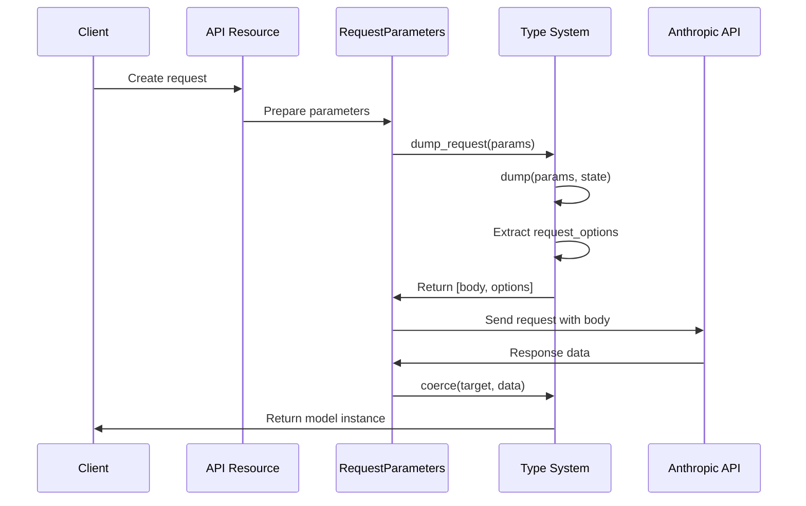

Sources: [lib/anthropic/internal/type/request_parameters.rb:4-49]()

## Error Handling

The type system provides robust error handling with meaningful error messages when type conversion fails.

When a conversion error occurs during model field access, the SDK throws a `Anthropic::Errors::ConversionError` with details about what went wrong. Users can still access the raw value using the `[]` accessor if needed.

```ruby
begin
  model_instance.field  # Parsed and validated field
rescue Anthropic::Errors::ConversionError => e
  raw_value = model_instance[:field]  # Raw, unparsed value
end
```

Sources: [lib/anthropic/internal/type/base_model.rb:89-106]()

## Practical Example

Let's walk through a practical example of how the type system processes a request and response for a message creation:

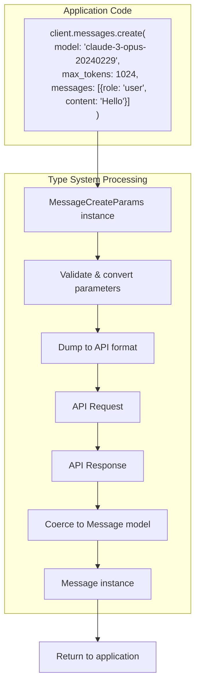

Sources: Understanding derived from all examined files

## Summary

The Anthropic Ruby SDK's type system provides a robust foundation for working with the Anthropic API, offering:

1. **Type Safety** - Ensures values conform to expected types and formats
2. **Seamless Conversion** - Handles conversion between API and Ruby representations
3. **Helpful Errors** - Provides clear error messages when issues occur
4. **Request/Response Handling** - Manages the serialization and deserialization process
5. **Rich Models** - Creates structured models with validation and accessors

This system operates largely behind the scenes, making the SDK easy to use while providing robust guarantees about data integrity.

Sources: All examined files

---

