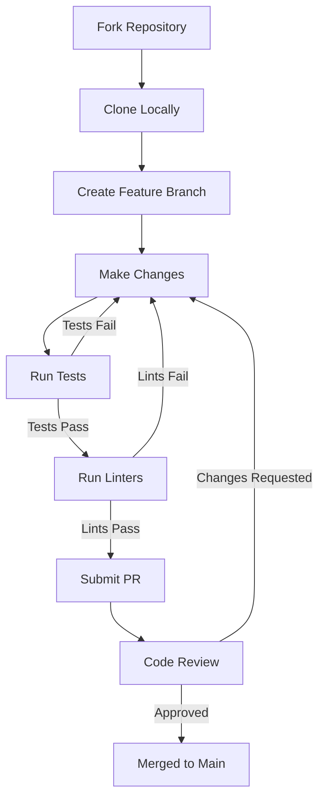
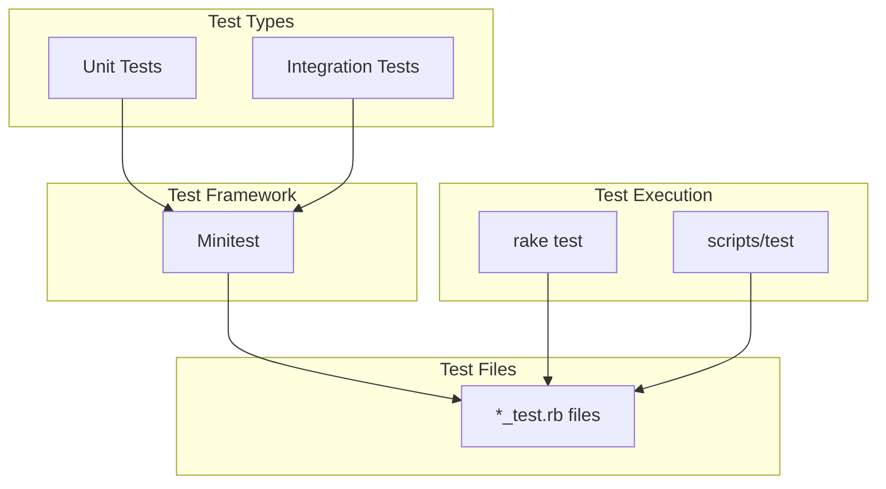
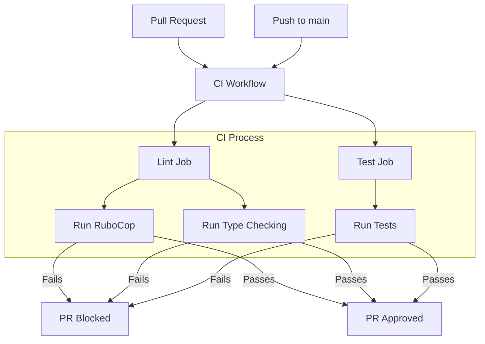
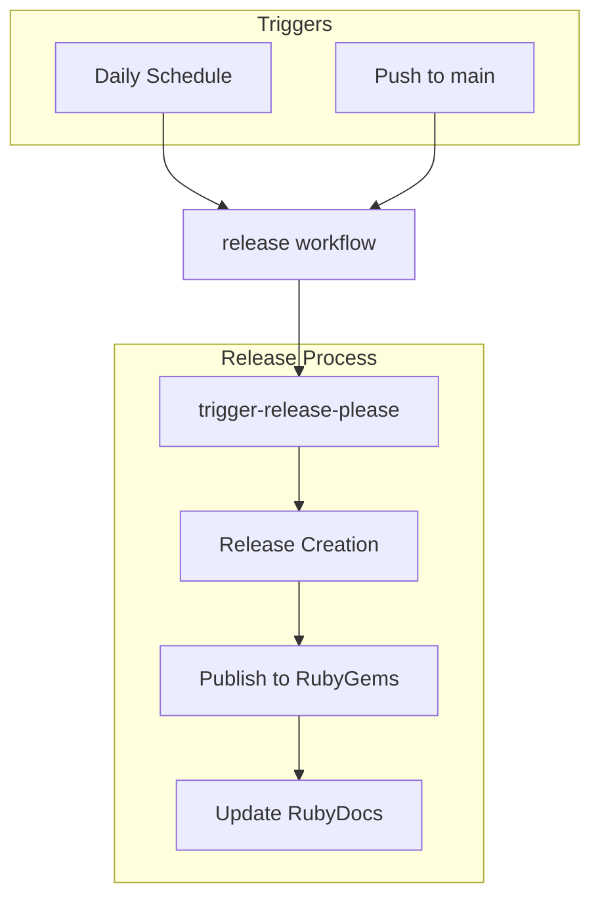
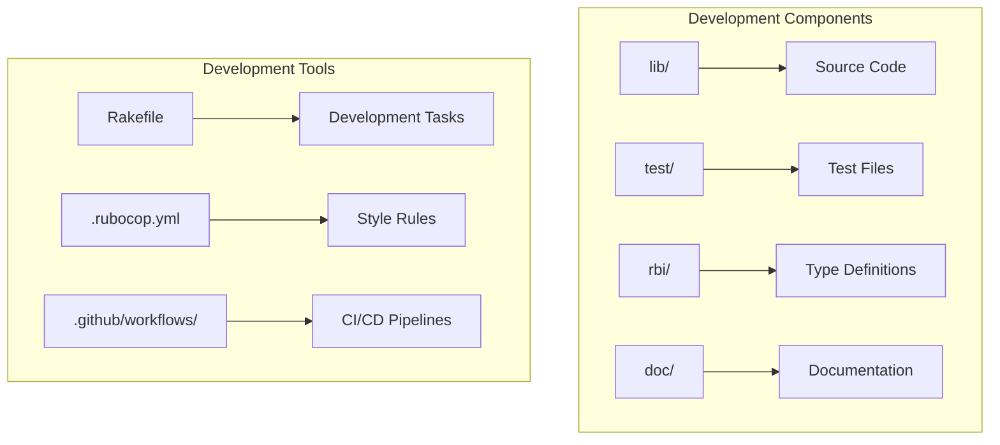

<!-- source: DeepWiki mcp.deepwiki.com · repo anthropics/anthropic-sdk-ruby · page 12 Development and Contributions · fetched 2026-10-26 -->

# Development and Contributions

<details>
<summary>Relevant source files</summary>

The following files were used as context for generating this wiki page:

- [.github/CODEOWNERS](.github/CODEOWNERS)
- [.github/workflows/ci.yml](.github/workflows/ci.yml)
- [.github/workflows/create-releases.yml](.github/workflows/create-releases.yml)
- [.github/workflows/publish-gem.yml](.github/workflows/publish-gem.yml)
- [.github/workflows/release-doctor.yml](.github/workflows/release-doctor.yml)
- [.gitignore](.gitignore)
- [.rubocop.yml](.rubocop.yml)
- [LICENSE](LICENSE)
- [Rakefile](Rakefile)
- [bin/check-release-environment](bin/check-release-environment)

</details>


This page provides comprehensive guidance for developers interested in contributing to the Anthropic Ruby SDK. It covers setting up a development environment, understanding code style guidelines, running tests and lints, and submitting contributions.

## Development Environment Setup

To contribute to the Anthropic Ruby SDK, you'll need a properly configured Ruby development environment.

### Prerequisites

- Ruby 3.1.0 or higher (as specified in [.rubocop.yml:11]())
- Bundler for dependency management
- Git for version control

### Setting Up Your Environment

1. Fork and clone the repository
   ```bash
   git clone https://github.com/yourusername/anthropic-sdk-ruby.git
   cd anthropic-sdk-ruby
   ```

2. Install dependencies
   ```bash
   bundle install
   ```

3. Run tests to verify your setup
   ```bash
   bundle exec rake test
   ```

## Development Workflow

The following diagram illustrates the typical workflow for contributing to the SDK:



Sources: [.github/workflows/ci.yml](), [Rakefile]()

## Code Style and Guidelines

The SDK follows a consistent code style enforced by RuboCop. The style is defined in the `.rubocop.yml` file and includes conventions for:

- Line length (max 110 characters)
- String literals (double quotes preferred)
- Spacing and indentation
- Class and method structure

### Running Style Checks

```bash
bundle exec rake rubocop    # Run linter
bundle exec rake ruboformat # Auto-format code
```

### Key Style Rules

| Category | Rule | Config Location |
|----------|------|----------------|
| Line Length | Max 110 characters with exceptions | [.rubocop.yml:38-45]() |
| String Style | Double quotes preferred | [.rubocop.yml:254-255]() |
| Method Calls | Parentheses required | [.rubocop.yml:199-204]() |
| Documentation | Not strictly required | [.rubocop.yml:169-170]() |
| Frozen String Literals | Required | [.rubocop.yml:185-188]() |

Sources: [.rubocop.yml]()

## Testing

The SDK uses Minitest for testing. All tests are located in the `test` directory.

### Test Structure



### Running Tests

```bash
bundle exec rake test            # Run all tests
TEST="./test/path/to/test.rb" bundle exec rake test  # Run specific test
```

Sources: [Rakefile:14-21](), [.github/workflows/ci.yml:27-41]()

## Automated Checks

The SDK uses GitHub Actions for continuous integration. Every pull request and push to main triggers a series of automated checks.

### CI Pipeline



Sources: [.github/workflows/ci.yml](), [scripts/lint](), [scripts/test]()

## Type Checking

The SDK uses both Sorbet and Steep for type checking.

### Running Type Checks

```bash
bundle exec rake steep     # Run Steep type checker
bundle exec rake sorbet    # Run Sorbet type checker
bundle exec rake typecheck # Run both type checkers
```

Sources: [Rakefile:72-84]()

## Available Rake Tasks

The SDK provides a variety of Rake tasks for development:

| Task | Description |
|------|-------------|
| `test` | Runs all tests |
| `rubocop` | Runs RuboCop linter |
| `ruboformat` | Auto-formats code with RuboCop |
| `syntax_tree` | Formats RBS files with syntax_tree |
| `format` | Runs both ruboformat and syntax_tree |
| `steep` | Runs Steep type checker |
| `sorbet` | Runs Sorbet type checker |
| `typecheck` | Runs both type checkers |
| `lint` | Runs RuboCop and type checkers |
| `build` | Builds the gem |
| `release` | Builds and releases the gem |

Sources: [Rakefile]()

## Release Process

Releases are managed through GitHub Actions. The process is automated with release-please for version management and changelog generation.

### Release Workflow



### Environment Requirements

The release process requires specific environment variables:

- `GEM_HOST_API_KEY`: API key for RubyGems.org
- `RUBYGEMS_HOST`: (Optional) For private gem repositories

Sources: [.github/workflows/create-releases.yml](), [.github/workflows/publish-gem.yml](), [bin/check-release-environment]()

## Contributing Guidelines

### General Guidelines

1. Create a branch for your contribution
2. Write tests for new features or bug fixes
3. Ensure all tests and lints pass
4. Submit a pull request to the main branch
5. Address any feedback during code review

### Pull Request Review Process

All pull requests are automatically assigned to the `@anthropics/sdk` team for review, as specified in [.github/CODEOWNERS:4]().

### Code Organization



Sources: [.gitignore](), [Rakefile](), [.rubocop.yml]()

## License

The Anthropic Ruby SDK is released under the MIT License, which allows for modification, distribution, and private/commercial use with proper attribution.

Sources: [LICENSE]()