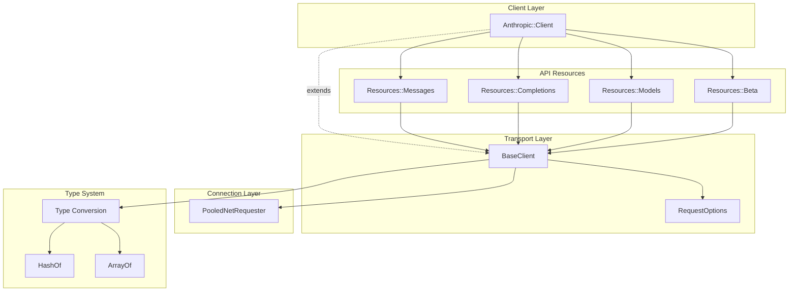
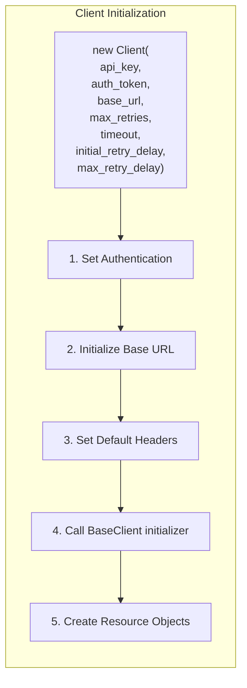
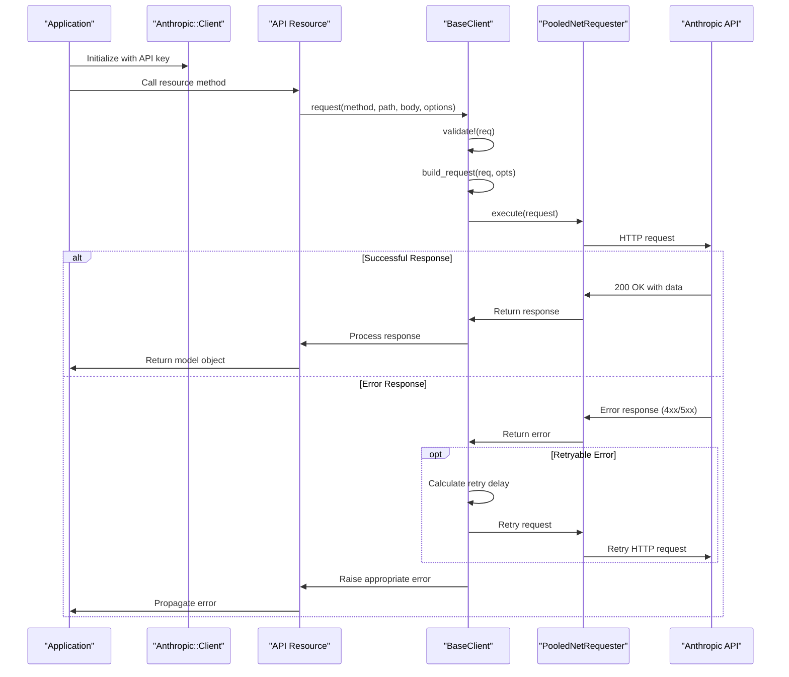
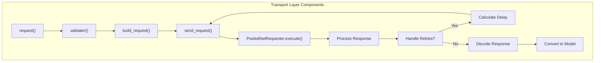
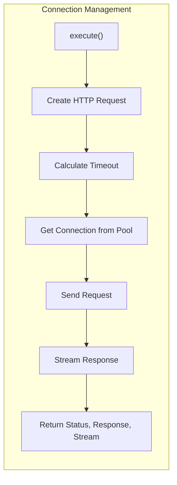
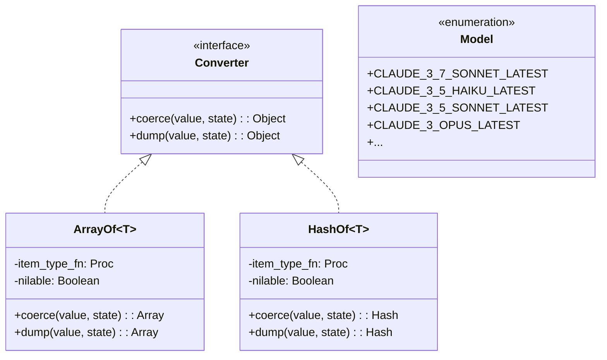
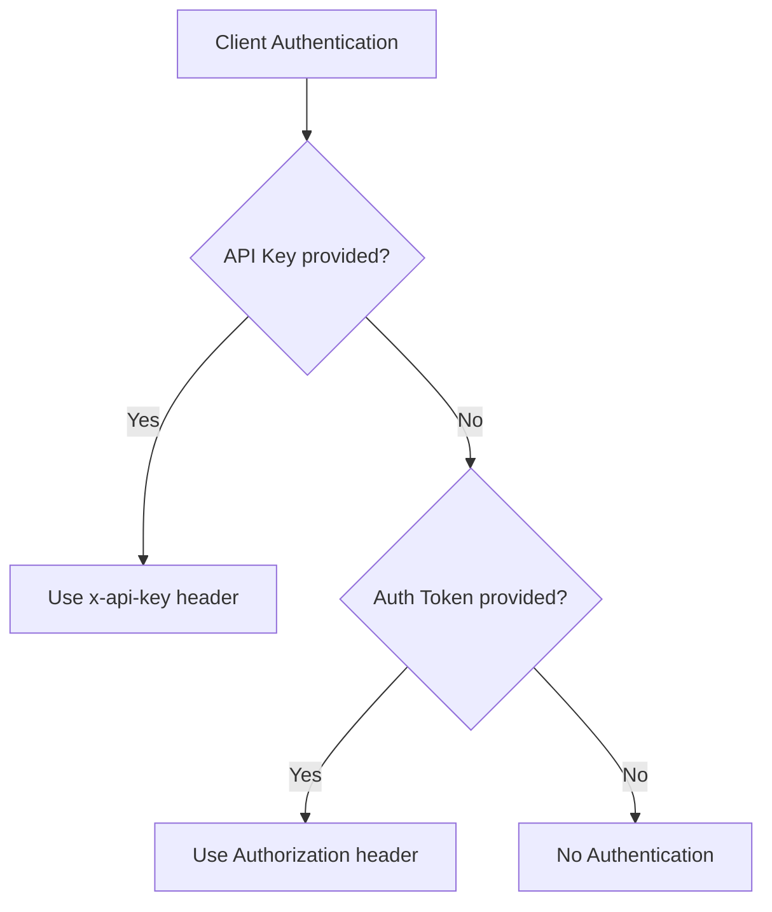

<!-- source: DeepWiki mcp.deepwiki.com · repo anthropics/anthropic-sdk-ruby · page 3 Client Architecture · fetched 2026-10-26 -->

# Client Architecture

<details>
<summary>Relevant source files</summary>

The following files were used as context for generating this wiki page:

- [lib/anthropic/client.rb](lib/anthropic/client.rb)
- [lib/anthropic/internal/transport/base_client.rb](lib/anthropic/internal/transport/base_client.rb)
- [lib/anthropic/internal/transport/pooled_net_requester.rb](lib/anthropic/internal/transport/pooled_net_requester.rb)
- [lib/anthropic/internal/type/array_of.rb](lib/anthropic/internal/type/array_of.rb)
- [lib/anthropic/internal/type/hash_of.rb](lib/anthropic/internal/type/hash_of.rb)
- [lib/anthropic/models/anthropic_beta.rb](lib/anthropic/models/anthropic_beta.rb)
- [lib/anthropic/models/model.rb](lib/anthropic/models/model.rb)
- [lib/anthropic/request_options.rb](lib/anthropic/request_options.rb)
- [rbi/lib/anthropic/client.rbi](rbi/lib/anthropic/client.rbi)
- [rbi/lib/anthropic/internal/type/array_of.rbi](rbi/lib/anthropic/internal/type/array_of.rbi)
- [sig/anthropic/client.rbs](sig/anthropic/client.rbs)
- [sig/anthropic/internal/type/array_of.rbs](sig/anthropic/internal/type/array_of.rbs)

</details>


This page documents the architecture of the client system in the Anthropic Ruby SDK, explaining how the different components fit together to handle API requests and responses. For detailed information about configuring specific request options, see [Request Options](#3.1). For error handling details, see [Error Handling](#3.2). For connection management details, see [Connection Management](#3.3).

## Client Overview

The Anthropic Ruby SDK provides a structured client architecture that abstracts away the complexities of making API calls to Anthropic's AI models. The client architecture has several layers:

1. **Client Layer** - Primary entry point for users, provides access to API resources
2. **Transport Layer** - Handles HTTP communication, request building, and response processing
3. **Connection Management** - Manages HTTP connections efficiently
4. **Type System** - Ensures proper validation and conversion of request and response data



Sources: [lib/anthropic/client.rb:1-107](), [lib/anthropic/internal/transport/base_client.rb:1-473](), [lib/anthropic/internal/transport/pooled_net_requester.rb:1-194]()

## Client Class Structure

The main entry point for interacting with the Anthropic API is the `Anthropic::Client` class, which extends the `BaseClient` transport layer. The client provides access to the various API resources and manages authentication.

```mermaid
classDiagram
    class Anthropic::Client {
        +api_key: String
        +auth_token: String
        +completions: Resources::Completions
        +messages: Resources::Messages
        +models: Resources::Models
        +beta: Resources::Beta
        -auth_headers(): Hash
        -api_key_auth(): Hash
        -bearer_auth(): Hash
        +initialize(api_key, auth_token, base_url, ...)
    }
    
    class BaseClient {
        -requester: PooledNetRequester
        -build_request(req, opts): Hash
        -retry_delay(headers, retry_count): Float
        -send_request(request, ...): Array
        +request(req): Object
    }
    
    class PooledNetRequester {
        -pools: Hash
        -execute(request): Array
    }
    
    class RequestOptions {
        +idempotency_key: String
        +extra_query: Hash
        +extra_headers: Hash
        +extra_body: Object
        +max_retries: Integer
        +timeout: Float
    }
    
    Anthropic::Client --|> BaseClient
    BaseClient --> PooledNetRequester
    BaseClient --> RequestOptions
```

Sources: [lib/anthropic/client.rb:4-106](), [lib/anthropic/internal/transport/base_client.rb:9-470](), [lib/anthropic/request_options.rb:3-75]()

## Client Initialization

The `Anthropic::Client` initialization process sets up the client with appropriate authentication and default configuration parameters.



The client supports several initialization parameters with reasonable defaults:

| Parameter | Default | Description |
|-----------|---------|-------------|
| `api_key` | `ENV["ANTHROPIC_API_KEY"]` | Anthropic API key for authentication |
| `auth_token` | `ENV["ANTHROPIC_AUTH_TOKEN"]` | Alternative auth token for authentication |
| `base_url` | `"https://api.anthropic.com"` | API endpoint base URL |
| `max_retries` | `2` | Maximum number of retries for failed requests |
| `timeout` | `600.0` (10 minutes) | Default request timeout in seconds |
| `initial_retry_delay` | `0.5` | Base delay for retries in seconds |
| `max_retry_delay` | `8.0` | Maximum delay between retries in seconds |

Sources: [lib/anthropic/client.rb:74-105](), [lib/anthropic/client.rb:5-16]()

## Request Processing Flow

When a request is made through the client, it follows a specific path through the system components:



Sources: [lib/anthropic/internal/transport/base_client.rb:394-461](), [lib/anthropic/internal/transport/base_client.rb:232-280](), [lib/anthropic/internal/transport/base_client.rb:332-393]()

## Resource Organization

The client provides access to various API resources, each represented by a dedicated resource class:

| Resource | Description | Key Methods |
|----------|-------------|-------------|
| `messages` | Primary interface for creating messages with Claude models | `create`, `stream_raw`, `count_tokens` |
| `completions` | Legacy interface for text completions | `create`, `create_streaming` |
| `models` | Access model information | `retrieve`, `list` |
| `beta` | Experimental API features | Varies by feature |

Each resource is initialized with a reference to the client and uses the client's `request` method to communicate with the API.

Sources: [lib/anthropic/client.rb:24-34](), [lib/anthropic/client.rb:101-104]()

## Transport Layer

The transport layer, primarily implemented in the `BaseClient` class, handles the core HTTP functionality:



The `BaseClient` is responsible for:
1. Request validation and building
2. Authentication header management
3. Retry logic for failed requests
4. Response processing and error handling
5. Type conversion of responses

Sources: [lib/anthropic/internal/transport/base_client.rb:394-461](), [lib/anthropic/internal/transport/base_client.rb:232-280](), [lib/anthropic/internal/transport/base_client.rb:332-393]()

## Connection Management

The SDK uses the `PooledNetRequester` to efficiently manage HTTP connections. It provides:

1. Connection pooling for performance
2. Timeout handling
3. Socket configuration
4. HTTP request execution



The connection pool is organized by origin (host+scheme) and reuses connections for better performance, with a default pool size equal to the number of processors available on the system.

Sources: [lib/anthropic/internal/transport/pooled_net_requester.rb:7-180](), [lib/anthropic/internal/transport/pooled_net_requester.rb:185-189]()

## Request Options

Each request can be customized with `RequestOptions`, which allows overriding client-level settings on a per-request basis:

| Option | Type | Description |
|--------|------|-------------|
| `idempotency_key` | String | Key for idempotent requests |
| `extra_query` | Hash | Additional query parameters |
| `extra_headers` | Hash | Additional request headers |
| `extra_body` | Hash | Additional request body fields |
| `max_retries` | Integer | Override retry count |
| `timeout` | Float | Override timeout value |

Sources: [lib/anthropic/request_options.rb:9-74]()

## Type System Integration

The SDK includes a robust type system for validating and converting data. Key type components include:



The type system ensures that:
1. Request parameters are properly validated
2. API responses are converted to appropriate Ruby objects
3. Model identifiers are properly validated against available models

Sources: [lib/anthropic/internal/type/array_of.rb:13-128](), [lib/anthropic/internal/type/hash_of.rb:13-148](), [lib/anthropic/models/model.rb:8-93]()

## Authentication Methods

The SDK supports two authentication methods:

1. **API Key Authentication** - Using the `x-api-key` header
2. **Bearer Token Authentication** - Using the `Authorization: Bearer` header

The client will use whichever credentials are provided during initialization, with precedence given to environment variables if no explicit credentials are provided.



Sources: [lib/anthropic/client.rb:36-57]()

---

