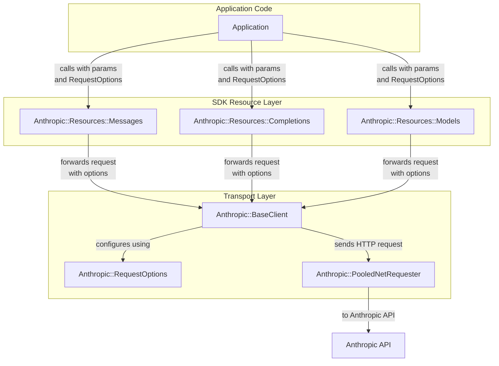
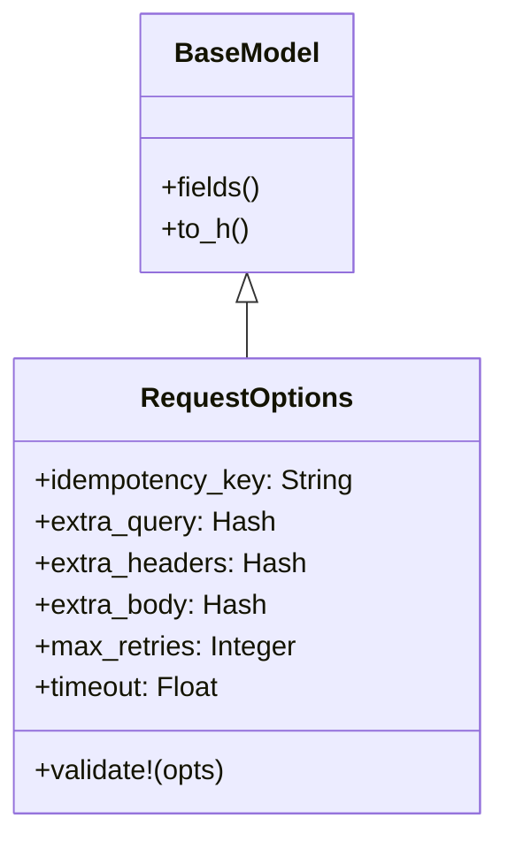
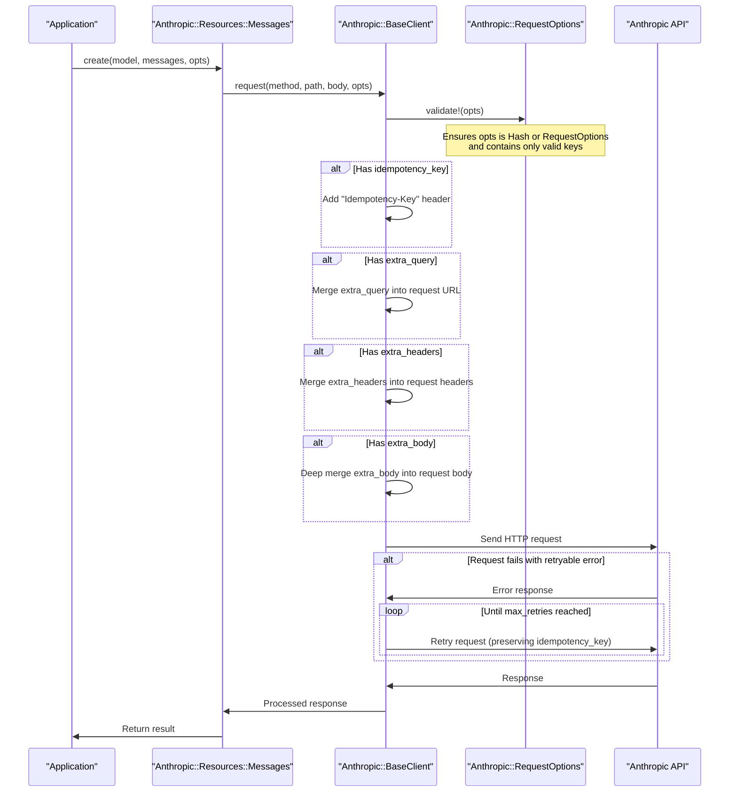
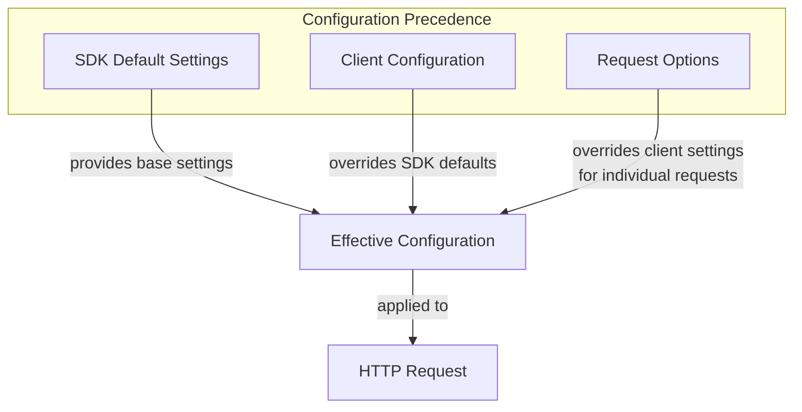

<!-- source: DeepWiki mcp.deepwiki.com · repo anthropics/anthropic-sdk-ruby · page 3.1 Request Options · fetched 2026-10-26 -->

# Request Options

<details>
<summary>Relevant source files</summary>

The following files were used as context for generating this wiki page:

- [lib/anthropic/request_options.rb](lib/anthropic/request_options.rb)

</details>


Request Options provide a flexible mechanism for configuring HTTP behavior for individual API requests in the Anthropic Ruby SDK. They allow you to customize networking parameters, add custom data, and override default client settings on a per-request basis.

For information about error handling and retries, see [Error Handling](#3.2). For details on connection management, see [Connection Management](#3.3).

## Overview and Architecture

The `RequestOptions` class is a core component of the SDK's transport layer, allowing fine-grained control over how individual API requests are processed and transmitted.



Sources: [lib/anthropic/request_options.rb:1-9]()

Request options can be provided to any API method (such as `messages.create` or `models.list`) using the `opts` parameter. You can pass either a `RequestOptions` instance or a simple Ruby Hash with symbol keys matching the available options.

## Available Options

The `RequestOptions` class provides the following configuration options:

| Option | Type | Description |
|--------|------|-------------|
| `idempotency_key` | String | A unique key to ensure write requests are only processed once |
| `extra_query` | Hash | Additional query parameters to include in the request URL |
| `extra_headers` | Hash | Additional HTTP headers to include with the request |
| `extra_body` | Hash | Additional data to include in the request body |
| `max_retries` | Integer | Maximum number of retry attempts for failed requests |
| `timeout` | Float | Request timeout in seconds |

Sources: [lib/anthropic/request_options.rb:28-66]()

### Request Options Class Structure



Sources: [lib/anthropic/request_options.rb:9-74]()

## Option Details

### Idempotency Key

The `idempotency_key` option allows you to assign a unique identifier to write operations. If a request fails due to a network issue and is retried with the same idempotency key, the Anthropic API will recognize the duplicate request and return the result of the original request instead of processing it twice.

```ruby
client.messages.create(
  model: "claude-3-opus-20240229",
  max_tokens: 1024,
  messages: [{ role: "user", content: "Hello, Claude!" }],
  opts: { idempotency_key: "unique-operation-id-123" }
)
```

Sources: [lib/anthropic/request_options.rb:28-33]()

### Extra Query Parameters

The `extra_query` option allows you to include additional query parameters in the request URL. These are merged with any query parameters specified at the client level.

```ruby
client.models.list(
  opts: { extra_query: { "version" => "2023-06-01" } }
)
```

The `extra_query` option accepts a hash where keys are strings and values can be strings or arrays of strings.

Sources: [lib/anthropic/request_options.rb:35-40]()

### Extra Headers

The `extra_headers` option allows you to include additional HTTP headers with the request. These are merged with any headers specified at the client level.

```ruby
client.messages.create(
  model: "claude-3-opus-20240229",
  max_tokens: 1024,
  messages: [{ role: "user", content: "Hello, Claude!" }],
  opts: { extra_headers: { "X-Custom-Header" => "custom-value" } }
)
```

Sources: [lib/anthropic/request_options.rb:42-47]()

### Extra Body

The `extra_body` option allows you to include additional data in the request body. These values are deep merged into the request body generated from the regular parameters.

```ruby
client.messages.create(
  model: "claude-3-opus-20240229",
  max_tokens: 1024,
  messages: [{ role: "user", content: "Hello, Claude!" }],
  opts: { extra_body: { "custom_field" => "custom_value" } }
)
```

Sources: [lib/anthropic/request_options.rb:49-54]()

### Max Retries

The `max_retries` option sets the maximum number of retry attempts for failed requests. If a request fails due to a retryable error (such as a rate limit or temporary server error), the SDK will automatically retry the request up to this many times.

```ruby
client.messages.create(
  model: "claude-3-opus-20240229",
  max_tokens: 1024,
  messages: [{ role: "user", content: "Hello, Claude!" }],
  opts: { max_retries: 5 }  # Override default retry limit
)
```

Sources: [lib/anthropic/request_options.rb:56-60]()

### Timeout

The `timeout` option sets the request timeout in seconds. If the API does not respond within this time period, the request will fail with a timeout error.

```ruby
client.messages.create(
  model: "claude-3-opus-20240229",
  max_tokens: 1024,
  messages: [{ role: "user", content: "Hello, Claude!" }],
  opts: { timeout: 120.0 }  # 2-minute timeout
)
```

Sources: [lib/anthropic/request_options.rb:62-66]()

## Request Processing Flow

The following diagram illustrates how request options are processed within the SDK:



Sources: [lib/anthropic/request_options.rb:10-26]()

## Usage Examples

### Basic Hash Syntax

Request options can be provided to any resource method using the `opts` parameter:

```ruby
# Basic example with timeout and max retries
response = client.messages.create(
  model: "claude-3-opus-20240229",
  max_tokens: 1024,
  messages: [{ role: "user", content: "Hello, Claude!" }],
  opts: {
    timeout: 60.0,
    max_retries: 3
  }
)
```

### Using RequestOptions Class

You can also create an instance of the `RequestOptions` class explicitly:

```ruby
# Using the RequestOptions class
options = Anthropic::RequestOptions.new(
  timeout: 60.0,
  max_retries: 3,
  extra_headers: { "X-Custom-Header" => "custom-value" }
)

response = client.messages.create(
  model: "claude-3-opus-20240229",
  max_tokens: 1024,
  messages: [{ role: "user", content: "Hello, Claude!" }],
  opts: options
)
```

## Configuration Hierarchy

Request options provided for individual API calls supplement or override the configuration set at the client level. The SDK follows a hierarchical approach to configuration:



Sources: [lib/anthropic/request_options.rb:1-76]()

For example, if you set a default timeout at the client level but provide a different timeout in the request options, the value from the request options will be used for that specific request only.

## Validation

Request options are validated before being used. The `RequestOptions.validate!` method ensures that:

1. The provided options are either a `RequestOptions` instance or a Hash
2. All keys in the Hash are valid options defined in the `RequestOptions` class

If validation fails, an `ArgumentError` will be raised with a descriptive error message.

```ruby
# This would raise an ArgumentError
client.messages.create(
  model: "claude-3-opus-20240229",
  messages: [{ role: "user", content: "Hello" }],
  opts: { invalid_option: "value" }  # Error: not a valid RequestOptions field
)
```

Sources: [lib/anthropic/request_options.rb:10-26]()

---

