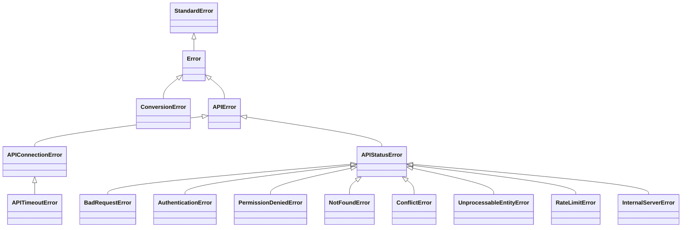
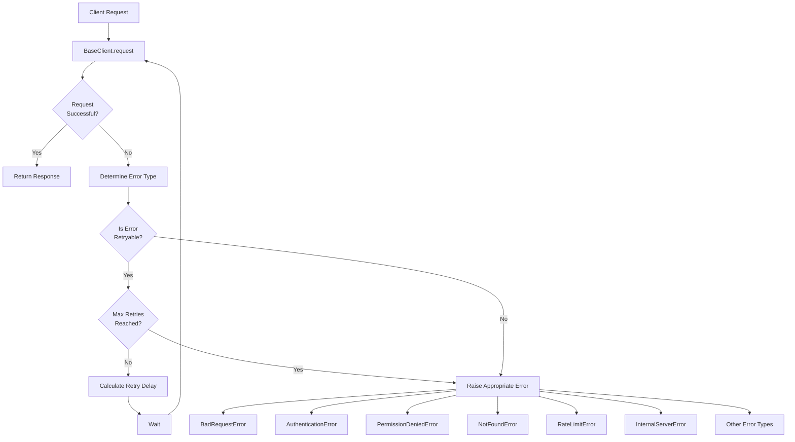
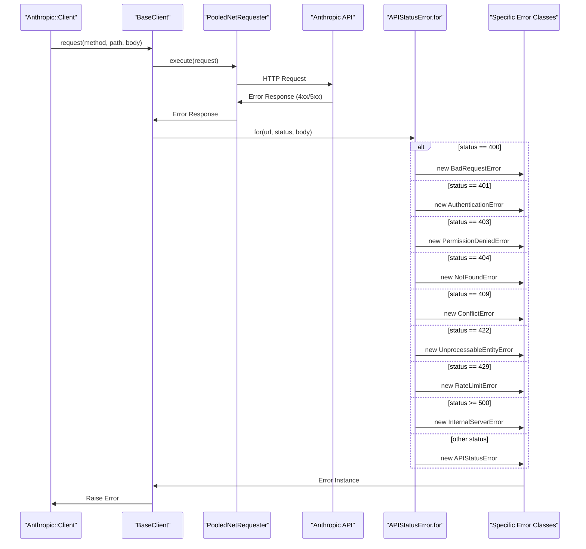

<!-- source: DeepWiki mcp.deepwiki.com · repo anthropics/anthropic-sdk-ruby · page 3.2 Error Handling · fetched 2026-10-26 -->

# Error Handling

<details>
<summary>Relevant source files</summary>

The following files were used as context for generating this wiki page:

- [lib/anthropic/errors.rb](lib/anthropic/errors.rb)
- [lib/anthropic/request_options.rb](lib/anthropic/request_options.rb)
- [rbi/lib/anthropic/errors.rbi](rbi/lib/anthropic/errors.rbi)
- [sig/anthropic/errors.rbs](sig/anthropic/errors.rbs)

</details>


The Anthropic Ruby SDK provides a robust error handling system that enables developers to handle various error scenarios that may occur when interacting with the Anthropic API. This document describes the error hierarchy, explains how errors are raised and handled, and provides strategies for dealing with different error types.

For information about configuring request-level options such as timeouts and retries, see [Request Options](#3.1).

## Error Hierarchy

The SDK implements a comprehensive hierarchy of error classes that map to different types of failures that can occur during API interactions. All errors inherit from the base `Anthropic::Errors::Error` class, which itself extends Ruby's `StandardError`.



Sources: [lib/anthropic/errors.rb:4-191]()

## Error Types

### Base Error Types

| Error Type | Description | When It Occurs |
|------------|-------------|----------------|
| `Anthropic::Errors::Error` | Base error class | Parent class for all Anthropic errors |
| `Anthropic::Errors::ConversionError` | Type conversion error | When data cannot be properly converted between formats |
| `Anthropic::Errors::APIError` | Generic API error | Base class for all API-related errors |

### Connection Errors

| Error Type | Description | HTTP Status |
|------------|-------------|-------------|
| `Anthropic::Errors::APIConnectionError` | Connection failure | N/A |
| `Anthropic::Errors::APITimeoutError` | Request timeout | N/A |

### HTTP Status Errors

| Error Type | Description | HTTP Status |
|------------|-------------|-------------|
| `Anthropic::Errors::BadRequestError` | Invalid request | 400 |
| `Anthropic::Errors::AuthenticationError` | Authentication failed | 401 |
| `Anthropic::Errors::PermissionDeniedError` | Permission denied | 403 |
| `Anthropic::Errors::NotFoundError` | Resource not found | 404 |
| `Anthropic::Errors::ConflictError` | Resource conflict | 409 |
| `Anthropic::Errors::UnprocessableEntityError` | Invalid parameters | 422 |
| `Anthropic::Errors::RateLimitError` | Rate limit exceeded | 429 |
| `Anthropic::Errors::InternalServerError` | Server-side error | 500+ |

Sources: [lib/anthropic/errors.rb:4-190]()

## Error Properties

The `APIError` class and its descendants contain useful properties that provide context about the error:

```ruby
error.url     # The URL that was being accessed
error.status  # The HTTP status code (if applicable)
error.body    # The response body (if available)
error.message # A human-readable error message
```

Sources: [lib/anthropic/errors.rb:15-22]()

## Error Handling Flow

When a request is made through the SDK, the following error handling flow occurs:



Sources: [lib/anthropic/errors.rb:92-133]()

## How Errors Are Constructed

When an API request fails, the SDK uses the `APIStatusError.for` factory method to create the appropriate error instance based on the HTTP status code:



Sources: [lib/anthropic/errors.rb:92-133]()

## Best Practices for Error Handling

### Catching Specific Errors

When working with the Anthropic Ruby SDK, it's recommended to catch specific error types when you expect them:

```ruby
begin
  response = client.messages.create(
    model: "claude-3-opus-20240229",
    max_tokens: 1024,
    messages: [{ role: "user", content: "Hello, Claude!" }]
  )
rescue Anthropic::Errors::RateLimitError => e
  # Handle rate limiting specifically
  puts "Rate limit exceeded: #{e.message}"
  sleep(5)
  retry
rescue Anthropic::Errors::APIStatusError => e
  # Handle other API errors
  puts "API error (#{e.status}): #{e.message}"
rescue Anthropic::Errors::APIConnectionError => e
  # Handle connection issues
  puts "Connection error: #{e.message}"
rescue Anthropic::Errors::Error => e
  # Handle any other Anthropic error
  puts "Anthropic error: #{e.message}"
end
```

### Handling Retryable Errors

The SDK automatically retries certain errors (like rate limits and server errors) based on the `max_retries` setting. However, you may want to implement your own retry logic for certain use cases:

```ruby
max_attempts = 3
attempts = 0

begin
  attempts += 1
  response = client.messages.create(
    model: "claude-3-opus-20240229",
    max_tokens: 1024,
    messages: [{ role: "user", content: "Hello, Claude!" }]
  )
rescue Anthropic::Errors::RateLimitError, Anthropic::Errors::InternalServerError => e
  if attempts < max_attempts
    # Exponential backoff
    sleep_time = 2 ** attempts
    puts "Attempt #{attempts} failed. Retrying in #{sleep_time} seconds..."
    sleep(sleep_time)
    retry
  else
    puts "Failed after #{max_attempts} attempts: #{e.message}"
    raise
  end
end
```

## Configuring Error Handling Behavior

You can configure some aspects of error handling through request options:

### Timeouts

Timeout errors (`APITimeoutError`) occur when a request takes longer than the configured timeout period. You can set the timeout at the client level or per-request:

```ruby
# Client-level timeout
client = Anthropic::Client.new(
  api_key: ENV["ANTHROPIC_API_KEY"],
  timeout: 120.0  # 120 seconds
)

# Request-level timeout
response = client.messages.create(
  model: "claude-3-opus-20240229",
  max_tokens: 1024,
  messages: [{ role: "user", content: "Hello, Claude!" }],
  opts: { timeout: 60.0 }  # 60 seconds for this request only
)
```

### Retry Configuration

You can configure the maximum number of retries for each request:

```ruby
# Client-level retry setting
client = Anthropic::Client.new(
  api_key: ENV["ANTHROPIC_API_KEY"],
  max_retries: 3
)

# Request-level retry setting
response = client.messages.create(
  model: "claude-3-opus-20240229",
  max_tokens: 1024,
  messages: [{ role: "user", content: "Hello, Claude!" }],
  opts: { max_retries: 5 }  # Override with 5 retries for this request
)
```

Sources: [lib/anthropic/request_options.rb:56-60]()

## Error Handling for Streaming Responses

When using streaming responses, error handling requires special attention since the response comes in chunks:

```ruby
begin
  client.messages.stream_raw(
    model: "claude-3-opus-20240229",
    max_tokens: 1024,
    messages: [{ role: "user", content: "Hello, Claude!" }]
  ) do |chunk|
    # Process each chunk
    puts chunk
  end
rescue Anthropic::Errors::Error => e
  # Handle errors that might occur during streaming
  puts "Error during streaming: #{e.message}"
end
```

## Conclusion

The Anthropic Ruby SDK provides a comprehensive error handling system that helps you build robust applications that can gracefully handle API errors, connection issues, and other failure scenarios. By understanding the error hierarchy and implementing appropriate error handling strategies, you can create more resilient applications that provide a better user experience even when errors occur.

---

