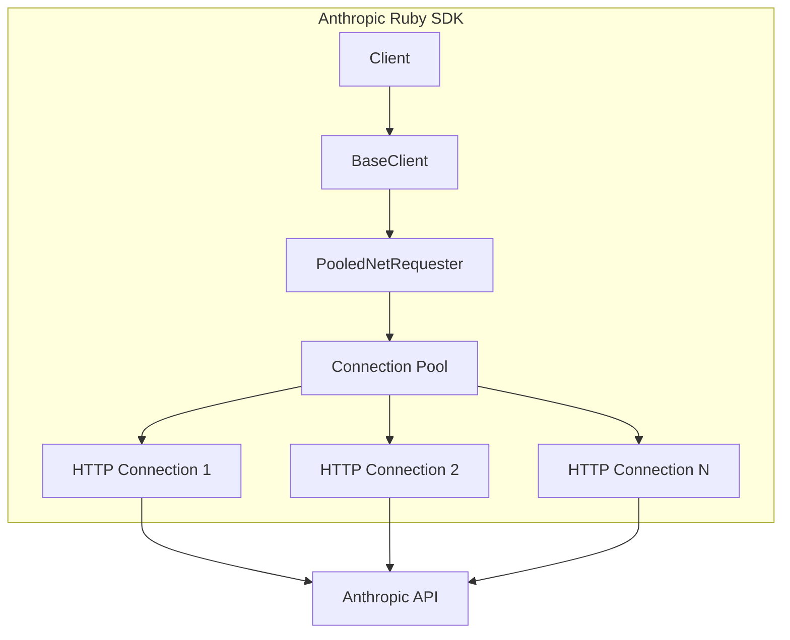
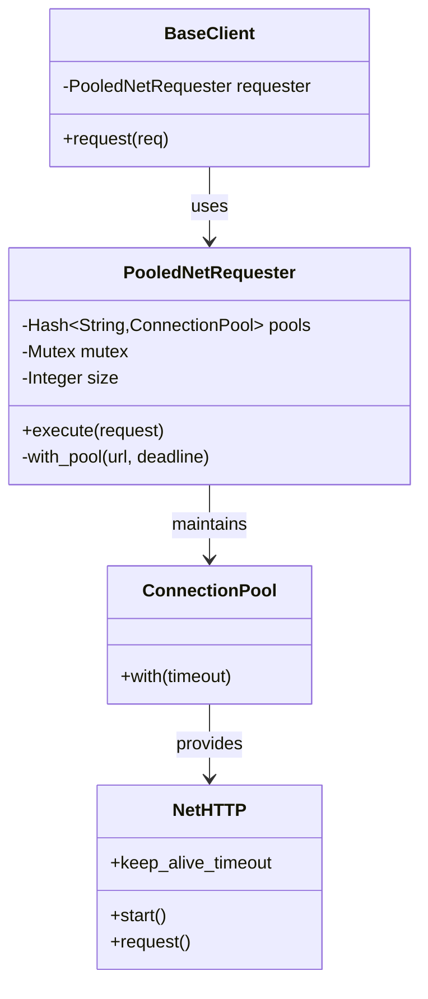
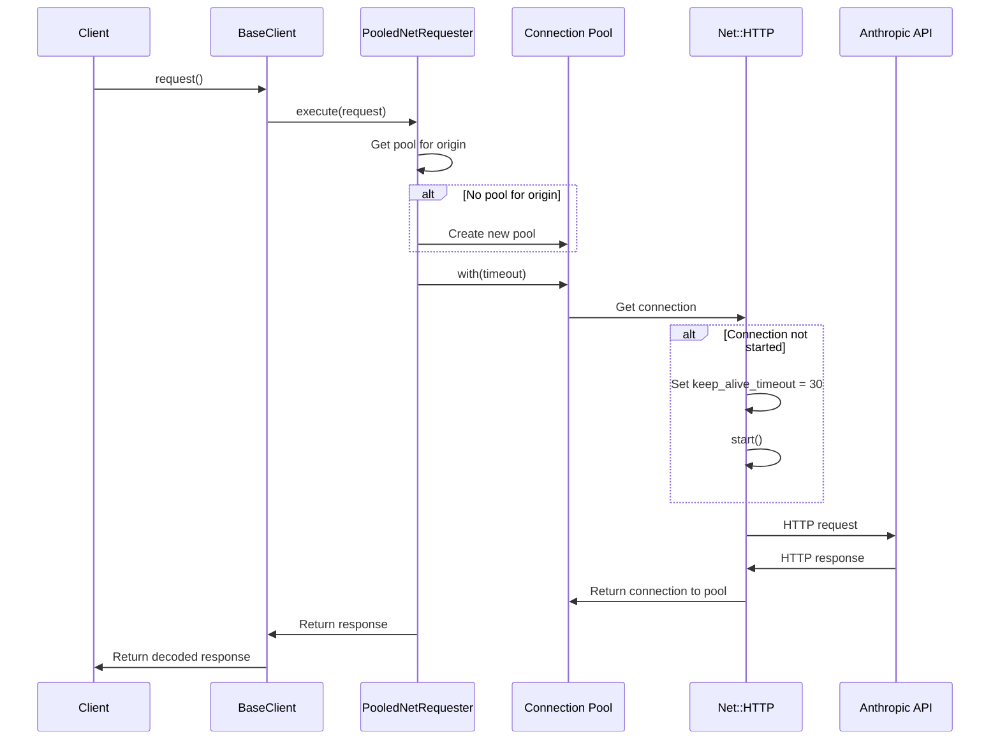
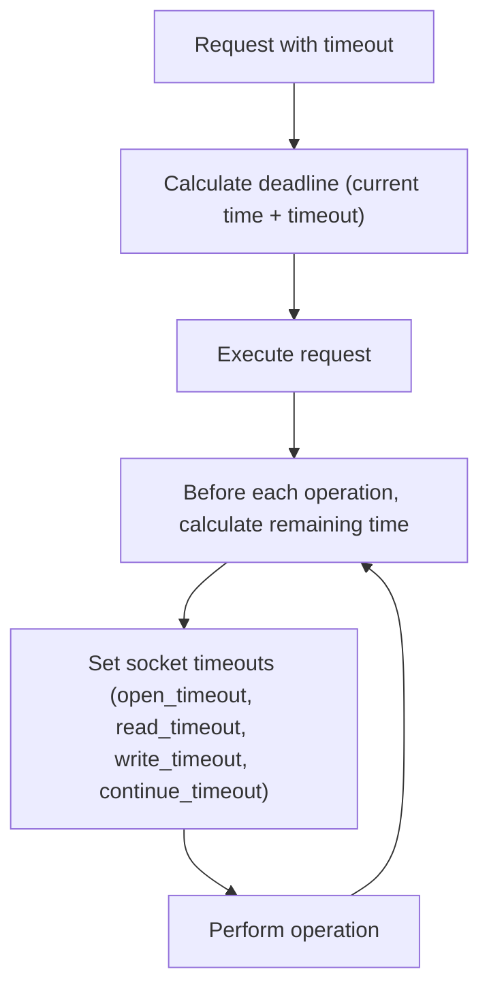
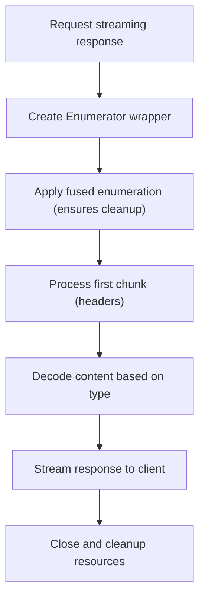

<!-- source: DeepWiki mcp.deepwiki.com · repo anthropics/anthropic-sdk-ruby · page 3.3 Connection Management · fetched 2026-10-26 -->

# Connection Management

<details>
<summary>Relevant source files</summary>

The following files were used as context for generating this wiki page:

- [lib/anthropic/internal/transport/base_client.rb](lib/anthropic/internal/transport/base_client.rb)
- [lib/anthropic/internal/transport/pooled_net_requester.rb](lib/anthropic/internal/transport/pooled_net_requester.rb)
- [lib/anthropic/internal/type/array_of.rb](lib/anthropic/internal/type/array_of.rb)
- [lib/anthropic/internal/type/hash_of.rb](lib/anthropic/internal/type/hash_of.rb)
- [lib/anthropic/internal/util.rb](lib/anthropic/internal/util.rb)
- [rbi/lib/anthropic/internal/page.rbi](rbi/lib/anthropic/internal/page.rbi)
- [rbi/lib/anthropic/internal/type/array_of.rbi](rbi/lib/anthropic/internal/type/array_of.rbi)
- [rbi/lib/anthropic/internal/util.rbi](rbi/lib/anthropic/internal/util.rbi)
- [sig/anthropic/internal/type/array_of.rbs](sig/anthropic/internal/type/array_of.rbs)
- [sig/anthropic/internal/util.rbs](sig/anthropic/internal/util.rbs)

</details>


This document explains how the Anthropic Ruby SDK manages HTTP connections when interacting with the Anthropic API. Efficient connection management is critical for optimizing performance and ensuring reliability when making API requests. For information about configuring request options, see [Request Options](#3.1).

## Overview

The Anthropic Ruby SDK implements connection pooling to efficiently manage HTTP connections to the API. This provides several benefits:

1. **Reduced Latency**: By reusing existing connections rather than establishing new ones for each request
2. **Lower Resource Usage**: Fewer TCP connections means less overhead
3. **Better Throughput**: Multiple requests can be processed more efficiently



Sources: [lib/anthropic/internal/transport/pooled_net_requester.rb:7-11](), [lib/anthropic/internal/transport/base_client.rb:146-148]()

## Connection Pooling Architecture

Connection pooling is primarily implemented through the `Anthropic::Internal::Transport::PooledNetRequester` class, which maintains a pool of HTTP connections organized by origin (scheme, host, and port).

### Key Components

- **PooledNetRequester**: Manages connection pools and executes HTTP requests
- **ConnectionPool**: Third-party gem that provides the pooling functionality
- **Net::HTTP**: Ruby's standard HTTP client used for actual connections

The SDK pools connections per origin (e.g., `https://api.anthropic.com`) and reuses them across requests, applying a keep-alive timeout of 30 seconds.



Sources: [lib/anthropic/internal/transport/pooled_net_requester.rb:7-190](), [lib/anthropic/internal/transport/base_client.rb:146-148]()

## Connection Pool Operation

The SDK dynamically manages connection pools based on the origins of requests:

1. When a request is made to a specific origin (e.g., `https://api.anthropic.com`), the SDK checks if a pool exists for that origin
2. If no pool exists, a new one is created with a size equal to the number of processors on the system
3. For each request, a connection is taken from the pool, used, and then returned to the pool
4. Connections are kept alive for 30 seconds (configurable) before being closed



Sources: [lib/anthropic/internal/transport/pooled_net_requester.rb:86-106](), [lib/anthropic/internal/transport/pooled_net_requester.rb:123-180]()

## HTTP Request Execution

The `execute` method in `PooledNetRequester` manages the entire HTTP request lifecycle:

1. Retrieves a connection from the pool for the request's URL
2. Sets appropriate timeouts on the connection
3. Builds the HTTP request with headers and body
4. Sends the request to the API
5. Returns the response status, headers, and body stream

The connection pool size defaults to the number of processors on the system, which allows for efficient parallel processing of requests.

### Request Body Handling

The SDK intelligently handles different types of request bodies:

| Body Type | Handling Method |
|-----------|----------------|
| String | Sets `content-length` and sends directly |
| StringIO | Sets `content-length` and streams content |
| Pathname/IO | Uses chunked encoding if no content-length |
| Enumerator | Uses chunked encoding for streaming |

Sources: [lib/anthropic/internal/transport/pooled_net_requester.rb:58-84](), [lib/anthropic/internal/transport/pooled_net_requester.rb:123-180]()

## Timeout Management

Timeouts are carefully managed throughout the connection lifecycle:

1. **Socket Timeout**: Applied to individual network operations
2. **Request Timeout**: Overall timeout for the entire request

The SDK calibrates socket timeouts based on the remaining time before the request deadline is reached. This ensures that long-running requests respect their overall timeout without unnecessarily aborting operations.



Sources: [lib/anthropic/internal/transport/pooled_net_requester.rb:39-42](), [lib/anthropic/internal/transport/base_client.rb:334-334]()

## Connection Error Handling

The SDK implements robust connection error handling:

1. **API Connection Errors**: Network errors, DNS failures, etc.
2. **API Timeout Errors**: Requests that exceed their timeout
3. **API Status Errors**: Unexpected HTTP status codes

For connection-related errors, the SDK implements a retry mechanism with exponential backoff. Retries are controlled by:

- `max_retries`: Maximum number of retry attempts
- `initial_retry_delay`: Base delay before the first retry
- `max_retry_delay`: Maximum delay between retries

The actual retry delay is calculated as:
```
delay = initial_retry_delay * (retry_count^2) * jitter
```
where jitter is a random value between 0.75 and 1.0 to prevent retry storms.

Sources: [lib/anthropic/internal/transport/base_client.rb:288-306](), [lib/anthropic/internal/transport/base_client.rb:379-391]()

## Streaming Response Management

For streaming API responses, the SDK employs specialized handling:

1. Creates an `Enumerator` to wrap the streaming response
2. Uses "fused enumeration" to ensure proper resource cleanup
3. Decodes content appropriately based on content-type headers

Streaming responses are particularly important for real-time AI interactions. The SDK ensures that:

- Connections are properly managed even during long-running streams
- Resources are cleaned up when streams are exhausted or closed early
- Timeout calibration continues throughout streaming



Sources: [lib/anthropic/internal/transport/pooled_net_requester.rb:167-179](), [lib/anthropic/internal/util.rb:627-649]()

## Advanced Features

### Keep-Alive Management

Connections are kept alive for 30 seconds by default, as defined in `KEEP_ALIVE_TIMEOUT`. This value is chosen based on performance best practices from the Go standard library.

### Connection Reaping

The SDK implements connection "reaping" - the process of properly closing connections when they are no longer needed or when errors occur. This prevents resource leaks and ensures system stability even during high-volume operations.

### Redirect Handling

The SDK follows HTTP redirects according to the HTTP specification, with additional security measures:

- Maximum of 20 redirects per request
- Prevention of HTTPS to HTTP downgrades
- Proper header management during cross-origin redirects

Sources: [lib/anthropic/internal/transport/base_client.rb:10-12](), [lib/anthropic/internal/transport/base_client.rb:89-129](), [lib/anthropic/internal/transport/pooled_net_requester.rb:10-11]()

## Performance Considerations

### Optimal Pool Size

The connection pool size defaults to the number of processors on the system, which is a good starting point for most applications. For applications with specific requirements, consider the following:

- **CPU-bound applications**: Consider reducing the pool size
- **I/O-bound applications**: Consider increasing the pool size
- **High-volume applications**: Monitor connection usage and adjust accordingly

### Resource Usage

Each connection in the pool consumes system resources. The SDK is designed to balance resource usage with performance, but be mindful of the total number of connections across your application, especially in serverless environments.

Sources: [lib/anthropic/internal/transport/pooled_net_requester.rb:185-186]()

---

