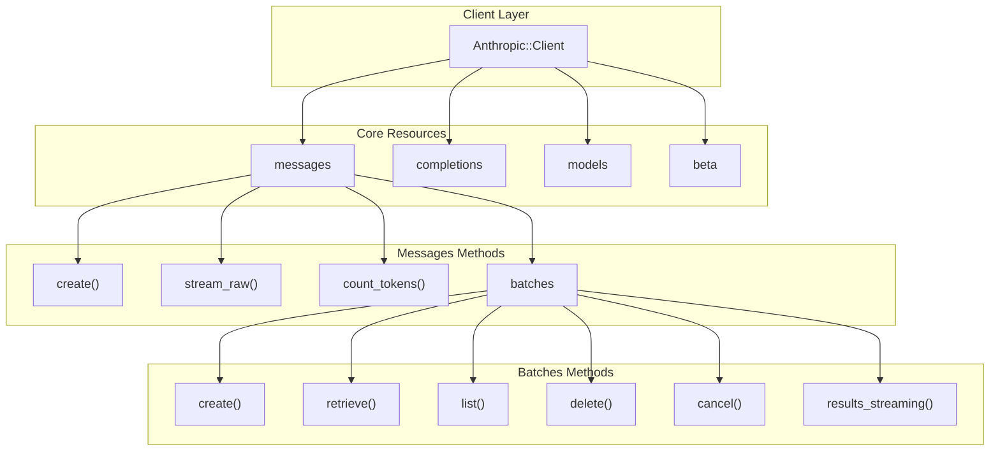
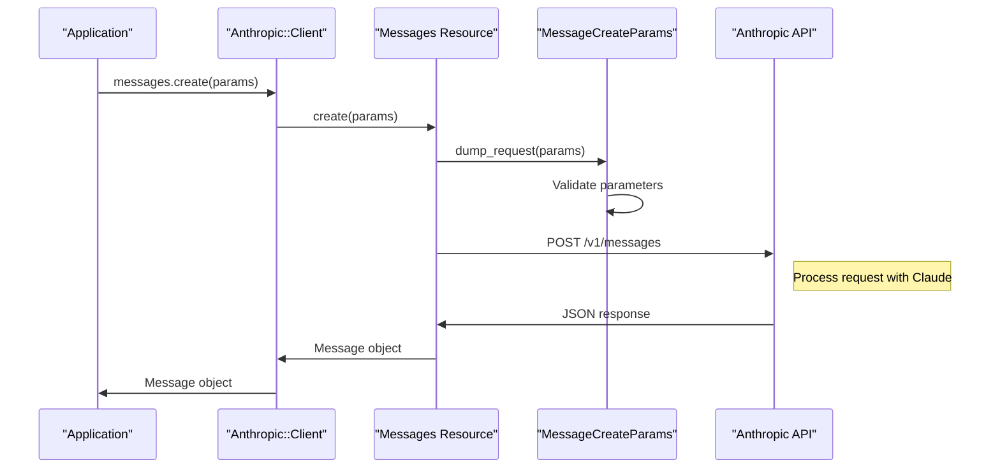
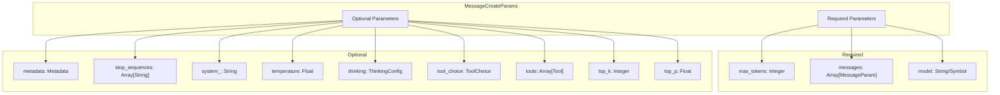
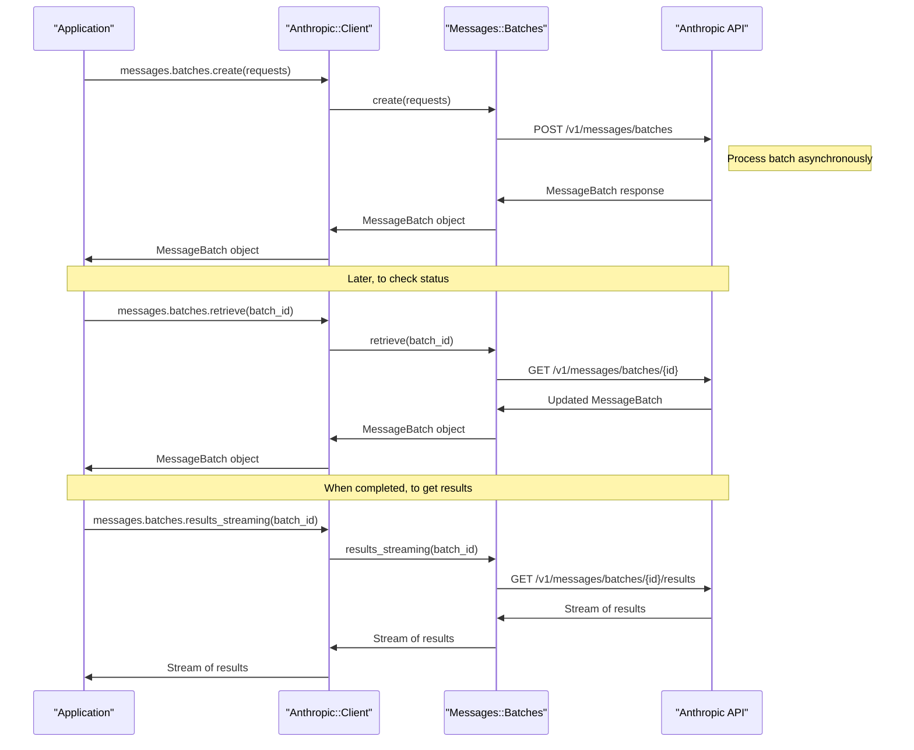

<!-- source: DeepWiki mcp.deepwiki.com · repo anthropics/anthropic-sdk-ruby · page 4 Messages API · fetched 2026-10-26 -->

# Messages API

<details>
<summary>Relevant source files</summary>

The following files were used as context for generating this wiki page:

- [lib/anthropic/models/beta/beta_message.rb](lib/anthropic/models/beta/beta_message.rb)
- [lib/anthropic/models/completion.rb](lib/anthropic/models/completion.rb)
- [lib/anthropic/models/completion_create_params.rb](lib/anthropic/models/completion_create_params.rb)
- [lib/anthropic/models/message.rb](lib/anthropic/models/message.rb)
- [lib/anthropic/models/message_create_params.rb](lib/anthropic/models/message_create_params.rb)
- [lib/anthropic/models/metadata.rb](lib/anthropic/models/metadata.rb)
- [lib/anthropic/resources/beta.rb](lib/anthropic/resources/beta.rb)
- [lib/anthropic/resources/beta/messages.rb](lib/anthropic/resources/beta/messages.rb)
- [lib/anthropic/resources/beta/messages/batches.rb](lib/anthropic/resources/beta/messages/batches.rb)
- [lib/anthropic/resources/beta/models.rb](lib/anthropic/resources/beta/models.rb)
- [lib/anthropic/resources/completions.rb](lib/anthropic/resources/completions.rb)
- [lib/anthropic/resources/messages.rb](lib/anthropic/resources/messages.rb)
- [lib/anthropic/resources/messages/batches.rb](lib/anthropic/resources/messages/batches.rb)
- [lib/anthropic/resources/models.rb](lib/anthropic/resources/models.rb)
- [test/anthropic/resources/beta/messages_test.rb](test/anthropic/resources/beta/messages_test.rb)
- [test/anthropic/resources/beta_test.rb](test/anthropic/resources/beta_test.rb)
- [test/anthropic/resources/completions_test.rb](test/anthropic/resources/completions_test.rb)
- [test/anthropic/resources/messages_test.rb](test/anthropic/resources/messages_test.rb)

</details>


The Messages API is the primary interface for interacting with Claude in the Anthropic Ruby SDK. It provides methods for sending structured messages to Claude and receiving AI-generated responses. This API supports both single queries and multi-turn conversations, with capabilities for streaming responses, token counting, and batch processing.

The Messages API is the recommended way to use Claude's capabilities, replacing the older Completions API (for information about the legacy API, see [Completions API](#6)).

## Architecture Overview

The Messages API is a core resource in the Anthropic Ruby SDK, accessible through the client's `messages` attribute. The following diagram illustrates its position in the SDK architecture:



Sources: [lib/anthropic/resources/messages.rb:1-145](), [lib/anthropic/resources/messages/batches.rb:1-180]()

## Core Methods

The Messages API provides three main methods for interacting with Claude:

### create

The `create` method sends messages to Claude and returns the model's response as a Message object. This is the primary method for generating responses from Claude.

```ruby
response = client.messages.create(
  max_tokens: 1024,
  messages: [{ role: "user", content: "Hello, Claude" }],
  model: "claude-3-opus-20240229"
)

puts response.content[0].text
```

Sources: [lib/anthropic/resources/messages.rb:9-51]()

### stream_raw

The `stream_raw` method provides streaming responses, allowing you to process Claude's output incrementally as it's generated. This is useful for building real-time interfaces.

```ruby
stream = client.messages.stream_raw(
  max_tokens: 1024,
  messages: [{ role: "user", content: "Hello, Claude" }],
  model: "claude-3-opus-20240229"
)

stream.each do |event|
  case event
  when Anthropic::Models::RawMessageDeltaEvent
    print event.delta.text
  end
end
```

Sources: [lib/anthropic/resources/messages.rb:57-102]()

### count_tokens

The `count_tokens` method counts the number of tokens in a message without generating a response. This is useful for estimating costs or ensuring messages fit within token limits.

```ruby
token_count = client.messages.count_tokens(
  messages: [{ role: "user", content: "Hello, Claude" }],
  model: "claude-3-opus-20240229"
)

puts "Input tokens: #{token_count.input_tokens}"
```

Sources: [lib/anthropic/resources/messages.rb:104-134]()

## Request Processing Flow

The following diagram illustrates how requests flow through the SDK when using the Messages API:



Sources: [lib/anthropic/resources/messages.rb:37-51](), [lib/anthropic/models/message_create_params.rb:1-381]()

## Request Parameters

When creating a message, you need to provide parameters to control Claude's behavior:

### Required Parameters

- **max_tokens**: Maximum number of tokens to generate (varies by model)
- **messages**: Array of message objects with `role` and `content`
- **model**: The Claude model to use (e.g., `"claude-3-opus-20240229"`)

### Optional Parameters

- **metadata**: Additional information about the request
- **stop_sequences**: Custom text sequences that will cause the model to stop
- **system_**: System prompt for providing context and instructions
- **temperature**: Amount of randomness (0.0-1.0, default 1.0)
- **thinking**: Configuration for enabling Claude's extended thinking
- **tool_choice**: How the model should use provided tools
- **tools**: Definitions of tools the model may use
- **top_k**: Only sample from top K options (advanced)
- **top_p**: Use nucleus sampling (advanced)

Here's a diagram showing the parameter structure:



Sources: [lib/anthropic/models/message_create_params.rb:8-378]()

### Messages Format

The `messages` parameter is an array of message objects, each with a `role` and `content`:

```ruby
messages = [
  { role: "user", content: "Hello, Claude" },
  { role: "assistant", content: "Hello! How can I help you today?" },
  { role: "user", content: "Tell me about yourself" }
]
```

Content can be a string or an array of content blocks:

```ruby
# Simple text
{ role: "user", content: "Hello, Claude" }

# Equivalent to
{ role: "user", content: [{ type: "text", text: "Hello, Claude" }] }

# Multimodal with image
{ 
  role: "user",
  content: [
    {
      type: "image",
      source: {
        type: "base64",
        media_type: "image/jpeg",
        data: "base64_encoded_image_data"
      }
    },
    { type: "text", text: "What's in this image?" }
  ]
}
```

Sources: [lib/anthropic/models/message_create_params.rb:25-112]()

## Response Structure

The `create` method returns a Message object with the following structure:

| Property | Type | Description |
|----------|------|-------------|
| id | String | Unique identifier for the message |
| content | Array | Array of content blocks (text, tool_use, thinking) |
| model | String | The model used to generate the response |
| role | Symbol | Always `:assistant` |
| stop_reason | Symbol | Why generation stopped (`:end_turn`, `:max_tokens`, `:stop_sequence`, `:tool_use`) |
| stop_sequence | String | Which custom stop sequence was generated (if any) |
| type | Symbol | Always `:message` |
| usage | Object | Token usage information |

Example response:

```ruby
Message {
  id: "msg_abc123",
  content: [{ type: "text", text: "Hello! I'm Claude..." }],
  model: "claude-3-opus-20240229",
  role: :assistant,
  stop_reason: :end_turn,
  stop_sequence: nil,
  type: :message,
  usage: {
    input_tokens: 10,
    output_tokens: 20,
    cache_creation_input_tokens: 0,
    cache_read_input_tokens: 0
  }
}
```

Sources: [lib/anthropic/models/message.rb:8-136]()

## Batch Processing

The Messages API includes a batches sub-resource for processing multiple message requests efficiently:

```ruby
batch = client.messages.batches.create(
  requests: [
    {
      max_tokens: 1024,
      messages: [{ role: "user", content: "Question 1" }],
      model: "claude-3-opus-20240229"
    },
    {
      max_tokens: 1024,
      messages: [{ role: "user", content: "Question 2" }],
      model: "claude-3-opus-20240229"
    }
  ]
)

# Later, check the status and get results
batch_info = client.messages.batches.retrieve(batch.id)

if batch_info.status == "completed"
  results = client.messages.batches.results_streaming(batch.id)
  results.each do |result|
    puts "Response to #{result.custom_id}: #{result.response.content[0].text}"
  end
end
```

The batch processing flow:



Batch operations include:
- **create**: Create a batch of message requests
- **retrieve**: Get information about a batch
- **list**: List all batches
- **delete**: Delete a completed batch
- **cancel**: Cancel an in-progress batch
- **results_streaming**: Stream the results of a batch

Sources: [lib/anthropic/resources/messages/batches.rb:7-168]()

## Beta Messages API

The SDK includes a beta version of the Messages API for experimental features:

```ruby
response = client.beta.messages.create(
  max_tokens: 1024,
  messages: [{ role: "user", content: "Hello, Claude" }],
  model: "claude-3-opus-20240229",
  betas: ["anthropic-beta"]
)
```

The beta API has the same core methods and parameters as the standard Messages API but may include additional functionality that's still under development. For more information, see [Beta Features](#8).

Sources: [lib/anthropic/resources/beta/messages.rb:10-146](), [lib/anthropic/resources/beta.rb:1-23]()

## Comparison with Completions API

The Messages API is recommended over the legacy Completions API:

| Feature | Messages API | Completions API |
|---------|-------------|----------------|
| Interface | Structured messages with roles | Raw text prompt with specific format |
| Input format | Array of messages with role and content | Single prompt string with "\n\nHuman:" and "\n\nAssistant:" |
| Multimodal support | Yes (images, etc.) | No |
| Tool usage | Yes | No |
| System prompts | Dedicated parameter | Must be embedded in prompt |
| Future compatibility | Yes | No (legacy) |

The Completions API is maintained for backward compatibility but will not receive new features. For more information, see [Completions API](#6).

Sources: [lib/anthropic/resources/completions.rb:9-16](), [lib/anthropic/models/completion_create_params.rb:1-152]()

## Error Handling

When using the Messages API, you should handle potential errors:

```ruby
begin
  response = client.messages.create(
    max_tokens: 1024,
    messages: [{ role: "user", content: "Hello, Claude" }],
    model: "claude-3-opus-20240229"
  )
rescue Anthropic::Error::BadRequestError => e
  puts "Bad request: #{e.message}"
rescue Anthropic::Error::AuthenticationError => e
  puts "Authentication failed: #{e.message}"
rescue Anthropic::Error::RateLimitError => e
  puts "Rate limit exceeded: #{e.message}"
rescue Anthropic::Error::APIError => e
  puts "API error: #{e.message}"
end
```

For more information on error handling, see [Error Handling](#3.2).

---

