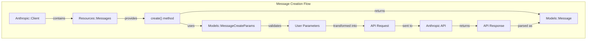
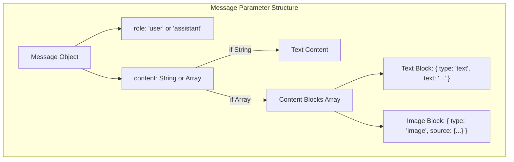
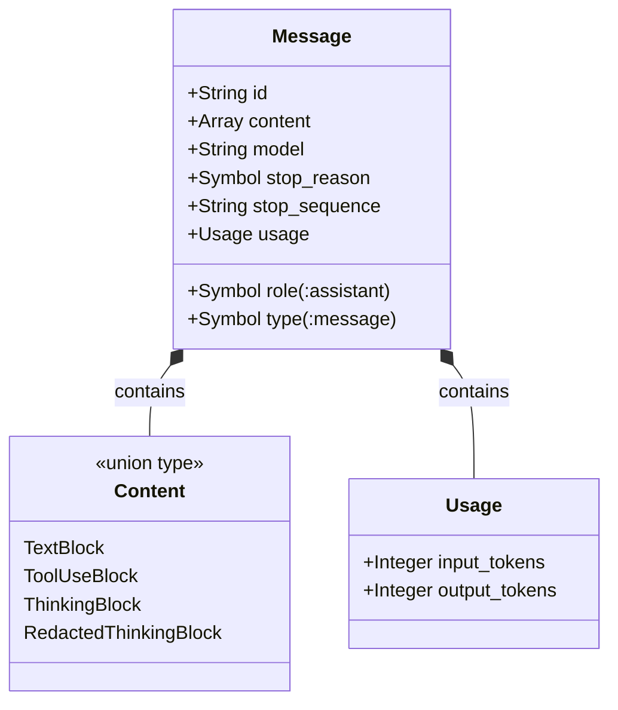

<!-- source: DeepWiki mcp.deepwiki.com · repo anthropics/anthropic-sdk-ruby · page 4.1 Message Creation · fetched 2026-10-26 -->

# Message Creation

<details>
<summary>Relevant source files</summary>

The following files were used as context for generating this wiki page:

- [lib/anthropic/models/beta/beta_message.rb](lib/anthropic/models/beta/beta_message.rb)
- [lib/anthropic/models/completion.rb](lib/anthropic/models/completion.rb)
- [lib/anthropic/models/completion_create_params.rb](lib/anthropic/models/completion_create_params.rb)
- [lib/anthropic/models/message.rb](lib/anthropic/models/message.rb)
- [lib/anthropic/models/message_create_params.rb](lib/anthropic/models/message_create_params.rb)
- [lib/anthropic/models/metadata.rb](lib/anthropic/models/metadata.rb)
- [lib/anthropic/resources/beta.rb](lib/anthropic/resources/beta.rb)
- [lib/anthropic/resources/beta/messages.rb](lib/anthropic/resources/beta/messages.rb)
- [lib/anthropic/resources/beta/messages/batches.rb](lib/anthropic/resources/beta/messages/batches.rb)
- [lib/anthropic/resources/beta/models.rb](lib/anthropic/resources/beta/models.rb)
- [lib/anthropic/resources/completions.rb](lib/anthropic/resources/completions.rb)
- [lib/anthropic/resources/messages.rb](lib/anthropic/resources/messages.rb)
- [lib/anthropic/resources/messages/batches.rb](lib/anthropic/resources/messages/batches.rb)
- [lib/anthropic/resources/models.rb](lib/anthropic/resources/models.rb)

</details>


Message Creation is the primary method for interacting with Claude AI models through the Anthropic Ruby SDK. It allows you to send structured input messages to Claude and receive generated responses. This functionality forms the core of most interactions with Claude, supporting both single queries and multi-turn conversations.

For streaming responses, see [Streaming Messages](#4.2). For processing multiple message requests in batches, see [Batch Processing](#5).

## Message Creation Overview

The Messages API enables you to send messages to Claude and receive AI-generated responses. Messages can contain text or multimedia content like images, and Claude will generate a contextually appropriate response.



Sources: [lib/anthropic/resources/messages.rb:37-51](), [lib/anthropic/models/message_create_params.rb:8-378]()

## Message Creation Parameters

The `create` method accepts a hash of parameters that define your request to Claude. These parameters determine what input Claude receives and how it generates a response.

### Required Parameters

Three parameters are required for every message creation request:

| Parameter | Type | Description |
|-----------|------|-------------|
| `max_tokens` | Integer | Maximum number of tokens Claude will generate in response |
| `messages` | Array | List of message objects forming the conversation history |
| `model` | String/Symbol | The Claude model to use (e.g., `:claude_3_opus`, `:claude_3_sonnet`) |

### Optional Parameters

Several optional parameters let you fine-tune Claude's response:

| Parameter | Type | Description |
|-----------|------|-------------|
| `metadata` | Hash | Additional information about the request (like `user_id`) |
| `stop_sequences` | Array | Custom text sequences that will stop generation |
| `system_` | String/Array | System prompt providing context and instructions |
| `temperature` | Float | Controls randomness (0.0-1.0) |
| `thinking` | Hash | Configuration for Claude's extended thinking capability |
| `tool_choice` | Hash | How Claude should use provided tools |
| `tools` | Array | Definitions of tools the model may use |
| `top_k` | Integer | Only sample from top K options for each token |
| `top_p` | Float | Use nucleus sampling with this probability threshold |

Sources: [lib/anthropic/models/message_create_params.rb:21-322]()

## Message Structure

The `messages` parameter is an array of message objects that form the conversation history. Each message must have a `role` ("user" or "assistant") and `content`.



### Example Message Structures

Simple text message:
```ruby
{ role: "user", content: "Hello, Claude" }
```

Message with multiple content blocks (text and image):
```ruby
{
  role: "user",
  content: [
    { type: "text", text: "What's in this image?" },
    {
      type: "image",
      source: {
        type: "base64",
        media_type: "image/jpeg",
        data: "base64_encoded_image_data"
      }
    }
  ]
}
```

Multi-turn conversation:
```ruby
[
  { role: "user", content: "Hello there." },
  { role: "assistant", content: "Hi, I'm Claude. How can I help you?" },
  { role: "user", content: "Can you explain LLMs in plain English?" }
]
```

Sources: [lib/anthropic/models/message_create_params.rb:25-112]()

## Creating Messages

To create a message, you use the `create` method on the Messages resource:

```ruby
client = Anthropic::Client.new(api_key: "your_api_key")

response = client.messages.create(
  max_tokens: 1024,
  messages: [{ role: "user", content: "Hello, Claude!" }],
  model: "claude-3-opus-20240229"
)

puts response.content[0].text
```

If you attempt to use the `create` method with streaming enabled, it will raise an ArgumentError directing you to use `stream_raw` instead.

Sources: [lib/anthropic/resources/messages.rb:38-51]()

## Message Response

The `create` method returns a `Message` object with the following structure:



### Message Response Fields

| Field | Type | Description |
|-------|------|-------------|
| `id` | String | Unique identifier for the message |
| `content` | Array | Array of content blocks in Claude's response |
| `model` | String | The model that generated the response |
| `role` | Symbol | Always `:assistant` |
| `stop_reason` | Symbol | Why generation stopped (`:end_turn`, `:max_tokens`, `:stop_sequence`, `:tool_use`) |
| `stop_sequence` | String | The stop sequence that was generated, if any |
| `type` | Symbol | Always `:message` |
| `usage` | Hash | Token usage information |

Content blocks in the response can be of different types, including:
- `TextBlock` - Contains text generated by Claude
- `ToolUseBlock` - Represents Claude using a tool
- `ThinkingBlock` - Shows Claude's thinking process
- `RedactedThinkingBlock` - Placeholder for redacted thinking content

Sources: [lib/anthropic/models/message.rb:8-138]()

## Using System Prompts

System prompts provide context and instructions to Claude about how to respond. They're passed using the `system_` parameter (note the underscore):

```ruby
response = client.messages.create(
  max_tokens: 1024,
  messages: [{ role: "user", content: "What's the weather like today?" }],
  model: "claude-3-opus-20240229",
  system_: "You are a helpful weather assistant. When asked about weather, explain that you don't have access to real-time weather data."
)
```

Sources: [lib/anthropic/models/message_create_params.rb:152-164]()

## Using Tools

Claude can use tools defined in your request. This allows Claude to call external functions or generate structured data:

```ruby
response = client.messages.create(
  max_tokens: 1024,
  messages: [{ role: "user", content: "What's the current price of AAPL stock?" }],
  model: "claude-3-opus-20240229",
  tools: [
    {
      name: "get_stock_price",
      description: "Get the current stock price for a given ticker symbol",
      input_schema: {
        type: "object",
        properties: {
          ticker: {
            type: "string",
            description: "The stock ticker symbol, e.g., AAPL for Apple Inc."
          }
        },
        required: ["ticker"]
      }
    }
  ]
)
```

The response may include `tool_use` content blocks that you can use to implement the actual tool functionality in your application.

Sources: [lib/anthropic/models/message_create_params.rb:212-282]()

## Beta Features

The SDK also provides access to beta features through the `Beta::Messages` resource class:

```ruby
response = client.beta.messages.create(
  max_tokens: 1024,
  messages: [{ role: "user", content: "Hello from the beta API!" }],
  model: "claude-3-opus-20240229",
  betas: ["anthropic-beta"]
)
```

Beta features may include additional parameters, tools, or capabilities not yet available in the standard API.

Sources: [lib/anthropic/resources/beta/messages.rb:40-55]()

## Error Handling

The `create` method will raise exceptions for various error conditions:

- `ArgumentError` if streaming is requested (use `stream_raw` instead)
- API errors from the Anthropic service
- Validation errors if parameters don't meet requirements

For detailed information on handling errors, see [Error Handling](#3.2).

Sources: [lib/anthropic/resources/messages.rb:39-43]()

## Relationship to Other APIs

The Messages API is recommended over the legacy Completions API. For specific use cases, consider these alternative APIs:

- For streaming responses: Use `stream_raw` method ([Streaming Messages](#4.2))
- For counting tokens without generating a response: Use `count_tokens` method ([Token Counting](#4.3))
- For processing multiple requests efficiently: Use `messages.batches.create` ([Creating and Managing Batches](#5.1))

Sources: [lib/anthropic/resources/messages.rb:7-54](), [lib/anthropic/resources/messages.rb:125-134](), [lib/anthropic/resources/messages/batches.rb:7-33]()

---

