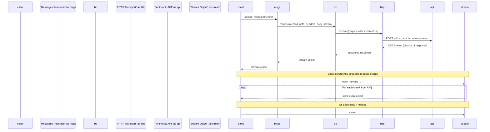

<!-- source: DeepWiki mcp.deepwiki.com · repo anthropics/anthropic-sdk-ruby · page 4.2 Streaming Messages · fetched 2026-10-26 -->

# Streaming Messages

<details>
<summary>Relevant source files</summary>

The following files were used as context for generating this wiki page:

- [lib/anthropic/internal/type/base_stream.rb](lib/anthropic/internal/type/base_stream.rb)
- [lib/anthropic/models/metadata.rb](lib/anthropic/models/metadata.rb)
- [lib/anthropic/resources/beta.rb](lib/anthropic/resources/beta.rb)
- [lib/anthropic/resources/beta/messages.rb](lib/anthropic/resources/beta/messages.rb)
- [lib/anthropic/resources/beta/messages/batches.rb](lib/anthropic/resources/beta/messages/batches.rb)
- [lib/anthropic/resources/beta/models.rb](lib/anthropic/resources/beta/models.rb)
- [lib/anthropic/resources/completions.rb](lib/anthropic/resources/completions.rb)
- [lib/anthropic/resources/messages.rb](lib/anthropic/resources/messages.rb)
- [lib/anthropic/resources/messages/batches.rb](lib/anthropic/resources/messages/batches.rb)
- [lib/anthropic/resources/models.rb](lib/anthropic/resources/models.rb)
- [rbi/lib/anthropic/internal.rbi](rbi/lib/anthropic/internal.rbi)
- [rbi/lib/anthropic/internal/type/base_page.rbi](rbi/lib/anthropic/internal/type/base_page.rbi)
- [rbi/lib/anthropic/internal/type/base_stream.rbi](rbi/lib/anthropic/internal/type/base_stream.rbi)
- [sig/anthropic/internal.rbs](sig/anthropic/internal.rbs)
- [sig/anthropic/internal/type/base_stream.rbs](sig/anthropic/internal/type/base_stream.rbs)

</details>


This document explains how to use the streaming capabilities of the Anthropic Ruby SDK to receive real-time responses from Claude. Streaming allows you to process Claude's responses incrementally as they are generated, rather than waiting for the complete response. This is particularly useful for providing a more responsive user experience, implementing typewriter-like effects, or handling very long responses efficiently.

For information about non-streaming message creation, see [Message Creation](#4.1). For batch processing of multiple messages, see [Batch Processing](#5).

## Overview of Message Streaming

Streaming in the Anthropic Ruby SDK works by establishing a connection to the API that returns partial results as they become available, using Server-Sent Events (SSE). When streaming, the Claude model generates content in small chunks that are sent to your application as soon as they're available, rather than waiting for the complete response to be generated.



Sources: [lib/anthropic/resources/messages.rb:86-102](), [lib/anthropic/internal/type/base_stream.rb:29-31]()

## Using the Messages API for Streaming

To stream responses from Claude, you use the `stream_raw` method on the `messages` resource. This method has the same parameters as the regular `create` method but returns a stream object instead of a complete response.

### Basic Streaming Usage

```ruby
client = Anthropic::Client.new(api_key: "your_api_key")

stream = client.messages.stream_raw(
  model: "claude-3-opus-20240229",
  max_tokens: 1000,
  messages: [
    { role: "user", content: "Tell me about the solar system" }
  ]
)

# Process events from the stream
stream.each do |event|
  case event.type
  when "message_start"
    puts "Message ID: #{event.message.id}"
  when "content_block_start"
    puts "Starting content block: #{event.index}"
  when "content_block_delta"
    print event.delta.text # Print incrementally
  when "content_block_stop"
    puts "\nContent block #{event.index} completed"
  when "message_stop"
    puts "Message completed"
  end
end

# Don't forget to close the stream when done
stream.close
```

Sources: [lib/anthropic/resources/messages.rb:86-102]()

### Stream Event Types

The stream emits different types of events at different stages of the response. The main event types are:

| Event Type | Description | Object Properties |
|------------|-------------|-------------------|
| `message_start` | Emitted when a message begins | `message` with initial message data |
| `content_block_start` | Emitted when a content block begins | `index`, `content_block` with block metadata |
| `content_block_delta` | Emitted when there's new content | `index`, `delta` with new text or other content |
| `content_block_stop` | Emitted when a content block completes | `index` |
| `message_stop` | Emitted when the message is complete | - |

Sources: [lib/anthropic/resources/messages.rb:82-84]()

## Stream Object Behavior

The stream object returned by `stream_raw` implements the Ruby `Enumerable` interface, which means you can use all the standard collection methods on it. The most common approach is to use the `each` method to process events as they arrive.

```mermaid
classDiagram
    class "Anthropic::Internal::Stream" {
        +each(&block)
        +close()
        +to_enum()
    }
    
    class "Enumerable" {
        +map()
        +select()
        +reduce()
        +...()
    }
    
    class "StreamEvents" {
        RawMessageStartEvent
        RawMessageDeltaEvent
        RawMessageStopEvent
        RawContentBlockStartEvent
        RawContentBlockDeltaEvent
        RawContentBlockStopEvent
    }
    
    "Anthropic::Internal::Stream" --|> "Enumerable" : implements
    "Anthropic::Internal::Stream" --> "StreamEvents" : yields
```

Sources: [lib/anthropic/internal/type/base_stream.rb:12-52]()

### Important Stream Methods

- `each`: Iterates through the stream events as they arrive
- `close`: Closes the underlying connection and releases resources
- `to_enum`: Converts the stream to an Enumerator for more advanced iterations

When you're done with a stream, you should always call `close` to properly release the underlying HTTP connection. The SDK will attempt to close streams during garbage collection, but this is not guaranteed, so explicitly closing the stream is recommended.

Sources: [lib/anthropic/internal/type/base_stream.rb:29-31](), [lib/anthropic/internal/type/base_stream.rb:48-51]()

## Parameters for Streaming

The `stream_raw` method accepts the same parameters as the regular `create` method, with the `stream` parameter automatically set to `true`.

Key parameters include:

| Parameter | Type | Description |
|-----------|------|-------------|
| `max_tokens` | Integer | Maximum number of tokens to generate |
| `messages` | Array | Array of message objects (role and content) |
| `model` | String | Model to use (e.g., "claude-3-opus-20240229") |
| `system_` | String | System prompt |
| `temperature` | Float | Controls randomness (0.0 to 1.0) |
| `stop_sequences` | Array | List of strings that will stop generation |
| `tools` | Array | Tool definitions for function calling |

If you try to use `stream: false` with the `stream_raw` method, it will raise an `ArgumentError` suggesting that you use the `create` method instead.

Sources: [lib/anthropic/resources/messages.rb:67-81](), [lib/anthropic/resources/messages.rb:88-91]()

## Beta Streaming Features

The SDK also provides a beta version of streaming with additional capabilities through the `beta.messages.stream_raw` method. This works similarly to the standard streaming method but accepts additional beta parameters.

To use beta streaming:

```ruby
stream = client.beta.messages.stream_raw(
  model: "claude-3-opus-20240229",
  max_tokens: 1000,
  messages: [
    { role: "user", content: "Tell me about the solar system" }
  ],
  betas: ["anthropic-beta"] # Required for beta features
)
```

The beta endpoint provides access to experimental features before they're available in the main API.

Sources: [lib/anthropic/resources/beta/messages.rb:91-111]()

## Resource Management Patterns

When working with streams, it's important to ensure proper resource management. Here are two common patterns:

### Manual Closing Pattern

```ruby
stream = client.messages.stream_raw(params)
begin
  stream.each do |event|
    # Process event
  end
ensure
  stream.close
end
```

### Using with Enumerable Methods

```ruby
stream = client.messages.stream_raw(params)
begin
  # Collect specific events
  content_events = stream.select { |event| event.type == "content_block_delta" }
  
  # Process the filtered events
  response_text = content_events.map { |event| event.delta.text }.join("")
ensure
  stream.close
end
```

Sources: [lib/anthropic/internal/type/base_stream.rb:29-31]()

## Legacy Completions API Streaming

For backward compatibility, the SDK also supports streaming through the legacy Completions API. This is done using the `create_streaming` method on the `completions` resource:

```ruby
stream = client.completions.create_streaming(
  model: "claude-3-opus-20240229",
  max_tokens_to_sample: 1000,
  prompt: "\n\nHuman: Tell me about the solar system\n\nAssistant:"
)
```

Note that the Completions API is considered legacy, and Anthropic recommends using the Messages API for all new development.

Sources: [lib/anthropic/resources/completions.rb:74-90]()

## Stream Processing Patterns

There are several common patterns for processing streaming responses:

### Accumulating Complete Response

```ruby
full_text = ""
stream.each do |event|
  if event.type == "content_block_delta"
    full_text += event.delta.text
  end
end
```

### Real-time Display

```ruby
stream.each do |event|
  if event.type == "content_block_delta"
    print event.delta.text
    $stdout.flush # Force output to display immediately
  end
end
```

### Parsing Tool Calls

```ruby
stream.each do |event|
  if event.type == "content_block_start" && event.content_block.type == "tool_use"
    tool_name = event.content_block.name
    puts "Starting tool call: #{tool_name}"
  elsif event.type == "content_block_delta" && event.delta.type == "tool_use"
    puts "Tool input update: #{event.delta.text}"
  end
end
```

Sources: [lib/anthropic/resources/messages.rb:82-84]()

## Error Handling in Streams

When working with streams, errors can occur either during stream initialization or while processing events. It's important to handle both cases:

```ruby
begin
  stream = client.messages.stream_raw(params)
  
  begin
    stream.each do |event|
      # Process event
    end
  rescue StandardError => e
    puts "Error during stream processing: #{e.message}"
  ensure
    stream.close
  end
rescue Anthropic::AnthropicError => e
  puts "Error creating stream: #{e.message}"
end
```

For more comprehensive information about error handling in the SDK, see [Error Handling](#3.2).

Sources: [lib/anthropic/internal/type/base_stream.rb:12-52]()

---

