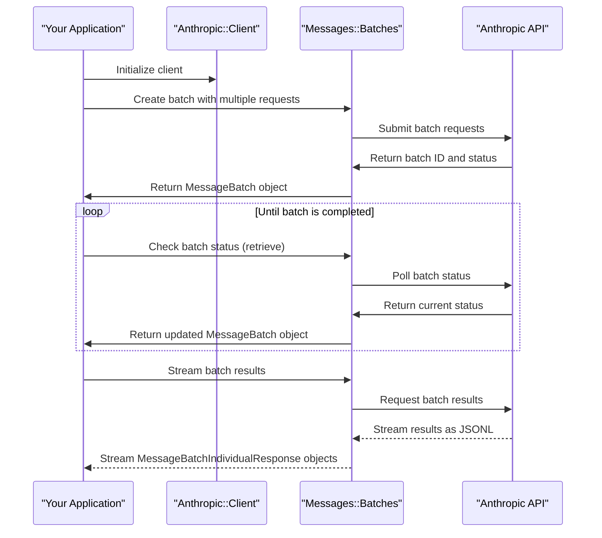

<!-- source: DeepWiki mcp.deepwiki.com · repo anthropics/anthropic-sdk-ruby · page 5 Batch Processing · fetched 2026-10-26 -->

# Batch Processing

<details>
<summary>Relevant source files</summary>

The following files were used as context for generating this wiki page:

- [lib/anthropic/models/messages/batch_results_params.rb](lib/anthropic/models/messages/batch_results_params.rb)
- [lib/anthropic/models/metadata.rb](lib/anthropic/models/metadata.rb)
- [lib/anthropic/resources/beta.rb](lib/anthropic/resources/beta.rb)
- [lib/anthropic/resources/beta/messages.rb](lib/anthropic/resources/beta/messages.rb)
- [lib/anthropic/resources/beta/messages/batches.rb](lib/anthropic/resources/beta/messages/batches.rb)
- [lib/anthropic/resources/beta/models.rb](lib/anthropic/resources/beta/models.rb)
- [lib/anthropic/resources/completions.rb](lib/anthropic/resources/completions.rb)
- [lib/anthropic/resources/messages.rb](lib/anthropic/resources/messages.rb)
- [lib/anthropic/resources/messages/batches.rb](lib/anthropic/resources/messages/batches.rb)
- [lib/anthropic/resources/models.rb](lib/anthropic/resources/models.rb)
- [rbi/lib/anthropic/resources/beta/messages/batches.rbi](rbi/lib/anthropic/resources/beta/messages/batches.rbi)
- [rbi/lib/anthropic/resources/beta/models.rbi](rbi/lib/anthropic/resources/beta/models.rbi)
- [rbi/lib/anthropic/resources/messages/batches.rbi](rbi/lib/anthropic/resources/messages/batches.rbi)
- [rbi/lib/anthropic/resources/models.rbi](rbi/lib/anthropic/resources/models.rbi)
- [sig/anthropic/resources/beta/messages/batches.rbs](sig/anthropic/resources/beta/messages/batches.rbs)
- [sig/anthropic/resources/messages/batches.rbs](sig/anthropic/resources/messages/batches.rbs)
- [test/anthropic/resources/beta/messages/batches_test.rb](test/anthropic/resources/beta/messages/batches_test.rb)
- [test/anthropic/resources/beta/models_test.rb](test/anthropic/resources/beta/models_test.rb)
- [test/anthropic/resources/messages/batches_test.rb](test/anthropic/resources/messages/batches_test.rb)
- [test/anthropic/resources/models_test.rb](test/anthropic/resources/models_test.rb)
- [test/anthropic/resources/shared_test.rb](test/anthropic/resources/shared_test.rb)

</details>


The Batch Processing functionality in the Anthropic Ruby SDK enables efficient processing of multiple message requests simultaneously. This feature is particularly useful for high-throughput applications where you need to send many message requests to Claude without the overhead of individual API calls.

The Message Batches API allows you to submit multiple message creation requests at once as a single batch job. Once submitted, batches are processed asynchronously, and you can later retrieve their results.

## Batch Processing Architecture

Batch processing is implemented as a sub-resource of the Messages API. The architecture follows the pattern shown below:

```mermaid
classDiagram
    class Client {
        +messages: Resources::Messages
    }
    
    class Resources::Messages {
        +create(params)
        +stream_raw(params)
        +count_tokens(params)
        +batches: Messages::Batches
    }
    
    class Messages::Batches {
        +create(requests)
        +retrieve(message_batch_id)
        +list(params)
        +delete(message_batch_id)
        +cancel(message_batch_id)
        +results_streaming(message_batch_id)
    }
    
    Client --> Resources::Messages : contains
    Resources::Messages --> Messages::Batches : contains
```

Sources: [lib/anthropic/resources/messages.rb:6-7](), [lib/anthropic/resources/messages.rb:139-142](), [lib/anthropic/resources/messages/batches.rb:1-179]()

## Batch Processing Workflow

The typical workflow for using batch processing involves creating a batch, checking its status, and then retrieving results:



Sources: [lib/anthropic/resources/messages/batches.rb:7-168]()

## Creating Message Batches

To create a message batch, use the `create` method on the `batches` resource. You need to provide an array of request objects, each containing a `custom_id` and the parameters for a single message request:

```ruby
batch = client.messages.batches.create(
  requests: [
    {
      custom_id: "request-1",
      params: {
        max_tokens: 1024,
        messages: [{content: "Explain quantum computing", role: :user}],
        model: "claude-3-haiku-20240307"
      }
    },
    {
      custom_id: "request-2",
      params: {
        max_tokens: 1024,
        messages: [{content: "Describe machine learning", role: :user}],
        model: "claude-3-haiku-20240307"
      }
    }
  ]
)
```

The `custom_id` field is important as it allows you to match individual results to their corresponding requests.

Sources: [lib/anthropic/resources/messages/batches.rb:7-33](), [test/anthropic/resources/messages/batches_test.rb:7-19]()

## Message Batch Status

After creating a batch, you can check its status using the `retrieve` method:

```ruby
batch = client.messages.batches.retrieve(message_batch_id)
```

The returned `MessageBatch` object contains important information such as:

| Field | Description |
|-------|-------------|
| `id` | Unique identifier for the batch |
| `processing_status` | Current status of the batch (e.g., `in_progress`, `completed`, `failed`) |
| `request_counts` | Counts of total, completed, and failed requests |
| `results_url` | URL to access the results (available when completed) |
| `created_at` | When the batch was created |
| `expires_at` | When the batch results will expire |

Sources: [lib/anthropic/resources/messages/batches.rb:35-57](), [test/anthropic/resources/messages/batches_test.rb:41-61]()

## Batch Lifecycle Management

The SDK provides several methods to manage batches throughout their lifecycle:

### Listing All Batches

You can list all available batches with pagination support:

```ruby
batches = client.messages.batches.list(limit: 10)
batches.each do |batch|
  puts "Batch ID: #{batch.id}, Status: #{batch.processing_status}"
end
```

Sources: [lib/anthropic/resources/messages/batches.rb:59-85](), [test/anthropic/resources/messages/batches_test.rb:64-91]()

### Canceling a Batch

If you need to stop a batch that's still in progress:

```ruby
canceled_batch = client.messages.batches.cancel(message_batch_id)
```

When cancellation is initiated, the batch enters a `canceling` state. The system may complete any in-progress, non-interruptible requests before finalizing cancellation.

Sources: [lib/anthropic/resources/messages/batches.rb:112-140](), [test/anthropic/resources/messages/batches_test.rb:109-129]()

### Deleting a Batch

To permanently delete a batch after it's completed:

```ruby
result = client.messages.batches.delete(message_batch_id)
```

Note that batches can only be deleted once they've finished processing. If you need to delete an in-progress batch, you must cancel it first.

Sources: [lib/anthropic/resources/messages/batches.rb:87-110](), [test/anthropic/resources/messages/batches_test.rb:94-106]()

## Retrieving Batch Results

When a batch is completed, you can access its results using the `results_streaming` method:

```ruby
results_stream = client.messages.batches.results_streaming(message_batch_id)
results_stream.each do |result|
  if result.error
    puts "Error for request #{result.custom_id}: #{result.error.message}"
  else
    puts "Result for request #{result.custom_id}: #{result.message.content}"
  end
end
```

This method returns a stream of `MessageBatchIndividualResponse` objects, one for each request in the batch. Each result includes the `custom_id` from the original request, allowing you to match results to requests.

Results are streamed as a JSONL (JSON Lines) file, with each line containing the result for one request. Results are not guaranteed to be in the same order as the original requests.

Sources: [lib/anthropic/resources/messages/batches.rb:142-168]()

## Beta Batch Processing

The SDK also includes a beta version of the batch processing API under the `beta.messages.batches` namespace. This version has the same core functionality but may include experimental features.

```mermaid
classDiagram
    class Client {
        +messages: Resources::Messages
        +beta: Resources::Beta
    }
    
    class Resources::Beta {
        +messages: Beta::Messages
    }
    
    class Beta::Messages {
        +batches: Beta::Messages::Batches
    }
    
    class Beta::Messages::Batches {
        +create(requests, betas)
        +retrieve(message_batch_id, betas)
        +list(params, betas)
        +delete(message_batch_id, betas)
        +cancel(message_batch_id, betas)
        +results_streaming(message_batch_id, betas)
    }
    
    Client --> Resources::Beta : contains
    Resources::Beta --> Beta::Messages : contains
    Beta::Messages --> Beta::Messages::Batches : contains
```

The main difference is that beta methods accept an additional `betas` parameter to specify which beta features to enable:

```ruby
batch = client.beta.messages.batches.create(
  requests: [...],
  betas: ["anthropic-beta"]
)
```

Sources: [lib/anthropic/resources/beta/messages/batches.rb:1-198](), [test/anthropic/resources/beta/messages/batches_test.rb:7-130]()

## Batch Processing Performance Considerations

When using batch processing, keep these performance considerations in mind:

1. **Batch Size**: Each batch can contain multiple requests, but there are limits to how many requests can be included in a single batch.

2. **Processing Time**: Batches are processed asynchronously and can take up to 24 hours to complete, depending on the number and complexity of requests.

3. **Result Expiration**: Batch results are available for a limited time (indicated by the `expires_at` field) before they're automatically deleted.

4. **Polling Frequency**: When checking batch status, implement appropriate polling intervals to avoid excessive API calls.

## Batch Processing vs. Single Requests

Here's a comparison of when to use batch processing versus individual message requests:

| Scenario | Batch Processing | Individual Requests |
|----------|------------------|---------------------|
| High volume of independent requests | ✅ Efficient | ❌ API overhead |
| Need immediate responses | ❌ Asynchronous | ✅ Synchronous |
| Processing thousands of requests | ✅ Scalable | ❌ Rate limit issues |
| Interactive conversations | ❌ Not suitable | ✅ Better UX |
| Background data processing | ✅ Ideal | ❌ Less efficient |

Sources: [lib/anthropic/resources/messages/batches.rb:7-15](), [lib/anthropic/resources/beta/messages/batches.rb:8-16]()

## Error Handling

Batch processing introduces specific error handling considerations:

1. **Batch-level errors**: These affect the entire batch operation (e.g., invalid batch format).
2. **Request-level errors**: Individual requests within a batch may fail while others succeed.

When streaming results, check each individual response for errors:

```ruby
results_stream = client.messages.batches.results_streaming(message_batch_id)
results_stream.each do |result|
  if result.error
    # Handle individual request error
    puts "Request #{result.custom_id} failed: #{result.error.message}"
  else
    # Process successful result
    puts "Request #{result.custom_id} succeeded"
  end
end
```

Sources: [lib/anthropic/resources/messages/batches.rb:142-168]()

## Summary

The Batch Processing feature in the Anthropic Ruby SDK provides an efficient way to process multiple message requests in a single operation. By submitting requests as a batch, you can achieve higher throughput and better resource utilization for high-volume applications.

The API follows a consistent pattern with methods for creating, retrieving, listing, canceling, and deleting batches, as well as streaming results. The asynchronous nature of batch processing makes it ideal for background tasks and large-scale processing jobs.

For lower-volume, real-time interaction with Claude, you may still prefer using the standard [Messages API](#4) for individual requests.

---

